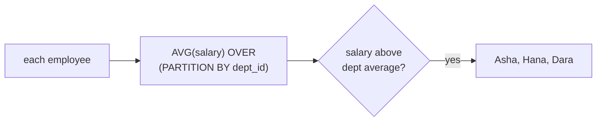

<!-- Written by `npm run lessons` from the lesson data in src/data. Edit the lesson there, not this page. -->

# Employees paid above their department's average

**SQL · Unit 8: SQL interview problems, from easy to hard · Lesson 8 of 16 · Should know**

> **In one line.** List employees whose salary is above the average salary of their own department, showing that average next to them.

[Open this lesson on the site](https://learn.hamropedia.com/sql/employees-paid-above-their-departments-average/) for its animation, the practice game and tap-to-explain words.

## What the question tests

Comparing a row with an aggregate of its own group — three valid ways (window function, join to a grouped subquery, correlated subquery) and knowing when each fits.

## The pattern

**Compare a row with its group** · Medium · tables: `employees`

**How to spot it.** "Above the average for their…", "more than their team's…", "compared with others in the same…".

## Picture it



*Every employee gets their own department's average beside them; then a simple comparison picks those above it.*

## How to approach it

1. Work out each department's average salary.
2. Put that average next to each employee — a window function does both in one step.
3. Keep rows where salary > the department average, filtering outside the CTE.
4. Decide what to do with Gus, who has no department.

## Solution

<details>
<summary>Show the solution</summary>

**Solution: a window average, filtered outside**

```sql
WITH with_avg AS (
  SELECT name, dept_id, salary,
         AVG(salary) OVER (PARTITION BY dept_id) AS dept_avg
  FROM employees
)
SELECT name, dept_id, salary, dept_avg
FROM with_avg
WHERE salary > dept_avg
ORDER BY dept_id, salary DESC;
```

| name | dept_id | salary | dept_avg |
| --- | --- | --- | --- |
| Asha | 1 | 95000 | 78750 |
| Hana | 1 | 80000 | 78750 |
| Dara | 2 | 60000 | 52500 |

Fatima is alone in Marketing, so she equals her own average. Gus forms a NULL group of one and also equals his average.

</details>

## Other correct ways

<details>
<summary>Show them</summary>

**Join to a grouped subquery**

```sql
SELECT e.name, e.dept_id, e.salary, a.dept_avg
FROM employees e
JOIN (
  SELECT dept_id, AVG(salary) AS dept_avg
  FROM employees
  GROUP BY dept_id
) AS a ON a.dept_id = e.dept_id
WHERE e.salary > a.dept_avg
ORDER BY e.dept_id, e.salary DESC;
```

| name | dept_id | salary | dept_avg |
| --- | --- | --- | --- |
| Asha | 1 | 95000 | 78750 |
| Hana | 1 | 80000 | 78750 |
| Dara | 2 | 60000 | 52500 |

Works in any database, even without window functions. Gus drops out here because NULL = NULL is not true in the join.

</details>

## Edge cases to say out loud

- An employee with no department: the window version groups NULLs together; the join version drops them. Ask which is wanted.
- A department of one person can never be above its own average.
- "Above" means strictly greater; say so.

## Common mistakes

- `WHERE salary > AVG(salary)` — an aggregate in WHERE is not allowed, and it would be the company average anyway.
- Comparing with the company average when the question says "their department".
- Filtering on the window function in the same SELECT's WHERE.

> **Not true:** `WHERE salary > AVG(salary)` compares each salary with the average of that person's department.  
> **In fact:** An aggregate is not allowed in WHERE, and with no grouping it would be the company average anyway. Work out the department average with a window function or a grouped subquery.

## In the interview

I need each employee's department average next to their row, so I compute AVG of salary over a window partitioned by department in a CTE, and keep rows where salary exceeds it. An equivalent approach joins employees to a grouped subquery of averages per department. I'd mention the NULL-department case, since the two approaches treat it differently.

<details>
<summary>&lt;b>How would you show how far above the average each person is, as a percentage?&lt;/b></summary>

`ROUND(100.0 * (salary - dept_avg) / dept_avg, 1)` in the outer query.

</details>

<details>
<summary>&lt;b>Which approach is fastest?&lt;/b></summary>

Usually the window function, because it reads the table once. The optimiser often makes them similar; check the plan.

</details>

## Practise

Write each answer yourself first, then open the answer and compare.

### 1. Explain

Explain the three ways to compare a row with its group's average.

<details>
<summary>Show one good answer</summary>

1. A window function: `AVG(salary) OVER (PARTITION BY dept_id)` puts the department average on every row; a CTE then filters `salary > dept_avg`. One pass, and the average is right there to show.  
2. Join to a grouped subquery: `SELECT dept_id, AVG(salary) … GROUP BY dept_id` makes one row per department, then you join it to employees on dept_id and compare. Works in every database, even ones without window functions.  
3. A correlated subquery: `WHERE salary > (SELECT AVG(salary) FROM employees e2 WHERE e2.dept_id = e.dept_id)`. Reads naturally, but is worked out once per row (good optimisers rewrite it), and the average isn't available to display.

</details>

### 2. Write

List orders whose amount is above that customer's average order amount.

<details>
<summary>Show one good answer</summary>

Partition the average by customer instead of department. Priya averages 85 (425 ÷ 5), so orders 101 (120) and 105 (150) are above it; Tom averages 137.5, so 104 (200) is. Lena's average is 60 (the NULL order is skipped), and her only amount equals it, so nothing of hers is above.

```sql
WITH with_avg AS (
  SELECT order_id, customer_id, amount,
         AVG(amount) OVER (PARTITION BY customer_id) AS customer_avg
  FROM orders
)
SELECT order_id, customer_id, amount, customer_avg
FROM with_avg
WHERE amount > customer_avg
ORDER BY customer_id, order_id;
```

| order_id | customer_id | amount | customer_avg |
| --- | --- | --- | --- |
| 101 | 1 | 120 | 85 |
| 105 | 1 | 150 | 85 |
| 104 | 2 | 200 | 137.5 |

</details>

### 3. Predict

If Chen's salary rose to 90000, who would the solution return?

<details>
<summary>Show one good answer</summary>

Asha, Chen and Dara. Engineering's average rises to (95,000 + 70,000 + 90,000 + 80,000) ÷ 4 = 83,750. Asha (95,000) and Chen (90,000) are above it; Hana (80,000) drops below. Sales is unchanged, so Dara is still above 52,500.

```sql
UPDATE employees SET salary = 90000 WHERE name = 'Chen';
WITH with_avg AS (
  SELECT name, dept_id, salary,
         AVG(salary) OVER (PARTITION BY dept_id) AS dept_avg
  FROM employees
)
SELECT name, dept_id, salary, dept_avg
FROM with_avg
WHERE salary > dept_avg
ORDER BY dept_id, salary DESC;
```

| name | dept_id | salary | dept_avg |
| --- | --- | --- | --- |
| Asha | 1 | 95000 | 83750 |
| Chen | 1 | 90000 | 83750 |
| Dara | 2 | 60000 | 52500 |

</details>

### 4. Edge cases

Make the solution exclude employees with no department, and explain why the join version already does.

<details>
<summary>Show one good answer</summary>

Add `WHERE dept_id IS NOT NULL` inside the CTE, so Gus is never given a "department" of his own. (In the window version, PARTITION BY puts all NULLs in one group, so Gus is compared with himself; he isn't above his own average, so he doesn't appear today, but only by luck: two employees with no department would be compared with each other.)

The join version excludes him already: it joins on `a.dept_id = e.dept_id`, and `NULL = NULL` is not true, so Gus's row finds no partner and the join drops it.

```sql
WITH with_avg AS (
  SELECT name, dept_id, salary,
         AVG(salary) OVER (PARTITION BY dept_id) AS dept_avg
  FROM employees
  WHERE dept_id IS NOT NULL
)
SELECT name, dept_id, salary, dept_avg
FROM with_avg
WHERE salary > dept_avg
ORDER BY dept_id, salary DESC;
```

| name | dept_id | salary | dept_avg |
| --- | --- | --- | --- |
| Asha | 1 | 95000 | 78750 |
| Hana | 1 | 80000 | 78750 |
| Dara | 2 | 60000 | 52500 |

</details>

## Go further (optional)

- PRACTICE · [DataLemur — window function questions](https://datalemur.com/questions) · real interview questions, many free
- READ · [PostgreSQL docs — Window Functions (tutorial)](https://www.postgresql.org/docs/current/tutorial-window.html) · official documentation, free

---

[← The highest-paid employee in each department](the-highest-paid-employee-in-each-department.md) · [All lessons](../../README.md) · [Month-over-month revenue growth →](month-over-month-revenue-growth.md)
