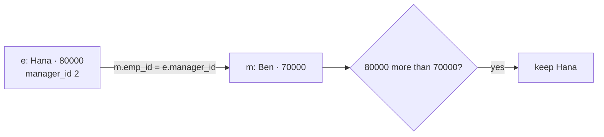

<!-- Written by `npm run lessons` from the lesson data in src/data. Edit the lesson there, not this page. -->

# Employees who earn more than their manager

**SQL · Unit 8: SQL interview problems, from easy to hard · Lesson 4 of 16 · Must know**

> **In one line.** Find every employee who earns more than their own manager. Show the employee's name and salary, and the manager's name and salary.

[Open this lesson on the site](https://learn.hamropedia.com/sql/employees-who-earn-more-than-their-manager/) for its animation, the practice game and tap-to-explain words.

## What the question tests

Whether you can treat one table as two — a self join — and read a self-referencing key the right way round.

## The pattern

**Self join** · Easy · tables: `employees`

**How to spot it.** "Their manager", "their parent", "the person who referred them" — a column pointing at another row of the same table.

## Picture it



*Each employee row is paired with its manager's row from the same table, and the two salaries are compared side by side.*

## How to approach it

1. Notice that manager_id points to another row of employees.
2. Use the table twice: e for the employee, m for the manager.
3. Join with `m.emp_id = e.manager_id` (m is e's manager).
4. Keep rows where e.salary > m.salary. An inner join is fine here: people with no manager can't earn more than one.

## Solution

<details>
<summary>Show the solution</summary>

**Solution: a self join**

```sql
SELECT e.name AS employee, e.salary,
       m.name AS manager, m.salary AS manager_salary
FROM employees e
JOIN employees m ON m.emp_id = e.manager_id
WHERE e.salary > m.salary
ORDER BY e.name;
```

| employee | salary | manager | manager_salary |
| --- | --- | --- | --- |
| Hana | 80000 | Ben | 70000 |

</details>

## Other correct ways

<details>
<summary>Show them</summary>

**A correlated subquery**

```sql
SELECT e.name AS employee
FROM employees e
WHERE e.salary > (
  SELECT m.salary
  FROM employees m
  WHERE m.emp_id = e.manager_id
)
ORDER BY e.name;
```

| employee |
| --- |
| Hana |

Works, but can't show the manager's name without another subquery. The self join is clearer.

</details>

## Edge cases to say out loud

- Employees with no manager (Asha): the inner join drops them, which is correct here.
- Equal salaries: "more than" means strictly greater, so a tie is not included — confirm with the interviewer.
- A manager_id that points to a deleted employee: the inner join drops the row; a foreign key should prevent it.

## Common mistakes

- Joining the wrong way round (`e.emp_id = m.manager_id`), which compares people with their reports.
- Leaving columns unprefixed, so name and salary are ambiguous.

> **Not true:** `e.emp_id = m.manager_id` joins each employee e to their manager m.  
> **In fact:** That condition makes e the manager of m. To join each employee e to their manager m, write `m.emp_id = e.manager_id`.

## In the interview

manager_id references the same table, so I self-join employees as e and m, matching the manager alias's emp_id to the employee's manager_id. Then I filter where the employee's salary is greater than the manager's. An inner join is right here because someone without a manager can't out-earn one.

<details>
<summary>&lt;b>How would you include the manager's manager?&lt;/b></summary>

Join employees a third time: `JOIN employees mm ON mm.emp_id = m.manager_id`, as a LEFT JOIN if the chain can end.

</details>

<details>
<summary>&lt;b>How would you count, per manager, how many reports earn more than them?&lt;/b></summary>

Same self join and filter, then GROUP BY m.emp_id, m.name with `COUNT(*)`.

</details>

## Practise

Write each answer yourself first, then open the answer and compare.

### 1. Explain

Explain what each alias stands for and why the join condition is written that way round.

<details>
<summary>Show one good answer</summary>

The table is used twice. e is the employee: the row we are asking about. m is the manager: a second copy of the same table, used to look up the boss.

`m.emp_id = e.manager_id` reads: "find the row in m whose id is the manager_id written on the employee's row". For Hana, manager_id is 2, so m is Ben's row.

Written the other way round, `e.emp_id = m.manager_id`, the roles swap: m becomes someone who reports to e. Then `e.salary > m.salary` would find managers who earn more than their reports, which is nearly everyone.

</details>

### 2. Write

Find employees who were hired before their manager.

<details>
<summary>Show one good answer</summary>

The same self join, comparing hire dates instead of salaries. In this data nobody was hired before their manager: Asha (2019) came before everyone she manages, and so did Dara and Ben (2020). An empty result is the right answer here.

```sql
SELECT e.name AS employee, e.hire_date,
       m.name AS manager, m.hire_date AS manager_hired
FROM employees e
JOIN employees m ON m.emp_id = e.manager_id
WHERE e.hire_date < m.hire_date
ORDER BY e.name;
```

| employee | hire_date | manager | manager_hired |
| --- | --- | --- | --- |

*(no rows)*

</details>

### 3. Predict

If Eli's salary rose to 61000, which rows would the solution return?

<details>
<summary>Show one good answer</summary>

Two rows: Eli (61,000) over his manager Dara (60,000), and Hana (80,000) over Ben (70,000), as before. Sorted by name, Eli comes first.

```sql
UPDATE employees SET salary = 61000 WHERE name = 'Eli';
SELECT e.name AS employee, e.salary,
       m.name AS manager, m.salary AS manager_salary
FROM employees e
JOIN employees m ON m.emp_id = e.manager_id
WHERE e.salary > m.salary
ORDER BY e.name;
```

| employee | salary | manager | manager_salary |
| --- | --- | --- | --- |
| Eli | 61000 | Dara | 60000 |
| Hana | 80000 | Ben | 70000 |

</details>

### 4. Edge cases

Change the solution to also list employees with no manager, showing NULL for the manager columns.

<details>
<summary>Show one good answer</summary>

Use a LEFT JOIN so employees with no manager keep their row (with NULLs), and let them through the WHERE on purpose: `e.salary > m.salary` is unknown when m is NULL, so add `OR m.emp_id IS NULL`. Asha now appears with NULL manager columns, next to Hana.

```sql
SELECT e.name AS employee, e.salary,
       m.name AS manager, m.salary AS manager_salary
FROM employees e
LEFT JOIN employees m ON m.emp_id = e.manager_id
WHERE e.salary > m.salary OR m.emp_id IS NULL
ORDER BY e.name;
```

| employee | salary | manager | manager_salary |
| --- | --- | --- | --- |
| Asha | 95000 | NULL | NULL |
| Hana | 80000 | Ben | 70000 |

</details>

## Go further (optional)

- PRACTICE · [LeetCode — Top SQL 50 study plan](https://leetcode.com/studyplan/top-sql-50/) · free account
- PRACTICE · [PostgreSQL Exercises — Joins and Subqueries](https://pgexercises.com/) · pgexercises.com, free

---

[← The second highest salary (and the Nth)](the-second-highest-salary-and-the-nth.md) · [All lessons](../../README.md) · [Customers who have never had an order delivered →](customers-who-have-never-had-an-order-delivered.md)
