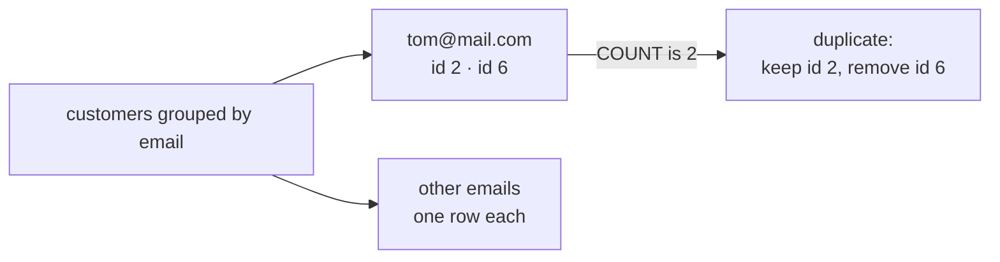

<!-- Written by `npm run lessons` from the lesson data in src/data. Edit the lesson there, not this page. -->

# Find duplicate emails, then remove the duplicates

**SQL · Unit 8: SQL interview problems, from easy to hard · Lesson 6 of 16 · Must know**

> **In one line.** Find every email that belongs to more than one customer, with how many sign-ups it has. Then delete the duplicates, keeping the row with the lowest customer_id.

[Open this lesson on the site](https://learn.hamropedia.com/sql/find-duplicate-emails-then-remove-the-duplicates/) for its animation, the practice game and tap-to-explain words.

## What the question tests

GROUP BY with HAVING, the ROW_NUMBER pattern for picking one row per group, and writing a safe DELETE.

## The pattern

**Duplicates (GROUP BY … HAVING COUNT(\*) > 1)** · Easy · tables: `customers`

**How to spot it.** "Duplicate", "appears more than once", "keep only one", "de-duplicate".

## Picture it



*Grouping by email puts both of Tom's sign-ups in one group. A group of two is a duplicate; keep the lowest id and remove the rest.*

## How to approach it

1. Group by the column that should be unique (email).
2. Keep groups with more than one row: HAVING `COUNT(*) > 1`.
3. To see the extra rows themselves, number the rows in each email group by customer_id and keep row numbers above 1.
4. To delete them, keep the `MIN(customer_id)` per email and delete everything else. Run it as a SELECT first.

## Solution

<details>
<summary>Show the solution</summary>

**Solution: find them with GROUP BY and HAVING**

```sql
SELECT email, COUNT(*) AS sign_ups
FROM customers
GROUP BY email
HAVING COUNT(*) > 1
ORDER BY email;
```

| email | sign_ups |
| --- | --- |
| tom@mail.com | 2 |

</details>

## Other correct ways

<details>
<summary>Show them</summary>

**Show the extra rows with ROW_NUMBER**

```sql
WITH numbered AS (
  SELECT customer_id, name, email,
         ROW_NUMBER() OVER (PARTITION BY email ORDER BY customer_id) AS rn
  FROM customers
)
SELECT customer_id, name, email
FROM numbered
WHERE rn > 1
ORDER BY customer_id;
```

| customer_id | name | email |
| --- | --- | --- |
| 6 | Tom | tom@mail.com |

These are the rows to remove: every row except the first in its email group.

---

**Delete the duplicates, keeping the lowest id**

```sql
DELETE FROM customers
WHERE customer_id NOT IN (
  SELECT MIN(customer_id)
  FROM customers
  GROUP BY email
);
SELECT customer_id, name, email
FROM customers
ORDER BY customer_id;
```

| customer_id | name | email |
| --- | --- | --- |
| 1 | Priya | priya@mail.com |
| 2 | Tom | tom@mail.com |
| 3 | Lena | lena@mail.com |
| 4 | Omar | omar@mail.com |
| 5 | Zoe | zoe@mail.com |

NOT IN is safe here because `MIN(customer_id)` is never NULL. Then add a UNIQUE constraint on email so it can't happen again.

</details>

## Edge cases to say out loud

- Case and spaces: 'Tom@mail.com ' and 'tom@mail.com' are different strings — normalise with `LOWER(TRIM(email))` if they should match.
- NULL emails group together in GROUP BY: decide whether they count as duplicates.
- If the duplicate rows have orders, the foreign key blocks the delete — re-point those orders to the kept id first.

## Common mistakes

- Using WHERE `COUNT(*) > 1` instead of HAVING: WHERE runs before the groups exist, so it can't see a count.
- Deleting without checking the rows first with a SELECT.
- Fixing the data but not adding a UNIQUE constraint, so duplicates come straight back.

> **Not true:** After the delete: the duplicates are gone for good, so no constraint is needed.  
> **In fact:** Without a rule in the database, the next double sign-up creates a duplicate again. Add a UNIQUE constraint on the email after cleaning up.

## Other databases

- MySQL can't delete from a table while selecting from it in a subquery; wrap the subquery in another SELECT or use a DELETE … JOIN.

## In the interview

To find duplicates I group by the column that should be unique and keep groups with HAVING COUNT star greater than one. To remove them, I number the rows within each group with ROW_NUMBER (or take the minimum id per group). Then I delete every row that isn't the keeper, checking it as a SELECT first. Then I'd add a unique constraint, and I'd ask whether emails need normalising for case and spaces before comparing.

<details>
<summary>&lt;b>How would you keep the most recent sign-up instead?&lt;/b></summary>

Order the ROW_NUMBER by signup_date DESC (with customer_id as a tiebreaker), or keep `MAX(customer_id)` if ids grow over time.

</details>

<details>
<summary>&lt;b>What if the duplicate customer has orders?&lt;/b></summary>

Update those orders to point at the kept customer_id first, in the same transaction, then delete.

</details>

## Practise

Write each answer yourself first, then open the answer and compare.

### 1. Explain

Explain why HAVING and not WHERE is used to find duplicates.

<details>
<summary>Show one good answer</summary>

A duplicate email is a fact about a group of rows ("this email appears more than once"), not about any single row. Looking at one row on its own, you can't tell whether its email is repeated.

WHERE runs before GROUP BY, one row at a time, so `COUNT(*)` doesn't exist yet there. GROUP BY email makes one group per email, and HAVING runs after it, so `HAVING COUNT(*) > 1` can keep only the groups with more than one row.

</details>

### 2. Write

Find customers who share the same name and city, and how many rows each pair has.

<details>
<summary>Show one good answer</summary>

Group by both columns and keep groups with more than one row. Only Tom in Leeds appears twice.

Note: GROUP BY puts NULLs together, so two people with the same name and no city would count as a pair. Usually that is what you want for finding duplicates, but say it out loud.

```sql
SELECT name, city, COUNT(*) AS sign_ups
FROM customers
GROUP BY name, city
HAVING COUNT(*) > 1
ORDER BY name, city;
```

| name | city | sign_ups |
| --- | --- | --- |
| Tom | Leeds | 2 |

</details>

### 3. Predict

What would the first query return if Zoe's email were changed to 'priya@mail.com'?

<details>
<summary>Show one good answer</summary>

Two rows: priya@mail.com with 2 sign-ups (Priya and now Zoe), and tom@mail.com with 2, as before. The query doesn't care that the names differ; it only groups by email.

```sql
UPDATE customers SET email = 'priya@mail.com' WHERE name = 'Zoe';
SELECT email, COUNT(*) AS sign_ups
FROM customers
GROUP BY email
HAVING COUNT(*) > 1
ORDER BY email;
```

| email | sign_ups |
| --- | --- |
| priya@mail.com | 2 |
| tom@mail.com | 2 |

</details>

### 4. Edge cases

Rewrite the duplicate check so 'TOM@mail.com' and 'tom@mail.com' count as the same email.

<details>
<summary>Show one good answer</summary>

Group by a cleaned-up version of the email: `LOWER(TRIM(email))`. LOWER makes the case the same; TRIM removes stray spaces, another common cause of fake "different" emails. Below, Tom's second sign-up is changed to 'TOM@mail.com' and the two still count as one.

To stop it happening again, store emails lower-cased, and put a unique index on the lower-cased value (`CREATE UNIQUE INDEX … ON customers (LOWER(email))`, or a COLLATE NOCASE column in SQLite).

```sql
UPDATE customers SET email = 'TOM@mail.com' WHERE customer_id = 6;
SELECT LOWER(TRIM(email)) AS email, COUNT(*) AS sign_ups
FROM customers
GROUP BY LOWER(TRIM(email))
HAVING COUNT(*) > 1
ORDER BY 1;
```

| email | sign_ups |
| --- | --- |
| tom@mail.com | 2 |

</details>

## Go further (optional)

- PRACTICE · [LeetCode — Top SQL 50 study plan](https://leetcode.com/studyplan/top-sql-50/) · free account
- PRACTICE · [DataLemur — duplicate rows questions](https://datalemur.com/questions) · real interview questions, many free

---

[← Customers who have never had an order delivered](customers-who-have-never-had-an-order-delivered.md) · [All lessons](../../README.md) · [The highest-paid employee in each department →](the-highest-paid-employee-in-each-department.md)
