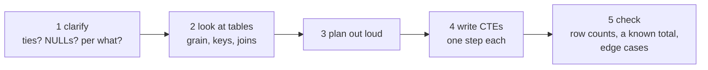

<!-- Written by `npm run lessons` from the lesson data in src/data. Edit the lesson there, not this page. -->

# How to answer any SQL interview question

**SQL · Unit 8: SQL interview problems, from easy to hard · Lesson 1 of 16 · Must know**

> **In one line.** A repeatable method: restate the question, look at the tables and their grain, ask about edge cases, and plan the steps out loud. Then write the query as small CTEs, and check the result against a few rows you can work out by hand.

[Open this lesson on the site](https://learn.hamropedia.com/sql/how-to-answer-any-sql-interview-question/) for its animation, the practice game and tap-to-explain words.

## The problem it solves

Under pressure, people jump straight into typing, write one giant query, and miss the NULLs or ties the interviewer planted. Interviewers grade the process as much as the answer: do you clarify, structure, and verify?

## The idea

Step 1, clarify: say the question back in your own words, and ask about ties, NULLs, duplicates and what "per" means.  
Step 2, look at the data: what is one row of each table (the grain), what are the keys, how do they join?  
Step 3, plan out loud: "First I'll get delivered orders, then total them per customer, then join the city."  
Step 4, write it as CTEs, one step each, running each one if you can.  
Step 5, check: does the row count make sense? Does a total match a number you can work out by hand? Then say the edge cases and how your query handles them.

## Analogy

A pilot's checklist. Experienced pilots still run it every flight — not because they forget how to fly, but because the checklist catches the one thing that pressure makes you skip.

**Where the analogy breaks.** A checklist is the same every flight. Interviews vary: if the question is simple, go through the steps quickly; don't spend five minutes clarifying "count the rows".

## Syntax

```sql
-- 1 clarify  2 look at the grain  3 plan out loud
WITH step_one AS (...),   -- 4 one CTE per step
     step_two AS (...)
SELECT ... FROM step_two; -- 5 check against rows you know
```

## How it works, step by step

1. Question: "Which city brings in the most delivered revenue?"
2. Clarify: delivered orders only? Customers with no city — drop them or show them as unknown? Ties?
3. Grain: one row of orders is one order; customers holds the city; join on customer_id.
4. Sanity-check the data first: 10 orders, 4 customers who ordered, 1 order with no amount.
5. Plan and write: a CTE of delivered orders → join customers → group by city → sort. Check: London = Priya 275 + Lena 60 = 335.

## Picture it



*Five steps, every time. The talking in steps 1, 3 and 5 is what the interviewer is grading; the CTEs in step 4 make your thinking easy to follow.*

## Examples on the practice database

**Step 2: look at the data before you write the answer**

```sql
SELECT COUNT(*) AS orders,
       COUNT(DISTINCT customer_id) AS customers_who_ordered,
       SUM(CASE WHEN amount IS NULL THEN 1 ELSE 0 END) AS missing_amounts
FROM orders;
```

| orders | customers_who_ordered | missing_amounts |
| --- | --- | --- |
| 10 | 4 | 1 |

Thirty seconds of this tells you there are missing amounts to mention, and how many rows to expect.

---

**Steps 4 and 5: write it in steps, then check a number**

```sql
WITH delivered AS (
  SELECT customer_id, amount
  FROM orders
  WHERE status = 'delivered'
)
SELECT COALESCE(c.city, 'unknown') AS city,
       SUM(d.amount) AS delivered_revenue
FROM delivered d
JOIN customers c ON c.customer_id = d.customer_id
GROUP BY COALESCE(c.city, 'unknown')
ORDER BY delivered_revenue DESC;
```

| city | delivered_revenue |
| --- | --- |
| London | 335 |
| Leeds | 275 |

Check by hand: London is Priya's 275 delivered plus Lena's 60. Zoe (no city) has no delivered order, so "unknown" doesn't appear.

## Must know

- Clarify first: ties, NULLs, duplicates, date ranges, and what "per" means.
- Know each table's grain and keys before joining.
- Think out loud — the interviewer is grading your reasoning.
- Write CTEs, one step each, named after what they hold.
- Verify: a row count, one total worked out by hand, and the edge cases said out loud.

## Common mistakes

- Typing straight away and writing one huge nested query.
- Not asking about ties, then using LIMIT 1 when two rows tie.
- Stopping when the query runs, without checking that the answer is right.

> **Not true:** Once the query runs without an error, the interview answer is finished.  
> **In fact:** A query can run and still be wrong. Check it against a small example and against the edge cases (ties, NULLs, no rows) before you stop.

## Other databases

- If the interviewer doesn't name a database, say "I'll write PostgreSQL" — it is the most common choice, and it means DATE_TRUNC, ::date casts and FILTER are all available.

## In the interview

I start by restating the question and asking about edge cases — ties, NULLs, duplicates, the time window. Then I look at the tables, to understand the grain and how they join. I explain my plan in steps, and write it as a chain of CTEs, so each step is readable and testable. Finally I sanity-check the output — row counts and one number I can verify by hand — and walk through how the query handles the edge cases.

<details>
<summary>&lt;b>What do you do if you don't know the exact function name in their database?&lt;/b></summary>

Say so, write the closest version you know (for example DATE_TRUNC), and explain what it does. Interviewers care about the logic, not the exact spelling.

</details>

<details>
<summary>&lt;b>How do you check a query when you can't run it?&lt;/b></summary>

Walk two or three rows through each step by hand, especially a NULL row and a tie.

</details>

## Practise

Write each answer yourself first, then open the answer and compare.

### 1. Explain

Say the five steps from memory, with one sentence on why each matters.

<details>
<summary>Show one good answer</summary>

1. Restate the question and clarify it: "So you want delivered revenue per city, highest first?" It catches misunderstandings before you write anything, and shows you listen.  
2. Look at the tables, their grain and the data: one row of orders is one order; the city is in customers; run a quick count. Joins and sums go wrong when you don't know what one row means.  
3. Ask about the edge cases: ties, NULLs, duplicates, date ranges, what "per" means. Each answer changes the query, and asking is what interviewers grade.  
4. Plan out loud, then write it as small CTEs, one step each, named after what they hold. Easy to follow, and easy to fix one step.  
5. Check the result: a row count and one number worked out by hand ("London = 275 + 60 = 335"). It catches fan-out, missing rows and integer division before the interviewer does.

</details>

### 2. Write

Use the five steps on: "Which product category had the most units sold in February?" Write your clarifying questions first.

<details>
<summary>Show one good answer</summary>

Clarifying questions first:  
• Which orders count? I'll assume everything except cancelled (shipped and pending were still sold), and say so.  
• "February" means February 2024, by order_date.  
• Units means the quantity in order_items, not the number of orders.  
• What if two categories tie? I'll return both, rather than pick one.

Grain: one order_items row is one product in one order; the category is in products; the date and status are in orders.

Plan: February's item lines with their category → units per category → keep the maximum. Check by hand: February has orders 105 (3 headphones, 1 backpack) and 107 (2 backpacks); 106 was cancelled and has no items. So Electronics = 3 and Bags = 1 + 2 = 3: a tie, and both come back.

```sql
WITH feb_items AS (
  SELECT p.category, oi.quantity
  FROM orders o
  JOIN order_items oi ON oi.order_id = o.order_id
  JOIN products p     ON p.product_id = oi.product_id
  WHERE o.order_date >= '2024-02-01' AND o.order_date < '2024-03-01'
    AND o.status <> 'cancelled'
),
by_category AS (
  SELECT category, SUM(quantity) AS units
  FROM feb_items
  GROUP BY category
)
SELECT category, units
FROM by_category
WHERE units = (SELECT MAX(units) FROM by_category)
ORDER BY category;
```

| category | units |
| --- | --- |
| Bags | 3 |
| Electronics | 3 |

</details>

### 3. Predict

Before running the city query, predict its result if cancelled orders were included too.

<details>
<summary>Show one good answer</summary>

Exactly the same: London 335, Leeds 275.

The only cancelled order is 106 (Lena, London), and its amount is NULL. SUM skips NULLs, so adding it changes nothing. A good prediction checks the data, not just the logic: "include cancelled orders" sounds like a big change, but here it adds one row with nothing to add.

```sql
WITH delivered AS (
  SELECT customer_id, amount
  FROM orders
  WHERE status IN ('delivered', 'cancelled')
)
SELECT COALESCE(c.city, 'unknown') AS city,
       SUM(d.amount) AS delivered_revenue
FROM delivered d
JOIN customers c ON c.customer_id = d.customer_id
GROUP BY COALESCE(c.city, 'unknown')
ORDER BY delivered_revenue DESC;
```

| city | delivered_revenue |
| --- | --- |
| London | 335 |
| Leeds | 275 |

</details>

### 4. Edge cases

List three edge cases you would raise for "What is the average order value per customer?" and how each changes the query.

<details>
<summary>Show one good answer</summary>

1. Orders with no amount, or cancelled orders. Order 106 has a NULL amount. AVG skips it (Lena's average is 60, from one order); treating it as £0 gives 30. Ask which is meant, then either filter `WHERE status <> 'cancelled'`, or use `AVG(COALESCE(amount, 0))`.

2. Customers with no orders. Omar has none. Starting from orders, he simply isn't there; if the question means "per customer, all of them", start from customers with a LEFT JOIN, and decide whether he shows NULL or 0.

3. Duplicate customers. Tom signed up twice (ids 2 and 6). Grouping by customer_id gives two Toms, one with no orders. If they are one person, group by the email instead (after cleaning it).

(A fourth worth asking: does "average order value per customer" mean each customer's own average, or one overall figure, which is total revenue ÷ number of orders?)

</details>

## Go further (optional)

- PRACTICE · [LeetCode — Top SQL 50 study plan](https://leetcode.com/studyplan/top-sql-50/) · free account
- PRACTICE · [DataLemur — SQL interview questions](https://datalemur.com/questions) · real interview questions, many free
- WATCH · [How to approach SQL interview questions (video)](https://www.youtube.com/results?search_query=how%20to%20approach%20sql%20interview%20questions) · YouTube search, free

---

[← How a database runs a join: nested loop, hash join, merge join](../unit-7-performance/how-a-database-runs-a-join-nested-loop-hash-join-merge-join.md) · [All lessons](../../README.md) · [Quick-fire SQL theory questions →](quick-fire-sql-theory-questions.md)
