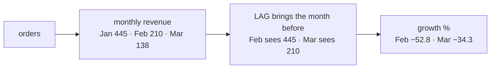

<!-- Written by `npm run lessons` from the lesson data in src/data. Edit the lesson there, not this page. -->

# Month-over-month revenue growth

**SQL · Unit 8: SQL interview problems, from easy to hard · Lesson 9 of 16 · Must know**

> **In one line.** For each month, show the revenue and the percentage change from the previous month, rounded to one decimal place.

[Open this lesson on the site](https://learn.hamropedia.com/sql/month-over-month-revenue-growth/) for its animation, the practice game and tap-to-explain words.

## What the question tests

Aggregating to the right grain first, then LAG, then safe percentage maths — integer division and division by zero included.

## The pattern

**Period-over-period change** · Medium · tables: `orders`

**How to spot it.** "Growth", "change from the previous", "month over month", "compared with last week".

## Picture it



*First shrink orders to one row per month, then let each month look back at the one before it with LAG, then do the percentage maths.*

## How to approach it

1. Aggregate orders to one row per month first (a CTE).
2. Use `LAG(revenue) OVER (ORDER BY month)` to bring last month's revenue onto each row.
3. Growth % = 100.0 × (this − last) ÷ last. Use 100.0 to avoid integer division and `NULLIF(last, 0)` to avoid dividing by zero.
4. The first month has no previous month, so its growth is NULL.

## Solution

<details>
<summary>Show the solution</summary>

**Solution: monthly CTE, then LAG**

```sql
WITH monthly AS (
  SELECT strftime('%Y-%m', order_date) AS month,
         SUM(amount) AS revenue
  FROM orders
  GROUP BY strftime('%Y-%m', order_date)
)
SELECT month, revenue,
       ROUND(100.0 * (revenue - LAG(revenue) OVER (ORDER BY month))
             / LAG(revenue) OVER (ORDER BY month), 1) AS growth_pct
FROM monthly
ORDER BY month;
```

| month | revenue | growth_pct |
| --- | --- | --- |
| 2024-01 | 445 | NULL |
| 2024-02 | 210 | -52.8 |
| 2024-03 | 138 | -34.3 |

</details>

## Other correct ways

<details>
<summary>Show them</summary>

**A named window, and a guard against dividing by zero**

```sql
WITH monthly AS (
  SELECT strftime('%Y-%m', order_date) AS month,
         SUM(amount) AS revenue
  FROM orders
  GROUP BY strftime('%Y-%m', order_date)
)
SELECT month, revenue,
       ROUND(100.0 * (revenue - LAG(revenue) OVER w)
             / NULLIF(LAG(revenue) OVER w, 0), 1) AS growth_pct
FROM monthly
WINDOW w AS (ORDER BY month)
ORDER BY month;
```

| month | revenue | growth_pct |
| --- | --- | --- |
| 2024-01 | 445 | NULL |
| 2024-02 | 210 | -52.8 |
| 2024-03 | 138 | -34.3 |

WINDOW w AS (…) names the window once. NULLIF turns a previous revenue of 0 into NULL, so the growth is NULL instead of an error.

</details>

## Edge cases to say out loud

- The first month: no previous month, so NULL.
- A previous month with 0 revenue: divide by `NULLIF(…, 0)`.
- A month with no orders at all has no row, so LAG would compare with two months ago — build a month list and LEFT JOIN if that matters.

## Common mistakes

- Using LAG on the order rows instead of the monthly totals.
- `(revenue - prev) / prev * 100` with whole numbers: integer division gives 0 or -1.
- Grouping by order_date instead of the month.

> **Not true:** Monthly growth: apply LAG to the single order rows, not to monthly totals.  
> **In fact:** On order rows, LAG compares one order with the order before it. Add up the revenue of each month first, then apply LAG to the monthly totals.

## Other databases

- PostgreSQL: `DATE_TRUNC('month', order_date)` for the month. MySQL: `DATE_FORMAT(order_date, '%Y-%m')`. SQL Server: `FORMAT(order_date, 'yyyy-MM')` or `DATEFROMPARTS(YEAR(d), MONTH(d), 1)`.

## In the interview

I aggregate to one row per month in a CTE. Then I use LAG over month order to bring the previous month's revenue alongside. The growth is 100.0 times the difference, divided by the previous value, rounded. I guard the division with NULLIF for zero months, note that the first month is NULL, and would fill in missing months with a calendar join if gaps are possible.

<details>
<summary>&lt;b>How would you do year-over-year growth on monthly data?&lt;/b></summary>

`LAG(revenue, 12) OVER (ORDER BY month)` — twelve rows back — assuming every month is present.

</details>

<details>
<summary>&lt;b>How would you compute it per product category?&lt;/b></summary>

Group by category and month, then `LAG(revenue) OVER (PARTITION BY category ORDER BY month)`.

</details>

## Practise

Write each answer yourself first, then open the answer and compare.

### 1. Explain

Explain why you aggregate to months before using LAG.

<details>
<summary>Show one good answer</summary>

LAG returns the previous row, so the rows must be the things you want to compare: months. On the raw orders table, the previous row is the previous order, so "growth" would compare one order with another order.

So first collapse to one row per month (GROUP BY month, SUM(amount)) in a CTE, and only then use LAG over those monthly rows. The previous row is now the previous month.

(The order of the steps matters for a second reason too: window functions run after GROUP BY, so even in one query, LAG over a SUM is computed on the grouped rows.)

</details>

### 2. Write

Compute month-over-month growth in the number of orders, not revenue.

<details>
<summary>Show one good answer</summary>

Swap SUM(amount) for COUNT(\*). January has 4 orders, February 3 (−25%) and March 3 (0%).

One question to ask: do cancelled orders count? Order 106 is in February's 3. Excluding it would make February 2 and March +50%.

```sql
WITH monthly AS (
  SELECT strftime('%Y-%m', order_date) AS month,
         COUNT(*) AS orders
  FROM orders
  GROUP BY strftime('%Y-%m', order_date)
)
SELECT month, orders,
       ROUND(100.0 * (orders - LAG(orders) OVER (ORDER BY month))
             / LAG(orders) OVER (ORDER BY month), 1) AS growth_pct
FROM monthly
ORDER BY month;
```

| month | orders | growth_pct |
| --- | --- | --- |
| 2024-01 | 4 | NULL |
| 2024-02 | 3 | -25 |
| 2024-03 | 3 | 0 |

</details>

### 3. Predict

What would growth_pct be for March if March revenue were 315?

<details>
<summary>Show one good answer</summary>

+50.0. February's revenue is 210, so (315 − 210) ÷ 210 = 105 ÷ 210 = 0.5, which is 50%.

The query below makes March 315 by adding 177 to order 110 (138 + 177 = 315).

```sql
UPDATE orders SET amount = amount + 177 WHERE order_id = 110;
WITH monthly AS (
  SELECT strftime('%Y-%m', order_date) AS month,
         SUM(amount) AS revenue
  FROM orders
  GROUP BY strftime('%Y-%m', order_date)
)
SELECT month, revenue,
       ROUND(100.0 * (revenue - LAG(revenue) OVER (ORDER BY month))
             / LAG(revenue) OVER (ORDER BY month), 1) AS growth_pct
FROM monthly
ORDER BY month;
```

| month | revenue | growth_pct |
| --- | --- | --- |
| 2024-01 | 445 | NULL |
| 2024-02 | 210 | -52.8 |
| 2024-03 | 315 | 50 |

</details>

### 4. Edge cases

Show what goes wrong if you remove the 100.0 and use whole-number maths, then fix it.

<details>
<summary>Show one good answer</summary>

Revenue is a whole number, so with whole-number maths the division throws away the fraction. (210 − 445) ÷ 445 is −0.53, which becomes 0, and 0 × 100 = 0: February shows 0% growth instead of −52.8%. March does the same. Nothing errors; the numbers are just wrong.

The fix is to make one side a decimal before dividing: multiply by 100.0 first, as the solution does. Multiplying by 100 (whole) first would be closer but still cut the decimals off: −52 instead of −52.8.

```sql
WITH monthly AS (
  SELECT strftime('%Y-%m', order_date) AS month,
         SUM(amount) AS revenue
  FROM orders
  GROUP BY strftime('%Y-%m', order_date)
)
SELECT month, revenue,
       (revenue - LAG(revenue) OVER (ORDER BY month))
         / LAG(revenue) OVER (ORDER BY month) * 100 AS whole_number_maths,
       ROUND(100.0 * (revenue - LAG(revenue) OVER (ORDER BY month))
             / LAG(revenue) OVER (ORDER BY month), 1) AS growth_pct
FROM monthly
ORDER BY month;
```

| month | revenue | whole_number_maths | growth_pct |
| --- | --- | --- | --- |
| 2024-01 | 445 | NULL | NULL |
| 2024-02 | 210 | 0 | -52.8 |
| 2024-03 | 138 | 0 | -34.3 |

</details>

## Go further (optional)

- PRACTICE · [DataLemur — month-over-month growth questions](https://datalemur.com/questions) · real interview questions, many free
- READ · [Mode SQL Tutorial — SQL Window Functions: LAG and LEAD](https://mode.com/sql-tutorial/) · Mode, free

---

[← Employees paid above their department's average](employees-paid-above-their-departments-average.md) · [All lessons](../../README.md) · [Each customer's first order →](each-customers-first-order.md)
