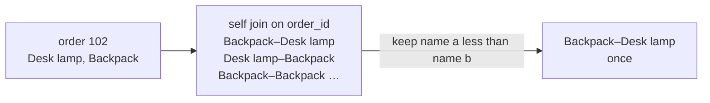

<!-- Written by `npm run lessons` from the lesson data in src/data. Edit the lesson there, not this page. -->

# Products bought together

**SQL · Unit 8: SQL interview problems, from easy to hard · Lesson 12 of 16 · Should know**

> **In one line.** Find every pair of different products that appear in the same order, and count how many orders contain each pair. List each pair once.

[Open this lesson on the site](https://learn.hamropedia.com/sql/products-bought-together/) for its animation, the practice game and tap-to-explain words.

## What the question tests

A self join on a link table, and the trick for listing each pair once — the basis of "customers who bought this also bought…".

## The pattern

**Pairs within a group (self join with a &lt; b)** · Medium · tables: `order_items`, `products`

**How to spot it.** "Bought together", "pairs", "in the same order / session / team", "co-occurrence".

## Picture it



*Joining an order's items to themselves makes every combination, including each item with itself and each pair twice. "a &lt; b" keeps exactly one copy of each real pair.*

## How to approach it

1. Join order_items to itself on the same order_id: every product paired with every other product in that order.
2. Keep only pairs where the first product's name is less than the second's — this removes self-pairs and mirrored duplicates (A–B and B–A).
3. Join products twice to get both names.
4. Group by the pair and count the orders.

## Solution

<details>
<summary>Show the solution</summary>

**Solution: self join with a &lt; b**

```sql
SELECT p1.product_name AS product_a, p2.product_name AS product_b,
       COUNT(*) AS orders_together
FROM order_items a
JOIN order_items b ON b.order_id = a.order_id
JOIN products p1   ON p1.product_id = a.product_id
JOIN products p2   ON p2.product_id = b.product_id
WHERE p1.product_name < p2.product_name
GROUP BY p1.product_name, p2.product_name
ORDER BY orders_together DESC, product_a, product_b;
```

| product_a | product_b | orders_together |
| --- | --- | --- |
| Backpack | Desk lamp | 1 |
| Backpack | Headphones | 1 |
| Desk lamp | Mug | 1 |
| Mug | Notebook | 1 |
| Notebook | Pen | 1 |

Each pair appears in one order in this small data set. On real data you would sort by orders_together and take the top pairs.

</details>

## Edge cases to say out loud

- The same product twice in one order: order_items has one row per product per order, so it can't pair with itself here — but say how you would handle it.
- Big orders make many pairs (n items → n × (n − 1) / 2 pairs), so this can get expensive on real data.
- Pairs vs. lift: "bought together most" favours popular products; analysts often normalise by each product's own popularity.

## Common mistakes

- Using `<>` instead of `<`, which lists every pair twice.
- Joining on product_id instead of order_id, which pairs a product with itself across orders.
- Counting rows when an order could contain a pair more than once — use `COUNT(DISTINCT a.order_id)` if so.

> **Not true:** Joining the item rows with `a.product_id <> b.product_id` lists each pair of products once.  
> **In fact:** `<>` gives every pair twice: (Pen, Mug) and (Mug, Pen). Use `<` so that each pair appears only once.

## In the interview

I self-join the order items table on order_id, so every product is paired with every other product in the same order. I filter with product a less than product b, to drop self-pairs and mirrored duplicates. Then I join the product names and count orders per pair. I'd note that the number of pairs grows quadratically with basket size, so on big data I might limit to recent orders or popular products.

<details>
<summary>&lt;b>Why `&lt;` and not `&lt;>`?&lt;/b></summary>

`<>` removes self-pairs but keeps both A–B and B–A. `<` keeps exactly one ordering of each pair.

</details>

<details>
<summary>&lt;b>How would you find triples bought together?&lt;/b></summary>

Join order_items three times on order_id with a &lt; b &lt; c, then group by all three.

</details>

## Practise

Write each answer yourself first, then open the answer and compare.

### 1. Explain

Explain what the self join produces before the WHERE, for order 102.

<details>
<summary>Show one good answer</summary>

Order 102 has two item lines: product 4 (desk lamp) and product 5 (backpack). Joining order_items to itself on order_id pairs every line of the order with every line of the same order, 2 × 2 = 4 rows: (lamp, lamp), (lamp, backpack), (backpack, lamp), (backpack, backpack).

Two of those are a product paired with itself, and the other two are the same pair in both orders. `WHERE p1.product_name < p2.product_name` removes both problems at once: a name is never less than itself, and of (lamp, backpack) and (backpack, lamp) only one has the names in alphabetical order. One row is left: (Backpack, Desk lamp).

```sql
SELECT a.order_id, a.product_id AS a_product, b.product_id AS b_product
FROM order_items a
JOIN order_items b ON b.order_id = a.order_id
WHERE a.order_id = 102
ORDER BY a.product_id, b.product_id;
```

| order_id | a_product | b_product |
| --- | --- | --- |
| 102 | 4 | 4 |
| 102 | 4 | 5 |
| 102 | 5 | 4 |
| 102 | 5 | 5 |

</details>

### 2. Write

For each product, list how many different products it has ever been bought with.

<details>
<summary>Show one good answer</summary>

Pair each product's item lines with the other lines of the same order (`b.product_id <> a.product_id`), and count distinct partners. LEFT JOINs keep the products with no partners: the headphones are often bought alone, and the phone case has never been bought at all.

```sql
SELECT p.product_name, COUNT(DISTINCT b.product_id) AS bought_with
FROM products p
LEFT JOIN order_items a ON a.product_id = p.product_id
LEFT JOIN order_items b ON b.order_id = a.order_id AND b.product_id <> a.product_id
GROUP BY p.product_id, p.product_name
ORDER BY bought_with DESC, p.product_name;
```

| product_name | bought_with |
| --- | --- |
| Backpack | 2 |
| Desk lamp | 2 |
| Mug | 2 |
| Notebook | 2 |
| Headphones | 1 |
| Pen | 1 |
| Phone case | 0 |

</details>

### 3. Predict

How many rows does the self join `order_items a JOIN order_items b ON b.order_id = a.order_id` produce before any WHERE?

<details>
<summary>Show one good answer</summary>

24. Each order contributes (its number of item lines)², because every line is paired with every line of the same order, itself included. Orders 101, 104, 107 and 108 have 1 line each (1 row each); orders 102, 103, 105, 109 and 110 have 2 lines each (4 rows each). 4 × 1 + 5 × 4 = 24.

```sql
SELECT COUNT(*) AS pairs_before_where
FROM order_items a
JOIN order_items b ON b.order_id = a.order_id;
```

| pairs_before_where |
| --- |
| 24 |

</details>

### 4. Edge cases

If an order could contain the same product on two rows, how would you stop it pairing with itself and double-counting?

<details>
<summary>Show one good answer</summary>

Two separate problems, two fixes:

• Self-pairs: compare product ids, not rows. `a.product_id < b.product_id` can never pair a product with itself, even if it appears on two rows of the order (two lines with the same product have equal ids, so `<` is false).  
• Double counting: the same pair would come out several times for one order (2 lines × 1 line = 2 rows). Count orders, not rows: `COUNT(DISTINCT a.order_id)`. Or remove the duplicates first, in a CTE: `SELECT DISTINCT order_id, product_id FROM order_items`, then self-join that.

In this database it can't happen, because the primary key (order_id, product_id) allows one row per product per order. But many real order tables have no such key.

</details>

## Go further (optional)

- PRACTICE · [DataLemur — frequently bought together questions](https://datalemur.com/questions) · real interview questions, many free
- PRACTICE · [PostgreSQL Exercises — Joins and Subqueries](https://pgexercises.com/) · pgexercises.com, free

---

[← Streaks: orders on consecutive days (gaps and islands)](streaks-orders-on-consecutive-days-gaps-and-islands.md) · [All lessons](../../README.md) · [Which products make up 80% of revenue? (share of total) →](which-products-make-up-80-of-revenue-share-of-total.md)
