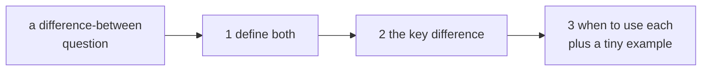

<!-- Written by `npm run lessons` from the lesson data in src/data. Edit the lesson there, not this page. -->

# Quick-fire SQL theory questions

**SQL · Unit 8: SQL interview problems, from easy to hard · Lesson 2 of 16 · Must know**

> **In one line.** Short "what is the difference between…" questions that open many SQL interviews; each is best answered with a one-line definition of both sides, the key difference, and when you would use each.

[Open this lesson on the site](https://learn.hamropedia.com/sql/quick-fire-sql-theory-questions/) for its animation, the practice game and tap-to-explain words.

## The problem it solves

These questions take thirty seconds each but set the tone for the interview. A crisp answer shows you really understand the tool; a vague one makes the interviewer dig deeper. They are collected here so you can revise them in one place.

## The idea

Use the same three-part shape every time. One: define both things in a sentence each. Two: state the difference that matters. Three: say when you would choose each, ideally with an example. Keep it under thirty seconds, then stop — let them ask for more. Open the follow-up questions below and answer each one out loud before showing the answer.

## Analogy

Penalty practice. You don't learn penalties by thinking about them; you take the same kick again and again until it is automatic, so it holds up under pressure.

**Where the analogy breaks.** A penalty is the same every time. Interviewers rephrase questions, so learn the idea behind each answer, not just the words.

## How it works, step by step

1. Define both sides: "WHERE filters rows; HAVING filters groups."
2. Give the difference that matters: "WHERE runs before grouping, so it can't use aggregates."
3. Say when to use each: "Row conditions in WHERE, aggregate conditions in HAVING."
4. Offer a tiny example if it helps, then stop talking.

## Picture it



*One shape for every theory question: define both, give the difference that matters, say when you would use each — in under thirty seconds.*

## Examples on the practice database

**Four classic answers, checked in one query**

```sql
SELECT (SELECT COUNT(*) FROM employees) AS count_star,
       (SELECT COUNT(manager_id) FROM employees) AS count_column,
       (SELECT COUNT(*) FROM (SELECT location FROM departments
                              UNION SELECT city FROM customers) AS u) AS union_rows,
       (SELECT COUNT(*) FROM (SELECT location FROM departments
                              UNION ALL SELECT city FROM customers) AS ua) AS union_all_rows;
```

| count_star | count_column | union_rows | union_all_rows |
| --- | --- | --- | --- |
| 8 | 7 | 5 | 10 |

`COUNT(*)` counts rows, `COUNT(column)` skips NULLs; UNION removes duplicates, UNION ALL keeps them.

## Must know

- Shape: define both, the key difference, when to use each.
- Keep it under thirty seconds, then stop.
- Use a tiny example from tables you know, like employees and orders.
- Revise the follow-up questions below out loud until each answer is automatic.

## Common mistakes

- Rambling for two minutes on a thirty-second question.
- Giving only one side ("HAVING is for groups") without the contrast.
- Memorising words without the reason, then freezing when the question is rephrased.

> **Not true:** For a quick theory question, a two-minute answer scores better than thirty seconds.  
> **In fact:** Thirty seconds is enough: define both things, give the key difference, say when to use each, then stop. A long answer hides the point.

## In the interview

For any "what's the difference" question I give a one-line definition of each, the difference that matters in practice, and when I would choose each. For example: WHERE filters rows before grouping and can't use aggregates; HAVING filters groups after GROUP BY and can — so row conditions go in WHERE and aggregate conditions in HAVING.

<details>
<summary>&lt;b>WHERE vs HAVING?&lt;/b></summary>

WHERE filters rows before grouping and can't use aggregates; HAVING filters groups after GROUP BY and can.

</details>

<details>
<summary>&lt;b>INNER JOIN vs LEFT JOIN?&lt;/b></summary>

INNER keeps only rows that match on both sides; LEFT keeps every left row and fills NULLs where the right has no match.

</details>

<details>
<summary>&lt;b>UNION vs UNION ALL?&lt;/b></summary>

UNION removes duplicate rows; UNION ALL keeps every row and is faster.

</details>

<details>
<summary>&lt;b>DELETE vs TRUNCATE vs DROP?&lt;/b></summary>

DELETE removes chosen rows (WHERE, logged, can roll back); TRUNCATE empties the whole table fast; DROP removes the table itself.

</details>

<details>
<summary>&lt;b>Primary key vs unique key?&lt;/b></summary>

Both forbid duplicates. One primary key per table and never NULL; many unique keys allowed, and they usually allow NULLs.

</details>

<details>
<summary>&lt;b>RANK vs DENSE_RANK vs ROW_NUMBER?&lt;/b></summary>

ROW_NUMBER: 1, 2, 3, 4. RANK: ties share, then a gap (1, 2, 2, 4). DENSE_RANK: ties share, no gap (1, 2, 2, 3).

</details>

<details>
<summary>&lt;b>`COUNT(*)` vs `COUNT(column)`?&lt;/b></summary>

`COUNT(*)` counts rows; `COUNT(column)` counts rows where that column isn't NULL.

</details>

<details>
<summary>&lt;b>What does NULL = NULL return?&lt;/b></summary>

NULL (unknown), not true. Use IS NULL.

</details>

<details>
<summary>&lt;b>Subquery vs CTE?&lt;/b></summary>

Both are queries inside a query. A CTE is named, defined at the top, reusable within the statement, can be recursive, and reads top to bottom.

</details>

<details>
<summary>&lt;b>Correlated vs non-correlated subquery?&lt;/b></summary>

A non-correlated subquery runs once on its own; a correlated one uses columns from the outer row, so logically it runs once per outer row.

</details>

<details>
<summary>&lt;b>Clustered vs non-clustered index?&lt;/b></summary>

A clustered index is the table itself stored in key order (one per table); a non-clustered index is a separate sorted structure pointing to rows.

</details>

<details>
<summary>&lt;b>Why not index every column?&lt;/b></summary>

Each index slows down every insert, update and delete and uses space; index the columns you filter, join and sort by.

</details>

<details>
<summary>&lt;b>What is normalisation?&lt;/b></summary>

Designing tables so each fact is stored once (usually to 3NF), which prevents update anomalies, at the cost of more joins.

</details>

<details>
<summary>&lt;b>What does ACID stand for?&lt;/b></summary>

Atomicity, Consistency, Isolation, Durability — the guarantees of a database transaction.

</details>

<details>
<summary>&lt;b>View vs materialised view?&lt;/b></summary>

A view is a saved query, always fresh, no stored data; a materialised view stores the result, fast to read, stale until refreshed.

</details>

<details>
<summary>&lt;b>OLTP vs OLAP?&lt;/b></summary>

OLTP systems handle many small, fast reads and writes (an app's database, normalised); OLAP systems handle big analytical queries over lots of history (a data warehouse, often denormalised).

</details>

## Practise

Write each answer yourself first, then open the answer and compare.

### 1. Explain

Answer five follow-up questions below out loud, without opening the answers, each in under thirty seconds.

<details>
<summary>Show one good answer</summary>

Five, each in one breath:

• WHERE vs HAVING: WHERE filters rows before grouping and can't use aggregates; HAVING filters groups after GROUP BY, so it can use COUNT and SUM.  
• INNER JOIN vs LEFT JOIN: INNER keeps only rows that match on both sides; LEFT keeps every row of the left table and fills NULLs where the right has no match. Use LEFT for "including the ones with none".  
• UNION vs UNION ALL: both stack two results; UNION removes duplicate rows (extra work), UNION ALL keeps them all and is faster. Default to UNION ALL unless you need distinct rows.  
• DELETE vs TRUNCATE vs DROP: DELETE removes chosen rows and can be rolled back; TRUNCATE empties the whole table fast; DROP removes the table itself.  
• RANK vs DENSE_RANK vs ROW_NUMBER: ROW_NUMBER gives 1, 2, 3, 4 with no ties; RANK lets ties share and then skips (1, 2, 2, 4); DENSE_RANK lets ties share without skipping (1, 2, 2, 3).

</details>

### 2. Write

Write one query that shows the difference between INNER JOIN and LEFT JOIN on departments and employees, as two counts in one row.

<details>
<summary>Show one good answer</summary>

Each count is a scalar subquery, so both fit in one row.

The INNER JOIN gives 7: every employee who has a department (Gus has none, so he isn't paired). The LEFT JOIN from departments gives 8: the same 7, plus one row for HR, which has nobody, with NULL employee columns. The difference is exactly the unmatched rows on the left side.

```sql
SELECT (SELECT COUNT(*) FROM departments d
          JOIN employees e ON e.dept_id = d.dept_id) AS inner_join_rows,
       (SELECT COUNT(*) FROM departments d
          LEFT JOIN employees e ON e.dept_id = d.dept_id) AS left_join_rows;
```

| inner_join_rows | left_join_rows |
| --- | --- |
| 7 | 8 |

</details>

### 3. Predict

What does `SELECT COUNT(DISTINCT city), COUNT(city), COUNT(*) FROM customers;` return?

<details>
<summary>Show one good answer</summary>

3, 5 and 6.

• `COUNT(DISTINCT city)`: London, Leeds and Bristol. The NULL is not counted.  
• `COUNT(city)`: every city that isn't NULL, duplicates included: Zoe is the only one missing, so 5.  
• `COUNT(*)`: every row, 6.

```sql
SELECT COUNT(DISTINCT city), COUNT(city), COUNT(*) FROM customers;
```

| COUNT(DISTINCT city) | COUNT(city) | COUNT(*) |
| --- | --- | --- |
| 3 | 5 | 6 |

</details>

### 4. Edge cases

Explain why `SELECT DISTINCT` and `GROUP BY` can give the same rows, and when they don't.

<details>
<summary>Show one good answer</summary>

When you select only the grouped columns, they mean the same thing: `SELECT DISTINCT dept_id FROM employees` and `SELECT dept_id FROM employees GROUP BY dept_id` both give one row per department (with one row for NULL). Many databases even run them the same way.

They differ when:  
• You want something per group. GROUP BY can count, sum or average each group (below); DISTINCT can only remove duplicates.  
• You filter groups. HAVING works with GROUP BY; DISTINCT has nothing like it.  
• DISTINCT applies to every selected column, including calculated ones, and runs after SELECT. GROUP BY groups by what you list, and everything else in SELECT must be aggregated.  
• The output order: neither guarantees one without ORDER BY.

```sql
SELECT dept_id, COUNT(*) AS people
FROM employees
GROUP BY dept_id
ORDER BY dept_id;
```

| dept_id | people |
| --- | --- |
| NULL | 1 |
| 1 | 4 |
| 2 | 2 |
| 3 | 1 |

</details>

## Go further (optional)

- PRACTICE · [LeetCode — Top SQL 50 study plan](https://leetcode.com/studyplan/top-sql-50/) · free account
- READ · [Mode SQL Tutorial — The SQL Tutorial for Data Analysis](https://mode.com/sql-tutorial/) · Mode, free
- WATCH · [Top SQL interview questions (video)](https://www.youtube.com/results?search_query=top%20sql%20interview%20questions%20and%20answers) · YouTube search, free

---

[← How to answer any SQL interview question](how-to-answer-any-sql-interview-question.md) · [All lessons](../../README.md) · [The second highest salary (and the Nth) →](the-second-highest-salary-and-the-nth.md)
