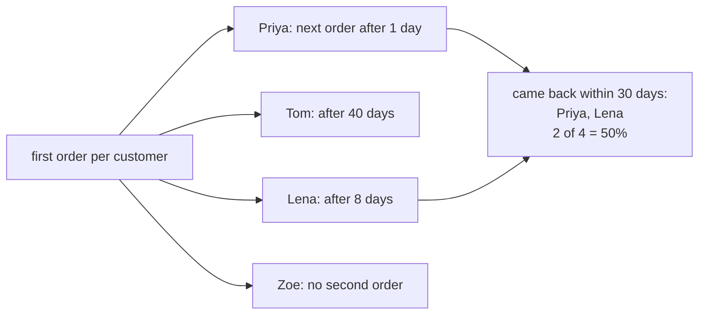

<!-- Written by `npm run lessons` from the lesson data in src/data. Edit the lesson there, not this page. -->

# Retention: who came back within 30 days?

**SQL · Unit 8: SQL interview problems, from easy to hard · Lesson 14 of 16 · Bonus**

> **In one line.** Of the customers who placed an order, what percentage placed another order within 30 days of their first one?

[Open this lesson on the site](https://learn.hamropedia.com/sql/retention-who-came-back-within-30-days/) for its animation, the practice game and tap-to-explain words.

## What the question tests

Cohort-style thinking: anchor each user on their first event, look for a later event within a window, and compute a rate — the core of product and growth analytics interviews.

## The pattern

**Retention (first event, then a later event within N days)** · Hard · tables: `orders`

**How to spot it.** "Retention", "came back", "returned within", "repeat purchase rate", "day-7 / day-30".

## Picture it



*Anchor each customer on their first order, then ask one yes-or-no question: was there another order within 30 days? The share of yeses is the retention rate.*

## How to approach it

1. Find each customer's first order date (MIN per customer).
2. For each customer, check whether any later order falls within 30 days of that first date.
3. Turn that into 1 or 0 per customer (MAX of a CASE).
4. Rate = 100.0 × customers who came back ÷ customers who ordered.

## Solution

<details>
<summary>Show the solution</summary>

**Solution: first date, then a flag per customer**

```sql
WITH firsts AS (
  SELECT customer_id, MIN(order_date) AS first_date
  FROM orders
  GROUP BY customer_id
),
flags AS (
  SELECT f.customer_id,
         MAX(CASE WHEN o.order_date > f.first_date
                   AND julianday(o.order_date) - julianday(f.first_date) <= 30
                  THEN 1 ELSE 0 END) AS came_back
  FROM firsts f
  JOIN orders o ON o.customer_id = f.customer_id
  GROUP BY f.customer_id
)
SELECT COUNT(*) AS customers,
       SUM(came_back) AS came_back_within_30_days,
       ROUND(100.0 * SUM(came_back) / COUNT(*), 1) AS retention_pct
FROM flags;
```

| customers | came_back_within_30_days | retention_pct |
| --- | --- | --- |
| 4 | 2 | 50 |

</details>

## Other correct ways

<details>
<summary>Show them</summary>

**See it per customer with LEAD**

```sql
WITH numbered AS (
  SELECT customer_id, order_date,
         ROW_NUMBER() OVER (PARTITION BY customer_id ORDER BY order_date) AS rn,
         LEAD(order_date) OVER (PARTITION BY customer_id ORDER BY order_date) AS next_date
  FROM orders
)
SELECT c.name, n.order_date AS first_order, n.next_date AS second_order,
       julianday(n.next_date) - julianday(n.order_date) AS gap_days
FROM numbered n
JOIN customers c ON c.customer_id = n.customer_id
WHERE n.rn = 1
ORDER BY c.customer_id;
```

| name | first_order | second_order | gap_days |
| --- | --- | --- | --- |
| Priya | 2024-01-06 | 2024-01-07 | 1 |
| Tom | 2024-01-21 | 2024-03-01 | 40 |
| Lena | 2024-02-12 | 2024-02-20 | 8 |
| Zoe | 2024-03-16 | NULL | NULL |

The gap to the second order shows the answer at a glance: 1 and 8 days are within 30; 40 isn't; Zoe never came back.

</details>

## Edge cases to say out loud

- A second order on the same day as the first: does it count as "coming back"? The solution says no (`>`); ask.
- Customers whose first order is less than 30 days before the end of the data haven't had a full 30 days yet — exclude them from the denominator for a fair rate.
- Should cancelled orders count as activity? Filter by status if not.

## Common mistakes

- Counting any second order, regardless of how long after.
- Dividing whole numbers and getting 0.
- Measuring from sign-up date when the question says first order (or the other way round).

> **Not true:** A customer who places a second order counts as coming back, however long after the first.  
> **In fact:** Only a second order placed within 30 days of the first one counts. The query has to compare the two dates, not just check that a second order exists.

## In the interview

I anchor each customer on their first order, with MIN per customer, and join back to their orders. Then I flag whether any later order falls within 30 days, taking MAX of a CASE so that each customer is one or zero. The retention rate is the sum of flags over the number of customers, times 100.0. I'd raise two definitional points: whether a same-day second order counts, and excluding customers who haven't had a full 30 days yet.

<details>
<summary>&lt;b>How would you compute retention by sign-up month (a cohort table)?&lt;/b></summary>

Add the first-order month to the firsts CTE, group the flags by that month, and compute the rate per cohort.

</details>

<details>
<summary>&lt;b>Why exclude recent customers from the denominator?&lt;/b></summary>

Someone who ordered yesterday hasn't had 30 days to come back; counting them as "not retained" makes the rate look worse than it is.

</details>

## Practise

Write each answer yourself first, then open the answer and compare.

### 1. Explain

Explain why each customer is reduced to a single 1 or 0 before the rate is calculated.

<details>
<summary>Show one good answer</summary>

Because the question is about customers, not orders: "what share of customers came back?". Every customer must count exactly once.

If you worked on order rows instead, Priya, with 5 orders, would count five times and her habits would outweigh everyone else's. So each customer is first reduced to one row with a single flag: 1 if they came back within 30 days, 0 if not (MAX over their orders turns "any qualifying order" into one 1). Then the rate is simple: the sum of the flags (customers who came back) ÷ the count of rows (customers).

</details>

### 2. Write

Compute the share of customers who came back within 7 days.

<details>
<summary>Show one good answer</summary>

Change 30 to 7. Only Priya came back within a week (her second order was the next day). Lena's came 8 days later and Tom's 40 days later, and Zoe has only one order. 1 out of 4 is 25.0%.

```sql
WITH firsts AS (
  SELECT customer_id, MIN(order_date) AS first_date
  FROM orders
  GROUP BY customer_id
),
flags AS (
  SELECT f.customer_id,
         MAX(CASE WHEN o.order_date > f.first_date
                   AND julianday(o.order_date) - julianday(f.first_date) <= 7
                  THEN 1 ELSE 0 END) AS came_back
  FROM firsts f
  JOIN orders o ON o.customer_id = f.customer_id
  GROUP BY f.customer_id
)
SELECT COUNT(*) AS customers,
       SUM(came_back) AS came_back_within_7_days,
       ROUND(100.0 * SUM(came_back) / COUNT(*), 1) AS retention_pct
FROM flags;
```

| customers | came_back_within_7_days | retention_pct |
| --- | --- | --- |
| 4 | 1 | 25 |

</details>

### 3. Predict

What would retention_pct be with a 45-day window?

<details>
<summary>Show one good answer</summary>

75.0. Tom now counts as well: his second order (1 March) came 40 days after his first (21 January), inside 45 days but outside 30. With Priya and Lena, that is 3 of the 4 customers. Zoe still has only one order.

```sql
WITH firsts AS (
  SELECT customer_id, MIN(order_date) AS first_date
  FROM orders
  GROUP BY customer_id
),
flags AS (
  SELECT f.customer_id,
         MAX(CASE WHEN o.order_date > f.first_date
                   AND julianday(o.order_date) - julianday(f.first_date) <= 45
                  THEN 1 ELSE 0 END) AS came_back
  FROM firsts f
  JOIN orders o ON o.customer_id = f.customer_id
  GROUP BY f.customer_id
)
SELECT COUNT(*) AS customers,
       SUM(came_back) AS came_back_within_45_days,
       ROUND(100.0 * SUM(came_back) / COUNT(*), 1) AS retention_pct
FROM flags;
```

| customers | came_back_within_45_days | retention_pct |
| --- | --- | --- |
| 4 | 3 | 75 |

</details>

### 4. Edge cases

Change the solution so only delivered orders count as activity. Who changes?

<details>
<summary>Show one good answer</summary>

Filter to delivered orders once, in a first CTE, and use it in both later steps, so the first order and the return visit are both delivered ones.

Who changes:  
• Lena: her first order (106) was cancelled, so her first delivered order is 107, and she has none after it. She no longer came back.  
• Zoe: her only order is pending, so she has no delivered orders and drops out of the customers counted entirely.  
• Priya (came back) and Tom (didn't) are unchanged.

The rate becomes 1 of 3: 33.3%. The query below shows the flags per customer, to make the change visible.

```sql
WITH delivered AS (
  SELECT customer_id, order_date
  FROM orders
  WHERE status = 'delivered'
),
firsts AS (
  SELECT customer_id, MIN(order_date) AS first_date
  FROM delivered
  GROUP BY customer_id
),
flags AS (
  SELECT f.customer_id,
         MAX(CASE WHEN d.order_date > f.first_date
                   AND julianday(d.order_date) - julianday(f.first_date) <= 30
                  THEN 1 ELSE 0 END) AS came_back
  FROM firsts f
  JOIN delivered d ON d.customer_id = f.customer_id
  GROUP BY f.customer_id
)
SELECT c.name, fl.came_back
FROM flags fl
JOIN customers c ON c.customer_id = fl.customer_id
ORDER BY c.customer_id;
```

| name | came_back |
| --- | --- |
| Priya | 1 |
| Tom | 0 |
| Lena | 0 |

</details>

## Go further (optional)

- PRACTICE · [DataLemur — retention questions](https://datalemur.com/questions) · real interview questions, many free
- WATCH · [Retention and cohort analysis in SQL (video)](https://www.youtube.com/results?search_query=sql%20retention%20cohort%20analysis) · YouTube search, free

---

[← Which products make up 80% of revenue? (share of total)](which-products-make-up-80-of-revenue-share-of-total.md) · [All lessons](../../README.md) · [The median salary →](the-median-salary.md)
