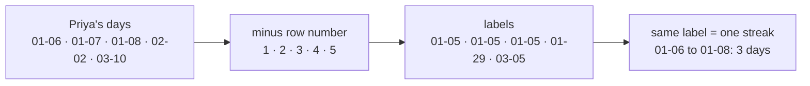

<!-- Written by `npm run lessons` from the lesson data in src/data. Edit the lesson there, not this page. -->

# Streaks: orders on consecutive days (gaps and islands)

**SQL · Unit 8: SQL interview problems, from easy to hard · Lesson 11 of 16 · Should know**

> **In one line.** Find every streak where a customer ordered on two or more consecutive days. Show the customer, the first and last day of the streak, and its length in days.

[Open this lesson on the site](https://learn.hamropedia.com/sql/streaks-orders-on-consecutive-days-gaps-and-islands/) for its animation, the practice game and tap-to-explain words.

## What the question tests

The "gaps and islands" technique, which turns consecutive runs into groups — a favourite hard question for login streaks, consecutive wins and uninterrupted sessions.

## The pattern

**Gaps and islands** · Hard · tables: `orders`, `customers`

**How to spot it.** "Consecutive", "in a row", "streak", "uninterrupted", "longest run".

## Picture it



*Day by day the date goes up by 1 and so does the row number, so their difference stays the same across a run. A gap breaks the run and changes the label.*

## How to approach it

1. Reduce to one row per customer per day (DISTINCT), so two orders on one day don't break the count.
2. Number each customer's days in order with ROW_NUMBER.
3. Subtract the row number from the date (as a day number). Consecutive days give the same result — that value labels the island.
4. Group by customer and that label: MIN date, MAX date and COUNT give the streak. Keep streaks of 2 or more.

## Solution

<details>
<summary>Show the solution</summary>

**Solution: date minus row number**

```sql
WITH days AS (
  SELECT DISTINCT customer_id, order_date
  FROM orders
),
labelled AS (
  SELECT customer_id, order_date,
         julianday(order_date)
           - ROW_NUMBER() OVER (PARTITION BY customer_id ORDER BY order_date) AS island
  FROM days
)
SELECT c.name, MIN(l.order_date) AS streak_start, MAX(l.order_date) AS streak_end,
       COUNT(*) AS days_in_a_row
FROM labelled l
JOIN customers c ON c.customer_id = l.customer_id
GROUP BY l.customer_id, c.name, l.island
HAVING COUNT(*) >= 2
ORDER BY days_in_a_row DESC, c.name;
```

| name | streak_start | streak_end | days_in_a_row |
| --- | --- | --- | --- |
| Priya | 2024-01-06 | 2024-01-08 | 3 |

</details>

## Other correct ways

<details>
<summary>Show them</summary>

**Flag each new streak with LAG, then number the streaks**

```sql
WITH days AS (
  SELECT DISTINCT customer_id, order_date
  FROM orders
),
flagged AS (
  SELECT customer_id, order_date,
         CASE WHEN julianday(order_date)
                 - julianday(LAG(order_date) OVER (PARTITION BY customer_id ORDER BY order_date)) = 1
              THEN 0 ELSE 1 END AS starts_streak
  FROM days
),
numbered AS (
  SELECT customer_id, order_date,
         SUM(starts_streak) OVER (PARTITION BY customer_id ORDER BY order_date) AS streak_id
  FROM flagged
)
SELECT customer_id, MIN(order_date) AS streak_start, MAX(order_date) AS streak_end,
       COUNT(*) AS days_in_a_row
FROM numbered
GROUP BY customer_id, streak_id
HAVING COUNT(*) >= 2
ORDER BY days_in_a_row DESC;
```

| customer_id | streak_start | streak_end | days_in_a_row |
| --- | --- | --- | --- |
| 1 | 2024-01-06 | 2024-01-08 | 3 |

Longer, but easy to explain: a row starts a new streak when yesterday is missing, and a running SUM of those starts numbers the streaks.

</details>

## Edge cases to say out loud

- Several orders on one day: DISTINCT first, or the row numbers jump and break the streak.
- Streaks that cross a month or year: day numbers (julianday, or date arithmetic) handle that; string tricks don't.
- "Longest streak per customer": wrap the result and keep the max length per customer, deciding how to break ties.

## Common mistakes

- Forgetting DISTINCT on (customer, day): two orders on the same day then break the streak.
- Subtracting the row number from a date string instead of a day number.
- Using LAG alone, which finds pairs of consecutive days but not whole streaks.

> **Not true:** Whole streaks: LAG by itself finds where each one starts and ends.  
> **In fact:** LAG finds pairs of days that follow each other, not where a streak starts and ends. Subtracting a row number from the day number gives every day of one streak the same value.

## Other databases

- PostgreSQL: `order_date - (ROW_NUMBER() OVER (…))::int` works directly on DATE values. SQL Server: `DATEADD(day, -ROW_NUMBER() OVER (…), order_date)`.

## In the interview

This is gaps and islands. I first reduce to distinct customer-days. Then I number each customer's days with ROW_NUMBER, and subtract that number from the date. Within a run of consecutive days both go up by one, so the difference is constant and labels the island. Grouping by customer and that label gives each streak's start, end and length, and HAVING keeps the ones of two days or more.

<details>
<summary>&lt;b>How would you find each customer's longest streak?&lt;/b></summary>

Wrap the streak query and use `ROW_NUMBER() OVER (PARTITION BY customer_id ORDER BY days_in_a_row DESC) = 1`, or MAX per customer.

</details>

<details>
<summary>&lt;b>How would you find gaps — periods with no orders?&lt;/b></summary>

Use `LEAD(order_date)` to get the next date, and keep rows where the next date is more than one day later; the gap runs between them.

</details>

## Practise

Write each answer yourself first, then open the answer and compare.

### 1. Explain

Explain, with Priya's dates, why date minus row number is constant inside a streak.

<details>
<summary>Show one good answer</summary>

Priya ordered on 6, 7 and 8 January, 2 February and 10 March. Number them 1 to 5 in date order, and subtract the number from the date:

• 6 Jan − 1 = 5 Jan  
• 7 Jan − 2 = 5 Jan  
• 8 Jan − 3 = 5 Jan  
• 2 Feb − 4 = 29 Jan  
• 10 Mar − 5 = 5 Mar

Inside a streak, the date goes up by one day and the row number goes up by one, so their difference stays the same: 5 January for all three. A gap makes the date jump by more than one while the row number still only goes up by one, so the difference changes. That difference is a label for each island: group by it, and each group is one streak.

</details>

### 2. Write

Find the longest run of consecutive order days across all customers combined.

<details>
<summary>Show one good answer</summary>

Same trick, without PARTITION BY: take every distinct date on which anyone ordered, number them in order, and group by date minus row number. The longest run is 6 to 8 January (3 days, all Priya's). Every other order date stands alone.

```sql
WITH days AS (
  SELECT DISTINCT order_date
  FROM orders
),
labelled AS (
  SELECT order_date,
         julianday(order_date) - ROW_NUMBER() OVER (ORDER BY order_date) AS island
  FROM days
)
SELECT MIN(order_date) AS run_start, MAX(order_date) AS run_end,
       COUNT(*) AS days_in_a_row
FROM labelled
GROUP BY island
ORDER BY days_in_a_row DESC, run_start
LIMIT 1;
```

| run_start | run_end | days_in_a_row |
| --- | --- | --- |
| 2024-01-06 | 2024-01-08 | 3 |

</details>

### 3. Predict

If Priya also ordered on 2024-01-09, what would the solution return?

<details>
<summary>Show one good answer</summary>

One streak for Priya, now 4 days long: 6 to 9 January. 9 January is row 4, and 9 Jan − 4 = 5 Jan, the same label as the other three, so it joins their island.

```sql
INSERT INTO orders VALUES (111, 1, '2024-01-09', 10, 'delivered');
WITH days AS (
  SELECT DISTINCT customer_id, order_date
  FROM orders
),
labelled AS (
  SELECT customer_id, order_date,
         julianday(order_date)
           - ROW_NUMBER() OVER (PARTITION BY customer_id ORDER BY order_date) AS island
  FROM days
)
SELECT c.name, MIN(l.order_date) AS streak_start, MAX(l.order_date) AS streak_end,
       COUNT(*) AS days_in_a_row
FROM labelled l
JOIN customers c ON c.customer_id = l.customer_id
GROUP BY l.customer_id, c.name, l.island
HAVING COUNT(*) >= 2
ORDER BY days_in_a_row DESC, c.name;
```

| name | streak_start | streak_end | days_in_a_row |
| --- | --- | --- | --- |
| Priya | 2024-01-06 | 2024-01-09 | 4 |

</details>

### 4. Edge cases

Add a second order for Priya on 2024-01-07 and show that the solution still gives a 3-day streak. Then remove DISTINCT and see what breaks.

<details>
<summary>Show one good answer</summary>

With DISTINCT, the second order on 7 January collapses into the same day, so the dates are still 6, 7, 8 and the solution still reports one 3-day streak.

Without DISTINCT (below), the days are 6, 7, 7, 8 numbered 1 to 4. The labels become 5 Jan, 5 Jan, 4 Jan, 4 Jan: the repeated day pushes the row number ahead of the date, so the streak splits into two "2-day streaks" (6–7 and 7–8), and 7 January is counted twice. DISTINCT matters because the trick assumes one row per day.

```sql
INSERT INTO orders VALUES (111, 1, '2024-01-07', 10, 'delivered');
WITH days AS (
  SELECT customer_id, order_date
  FROM orders
),
labelled AS (
  SELECT customer_id, order_date,
         julianday(order_date)
           - ROW_NUMBER() OVER (PARTITION BY customer_id ORDER BY order_date) AS island
  FROM days
)
SELECT c.name, MIN(l.order_date) AS streak_start, MAX(l.order_date) AS streak_end,
       COUNT(*) AS days_in_a_row
FROM labelled l
JOIN customers c ON c.customer_id = l.customer_id
GROUP BY l.customer_id, c.name, l.island
HAVING COUNT(*) >= 2
ORDER BY streak_start;
```

| name | streak_start | streak_end | days_in_a_row |
| --- | --- | --- | --- |
| Priya | 2024-01-06 | 2024-01-07 | 2 |
| Priya | 2024-01-07 | 2024-01-08 | 2 |

</details>

## Go further (optional)

- PRACTICE · [DataLemur — consecutive days questions](https://datalemur.com/questions) · real interview questions, many free
- PRACTICE · [LeetCode — Top SQL 50 study plan](https://leetcode.com/studyplan/top-sql-50/) · free account
- WATCH · [SQL gaps and islands (video)](https://www.youtube.com/results?search_query=sql%20gaps%20and%20islands%20problem) · YouTube search, free

---

[← Each customer's first order](each-customers-first-order.md) · [All lessons](../../README.md) · [Products bought together →](products-bought-together.md)
