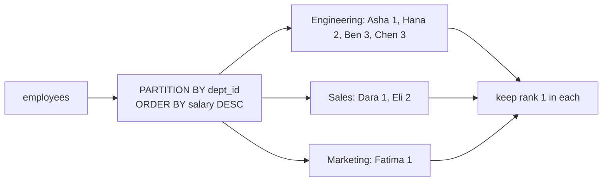

<!-- Written by `npm run lessons` from the lesson data in src/data. Edit the lesson there, not this page. -->

# The highest-paid employee in each department

**SQL · Unit 8: SQL interview problems, from easy to hard · Lesson 7 of 16 · Must know**

> **In one line.** For each department, return the employee (or employees, if tied) with the highest salary. Show the department name, the employee's name and their salary.

[Open this lesson on the site](https://learn.hamropedia.com/sql/the-highest-paid-employee-in-each-department/) for its animation, the practice game and tap-to-explain words.

## What the question tests

The most common window-function question: top N per group, including how to handle ties and how to filter on a window function.

## The pattern

**Top N per group** · Medium · tables: `employees`, `departments`

**How to spot it.** "In each", "per", "for every" together with "highest", "top 3", "most recent", "first".

## Picture it



*Rank inside each department separately, then keep the rows ranked 1. Every department gets its own number one.*

## How to approach it

1. Ask: if two people tie for top salary in a department, show both? (Yes here.)
2. Rank employees within each department by salary, highest first: `RANK() OVER (PARTITION BY dept_id ORDER BY salary DESC)`.
3. RANK keeps ties together; ROW_NUMBER would pick one at random.
4. Do the ranking in a CTE, then keep rank 1 outside it, and join departments for the name.

## Solution

<details>
<summary>Show the solution</summary>

**Solution: RANK in a CTE, filter outside**

```sql
WITH ranked AS (
  SELECT d.dept_name, e.name, e.salary,
         RANK() OVER (PARTITION BY e.dept_id ORDER BY e.salary DESC) AS rnk
  FROM employees e
  JOIN departments d ON d.dept_id = e.dept_id
)
SELECT dept_name, name, salary
FROM ranked
WHERE rnk = 1
ORDER BY dept_name;
```

| dept_name | name | salary |
| --- | --- | --- |
| Engineering | Asha | 95000 |
| Marketing | Fatima | 52000 |
| Sales | Dara | 60000 |

</details>

## Other correct ways

<details>
<summary>Show them</summary>

**Without window functions: match the department maximum**

```sql
SELECT d.dept_name, e.name, e.salary
FROM employees e
JOIN departments d ON d.dept_id = e.dept_id
WHERE e.salary = (
  SELECT MAX(e2.salary)
  FROM employees e2
  WHERE e2.dept_id = e.dept_id
)
ORDER BY d.dept_name;
```

| dept_name | name | salary |
| --- | --- | --- |
| Engineering | Asha | 95000 |
| Marketing | Fatima | 52000 |
| Sales | Dara | 60000 |

Also keeps ties. Harder to extend to "top 3" than the window version.

</details>

## Edge cases to say out loud

- Ties for the top: RANK (or DENSE_RANK) returns all of them; ROW_NUMBER returns one.
- Departments with no employees (HR): not in the result. Ask whether they should appear with NULLs (then LEFT JOIN from departments).
- Employees with no department (Gus): dropped by the inner join to departments.

## Common mistakes

- Putting the window function in WHERE.
- `GROUP BY dept_id` with `MAX(salary)` and `name` in SELECT — the name isn't guaranteed to belong to the max.
- Using ROW_NUMBER when ties should all be returned.

> **Not true:** `SELECT dept_id, name, MAX(salary) … GROUP BY dept_id` returns the name of each department's top earner.  
> **In fact:** The name is not tied to the maximum: most databases reject the query, and the rest may show any name from the group. Rank the rows with a window function instead.

## In the interview

This is top-N-per-group. I rank employees within each department with RANK partitioned by department and ordered by salary descending, in a CTE, then filter to rank one outside — window functions can't go in WHERE. I use RANK so tied top earners are all returned; if they wanted exactly one per department I'd switch to ROW_NUMBER with a tiebreaker. For "top three salaries" I'd use DENSE_RANK less than or equal to three.

<details>
<summary>&lt;b>How would you return the top 3 salaries in each department?&lt;/b></summary>

`DENSE_RANK() OVER (PARTITION BY dept_id ORDER BY salary DESC) <= 3`, so that three different salary amounts are covered, with ties.

</details>

<details>
<summary>&lt;b>Why not GROUP BY dept_id with `MAX(salary)`?&lt;/b></summary>

That gives the top amount per department, but not who earns it. You would have to join back, and that is the alternative solution.

</details>

## Practise

Write each answer yourself first, then open the answer and compare.

### 1. Explain

Explain why the rank must be computed in a CTE and filtered outside.

<details>
<summary>Show one good answer</summary>

Because of the order a query runs in. WHERE runs before SELECT, and window functions like RANK are worked out in the SELECT step. So when WHERE runs, the rank doesn't exist yet, and `WHERE RANK() OVER (…) = 1` is an error.

The fix is two steps: a CTE (or subquery) works out the rank for every row, and the outer query, which runs afterwards, filters on it like an ordinary column. (Some databases, such as Snowflake and BigQuery, add QUALIFY to filter on a window function directly.)

</details>

### 2. Write

Return the two highest-paid employees in each department, including ties.

<details>
<summary>Show one good answer</summary>

Same as the solution, with `rnk <= 2`. RANK keeps ties: if two people shared second place, both would be included. Here Engineering gives Asha and Hana (Ben and Chen tie for third, so they are out), Sales gives Dara and Eli, and Marketing has only Fatima.

```sql
WITH ranked AS (
  SELECT d.dept_name, e.name, e.salary,
         RANK() OVER (PARTITION BY e.dept_id ORDER BY e.salary DESC) AS rnk
  FROM employees e
  JOIN departments d ON d.dept_id = e.dept_id
)
SELECT dept_name, name, salary, rnk
FROM ranked
WHERE rnk <= 2
ORDER BY dept_name, rnk, name;
```

| dept_name | name | salary | rnk |
| --- | --- | --- | --- |
| Engineering | Asha | 95000 | 1 |
| Engineering | Hana | 80000 | 2 |
| Marketing | Fatima | 52000 | 1 |
| Sales | Dara | 60000 | 1 |
| Sales | Eli | 45000 | 2 |

</details>

### 3. Predict

What does the solution return if Hana's salary becomes 95000?

<details>
<summary>Show one good answer</summary>

Engineering now has two rows: Asha and Hana both earn 95,000, so both get rank 1. Marketing (Fatima) and Sales (Dara) are unchanged. 4 rows in all.

The ORDER BY below adds name, so the two Engineering rows always come out in the same order.

```sql
UPDATE employees SET salary = 95000 WHERE name = 'Hana';
WITH ranked AS (
  SELECT d.dept_name, e.name, e.salary,
         RANK() OVER (PARTITION BY e.dept_id ORDER BY e.salary DESC) AS rnk
  FROM employees e
  JOIN departments d ON d.dept_id = e.dept_id
)
SELECT dept_name, name, salary
FROM ranked
WHERE rnk = 1
ORDER BY dept_name, name;
```

| dept_name | name | salary |
| --- | --- | --- |
| Engineering | Asha | 95000 |
| Engineering | Hana | 95000 |
| Marketing | Fatima | 52000 |
| Sales | Dara | 60000 |

</details>

### 4. Edge cases

Change the query so HR appears with NULL name and salary.

<details>
<summary>Show one good answer</summary>

Start from departments and LEFT JOIN employees, and partition by d.dept_id (not e.dept_id, which is NULL for HR). HR gets one row with NULL name and salary; it is the only row in its partition, so its rank is 1 and it survives the filter.

```sql
WITH ranked AS (
  SELECT d.dept_name, e.name, e.salary,
         RANK() OVER (PARTITION BY d.dept_id ORDER BY e.salary DESC) AS rnk
  FROM departments d
  LEFT JOIN employees e ON e.dept_id = d.dept_id
)
SELECT dept_name, name, salary
FROM ranked
WHERE rnk = 1
ORDER BY dept_name;
```

| dept_name | name | salary |
| --- | --- | --- |
| Engineering | Asha | 95000 |
| HR | NULL | NULL |
| Marketing | Fatima | 52000 |
| Sales | Dara | 60000 |

</details>

## Go further (optional)

- PRACTICE · [LeetCode — Top SQL 50 study plan](https://leetcode.com/studyplan/top-sql-50/) · free account
- PRACTICE · [DataLemur — top N per group questions](https://datalemur.com/questions) · real interview questions, many free
- READ · [Mode SQL Tutorial — SQL Window Functions](https://mode.com/sql-tutorial/) · Mode, free

---

[← Find duplicate emails, then remove the duplicates](find-duplicate-emails-then-remove-the-duplicates.md) · [All lessons](../../README.md) · [Employees paid above their department's average →](employees-paid-above-their-departments-average.md)
