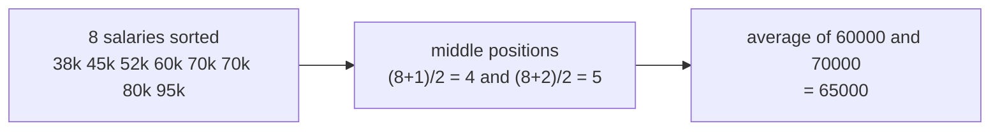

<!-- Written by `npm run lessons` from the lesson data in src/data. Edit the lesson there, not this page. -->

# The median salary

**SQL · Unit 8: SQL interview problems, from easy to hard · Lesson 15 of 16 · Bonus**

> **In one line.** Find the median salary of all employees, and then the median salary in each department.

[Open this lesson on the site](https://learn.hamropedia.com/sql/the-median-salary/) for its animation, the practice game and tap-to-explain words.

## What the question tests

Whether you can build a statistic that SQL doesn't always provide, using row numbers and counts — and handle both odd and even group sizes.

## The pattern

**Median with ROW_NUMBER and COUNT** · Hard · tables: `employees`

**How to spot it.** "Median", "middle value", "50th percentile".

## Picture it



*With an even number of rows there are two middle values, and the median is their average. With an odd number, both formulas point at the same single row.*

## How to approach it

1. Sort the salaries and number them 1 to n with ROW_NUMBER; get n with `COUNT(*) OVER ()`.
2. The middle positions are (n + 1) / 2 and (n + 2) / 2 using whole-number division: the same row when n is odd, the two middle rows when n is even.
3. Average the salaries at those positions.
4. For each department, add PARTITION BY dept_id to both window functions and GROUP BY dept_id.

## Solution

<details>
<summary>Show the solution</summary>

**Solution: row numbers and a count**

```sql
WITH ordered AS (
  SELECT salary,
         ROW_NUMBER() OVER (ORDER BY salary) AS rn,
         COUNT(*) OVER () AS n
  FROM employees
)
SELECT AVG(salary) AS median_salary
FROM ordered
WHERE rn IN ((n + 1) / 2, (n + 2) / 2);
```

| median_salary |
| --- |
| 65000 |

n = 8, so positions 4 and 5: 60000 and 70000, averaging 65000. The average salary is 63750 — the median and the mean are different things.

</details>

## Other correct ways

<details>
<summary>Show them</summary>

**The median in each department**

```sql
WITH ordered AS (
  SELECT dept_id, salary,
         ROW_NUMBER() OVER (PARTITION BY dept_id ORDER BY salary) AS rn,
         COUNT(*) OVER (PARTITION BY dept_id) AS n
  FROM employees
  WHERE dept_id IS NOT NULL
)
SELECT dept_id, AVG(salary) AS median_salary
FROM ordered
WHERE rn IN ((n + 1) / 2, (n + 2) / 2)
GROUP BY dept_id
ORDER BY dept_id;
```

| dept_id | median_salary |
| --- | --- |
| 1 | 75000 |
| 2 | 52500 |
| 3 | 52000 |

Engineering has 4 people (70000, 70000, 80000, 95000): the middle two average 75000.

</details>

## Edge cases to say out loud

- Even vs odd counts: the two-position trick covers both.
- NULL salaries: filter them out before numbering, or they shift the positions.
- Ties in salary don't matter: whichever tied row gets which number, the values at the middle positions are the same.

## Common mistakes

- Using AVG — that is the mean, not the median.
- Taking only position n / 2, which is wrong for odd counts and only half the answer for even counts.
- Decimal division in the position maths ((n + 1) / 2.0), which gives 4.5 and matches no row.

> **Not true:** `AVG(salary)` returns the median salary.  
> **In fact:** AVG returns the mean: the total divided by the count. The median is the middle value once the rows are sorted, and one huge salary moves the mean far more than the median.

## Other databases

- PostgreSQL and Oracle: `PERCENTILE_CONT(0.5) WITHIN GROUP (ORDER BY salary)` gives the median directly; SQL Server has PERCENTILE_CONT as a window function. MySQL and SQLite have no built-in median, so use this pattern.

## In the interview

If the database has PERCENTILE_CONT, the median is PERCENTILE_CONT 0.5 within group ordered by salary. Otherwise I number the sorted values with ROW_NUMBER, and get the count n with COUNT over the same window. Then I average the values at positions n plus one over two and n plus two over two, using integer division. That is the single middle row for odd n, and the two middle rows for even n. Partitioning both window functions gives a median per group.

<details>
<summary>&lt;b>Median or mean — when does the difference matter?&lt;/b></summary>

When the data is skewed: one very high salary pulls the mean up but barely moves the median.

</details>

<details>
<summary>&lt;b>How would you get the 90th percentile?&lt;/b></summary>

`PERCENTILE_CONT(0.9) WITHIN GROUP (ORDER BY salary)` where available; otherwise the row at position `CEIL(0.9 × n)` with the same ROW_NUMBER pattern.

</details>

## Practise

Write each answer yourself first, then open the answer and compare.

### 1. Explain

Explain why positions (n + 1) / 2 and (n + 2) / 2 work for both odd and even n.

<details>
<summary>Show one good answer</summary>

Both use whole-number division, which drops the fraction.

• Odd n, say 7: (7 + 1) / 2 = 4 and (7 + 2) / 2 = 9 / 2 = 4. Both point at row 4, the single middle row, and the average of one value is that value.  
• Even n, say 8: (8 + 1) / 2 = 9 / 2 = 4 and (8 + 2) / 2 = 5. They point at rows 4 and 5, the two middle rows, and AVG gives the halfway point between them, which is the median of an even list.

So one formula covers both cases, with no CASE needed.

</details>

### 2. Write

Find the median order amount, ignoring the order with no amount.

<details>
<summary>Show one good answer</summary>

Filter the NULL out before numbering, so it neither takes a position nor counts in n. 9 amounts remain: 30, 33, 45, 60, 75, 80, 120, 150, 200. n is 9, so the median is row 5: 75.

```sql
WITH ordered AS (
  SELECT amount,
         ROW_NUMBER() OVER (ORDER BY amount) AS rn,
         COUNT(*) OVER () AS n
  FROM orders
  WHERE amount IS NOT NULL
)
SELECT AVG(amount) AS median_amount
FROM ordered
WHERE rn IN ((n + 1) / 2, (n + 2) / 2);
```

| median_amount |
| --- |
| 75 |

</details>

### 3. Predict

What is the median salary if Asha leaves (7 employees)?

<details>
<summary>Show one good answer</summary>

60,000. The 7 remaining salaries in order are 38,000, 45,000, 52,000, 60,000, 70,000, 70,000 and 80,000. n is odd, so the median is the 4th: Dara's 60,000. (With all 8 it was 65,000, the average of 60,000 and 70,000.)

Asha can't simply be deleted below, because other employees' manager_id points at her, so the query leaves her out with a WHERE instead.

```sql
WITH ordered AS (
  SELECT salary,
         ROW_NUMBER() OVER (ORDER BY salary) AS rn,
         COUNT(*) OVER () AS n
  FROM employees
  WHERE name <> 'Asha'
)
SELECT AVG(salary) AS median_salary
FROM ordered
WHERE rn IN ((n + 1) / 2, (n + 2) / 2);
```

| median_salary |
| --- |
| 60000 |

</details>

### 4. Edge cases

What happens to the median calculation if one salary is NULL and you don't filter it out?

<details>
<summary>Show one good answer</summary>

The median comes out wrong, without any error. The NULL still gets a row number (SQLite sorts NULLs first, so it takes position 1) and is counted in n, so every real value is pushed one place along and the middle is picked at the wrong spot. If the NULL itself lands in the middle, AVG skips it and averages whatever else is there.

The salary column can't be NULL here, so the query below does it with order amounts, which have one NULL. With it, n is 10 and the middle rows are 60 and 75, giving 67.5; the true median of the 9 real amounts is 75. Always filter `WHERE x IS NOT NULL` first, as AVG and COUNT(column) do automatically.

```sql
WITH ordered AS (
  SELECT amount,
         ROW_NUMBER() OVER (ORDER BY amount) AS rn,
         COUNT(*) OVER () AS n
  FROM orders
)
SELECT AVG(amount) AS median_with_the_null
FROM ordered
WHERE rn IN ((n + 1) / 2, (n + 2) / 2);
```

| median_with_the_null |
| --- |
| 67.5 |

</details>

## Go further (optional)

- READ · [PostgreSQL docs — Ordered-Set Aggregate Functions (PERCENTILE_CONT)](https://www.postgresql.org/docs/current/functions-aggregate.html#FUNCTIONS-ORDEREDSET-TABLE) · official documentation, free
- PRACTICE · [DataLemur — median questions](https://datalemur.com/questions) · real interview questions, many free

---

[← Retention: who came back within 30 days?](retention-who-came-back-within-30-days.md) · [All lessons](../../README.md) · [Customers who bought every product in a category →](customers-who-bought-every-product-in-a-category.md)
