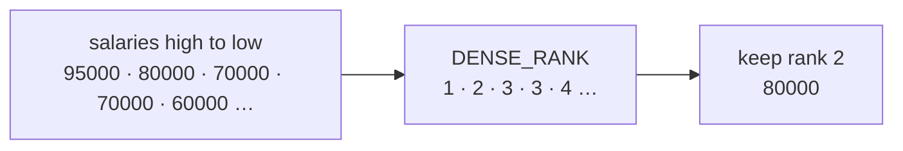

<!-- Written by `npm run lessons` from the lesson data in src/data. Edit the lesson there, not this page. -->

# The second highest salary (and the Nth)

**SQL · Unit 8: SQL interview problems, from easy to hard · Lesson 3 of 16 · Must know**

> **In one line.** Return the second highest salary from employees. If there is no second highest salary, return NULL.

[Open this lesson on the site](https://learn.hamropedia.com/sql/the-second-highest-salary-and-the-nth/) for its animation, the practice game and tap-to-explain words.

## What the question tests

Whether you think about ties and about "no answer". LIMIT 1 OFFSET 1 is wrong when two people share the top salary, and many answers return no row at all instead of NULL.

## The pattern

**Nth highest value** · Easy · tables: `employees`

**How to spot it.** The words "second highest", "Nth largest", "third most recent". The answer is a value, not a person, so ties must collapse: think DENSE_RANK or DISTINCT.

## Picture it



*DENSE_RANK gives tied salaries the same rank without leaving gaps, so "rank 2" is always the second-highest different amount.*

## How to approach it

1. Ask: if two people tie for the highest salary, is the "second highest" the next different amount? (Usually yes.)
2. Rank the distinct salaries from highest down, so ties share a rank and no number is skipped.
3. Keep the salary ranked 2.
4. Wrap it so that "no such salary" gives one row containing NULL, not an empty result — an aggregate like MAX does this.

## Solution

<details>
<summary>Show the solution</summary>

**Solution: DENSE_RANK, wrapped in MAX**

```sql
WITH ranked AS (
  SELECT salary,
         DENSE_RANK() OVER (ORDER BY salary DESC) AS rnk
  FROM employees
)
SELECT MAX(salary) AS second_highest
FROM ranked
WHERE rnk = 2;
```

| second_highest |
| --- |
| 80000 |

MAX over no rows returns NULL, so if there were no second salary you would still get one row with NULL. Change 2 to N for the Nth highest.

</details>

## Other correct ways

<details>
<summary>Show them</summary>

**Without window functions: the highest below the highest**

```sql
SELECT MAX(salary) AS second_highest
FROM employees
WHERE salary < (SELECT MAX(salary) FROM employees);
```

| second_highest |
| --- |
| 80000 |

Short and clear for "second", but it doesn't generalise neatly to the Nth.

---

**DISTINCT with LIMIT and OFFSET, inside a scalar subquery**

```sql
SELECT (
  SELECT DISTINCT salary
  FROM employees
  ORDER BY salary DESC
  LIMIT 1 OFFSET 1
) AS second_highest;
```

| second_highest |
| --- |
| 80000 |

DISTINCT makes ties collapse; the outer SELECT turns "no row" into NULL.

</details>

## Edge cases to say out loud

- Ties for first: two people on 95000 — the answer is still the next different salary, 80000.
- Fewer than two different salaries: return NULL, not an empty result.
- NULL salaries: ignored by ranking and MAX, which is usually what you want — say so.

## Common mistakes

- `ORDER BY salary DESC LIMIT 1 OFFSET 1` without DISTINCT: returns the top salary again when two people tie for first.
- Using RANK: after a tie for first, there is no rank 2.
- Returning an empty result when the question asked for NULL.

> **Not true:** `ORDER BY salary DESC LIMIT 1 OFFSET 1`: the second highest salary, ties or no ties.  
> **In fact:** When two people tie for first place, the second row is the top salary again. Add DISTINCT, or use DENSE_RANK.

## In the interview

I first confirm that ties should collapse, so the second highest is the second different amount. Then I rank salaries with DENSE_RANK in descending order — dense so a tie doesn't skip a number — and take rank 2. I wrap it in MAX so that if there is no second salary I return a single NULL instead of no rows, and for the Nth highest I just change the 2.

<details>
<summary>&lt;b>How would you return the employees who earn the second highest salary?&lt;/b></summary>

Keep the DENSE_RANK CTE with names in it and select every row `WHERE rnk = 2`.

</details>

<details>
<summary>&lt;b>Why DENSE_RANK and not RANK?&lt;/b></summary>

With RANK, a tie at the top makes the next rank 3, so rank 2 would not exist.

</details>

## Practise

Write each answer yourself first, then open the answer and compare.

### 1. Explain

Explain why LIMIT 1 OFFSET 1 can give the wrong answer here, using a tie example.

<details>
<summary>Show one good answer</summary>

`ORDER BY salary DESC LIMIT 1 OFFSET 1` takes the second row, not the second salary. With a tie at the top, the second row has the same salary as the first.

If Hana's salary were 95,000 too, the sorted salaries would be 95,000, 95,000, 70,000… The second row is 95,000: the highest again, not the second highest (which is 70,000). The query below makes that change and shows the wrong answer.

It has a second problem: when there is no second row, it returns no rows at all, while the question asks for NULL. `SELECT DISTINCT` inside a scalar subquery fixes both, and DENSE_RANK = 2 is clearer still.

```sql
UPDATE employees SET salary = 95000 WHERE name = 'Hana';
SELECT salary AS not_second_highest
FROM employees
ORDER BY salary DESC
LIMIT 1 OFFSET 1;
```

| not_second_highest |
| --- |
| 95000 |

</details>

### 2. Write

Return the third highest salary, and then the second highest salary within each department.

<details>
<summary>Show one good answer</summary>

The third highest is the same query with `WHERE rnk = 3`: 70,000 (after 95,000 and 80,000; Ben and Chen share it, and DENSE_RANK counts it once).

Per department, add PARTITION BY dept_id so each department ranks its own salaries. Starting from departments with a LEFT JOIN, and putting `rnk = 2` in the ON, keeps departments with no second salary: Marketing (only Fatima) and HR (nobody) show NULL, as the original question asks.

```sql
WITH ranked AS (
  SELECT dept_id, salary,
         DENSE_RANK() OVER (PARTITION BY dept_id ORDER BY salary DESC) AS rnk
  FROM employees
  WHERE dept_id IS NOT NULL
)
SELECT d.dept_name, MAX(r.salary) AS second_highest
FROM departments d
LEFT JOIN ranked r ON r.dept_id = d.dept_id AND r.rnk = 2
GROUP BY d.dept_id, d.dept_name
ORDER BY d.dept_id;
```

| dept_name | second_highest |
| --- | --- |
| Engineering | 80000 |
| Sales | 45000 |
| Marketing | NULL |
| HR | NULL |

</details>

### 3. Predict

If Hana's salary were changed to 95000, what would the solution return?

<details>
<summary>Show one good answer</summary>

70,000. Asha and Hana would both be on 95,000, and DENSE_RANK gives them both rank 1. The next different salary, 70,000 (Ben and Chen), gets rank 2.

```sql
UPDATE employees SET salary = 95000 WHERE name = 'Hana';
WITH ranked AS (
  SELECT salary,
         DENSE_RANK() OVER (ORDER BY salary DESC) AS rnk
  FROM employees
)
SELECT MAX(salary) AS second_highest
FROM ranked
WHERE rnk = 2;
```

| second_highest |
| --- |
| 70000 |

</details>

### 4. Edge cases

What does your query return on an empty employees table? Make sure it is one row with NULL.

<details>
<summary>Show one good answer</summary>

One row, with NULL. That is why the solution wraps the result in MAX: an aggregate with no GROUP BY always returns exactly one row, even when no rows match, and MAX of nothing is NULL.

Without the MAX (`SELECT salary FROM ranked WHERE rnk = 2`), an empty table would return no rows at all. Below, every employee is deleted first.

```sql
DELETE FROM employees;
WITH ranked AS (
  SELECT salary,
         DENSE_RANK() OVER (ORDER BY salary DESC) AS rnk
  FROM employees
)
SELECT MAX(salary) AS second_highest
FROM ranked
WHERE rnk = 2;
```

| second_highest |
| --- |
| NULL |

</details>

## Go further (optional)

- PRACTICE · [LeetCode — Top SQL 50 study plan](https://leetcode.com/studyplan/top-sql-50/) · free account
- PRACTICE · [DataLemur — second highest salary](https://datalemur.com/questions) · real interview questions, many free

---

[← Quick-fire SQL theory questions](quick-fire-sql-theory-questions.md) · [All lessons](../../README.md) · [Employees who earn more than their manager →](employees-who-earn-more-than-their-manager.md)
