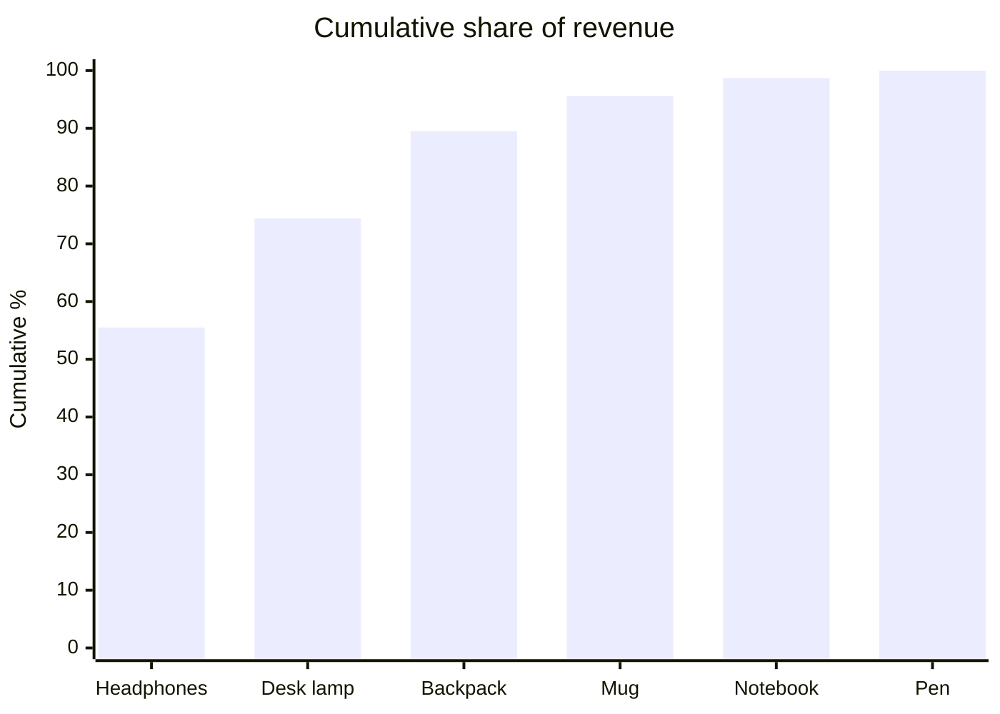

<!-- Written by `npm run lessons` from the lesson data in src/data. Edit the lesson there, not this page. -->

# Which products make up 80% of revenue? (share of total)

**SQL · Unit 8: SQL interview problems, from easy to hard · Lesson 13 of 16 · Should know**

> **In one line.** Show each product's revenue, its percentage of total revenue, and the running (cumulative) percentage from the best seller down. Then list the products that bring in the first 80% of revenue.

[Open this lesson on the site](https://learn.hamropedia.com/sql/which-products-make-up-80-of-revenue-share-of-total/) for its animation, the practice game and tap-to-explain words.

## What the question tests

Window aggregates over the whole result (share of total), a running total with an explicit ROWS frame, and turning a cumulative share into a filter — the classic Pareto analysis.

## The pattern

**Share of total and cumulative share** · Medium · tables: `order_items`, `products`

**How to spot it.** "Percentage of total", "share", "contribution", "cumulative", "top products making up X%".

## Picture it



*Sorted from best seller down, the running share climbs fast and then flattens. The first three products already pass 80% — that is the Pareto pattern.*

## How to approach it

1. Total revenue per product in a CTE: `SUM(quantity × price)`.
2. Share of total: revenue ÷ `SUM(revenue) OVER ()`, times 100.0.
3. Cumulative share: a running SUM ordered by revenue descending, with ROWS UNBOUNDED PRECEDING, divided by the total.
4. For "the first 80%": keep products whose revenue before them is still under 80% of the total.

## Solution

<details>
<summary>Show the solution</summary>

**Solution: share and running share with window functions**

```sql
WITH product_revenue AS (
  SELECT p.product_name, SUM(oi.quantity * p.price) AS revenue
  FROM order_items oi
  JOIN products p ON p.product_id = oi.product_id
  GROUP BY p.product_name
)
SELECT product_name, revenue,
       ROUND(100.0 * revenue / SUM(revenue) OVER (), 1) AS pct_of_total,
       ROUND(100.0 * SUM(revenue) OVER (ORDER BY revenue DESC ROWS UNBOUNDED PRECEDING)
             / SUM(revenue) OVER (), 1) AS cumulative_pct
FROM product_revenue
ORDER BY revenue DESC;
```

| product_name | revenue | pct_of_total | cumulative_pct |
| --- | --- | --- | --- |
| Headphones | 440 | 55.5 | 55.5 |
| Desk lamp | 150 | 18.9 | 74.4 |
| Backpack | 120 | 15.1 | 89.5 |
| Mug | 48 | 6.1 | 95.6 |
| Notebook | 25 | 3.2 | 98.7 |
| Pen | 10 | 1.3 | 100 |

</details>

## Other correct ways

<details>
<summary>Show them</summary>

**The products that make up the first 80%**

```sql
WITH product_revenue AS (
  SELECT p.product_name, SUM(oi.quantity * p.price) AS revenue
  FROM order_items oi
  JOIN products p ON p.product_id = oi.product_id
  GROUP BY p.product_name
),
running AS (
  SELECT product_name, revenue,
         SUM(revenue) OVER (ORDER BY revenue DESC ROWS UNBOUNDED PRECEDING) - revenue AS revenue_before
  FROM product_revenue
)
SELECT product_name, revenue
FROM running
WHERE revenue_before < 0.8 * (SELECT SUM(revenue) FROM product_revenue)
ORDER BY revenue DESC;
```

| product_name | revenue |
| --- | --- |
| Headphones | 440 |
| Desk lamp | 150 |
| Backpack | 120 |

A product is in the first 80% if the revenue before it hadn't reached 80% yet. Backpack starts at 74.4%, so it is the one that crosses the line.

</details>

## Edge cases to say out loud

- Ties in revenue: the running total needs a tiebreaker (e.g. product name), or tied products share a RANGE frame.
- Products that never sold (the phone case) don't appear; LEFT JOIN from products if they should show 0%.
- Rounding: the rounded percentages may not add up to exactly 100.

## Common mistakes

- Integer division: `revenue / SUM(revenue) OVER ()` gives 0 for every row unless you multiply by 100.0 first.
- Leaving the frame as the default RANGE, so tied revenues get the same cumulative value.
- Filtering `cumulative_pct <= 80`, which drops the product that crosses 80% — usually it should be included.

> **Not true:** Filtering on `cumulative_pct <= 80` keeps the product that takes the running total past 80%.  
> **In fact:** That product's own running share is already above 80, so the filter drops it. Usually it belongs in the answer: keep each product whose running total before it was still under 80%.

## In the interview

I total revenue per product in a CTE, then divide each by SUM over an empty window for the share of total. For the cumulative share I use a running SUM, ordered by revenue descending, with an explicit ROWS frame. To list the products making up the first 80%, I keep those whose revenue before them is still under 80% of the total, which includes the product that crosses the line.

<details>
<summary>&lt;b>How would you show each product's share within its own category?&lt;/b></summary>

Divide by `SUM(revenue) OVER (PARTITION BY category)` instead of `OVER ()`.

</details>

<details>
<summary>&lt;b>Why ROWS UNBOUNDED PRECEDING rather than the default?&lt;/b></summary>

The default RANGE frame lumps tied values together; ROWS adds one product at a time.

</details>

## Practise

Write each answer yourself first, then open the answer and compare.

### 1. Explain

Explain the difference between the pct_of_total and cumulative_pct columns.

<details>
<summary>Show one good answer</summary>

pct_of_total is each product on its own: its revenue ÷ total revenue. The headphones bring in 440 of 793, so 55.5%. These add up to 100% across all rows.

cumulative_pct is a running total: this product plus every product above it in the list, ÷ total revenue. It only grows as you go down: 55.5% after the headphones, 74.4% once the desk lamp is added, 89.5% after the backpack, and 100% at the last row. It answers "how much of revenue do the top N products bring in?", which is what the 80% question needs.

</details>

### 2. Write

Do the same analysis for customers: each customer's share of total spend and the cumulative share.

<details>
<summary>Show one good answer</summary>

Same structure, with customers instead of products: total each customer's spend, then divide by the grand total (empty OVER) and by the running total (ordered OVER). Priya alone is 53.6% of all spending, and Priya and Tom together are 88.3%.

```sql
WITH customer_spend AS (
  SELECT c.name, SUM(o.amount) AS spend
  FROM orders o
  JOIN customers c ON c.customer_id = o.customer_id
  GROUP BY c.customer_id, c.name
)
SELECT name, spend,
       ROUND(100.0 * spend / SUM(spend) OVER (), 1) AS pct_of_total,
       ROUND(100.0 * SUM(spend) OVER (ORDER BY spend DESC ROWS UNBOUNDED PRECEDING)
             / SUM(spend) OVER (), 1) AS cumulative_pct
FROM customer_spend
ORDER BY spend DESC;
```

| name | spend | pct_of_total | cumulative_pct |
| --- | --- | --- | --- |
| Priya | 425 | 53.6 | 53.6 |
| Tom | 275 | 34.7 | 88.3 |
| Lena | 60 | 7.6 | 95.8 |
| Zoe | 33 | 4.2 | 100 |

</details>

### 3. Predict

Which products would be in "the first 90% of revenue"?

<details>
<summary>Show one good answer</summary>

Headphones, desk lamp, backpack and mug.

The first three only reach 89.5%, just short of 90%, so you need the mug too (it takes the total to 95.6%). The rule in the alternative query is "keep a product if the revenue before it was still under the target"; with 0.9 instead of 0.8, the mug passes (89.5% before it) and the notebook doesn't (95.6% before it).

```sql
WITH product_revenue AS (
  SELECT p.product_name, SUM(oi.quantity * p.price) AS revenue
  FROM order_items oi
  JOIN products p ON p.product_id = oi.product_id
  GROUP BY p.product_name
),
running AS (
  SELECT product_name, revenue,
         SUM(revenue) OVER (ORDER BY revenue DESC ROWS UNBOUNDED PRECEDING) - revenue AS revenue_before
  FROM product_revenue
)
SELECT product_name, revenue
FROM running
WHERE revenue_before < 0.9 * (SELECT SUM(revenue) FROM product_revenue)
ORDER BY revenue DESC;
```

| product_name | revenue |
| --- | --- |
| Headphones | 440 |
| Desk lamp | 150 |
| Backpack | 120 |
| Mug | 48 |

</details>

### 4. Edge cases

Make the phone case appear with 0 revenue and 0%, without breaking the cumulative column.

<details>
<summary>Show one good answer</summary>

Start from products with a LEFT JOIN, so the phone case has a row, and COALESCE its NULL revenue to 0. A zero adds nothing to any sum, so the totals and the running column are unchanged: the phone case sorts last, with 0% and a cumulative 100%.

Add product_name to both ORDER BYs (the window's and the query's). That way two products with equal revenue, such as several unsold ones at 0, always come out in the same order, and the running total doesn't depend on chance.

```sql
WITH product_revenue AS (
  SELECT p.product_name, COALESCE(SUM(oi.quantity * p.price), 0) AS revenue
  FROM products p
  LEFT JOIN order_items oi ON oi.product_id = p.product_id
  GROUP BY p.product_name
)
SELECT product_name, revenue,
       ROUND(100.0 * revenue / SUM(revenue) OVER (), 1) AS pct_of_total,
       ROUND(100.0 * SUM(revenue) OVER (ORDER BY revenue DESC, product_name ROWS UNBOUNDED PRECEDING)
             / SUM(revenue) OVER (), 1) AS cumulative_pct
FROM product_revenue
ORDER BY revenue DESC, product_name;
```

| product_name | revenue | pct_of_total | cumulative_pct |
| --- | --- | --- | --- |
| Headphones | 440 | 55.5 | 55.5 |
| Desk lamp | 150 | 18.9 | 74.4 |
| Backpack | 120 | 15.1 | 89.5 |
| Mug | 48 | 6.1 | 95.6 |
| Notebook | 25 | 3.2 | 98.7 |
| Pen | 10 | 1.3 | 100 |
| Phone case | 0 | 0 | 100 |

</details>

## Go further (optional)

- PRACTICE · [DataLemur — percentage of total questions](https://datalemur.com/questions) · real interview questions, many free
- READ · [Mode SQL Tutorial — SQL Window Functions](https://mode.com/sql-tutorial/) · Mode, free

---

[← Products bought together](products-bought-together.md) · [All lessons](../../README.md) · [Retention: who came back within 30 days? →](retention-who-came-back-within-30-days.md)
