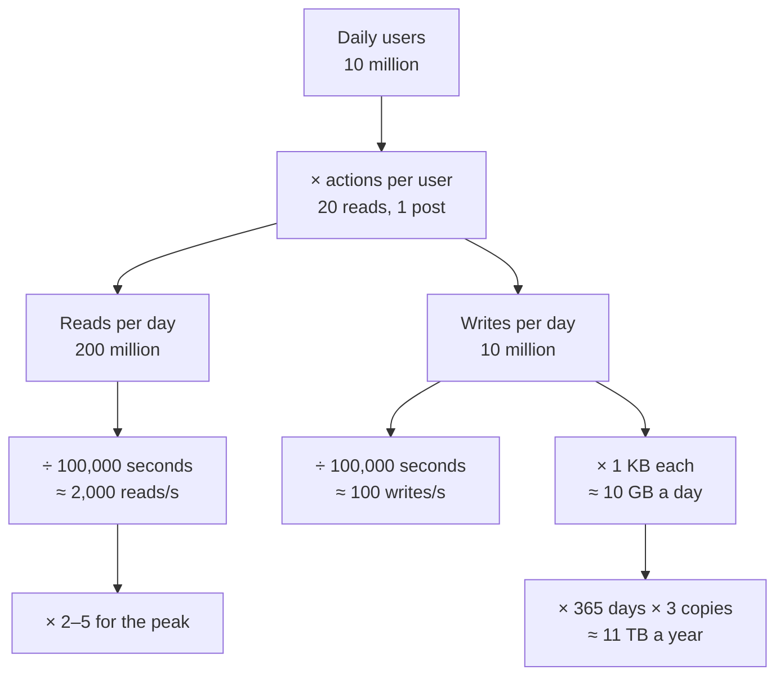

<!-- Written by `npm run lessons` from the lesson data in src/data. Edit the lesson there, not this page. -->

# Back-of-the-envelope estimation

**System Design · Unit 0: How system design interviews work · Lesson 3 of 4 · Must know**

> **In one line.** Quick, rough maths to estimate traffic, storage and bandwidth, so your design decisions are based on scale.

[Open this lesson on the site](https://learn.hamropedia.com/system-design/back-of-the-envelope-estimation/) for its animation, the practice game and tap-to-explain words.

## The problem it solves

Without numbers you can't tell whether one server is enough or you need a hundred. Estimation turns a vague 'big app' into numbers that decide the design.

## The idea

You turn the number of users into requests per second (QPS), storage per day and per year, and bandwidth. Rough is fine. A day has 86,400 seconds, about 100,000, so 1 million requests a day is about 12 per second. Peak traffic is often 2–5 times the average.

## How it works, step by step

1. Start from users: daily active users × actions per user per day = actions per day.
2. Divide by about 100,000 (the seconds in a day, rounded) to get the average per second, then multiply by 2–5 for the peak.
3. Split reads and writes. Example: 10 million users each read 20 pages and post 1 item a day → 200 million reads (about 2,000 a second) and 10 million writes (about 100 a second).
4. Storage: writes per day × size of each item × days kept. 10 million posts × 1 KB = 10 GB a day, about 3.6 TB a year, or about 11 TB with 3 copies.
5. Bandwidth: requests per second × response size. 2,000 reads a second × 100 KB = 200 MB a second going out.
6. Then decide: is that one database or many? Does the hot data fit in a cache's memory? Do we need a CDN?

## Picture it



*Start from users, multiply by actions, divide by about 100,000 seconds in a day for per-second numbers, and multiply by item size for storage.*

## Analogy

Working out how much food to buy for a party: number of guests × how much each person eats, plus extra for the hungry ones (the peak).

**Where the analogy breaks.** Party guests are a fixed number. Real traffic has spikes, like a viral post or a sale, that can be 10 times normal or more, so you design for the peak, not the average.

## Example

A Twitter-like app: 300 million daily users, each posting 2 tweets a day, gives 600 million tweets a day, about 7,000 writes per second on average and maybe 15,000–20,000 at peak. At about 300 bytes each, that's 180 GB of text a day, or about 65 TB a year before media and replication.

## Must know

- Use powers of ten for speed: KB ≈ 10³ bytes, MB ≈ 10⁶, GB ≈ 10⁹, TB ≈ 10¹², PB ≈ 10¹⁵.
- Seconds per day ≈ 10⁵. Requests per day ÷ 10⁵ ≈ requests per second.
- Read-to-write ratio matters: many apps read 10–100 times more than they write, which points to caching and read replicas.
- Latency ladder: memory read ≈ 100 ns; SSD read ≈ 100 µs; round trip inside a datacentre ≈ 0.5 ms; across a continent and back ≈ 100–150 ms.
- Storage = items per day × size × days kept × copies (often 3 for replication).
- Rough capacity: one app server handles thousands of simple requests per second; one SQL database handles thousands to tens of thousands of simple queries per second.

## Common mistakes

- Spending 10 minutes on exact arithmetic. Round hard: 86,400 ≈ 100,000.
- Using the average and forgetting the peak.
- Mixing up bits and bytes: network speeds are in bits, so 1 Gbps ≈ 125 MB a second.
- Working out numbers and then never using them to make a decision.

> **Not true:** 1 Gbps ≈ 1 GB of data a second.  
> **In fact:** Network speeds are given in bits, and a byte is 8 bits. 1 Gbps is about 125 MB a second.

> **Not true:** Sizing: plan for the average load; the peak needs no extra planning.  
> **In fact:** Traffic comes in peaks, often several times the average. Size the system for the peak, or it fails just when it is needed most.

## In the interview

I'll estimate the scale first, because it decides the design. For example, 100 million requests a day is only about 1,200 per second on average, maybe 5,000 at peak. A few load-balanced app servers and one database with read replicas can handle that. If it were 100 times more, I'd plan for sharding and heavy caching.

<details>
<summary>&lt;b>Why multiply by a replication factor?&lt;/b></summary>

Data is usually stored about 3 times for durability and availability, so real disk use is roughly 3 times the raw data.

</details>

<details>
<summary>&lt;b>What if your estimate is wrong?&lt;/b></summary>

That's fine. State your assumptions clearly; the interviewer cares that the design changes sensibly when the numbers change.

</details>

## Practise

Try each one yourself first, then open the answer and compare.

### 1. Explain

Explain why 1 million requests a day is only about 12 requests per second.

<details>
<summary>Show one good answer</summary>

A day has 86,400 seconds, about 100,000. The requests are spread over the whole day, so 1,000,000 ÷ 86,400 ≈ 11.6, about 12 requests a second. (With the rounded 100,000 you get 10, which is close enough.)

"A million a day" sounds big, but 12 a second is easy for one server. Even with a peak of 2 to 5 times the average (25 to 60 a second), one server copes. The lesson: always turn per-day numbers into per-second numbers before deciding anything.

</details>

### 2. Draw

Write the latency ladder (memory, SSD, datacentre round trip, cross-continent round trip) from memory, with rough numbers.

<details>
<summary>Show one good answer</summary>

Each step down is a big jump: memory to SSD is about 1,000 times slower, and a round trip across a continent is about 200 times slower than one inside a datacentre.

What it tells you: keep hot data in memory (a cache); avoid many round trips in a row; and put data near users (CDN, regions), because nothing beats the speed of light across an ocean.

```text
Memory read                ~100 ns
SSD random read            ~100 µs  (0.1 ms)
Round trip, same DC        ~0.5 ms
Round trip, across a
continent and back         ~100–150 ms

(L1 cache ~1 ns; spinning-disk seek ~10 ms)
```

</details>

### 3. Apply

Estimate QPS, storage per year and bandwidth for a photo app with 50 million daily users, each uploading one 2 MB photo a day and viewing 50.

<details>
<summary>Show one good answer</summary>

Assumptions: 50 million daily users; each uploads one 2 MB photo and views 50 a day; a day ≈ 100,000 seconds; peak ≈ 2 to 5 times the average.

QPS  
• Uploads: 50 million a day ÷ 100,000 ≈ 500 a second (578 exactly), so 1,000 to 2,500 at peak.  
• Views: 50 million × 50 = 2.5 billion a day ≈ 25,000 a second (about 29,000 exactly), so 50,000 to 125,000 at peak.  
• Reads outnumber writes 50 to 1.

Storage  
• 50 million × 2 MB = 100 TB a day.  
• × 365 ≈ 36.5 PB a year; × 3 copies ≈ 110 PB a year (before thumbnails).

Bandwidth  
• In: 500 uploads a second × 2 MB ≈ 1 GB a second (8 Gbps).  
• Out: 25,000 views a second × 2 MB ≈ 50 GB a second (400 Gbps) if every view were full size.

What the numbers decide: photos go in object storage, not a database (petabytes); a CDN is essential (400 Gbps can't come from your own servers); serve smaller thumbnails for feeds, which cuts the 50 GB a second hugely; and metadata reads (50:1) want a cache and read replicas.

```python
users = 50e6
uploads_per_s = users / 1e5            # 500
views_per_s = users * 50 / 1e5         # 25,000
tb_per_day = users * 2 / 1e6           # 100 TB (2 MB each)
pb_per_year = tb_per_day * 365 / 1e3   # 36.5 PB
pb_with_copies = pb_per_year * 3       # 109.5 PB
gb_in_per_s = uploads_per_s * 2 / 1e3  # 1 GB/s
gb_out_per_s = views_per_s * 2 / 1e3   # 50 GB/s
print(uploads_per_s, views_per_s, pb_per_year, pb_with_copies, gb_in_per_s, gb_out_per_s)
# 500.0 25000.0 36.5 109.5 1.0 50.0
```

</details>

### 4. Trade-offs

When is detailed estimation a waste of interview time, and when does a number change your design?

<details>
<summary>Show one good answer</summary>

A waste of time when the number can't change any decision:  
• The scale is obviously small (an internal tool, 1,000 users): say "this fits on one server" and move on.  
• Exact arithmetic: 86,400 vs 100,000 never changes a design. Round to powers of ten.  
• Low-level design questions, or when the interviewer tells you to skip it.

A number changes the design when it crosses a limit:  
• Requests per second vs what one machine handles (thousands): one server, or a fleet with a load balancer?  
• Data size vs one database or one machine's memory: one database, or sharding? Does the hot set fit in a cache?  
• Read-to-write ratio: 100 to 1 points to caches and read replicas; write-heavy points to queues, batching and write-friendly stores.  
• Bandwidth: hundreds of Gbps out means a CDN.  
• Storage growth: petabytes a year means object storage, and deciding how long to keep things.

The rule: estimate only what you will use, and say out loud which decision each number made.

</details>

## Go further (optional)

- READ · [Hello Interview: back-of-the-envelope estimation](https://www.google.com/search?q=Hello+Interview+back-of-the-envelope+estimation) · hellointerview.com · free guides
- READ · [Latency numbers every programmer should know](https://www.google.com/search?q=latency+numbers+every+programmer+should+know) · Jeff Dean / Peter Norvig
- READ · [Hello Interview: numbers to know](https://www.google.com/search?q=Hello+Interview+numbers+to+know) · hellointerview.com · free guides

---

[← The high-level design interview: a step-by-step answer framework](the-high-level-design-interview-a-step-by-step-answer-framework.md) · [All lessons](../../README.md) · [The low-level design interview: a step-by-step approach →](the-low-level-design-interview-a-step-by-step-approach.md)
