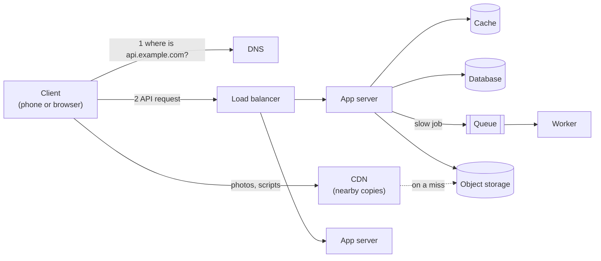

<!-- Written by `npm run lessons` from the lesson data in src/data. Edit the lesson there, not this page. -->

# Meet the building blocks: a map of a typical web system

**System Design · Unit 0: How system design interviews work · Lesson 1 of 4 · Must know**

> **In one line.** Most large web systems are built from the same dozen parts, connected in a familiar shape: clients, DNS, a CDN, load balancers, app servers, caches, databases, queues, workers and object storage.

[Open this lesson on the site](https://learn.hamropedia.com/system-design/meet-the-building-blocks-a-map-of-a-typical-web-system/) for its animation, the practice game and tap-to-explain words.

## The problem it solves

System design questions use many technical words at once. If you don't know what each part does, answers sound like a list of jargon. Learning the map first makes every later lesson easier, because each one is a closer look at one box on this map.

## The idea

A user's app (the client) sends a request over the internet. DNS finds your servers' address, a CDN serves files like photos from somewhere nearby, and a load balancer spreads the other requests across many identical app servers.

App servers run your code: they read quick copies of data from a cache and the real data from a database. Slow jobs go onto a queue for background workers, and big files live in object storage.

## How it works, step by step

1. Client: the phone app is the client. It sends a request: 'upload this photo with this caption'.
2. DNS: the app asks DNS for the address of api.example.com and gets back an IP address — like a phone number for a server.
3. Load balancer: the request reaches the load balancer, which picks one of many app servers that is healthy and not too busy.
4. App server: your code checks who the user is, gets an upload link from object storage, and saves the caption and photo details in the database.
5. Database: the permanent record of users, posts and likes. It's the source of truth.
6. Queue and workers: the app server puts a message 'make thumbnails for photo 42' on a queue and replies straight away. A background worker picks it up and makes the thumbnails.
7. Cache: when friends open the post, the app server checks the cache (fast memory) first, and only reads the database on a miss.
8. CDN: the photo itself is downloaded from a CDN server near each friend, not from your own servers.

## Picture it



*Follow the numbers. The client finds the servers through DNS, then sends its request to the load balancer. App servers read the cache and database, hand slow jobs to the queue, and keep files in object storage, which the CDN serves to users.*

## Analogy

A big restaurant chain. The phone book tells you where the nearest branch is (DNS). A host at the door sends you to a free waiter (load balancer). Waiters take orders and serve them (app servers). The pantry holds everything (database), but cooks keep the most-used ingredients on the counter (cache). Washing up happens in the back without making customers wait (queue and workers). The cold store holds big, bulky stock (object storage), and takeaway hatches around town hand out popular items fast (CDN).

**Where the analogy breaks.** A waiter remembers your table. Good app servers deliberately remember nothing between requests (they're 'stateless'), so any server can handle your next request. That's exactly what makes it easy to add more servers.

## Example

Netflix, Instagram, Uber and a small startup all share this shape. What changes is the size of each box and which boxes matter most: Netflix leans on its CDN, Uber on live location, a bank on its database and transactions.

## Must know

- Client: the app or browser the user holds.
- DNS: turns a name (example.com) into a server's address.
- CDN: servers around the world that keep copies of files close to users.
- Load balancer: spreads requests across many servers and skips broken ones.
- App server: runs your code; usually stateless, so you can add more.
- Cache: fast memory holding copies of often-read data (often Redis).
- Database: the permanent, trusted store of your data.
- Queue and workers: a waiting line of jobs, and the background programs that do them.
- Object storage: cheap, huge storage for files like photos and videos (for example Amazon S3).

## Common mistakes

- Learning tool names (Redis, Kafka) before knowing what job each box does.
- Thinking every system needs every box. A small app may only need one server and one database.
- Treating the cache as the place where data really lives. The database is the source of truth.

> **Not true:** A small app: still needs the CDN, the cache, the queue and the load balancer.  
> **In fact:** Each box is added to solve one problem. A small app may need only one server and one database.

> **Not true:** Source of truth: the cache, since reads go there first.  
> **In fact:** The cache holds copies for speed and can be emptied at any time. The database is the source of truth.

## In the interview

Most designs start from the same shape. Clients reach us through DNS, and files come from a CDN. A load balancer spreads requests across stateless app servers. Those servers read from a cache and a database, push slow work onto a queue for workers, and keep large files in object storage. Then I scale whichever box the requirements stress most.

<details>
<summary>&lt;b>Which box is usually the hardest to scale?&lt;/b></summary>

The database, because it holds data that must stay correct. App servers are easy to copy; data is not.

</details>

<details>
<summary>&lt;b>Why put a queue between the app server and the workers?&lt;/b></summary>

So the user doesn't wait for slow work, and so a burst of jobs waits in line instead of overloading the workers.

</details>

## Practise

Try each one yourself first, then open the answer and compare.

### 1. Explain

Name the nine building blocks and say what each one does, in one sentence each, from memory.

<details>
<summary>Show one good answer</summary>

• Client: the app or browser in the user's hand; it sends the requests.  
• DNS: turns a name like api.example.com into the IP address of a server.  
• CDN: servers spread around the world that keep copies of files (photos, scripts, video) close to users.  
• Load balancer: receives every request and passes it to one healthy app server, so no single server is overloaded.  
• App servers: run your code; they keep nothing between requests (stateless), so you can add more.  
• Cache: fast memory (often Redis) holding copies of data that is read a lot, so the database is asked less often.  
• Database: the permanent, trusted record of the data: the source of truth.  
• Queue and workers: a waiting line of slow jobs, and the background programs that take jobs off it and do them.  
• Object storage: cheap, almost unlimited storage for big files such as photos and videos (Amazon S3).

</details>

### 2. Draw

Draw the map from memory: client, DNS, CDN, load balancer, app servers, cache, database, queue, workers and object storage, with arrows.

<details>
<summary>Show one good answer</summary>

Two paths leave the client: files go to the CDN, and API requests go through the load balancer to the app servers. Everything behind the app servers is reached only through them. The CDN pulls from object storage when it doesn't have a file yet.

Check yours for the three arrows people most often miss: client to DNS first, the queue feeding the workers (not the other way round), and CDN to object storage on a miss.

```text
Client (phone or browser)
 │ 1. "where is api.example.com?"
 ├──────────► DNS
 │ photos, scripts
 ├──────────► CDN ─── on a miss ───┐
 │ 2. API request                  │
 ▼                                 │
Load balancer                      │
 ├──► App server ──┐               │
 └──► App server ──┤               │
                   ├──► Cache      │
                   ├──► Database   │
                   ├──► Queue ──► Workers
                   └──► Object storage
```

</details>

### 3. Apply

Pick an app you use every day, such as a food-delivery app. For one action, like placing an order, say which boxes the request passes through and why.

<details>
<summary>Show one good answer</summary>

Placing an order in a food-delivery app:

1. Client: you tap "Place order". The app sends POST /orders with the basket and the delivery address.  
2. DNS: the app already looked up api.fooddelivery.com earlier and cached the address, so this costs nothing now.  
3. Load balancer: picks a healthy order-service server. If one server has crashed, your order still goes through.  
4. App server: checks who you are, checks the restaurant is open, and works out the price.  
5. Cache: the menu and prices are read from the cache: every user reads them, and they rarely change.  
6. Database: the order is written to the database, inside a transaction with the payment record. This must never be lost or half-saved, so it goes to the source of truth, not the cache.  
7. Queue and workers: the server puts "order 123 placed" on a queue and replies "order received" straight away. Workers then tell the restaurant, send you a push notification and start finding a courier. You don't wait for any of that.

The CDN and object storage did their job earlier: the restaurant photos you scrolled past came from a CDN server near you.

</details>

### 4. Trade-offs

For a tiny app with 100 users, which boxes would you leave out, and why?

<details>
<summary>Show one good answer</summary>

With 100 users, keep only the client, DNS, one app server and one database (with backups). Leave out:

• Load balancer and extra app servers: one small server handles thousands of requests a second; 100 users send a handful. (A managed platform can add a second server later in minutes.)  
• Cache: the database answers 100 users easily, and a cache brings its own bugs: stale data, and invalidation.  
• Queue and workers: do the few slow jobs inline, or with a simple scheduled task.  
• CDN: serve the few static files from the app server or a static host.

Maybe keep object storage if users upload files: it is cheap, simple, and better than putting files in the database.

The reason: every box costs money, adds something to run and monitor, and adds a new way to fail. Add a box when a number (traffic, latency, data size) says you need it, not before.

</details>

## Go further (optional)

- READ · [The System Design Primer](https://github.com/donnemartin/system-design-primer) · Donne Martin · GitHub, free
- WATCH · [System Design for Beginners (full course)](https://www.youtube.com/results?search_query=freeCodeCamp+system+design+for+beginners+course) · freeCodeCamp · free on YouTube
- WATCH · [ByteByteGo: system design concepts for beginners](https://www.youtube.com/results?search_query=ByteByteGo+system+design+concepts+for+beginners) · ByteByteGo · YouTube

---

[All lessons](../../README.md) · [The high-level design interview: a step-by-step answer framework →](the-high-level-design-interview-a-step-by-step-answer-framework.md)
