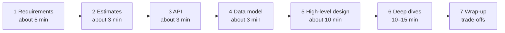

<!-- Written by `npm run lessons` from the lesson data in src/data. Edit the lesson there, not this page. -->

# The high-level design interview: a step-by-step answer framework

**System Design · Unit 0: How system design interviews work · Lesson 2 of 4 · Must know**

> **In one line.** A repeatable order of steps for answering any 'Design X' question in about 45 minutes.

[Open this lesson on the site](https://learn.hamropedia.com/system-design/the-high-level-design-interview-a-step-by-step-answer-framework/) for its animation, the practice game and tap-to-explain words.

## The problem it solves

Under pressure, most people either freeze or start drawing boxes before they understand the question. Both lose marks. A fixed method gives you something to do in every minute, and shows the interviewer how you think.

## The idea

Interviewers judge how you think, not whether you reach one 'right' design. A framework stops you jumping straight to boxes and arrows. The usual order: clarify requirements, estimate the scale, define the API, sketch the data model, draw a simple design that works, then go deep on the hardest parts and discuss trade-offs.

## How it works, step by step

1. Requirements: ask who uses the system and what the 3–4 core features are. For a URL shortener: 'Do we need custom aliases? Expiry? Click analytics?' Then the non-functional side: 'How many users? Is a slightly stale read acceptable?' Write the answers in a corner of the board.
2. Estimates: turn the numbers into requests per second and storage. Say each assumption out loud, for example 'I'll assume 100 reads for every write'.
3. API: write 2–4 endpoints with their inputs and outputs. This fixes exactly what the system must do.
4. Data model: list the main tables or objects and their keys. Ask yourself: what is the main query, and which key does it use?
5. High-level design: draw client → load balancer → service → database, and walk one request through it. Make it work before you make it big.
6. Deep dives: find the bottleneck from your estimates (reads, writes or storage) and fix it with caching, replicas, sharding or queues. Explain each choice and what it costs.
7. Wrap-up: summarise the design in three sentences, name its weak spots, and say what you would monitor.

## Picture it



*Work left to right. Each box is one stage of the interview, with roughly how long to spend on it.*

## Analogy

An architect meeting a client. They ask how many people will live in the house and what it is for before they draw anything.

**Where the analogy breaks.** A client answers once. In an interview you keep checking in ('does this match what you had in mind?'), and the interviewer may change the requirements halfway on purpose to see how you adapt.

## Example

For 'Design a URL shortener': 3 minutes on requirements (shorten, redirect, custom alias? expiry?), 3 on estimates (100 million new links a month), 3 on the API (POST /urls, GET /{code}), then the simple design, then a deep dive on generating unique short codes.

## Must know

- 1. Requirements (about 5 min): functional (what it does) and non-functional (scale, latency, availability, consistency). Write them down.
- 2. Estimates (about 3 min): users, requests per second, storage, bandwidth. Only as much as changes a decision.
- 3. API (about 3 min): the main endpoints with inputs and outputs.
- 4. Data model (about 3 min): the main entities, and which kind of database fits.
- 5. High-level design (about 10 min): the simplest design that works end to end.
- 6. Deep dives (10–15 min): fix the bottlenecks — caching, sharding, queues, failure handling.
- 7. Wrap-up: the trade-offs you made, what you'd do with more time, how you'd monitor it.

## Trade-offs

- Don't over-design early: start simple, then scale only the parts the numbers say need it.
- Think out loud. If you are silent, the interviewer can't give you credit for good reasoning.

## Common mistakes

- Designing before asking a single question.
- Adding Kafka, microservices and sharding to a system that gets 10 requests a second.
- Long silences. The interviewer can only give credit for what you say.
- Never stating trade-offs. Every choice has a cost, and naming it is what earns the strongest marks.

> **Not true:** A stronger answer: add Kafka, microservices and sharding, even at 10 requests a second.  
> **In fact:** A system that gets 10 requests a second needs none of them. Match the design to the numbers: every extra part costs complexity.

> **Not true:** First minute: start drawing boxes; questions about requirements can wait.  
> **In fact:** The first five minutes are for requirements: what the system must do, and at what scale. A design built on wrong assumptions answers the wrong question.

## In the interview

Before I design anything, I'd like to clarify the requirements and the scale. Then I'll propose a simple design that works end to end, and we can go deep on the parts you care about most, discussing the trade-offs as we go.

<details>
<summary>&lt;b>What if they mention a technology you don't know?&lt;/b></summary>

Say so honestly, then reason from first principles: describe what the component must do (for example, 'a durable queue that keeps order per user') and the properties you need.

</details>

<details>
<summary>&lt;b>How detailed should the estimates be?&lt;/b></summary>

Rough powers of ten are enough. The point is to decide things like 'one database is enough' or 'we need sharding', not to get exact numbers.

</details>

## Practise

Try each one yourself first, then open the answer and compare.

### 1. Explain

Say the 7 steps from memory, with the rough minutes for each.

<details>
<summary>Show one good answer</summary>

1. Requirements, about 5 minutes: the core features (functional) and the scale, speed, availability and consistency needed (non-functional). Write them down.  
2. Estimates, about 3 minutes: users, requests per second, storage, bandwidth. Only what changes a decision.  
3. API, about 3 minutes: the 2 to 4 main endpoints, with inputs and outputs.  
4. Data model, about 3 minutes: the main entities, their keys, and which kind of database fits.  
5. High-level design, about 10 minutes: the simplest design that works end to end, with one request walked through it.  
6. Deep dives, 10 to 15 minutes: fix the bottlenecks the numbers point to (caching, sharding, queues, failures), with the cost of each.  
7. Wrap-up, a few minutes: summarise, name the trade-offs and weak spots, and say what you'd monitor.

</details>

### 2. Draw

Draw the framework as a timeline for a 45-minute interview.

<details>
<summary>Show one good answer</summary>

About 44 minutes of design, and a few minutes at the end for your questions. The two big blocks are the high-level design and the deep dives; the four small steps before them should feel quick.

```text
 0 min ┬ 1 Requirements        5 min
       │
 5     ┼ 2 Estimates           3
 8     ┼ 3 API                 3
11     ┼ 4 Data model          3
14     ┼ 5 High-level design  10
       │
24     ┼ 6 Deep dives         15
       │
       │
39     ┼ 7 Wrap-up             3
42     ┼ Your questions        3
45     ┴ end
```

</details>

### 3. Apply

Run the framework out loud for 'Design a to-do list app' in 15 minutes. Record yourself and listen back.

<details>
<summary>Show one good answer</summary>

A 15-minute version, about a third of each step:

1. Requirements (2 min): create, edit, complete and delete tasks; group them into lists; due dates and reminders; sync across phone and laptop. Out of scope: shared lists. Non-functional: 10 million users, 1 million a day; fast; a task I just added must show on my other device (read-your-own-writes).  
2. Estimates (1 min): 1 million users × 20 reads and 5 writes a day ≈ 200 reads and 50 writes a second. Storage: 10 million users × 200 tasks × 500 bytes ≈ 1 TB. Small: one database is enough.  
3. API (2 min): GET /lists, POST /lists/{id}/tasks, PATCH /tasks/{id} (edit or tick), DELETE /tasks/{id}, and GET /tasks?since=cursor for sync.  
4. Data model (2 min): users, lists (list_id, user_id) and tasks (task_id, list_id, title, done, due_at, updated_at). Relational fits; index tasks by (user_id, updated_at) for sync and by due_at for reminders.  
5. High-level design (4 min): client → load balancer → stateless API servers → PostgreSQL with a read replica. A reminder worker runs every minute, finds tasks due now, and puts push notifications on a queue.  
6. Deep dive (3 min): offline edits on two devices. Each change carries updated_at (or a version number); the server keeps the newest per field and sends changes since the device's cursor.  
7. Wrap-up (1 min): simple, cheap design. Weak spots: one primary database (add automatic failover), and a burst of reminders at 9:00 (spread them through the queue).

When you listen back, check: did you ask before designing, say your assumptions out loud, and keep talking?

</details>

### 4. Trade-offs

Name two common mistakes candidates make (for example, going deep too early) and how the framework prevents each one.

<details>
<summary>Show one good answer</summary>

1. Going deep too early: designing the perfect sharding scheme before the basic flow exists, then running out of time with no working design. The framework puts a simple end-to-end design (step 5) before the deep dives (step 6), and time boxes keep each step short.

2. Designing before understanding: drawing boxes in minute one, then finding out the interviewer wanted something else. Step 1 forces questions first, and writing the requirements on the board lets you check them.

3. Over-engineering: adding Kafka, microservices and sharding for 10 requests a second. Step 2 gives you numbers, and each deep dive must be justified by one.

4. Never naming trade-offs. The wrap-up step makes you say what each choice costs, which is where the strongest marks are.

</details>

## Go further (optional)

- READ · [Hello Interview: system design delivery framework](https://www.google.com/search?q=Hello+Interview+system+design+delivery+framework) · hellointerview.com · free guides
- READ · [Hello Interview: a framework for system design interviews](https://www.google.com/search?q=Hello+Interview+a+framework+for+system+design+interviews) · hellointerview.com · free guides
- WATCH · [ByteByteGo: system design interview step by step](https://www.youtube.com/results?search_query=ByteByteGo+system+design+interview+step+by+step) · ByteByteGo · YouTube

---

[← Meet the building blocks: a map of a typical web system](meet-the-building-blocks-a-map-of-a-typical-web-system.md) · [All lessons](../../README.md) · [Back-of-the-envelope estimation →](back-of-the-envelope-estimation.md)
