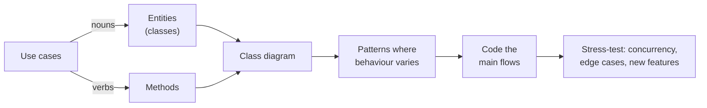

<!-- Written by `npm run lessons` from the lesson data in src/data. Edit the lesson there, not this page. -->

# The low-level design interview: a step-by-step approach

**System Design · Unit 0: How system design interviews work · Lesson 4 of 4 · Must know**

> **In one line.** A repeatable way to answer 'Design the classes for X' (a parking lot, an elevator, Splitwise) and write the key code.

[Open this lesson on the site](https://learn.hamropedia.com/system-design/the-low-level-design-interview-a-step-by-step-approach/) for its animation, the practice game and tap-to-explain words.

## The problem it solves

LLD questions are open-ended: 'design a parking lot' could mean almost anything. Without a method you write random classes, or code that breaks the moment the interviewer adds a requirement.

## The idea

Low-level design (LLD) tests object-oriented design: clear classes, good relationships, sensible patterns, and code that is easy to extend. Clarify the scope, list the entities, draw a class diagram, pick patterns where things vary, code the main flows, then discuss concurrency and how you'd add new features.

## How it works, step by step

1. Clarify: write 4–6 use cases as short sentences ('a car enters', 'the system assigns a spot', 'the driver pays on exit'). Agree what's out of scope.
2. Find the entities: underline the nouns in the use cases (car, spot, ticket, payment). They're your candidate classes. The verbs (assign, pay) become methods.
3. Draw the class diagram: fields, key methods and relationships. For each relationship ask: is it 'is-a' (inheritance) or 'has-a' (composition)?
4. Spot what varies: pricing rules, vehicle types, payment methods. Put each behind an interface (Strategy, Factory or State).
5. Code the main flow, such as park() and leave(), with clear names, and show how the classes call each other.
6. Stress-test it: two cars at two gates at the same moment (concurrency), a lost ticket (an edge case), and 'now add electric charging' (an extension). Say what changes.

## Picture it



*Nouns in the use cases become classes and verbs become methods. Draw them, add patterns where things vary, code the main flow, then test the design against harder situations.*

## Analogy

Planning a kitchen before building it: decide which stations you need (classes), who passes what to whom (relationships), and only then build the cupboards (code).

**Where the analogy breaks.** A kitchen is built once. A software design keeps changing, so interviewers will add a new requirement ('now add electric-car charging') to see if your design bends instead of breaks.

## Example

Parking lot: clarify (floors? vehicle types? payment?), list entities (ParkingLot, Floor, Spot, Vehicle, Ticket, Payment), draw relationships, use Strategy for pricing and spot assignment, code park() and leave(), then explain how two gates avoid giving out the same spot.

## Must know

- 1. Clarify requirements and scope: the main use cases, what's out of scope.
- 2. Identify entities (nouns) and actions (verbs) from the use cases.
- 3. Draw a class diagram: fields, methods, relationships (composition, inheritance, interfaces).
- 4. Apply patterns where behaviour varies: Strategy, State, Factory, Observer.
- 5. Code the core flows with clean names; skip trivial getters.
- 6. Discuss concurrency (two users at once), edge cases and extensibility.
- Use SOLID to justify your choices out loud.

## Common mistakes

- One giant class (a 'god class') that does everything.
- Deep inheritance trees where composition would be simpler.
- Using patterns that don't fit, just to mention them.
- Ignoring concurrency when two users can act on the same thing.

> **Not true:** Inheritance is the first tool to reach for when two classes share code.  
> **In fact:** Deep inheritance trees are rigid and hard to change. Composition, where a class holds another object and uses it, is often simpler.

> **Not true:** One big class holding the whole design is easy to extend later.  
> **In fact:** A class that does everything (a 'god class') is hard to change, because each change risks all the rest. Give each class one job.

## In the interview

I'll confirm the use cases first, then pull the main entities out of them and sketch a class diagram. Where behaviour is likely to change, like pricing, I'll put it behind an interface. Then I'll code the core flow and finish with concurrency and how the design extends.

<details>
<summary>&lt;b>Which language should I use?&lt;/b></summary>

The one you're strongest in. Python and Java are both fine; clean structure matters more than syntax.

</details>

<details>
<summary>&lt;b>How much code is expected?&lt;/b></summary>

The main classes and the one or two core flows, written cleanly. Not every getter, setter or menu.

</details>

## Practise

Try each one yourself first, then open the answer and compare.

### 1. Explain

Say the 6 steps from memory.

<details>
<summary>Show one good answer</summary>

1. Clarify: write 4 to 6 use cases, and agree what is out of scope.  
2. Find the entities: the nouns in the use cases become classes, and the verbs become methods.  
3. Draw the class diagram: fields, key methods, and relationships (has-a or is-a).  
4. Spot what varies (pricing, vehicle types, payment methods) and put each behind an interface: Strategy, State, Factory or Observer.  
5. Code the core flows cleanly, such as park() and leave(); skip trivial getters.  
6. Stress-test: two users at the same moment (concurrency), edge cases, and "now add a new feature". Say what changes.

</details>

### 2. Draw

Draw the class diagram for a simple library system (books, members, loans) in 10 minutes.

<details>
<summary>Show one good answer</summary>

The key decision is splitting Book (the title, of which the library may own several) from BookCopy (one physical copy, which is what you actually lend). A Loan joins one Member to one BookCopy, with dates; that is also where a late fee would be worked out (a FeePolicy interface, if fee rules vary).

Use cases it must support: search books, lend a copy, return a copy, see a member's loans, and refuse a loan if the member is at their limit.

```text
Library
 ├─ books: Book[]          (has many)
 ├─ members: Member[]      (has many)
 ├─ lend(member, copy) → Loan
 └─ return_copy(copy)

Book     1 ───── *  BookCopy
 isbn, title,        copy_id,
 author              is_available

Member   1 ───── *  Loan  * ───── 1  BookCopy
 member_id,          borrowed_on,
 name,               due_on,
 max_loans = 3       returned_on
```

</details>

### 3. Apply

Run the full approach out loud for 'Design a tic-tac-toe game' in 20 minutes, including code for making a move and checking for a winner.

<details>
<summary>Show one good answer</summary>

1. Clarify: two players, X and O, take turns on a 3 × 3 board (maybe n × n later). A move must be on the board and on an empty square. The game ends with a win (a full row, column or diagonal) or a draw (board full). Out of scope: a computer player, a user interface.  
2. Entities: Game, Board, Player (a name and a symbol), Move. Verbs: make a move, check for a winner, check for a draw.  
3. Class diagram: a Game has one Board and two Players; the Board holds the cells; the Game has a status (in progress, won, draw).  
4. What varies: the board size, and later perhaps the win rule or a computer player (a Strategy for choosing moves). Not worth a pattern today.  
5. Code (below): Board checks and stores moves and knows whether a symbol has won; Game handles turns and status.  
6. Stress-test: a move after the game ended is refused; a taken square is refused. Faster win check: only check the lines through the last move (O(n)), or keep a counter per row, column and diagonal (O(1)). Concurrency: two players send a move at once; take a lock per game, and check it is that player's turn.

```python
from enum import Enum


class Status(Enum):
    IN_PROGRESS = "in progress"
    WON = "won"
    DRAW = "draw"


class Board:
    def __init__(self, size=3):
        self.size = size
        self.cells = [[None] * size for _ in range(size)]

    def place(self, row, col, symbol):
        if not (0 <= row < self.size and 0 <= col < self.size):
            raise ValueError("off the board")
        if self.cells[row][col] is not None:
            raise ValueError("square taken")
        self.cells[row][col] = symbol

    def is_full(self):
        return all(cell is not None for line in self.cells for cell in line)

    def has_won(self, symbol):
        n = self.size
        lines = [list(row) for row in self.cells]
        lines += [[self.cells[r][c] for r in range(n)] for c in range(n)]
        lines.append([self.cells[i][i] for i in range(n)])
        lines.append([self.cells[i][n - 1 - i] for i in range(n)])
        return any(all(cell == symbol for cell in line) for line in lines)


class Game:
    def __init__(self, player_x, player_o, size=3):
        self.board = Board(size)
        self.players = [(player_x, "X"), (player_o, "O")]
        self.turn = 0
        self.status = Status.IN_PROGRESS
        self.winner = None

    def move(self, row, col):
        if self.status is not Status.IN_PROGRESS:
            raise ValueError("game is over")
        name, symbol = self.players[self.turn]
        self.board.place(row, col, symbol)
        if self.board.has_won(symbol):
            self.status, self.winner = Status.WON, name
        elif self.board.is_full():
            self.status = Status.DRAW
        else:
            self.turn = 1 - self.turn
        return self.status


game = Game("Asha", "Ben")
for row, col in [(0, 0), (1, 1), (0, 1), (2, 2), (0, 2)]:
    status = game.move(row, col)
print(status, game.winner)        # Status.WON Asha

try:
    game.move(2, 0)
except ValueError as error:
    print(error)                  # game is over
```

</details>

### 4. Trade-offs

What are the risks of using many design patterns just to impress the interviewer?

<details>
<summary>Show one good answer</summary>

• More code, less clarity: every pattern adds classes and indirection. A tic-tac-toe game with a Factory, an Observer and a Singleton is harder to read than one without.  
• Lost time: you spend the interview wiring patterns and never finish the core flow, which is what is being marked.  
• It looks memorised: the interviewer wants to see you notice a problem and pick a tool for it, not recite a list.  
• Hard follow-up questions: "why is this a Singleton?" If the honest answer is "to mention one", you lose marks.  
• Harder to change: the wrong abstraction makes the next requirement harder, not easier.

The rule: name the problem first ("pricing rules will change"), then the pattern that solves it (Strategy). If you can't name the problem, leave the pattern out (YAGNI: you aren't gonna need it).

</details>

## Go further (optional)

- CODE · [Awesome Low-Level Design (questions and solutions)](https://github.com/ashishps1/awesome-low-level-design) · GitHub, free
- READ · [Design patterns catalogue](https://refactoring.guru/design-patterns/catalog) · Refactoring.Guru, free

---

[← Back-of-the-envelope estimation](back-of-the-envelope-estimation.md) · [All lessons](../../README.md) · [Client–server, DNS, and what happens when you type a URL →](../unit-1-networking/client-server-dns-and-what-happens-when-you-type-a-url.md)
