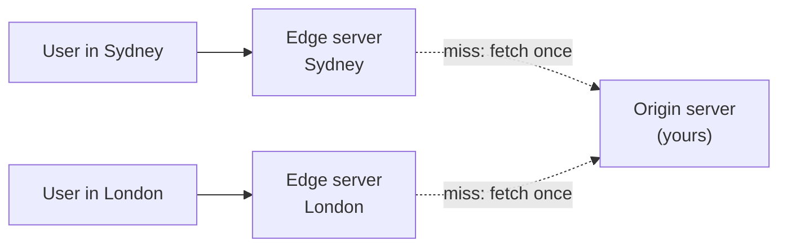

<!-- Written by `npm run lessons` from the lesson data in src/data. Edit the lesson there, not this page. -->

# CDN (content delivery network)

**System Design · Unit 1: Networking and APIs · Lesson 4 of 5 · Must know**

> **In one line.** A network of servers around the world that caches static content (images, video, scripts) close to users.

[Open this lesson on the site](https://learn.hamropedia.com/system-design/cdn-content-delivery-network/) for its animation, the practice game and tap-to-explain words.

## The problem it solves

Distance costs time: a user in Sydney fetching from London waits around a quarter of a second for each round trip, and every byte you send costs bandwidth. Big files and users all over the world make this much worse.

## The idea

Instead of every user fetching a video from your one datacentre, copies are served from a nearby 'edge' server. This cuts latency, takes load off your servers and absorbs traffic spikes. Content is pulled into the CDN on the first request (pull CDN) or uploaded in advance (push CDN).

## How it works, step by step

1. You point a hostname, like cdn.example.com, at the CDN provider.
2. A user's request goes to the nearest edge server (found through DNS or 'anycast' routing).
3. Cache hit: the edge already has the file and returns it in a few milliseconds.
4. Cache miss: the edge fetches the file from your origin server once, stores it, and returns it. Every later user in that region gets the fast copy.
5. The file stays until its TTL expires. To update it straight away, publish a new file name (app.3f9a.js → app.7c2b.js) or purge the old one.

## Picture it



*Users talk to the edge server near them. Only on a miss does the edge fetch the file from your origin; after that, everyone nearby gets the fast local copy.*

## Analogy

Local supermarket branches stocking popular products, so you don't have to drive to the central warehouse.

**Where the analogy breaks.** A supermarket can check the warehouse for the newest stock. A CDN serves its cached copy until it expires. So after you change a file, users may get the old one, unless you put a version in the file name or purge the cache.

## Example

Netflix places its own CDN boxes inside internet providers' networks, so most video traffic never crosses the wider internet.

## Must know

- Best for static, popular, cacheable content: images, video segments, JavaScript and CSS files.
- Pull CDN: fetches from your origin server on a cache miss. Push CDN: you upload content ahead of time.
- Control freshness with TTL headers; put a version or hash in file names (app.3f9a.js) so updates appear immediately.
- Also helps with DDoS protection, and can handle TLS close to the user.

## Common mistakes

- Caching personalised pages at the edge, and showing one user's data to another.
- Long TTLs on files that change, without versioned names.
- Forgetting that the first request in each region is still slow (a 'cold' cache).

> **Not true:** A CDN makes even the very first request in each region fast.  
> **In fact:** The first request in a region is a cache miss: the edge server has to fetch the file from the origin. Only the requests after it are fast.

## In the interview

I'd serve static assets and media through a CDN, so users download them from a nearby edge server. That lowers latency and takes most of the bandwidth off our origin. I'd use versioned file names so updates show up immediately.

<details>
<summary>&lt;b>Can a CDN cache API responses?&lt;/b></summary>

Sometimes, for short TTLs on public data like a product page. Personalised responses usually can't be cached at the edge.

</details>

<details>
<summary>&lt;b>Pull or push?&lt;/b></summary>

Pull for most sites (simple and automatic). Push when content is large and known in advance, like a video library.

</details>

## Practise

Try each one yourself first, then open the answer and compare.

### 1. Explain

Explain a CDN with the supermarket picture, and where the picture breaks.

<details>
<summary>Show one good answer</summary>

A CDN is like a supermarket chain. Instead of everyone driving to the central warehouse (your origin server), each town has a branch (an edge server) that stocks the popular products (files). You shop at your local branch: much quicker. When the branch runs out of something, it orders it once from the warehouse (a cache miss) and then has it for everyone in town.

Where the picture breaks: a supermarket can check the warehouse for the newest version. A CDN keeps selling its copy until it expires (its TTL), even if you have changed the file at the warehouse. So after an update, users may get the old file unless the new one has a new name (app.3f9a.js) or you purge the cache. Also, a supermarket only stocks things everyone buys: anything personal to one user (their account page) should not be stored at the edge.

</details>

### 2. Draw

Draw a user, a CDN edge server and your origin, showing a cache hit and a cache miss.

<details>
<summary>Show one good answer</summary>

On a hit the user never touches your servers. On a miss the edge fetches the file once from the origin, keeps a copy until its TTL runs out, and every later nearby user gets a hit.

```text
Cache hit
  User (Sydney) ──► Edge (Sydney)
                     has the file
  User ◄──────────── reply, ~10 ms

Cache miss
  User (Sydney) ──► Edge (Sydney)
                     not there yet
                       │ fetch once
                       ▼
                    Origin (London)
                       │ file
                       ▼
                    Edge stores a copy
                    (until the TTL ends)
  User ◄──────────── reply, ~300 ms

  Next user in Sydney: a hit.
```

</details>

### 3. Apply

In a YouTube-like design, which data goes through the CDN and which does not?

<details>
<summary>Show one good answer</summary>

Through the CDN (public, large, read by many people, the same for everyone):  
• Video segments: each video is cut into chunks of a few seconds, at several qualities (240p to 4K). This is almost all of the bandwidth.  
• Thumbnails, channel pictures and banners.  
• The website's static files: JavaScript, CSS, fonts, icons.

Not through the CDN (personal, changing, or writes), straight to your API servers:  
• Uploads: they go to object storage, often through a signed upload URL, then to the transcoding pipeline.  
• The home feed and recommendations, which are different for every user.  
• Watch history, likes, comments, subscriptions: writes, and data about one user.  
• Search, sign-in and payments.  
• View counts and analytics events.

A middle case: rarely watched "long-tail" videos may be served from the origin or a regional cache, because caching them at every edge wastes space.

</details>

### 4. Trade-offs

You fixed a bug in app.js but users still get the old file. Why, and how do you prevent it next time?

<details>
<summary>Show one good answer</summary>

Why: app.js has the same name as before, and copies are cached with a long TTL in two places: the CDN's edge servers and users' browsers. Neither knows the file has changed, so both keep serving the old one until their copy expires.

Right now: purge app.js from the CDN. That fixes the edge, but browsers that already have it may still use their copy until it expires.

Next time: put a fingerprint of the contents in the file name (app.3f9a.js, made by the build tool). A changed file gets a new name, so no cache has ever seen it, and you can give these files a very long TTL ("immutable"). The HTML page that names the file is cached briefly (or revalidated every time), so it picks up the new name within seconds.

</details>

## Go further (optional)

- READ · [What is a CDN?](https://www.cloudflare.com/learning/cdn/what-is-a-cdn/) · Cloudflare Learning Center, free
- READ · [The System Design Primer](https://github.com/donnemartin/system-design-primer) · Donne Martin · GitHub, free
- WATCH · [ByteByteGo: what is a CDN](https://www.youtube.com/results?search_query=ByteByteGo+what+is+a+CDN) · ByteByteGo · YouTube

---

[← Real-time communication: polling, long polling, WebSockets, SSE](real-time-communication-polling-long-polling-websockets-sse.md) · [All lessons](../../README.md) · [Proxies, reverse proxies and API gateways →](proxies-reverse-proxies-and-api-gateways.md)
