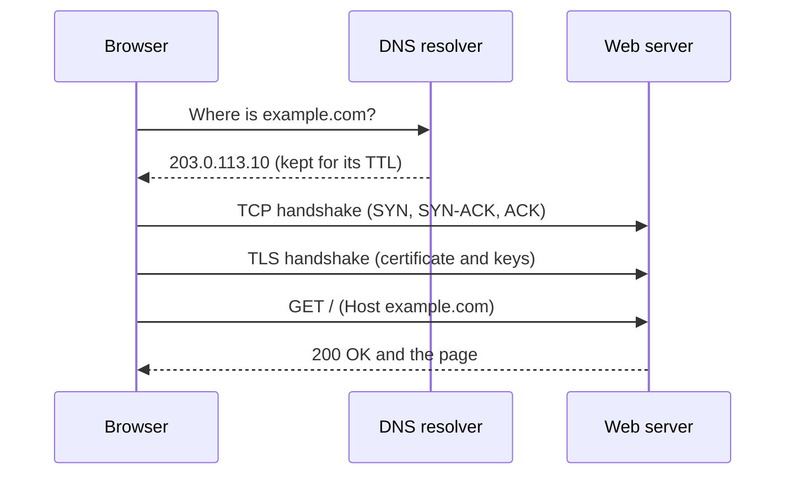

<!-- Written by `npm run lessons` from the lesson data in src/data. Edit the lesson there, not this page. -->

# Client–server, DNS, and what happens when you type a URL

**System Design · Unit 1: Networking and APIs · Lesson 1 of 5 · Must know**

> **In one line.** Clients (browsers, apps) send requests; servers process them and send responses. DNS turns a name like example.com into an IP address the client can connect to.

[Open this lesson on the site](https://learn.hamropedia.com/system-design/client-server-dns-and-what-happens-when-you-type-a-url/) for its animation, the practice game and tap-to-explain words.

## The problem it solves

Computers find each other by IP address, but people remember names. Between typing a name and seeing a page there are several steps, and each can be slow or fail. Knowing them lets you explain latency, failover and where caching helps.

## The idea

When you type a URL, the browser asks DNS for the server's IP address (often from a cache). Then it opens a TCP connection, does a TLS handshake for HTTPS, and sends an HTTP request. The request usually reaches a load balancer, which passes it to an application server. That server may read a cache or database, then sends the response back.

## How it works, step by step

1. You type example.com. The browser checks its own DNS cache, then the operating system's.
2. On a miss, it asks a resolver, often run by your internet provider. The resolver asks a root server ('who handles .com?'), then a .com server ('who handles example.com?'), then example.com's own name server, which returns the IP address, say 203.0.113.10. Every answer is cached for its TTL.
3. The browser opens a TCP connection to that IP on port 443, with a three-step handshake (SYN, SYN-ACK, ACK).
4. TLS handshake: the server shows a certificate proving it really is example.com, and both sides agree on encryption keys.
5. The browser sends the request: 'GET /', with the header 'Host: example.com'. A load balancer receives it and passes it to one of many app servers.
6. The app server reads from a cache or database, builds the page and sends it back. The browser then requests the images, CSS and scripts, often from a CDN.

## Picture it



*Time runs from top to bottom. First the browser finds the address, then it opens a connection, secures it, and only then asks for the page.*

## Analogy

Calling a shop. You look up the number in a phone book (DNS), dial (TCP connection), check you're really talking to that shop (TLS), then ask your question (HTTP request).

**Where the analogy breaks.** A phone book rarely changes. DNS answers are cached for a set time (the TTL), so when a server's IP changes, some users keep reaching the old address for minutes or hours. That matters when you fail over to a new server.

## Example

Big sites use DNS to send users to their nearest datacentre (geo-DNS), and to move traffic away from a datacentre that is down.

## Must know

- DNS lookup order: browser cache → operating system cache → resolver (for example your ISP) → root server → top-level domain (.com) → the domain's authoritative server.
- TCP gives reliable, ordered delivery. UDP is faster but packets can be lost; it suits video calls, games and DNS itself.
- TLS (the S in HTTPS) encrypts the connection and proves the server's identity with a certificate.
- Every new connection costs round trips, so clients reuse connections (keep-alive, HTTP/2).
- IP address = which machine; port = which program on it (443 for HTTPS).

## Trade-offs

- Low DNS TTL: faster failover, but more DNS lookups. High TTL: fewer lookups, but slow to change.

## Common mistakes

- Forgetting DNS caching when you plan a failover by changing DNS records.
- Mixing up TCP (the reliable connection) with HTTP (the request format that travels over it).
- Thinking HTTPS only encrypts. It also proves the server's identity.

> **Not true:** A change to a DNS record reaches every user straight away.  
> **In fact:** Resolvers and browsers keep the old answer until its TTL (time to live) runs out, so some users go to the old address for minutes or hours.

> **Not true:** TCP = HTTP: two names for the same thing.  
> **In fact:** TCP is the reliable connection between two machines. HTTP is the format of the requests and responses that travel over that connection.

## In the interview

The browser resolves the domain through DNS, usually from a cache, to get an IP address. It opens a TCP connection and does a TLS handshake, then sends the HTTP request. The request typically hits a load balancer, which forwards it to an app server; the server reads from a cache or database and sends back the response.

<details>
<summary>&lt;b>TCP or UDP for a live video call?&lt;/b></summary>

Usually UDP-based protocols. A late video packet is useless, so it's better to skip it than to wait for it to be resent.

</details>

<details>
<summary>&lt;b>Why does HTTPS add latency?&lt;/b></summary>

The TLS handshake adds round trips before the first request. Reusing connections and TLS 1.3 reduce the cost.

</details>

## Practise

Try each one yourself first, then open the answer and compare.

### 1. Explain

Explain what happens when you type a URL and press Enter, in under a minute.

<details>
<summary>Show one good answer</summary>

1. DNS: the browser needs an IP address for example.com. It checks its own cache, then the operating system's, then asks a resolver (usually your internet provider's), which asks the root servers, then the .com servers, then example.com's own name server. The answer is cached for its TTL.  
2. TCP: the browser opens a connection to that IP on port 443 with a three-step handshake (SYN, SYN-ACK, ACK).  
3. TLS: the server shows a certificate proving it really is example.com, and both sides agree on encryption keys.  
4. HTTP: the browser sends "GET /" with the header "Host: example.com".  
5. Server side: a load balancer passes the request to one app server, which reads a cache or the database and builds the response.  
6. Back in the browser: it reads the HTML, then fetches the CSS, scripts and images (often from a CDN), and draws the page.

</details>

### 2. Draw

Draw the full path: browser, DNS resolver, load balancer, app server, database, and back.

<details>
<summary>Show one good answer</summary>

The DNS lookup happens once and is then cached; the TCP and TLS handshakes happen once per connection; every request after that goes straight down the right-hand path and back.

```text
Browser
  │ 1. example.com?
  ▼
DNS resolver ──► root → .com → example.com's
  │                 name server
  │ 2. "93.184.216.34" (cached for the TTL)
  ▼
Browser ── 3. TCP + TLS handshake ──┐
  │ 4. GET / (Host: example.com)    │
  ▼                                 │
Load balancer ◄─────────────────────┘
  │ 5. picks a healthy server
  ▼
App server ──► cache (miss) ──► Database
  │ 6. builds the response
  ▼
Load balancer ──► Browser: HTML, then
                  CSS, JS, images (CDN)
```

</details>

### 3. Apply

Your site moves to a new IP address. Explain why some users still reach the old server for a while, and what you would set in advance.

<details>
<summary>Show one good answer</summary>

Why: DNS answers are cached. Browsers, operating systems and resolvers all keep the old answer (the old IP) until its TTL runs out, and some resolvers keep it even longer than they should. Until then, those users go to the old server.

What to set in advance:  
1. A day or two before the move, lower the record's TTL, for example from 1 day to 60 seconds. Do this at least one old TTL before the switch, so the long-lived copies have expired.  
2. Switch the record to the new IP. Most users move within about a minute.  
3. Keep the old server running for a while, forwarding (proxying) its requests to the new one, so stragglers still work. Watch its traffic fall to zero before you switch it off.  
4. Raise the TTL again afterwards.

Better still, put a load balancer or a fixed (floating) IP in front, so the address users see never changes and you only swap the servers behind it.

</details>

### 4. Trade-offs

Compare TCP and UDP: what each gives up, and one system that should use each.

<details>
<summary>Show one good answer</summary>

TCP gives you a connection, delivery of every packet, in order, and slows down when the network is busy. What it gives up: speed. There is a handshake before any data, and a lost packet holds up everything behind it until it is resent. Use it when every byte must arrive: web pages, APIs, payments, file downloads. Example: a banking API.

UDP just sends packets: no connection, no guarantee they arrive, no ordering. What it gives up: reliability (the program must cope with loss itself). What it gains: low, steady latency. Use it when late data is useless anyway: live video calls, online games, DNS lookups. Example: a video call, where it is better to skip a lost frame than freeze while waiting for it.

(QUIC, used by HTTP/3, builds TCP-like reliability on top of UDP, to get fast setup without head-of-line blocking.)

</details>

## Go further (optional)

- READ · [What is DNS?](https://www.cloudflare.com/learning/dns/what-is-dns/) · Cloudflare Learning Center, free
- READ · [An overview of HTTP](https://www.google.com/search?q=MDN+an+overview+of+HTTP) · MDN Web Docs, free
- WATCH · [ByteByteGo: what happens when you type a URL into your browser](https://www.youtube.com/results?search_query=ByteByteGo+what+happens+when+you+type+a+URL+into+your+browser) · ByteByteGo · YouTube

---

[← The low-level design interview: a step-by-step approach](../unit-0-interview-basics/the-low-level-design-interview-a-step-by-step-approach.md) · [All lessons](../../README.md) · [HTTP and REST API design →](http-and-rest-api-design.md)
