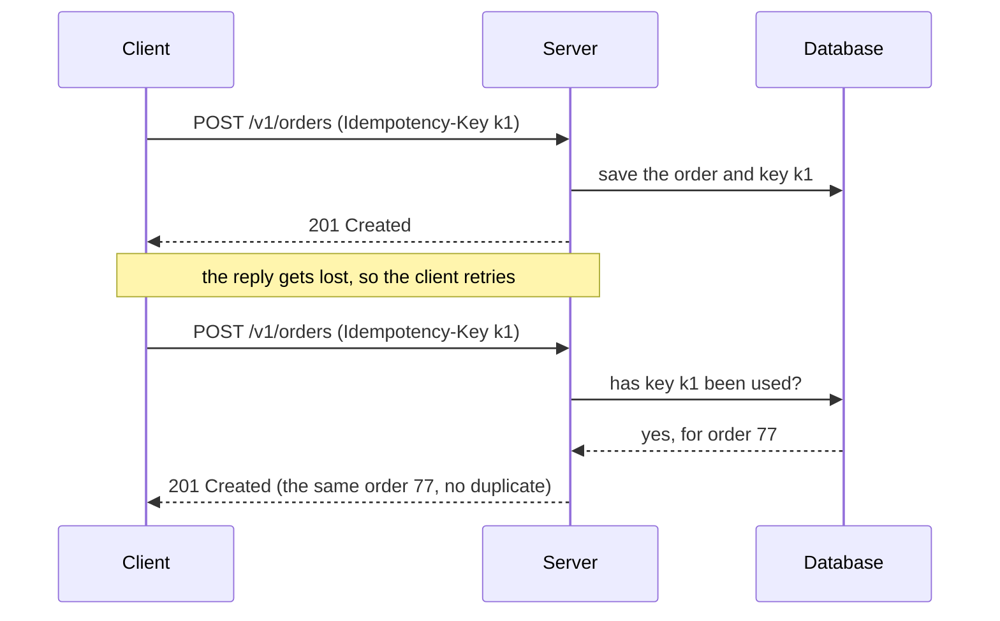

<!-- Written by `npm run lessons` from the lesson data in src/data. Edit the lesson there, not this page. -->

# HTTP and REST API design

**System Design · Unit 1: Networking and APIs · Lesson 2 of 5 · Must know**

> **In one line.** HTTP is the request–response protocol of the web. REST is a style of API design built around resources (nouns) and standard methods (GET, POST, PUT, PATCH, DELETE).

[Open this lesson on the site](https://learn.hamropedia.com/system-design/http-and-rest-api-design/) for its animation, the practice game and tap-to-explain words.

## The problem it solves

Clients and servers are often built by different teams, or even different companies. They need a clear, stable contract for asking and answering; otherwise every change breaks somebody.

## The idea

A good API is predictable. Resources have clear URLs like /users/42/orders, methods mean what they say, and status codes tell the client what happened. Lists are paginated, the API is versioned, and requests that may be retried are made idempotent so a retry can't do the work twice.

## How it works, step by step

1. Name resources as nouns: /users, /users/42, /users/42/orders. Avoid verbs in URLs, like /getUserOrders.
2. Choose the method by intent: GET to read, POST to create, PUT to replace, PATCH to change part, DELETE to remove.
3. Return a status code that tells the truth: 201 after creating, 400 for bad input, 404 when something is missing, 409 for a conflict, 429 when rate-limited, 500 when the server broke.
4. Paginate lists: return 20 items plus a cursor; the client sends the cursor back to get the next 20.
5. Make retries safe: the client sends an Idempotency-Key header with POST; the server stores the key with the result and returns the same result if the key comes again.
6. Version from day one: /v1/. When you must break something, add /v2/ and keep /v1/ running for old clients.

## Picture it



*A retried request carries the same idempotency key, so the server recognises it and returns the first result instead of creating a second order.*

## Analogy

A restaurant menu with clear sections. You ask for a dish by name (the resource), say what you want done (the method), and the waiter replies 'served', 'out of stock' or 'not on the menu' (the status code).

**Where the analogy breaks.** A waiter can improvise. An API is a contract: once apps depend on it, you can't change it freely, which is why versioning matters.

## Example

GET /v1/orders?limit=20&cursor=abc returns 200 OK with 20 orders and a cursor for the next page. POST /v1/orders with an Idempotency-Key header returns 201 Created; retrying with the same key returns the same order instead of creating a second one.

## Must know

- Methods: GET reads (safe), POST creates, PUT replaces, PATCH changes part, DELETE removes. GET, PUT and DELETE should be idempotent.
- Status codes: 2xx success (200, 201), 3xx redirect (301, 302), 4xx client error (400, 401, 403, 404, 409, 429), 5xx server error (500, 503).
- Pagination: offset (simple, but slow and unstable on big, changing lists) or cursor (fast and stable; preferred at scale).
- Idempotency key: the client sends a unique key so a retried request isn't processed twice. Essential for payments.
- Versioning: /v1/ in the path or a header, so old clients keep working.
- Alternatives: GraphQL (the client chooses the fields it wants) and gRPC (fast, typed calls between services).

## Trade-offs

- REST: simple and cacheable, but may need several calls per screen.
- GraphQL: flexible queries, but harder caching and rate limiting.
- gRPC: fast and strongly typed, but less browser-friendly.

## Common mistakes

- Returning 200 OK with an error message hidden in the body.
- Using GET for actions that change data (crawlers and browser prefetching may call it).
- No pagination, so one request can return a million rows.
- Breaking changes without a new version.

> **Not true:** Errors: return 200 OK and describe the problem in the body.  
> **In fact:** Clients, proxies and monitoring tools read the status code. Use 4xx for a client's mistake and 5xx for a server failure, so that errors can be seen.

> **Not true:** GET: fine for an action that changes data, such as deleting a row.  
> **In fact:** GET must be safe: crawlers and browser prefetching may call it at any time. Use POST, PUT, PATCH or DELETE for changes.

## In the interview

I'd design the API around resources, with standard methods and status codes. I'd paginate lists with cursors and version the API. I'd also require an idempotency key on any create or payment endpoint, so client retries are safe.

<details>
<summary>&lt;b>401 or 403?&lt;/b></summary>

401 means not authenticated (we don't know who you are). 403 means authenticated but not allowed to do this.

</details>

<details>
<summary>&lt;b>Why is cursor pagination better than offset?&lt;/b></summary>

Offset has to skip rows, which is slow for page 10,000, and pages shift when new rows arrive. A cursor continues from the last item seen, so it's fast and stable.

</details>

## Practise

Try each one yourself first, then open the answer and compare.

### 1. Explain

Explain idempotency, and why POST isn't idempotent by default.

<details>
<summary>Show one good answer</summary>

An operation is idempotent if doing it twice has the same effect as doing it once. "Set my email to a@b.com" (PUT) is idempotent: the second time changes nothing. "Delete order 7" (DELETE) is too: after the first time it is already gone. GET reads, so it changes nothing at all.

POST usually means "create a new one". Send "create an order for £50" twice and you get two orders. That matters because networks fail: if the reply is lost, the client can't tell whether the order was made, and the safe-looking retry creates a duplicate.

The fix is an idempotency key: the client makes one unique key per real action and sends it with every retry. The server saves the key with the first result, and returns that same result when the key comes again, instead of creating a second order.

</details>

### 2. Draw

Write the API for a small library app (list books, borrow a book, return a book) with methods, URLs and status codes.

<details>
<summary>Show one good answer</summary>

Resources are nouns (books, loans); borrowing creates a loan, and returning updates it, so history is kept. Status codes say exactly what went wrong, so the app can show the right message.

```text
GET   /v1/books?limit=20&cursor=…
      200 OK   { books: [...], next_cursor }

GET   /v1/books/{book_id}
      200 OK | 404 Not Found

POST  /v1/loans
      body: { book_id, member_id }
      header: Idempotency-Key
      201 Created  { loan_id, due_on }
      404 Not Found   (no such book)
      403 Forbidden   (member at loan limit)
      409 Conflict    (no copy available)

PATCH /v1/loans/{loan_id}
      body: { status: "returned" }
      200 OK  (also when already returned)
      404 Not Found
```

</details>

### 3. Apply

Design the API for sending money between two bank accounts, including how a retried request is handled.

<details>
<summary>Show one good answer</summary>

The endpoint:  
POST /v1/transfers  
Headers: Authorization: Bearer &lt;token>, Idempotency-Key: &lt;a UUID made once per transfer by the client>  
Body: from_account, to_account, amount_minor (integer pence, never a float), currency, reference.

Responses: 201 Created with transfer_id and status; 400 for bad input; 401 or 403 if the caller can't use from_account; 404 for an unknown account; 422 for not enough money; 409 if the same key comes with a different body; 429 when rate-limited. GET /v1/transfers/{id} lets the client check what happened.

On the server, in one database transaction: insert the idempotency key (a UNIQUE column), insert the transfer, then write the two ledger entries (debit and credit). Store the response with the key. Either all of it happens, or none of it.

A retried request (say the reply timed out) carries the same key:  
• If the key is found and finished, return the stored response: the money moves once.  
• If the first attempt is still running, return 409 "in progress" (or wait for it).  
• Keys expire after, say, 24 hours.

The client's rule: on a timeout or a 5xx, retry with the same key and back off; never make a new key for the same transfer.

</details>

### 4. Trade-offs

When would you choose gRPC or GraphQL instead of REST?

<details>
<summary>Show one good answer</summary>

Choose gRPC for calls between your own services: it is fast (binary messages over HTTP/2), strongly typed (the .proto file is the contract, and client code is generated from it), and supports streaming in both directions. The cost: browsers can't call it directly without a proxy, and it is harder to inspect by hand than JSON.

Choose GraphQL when many different clients (web, iOS, Android) need different slices of the same data, and REST would mean several round trips per screen or a lot of unused fields. The client asks for exactly the fields it needs, in one request. The costs: HTTP caching is harder (one endpoint, POST bodies), rate limiting must look at how expensive a query is, and careless resolvers cause N+1 database queries.

Stay with REST for public APIs, simple CRUD, and anything that benefits from plain HTTP caching and tooling. A common mix: REST or GraphQL at the edge for apps, gRPC inside between services.

</details>

## Go further (optional)

- READ · [Designing robust and predictable APIs with idempotency](https://stripe.com/blog/idempotency) · Stripe blog
- READ · [HTTP response status codes](https://www.google.com/search?q=MDN+HTTP+response+status+codes) · MDN Web Docs, free
- READ · [Hello Interview: API design](https://www.google.com/search?q=Hello+Interview+API+design) · hellointerview.com · free guides

---

[← Client–server, DNS, and what happens when you type a URL](client-server-dns-and-what-happens-when-you-type-a-url.md) · [All lessons](../../README.md) · [Real-time communication: polling, long polling, WebSockets, SSE →](real-time-communication-polling-long-polling-websockets-sse.md)
