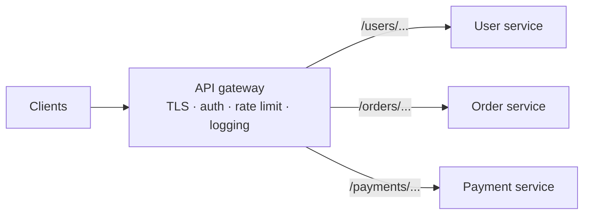

<!-- Written by `npm run lessons` from the lesson data in src/data. Edit the lesson there, not this page. -->

# Proxies, reverse proxies and API gateways

**System Design · Unit 1: Networking and APIs · Lesson 5 of 5 · Should know**

> **In one line.** A reverse proxy sits in front of your servers and receives requests on their behalf. An API gateway is a reverse proxy with API features: authentication, rate limiting and routing to the right service.

[Open this lesson on the site](https://learn.hamropedia.com/system-design/proxies-reverse-proxies-and-api-gateways/) for its animation, the practice game and tap-to-explain words.

## The problem it solves

With many services, every client would need to know every service's address, and every service would repeat the same login checks, rate limits and logging. That's duplicated, inconsistent work.

## The idea

Clients talk to one entry point instead of many servers. That entry point can handle TLS, compress responses, cache, check tokens, apply rate limits, and send /orders to the order service and /users to the user service.

## How it works, step by step

1. The client sends every request to one address, for example api.example.com.
2. The gateway handles TLS, then checks the token (who is this?) and the rate limit (are they allowed this many requests?).
3. It looks at the path: /orders/… goes to the order service, /users/… to the user service.
4. It forwards the request, waits for the answer and sends it back, logging the request and how long it took.
5. Behind it, each service may run several copies, so a load balancer (often built into the gateway) picks one.

## Picture it



*Every request goes through one front door. The gateway checks and logs it, then sends it to the right service based on its path.*

## Analogy

A hotel reception. Guests don't walk into the kitchen or the laundry; reception checks who they are and passes each request to the right department.

**Where the analogy breaks.** A reception desk with one person is a bottleneck and a single point of failure. A gateway must itself be replicated and kept fast, or every request suffers.

## Example

Nginx or Envoy as a reverse proxy; a managed API gateway that checks tokens and allows 100 requests per minute per API key before anything reaches the services.

## Must know

- Forward proxy: acts for clients (for example, a company's web proxy). Reverse proxy: acts for servers.
- Gateway jobs: routing, authentication, rate limiting, TLS, request logging, API versioning.
- A load balancer spreads traffic across copies of a service; a gateway decides what's allowed and which service it goes to. Many products do both.
- Keep business logic out of the gateway.

## Common mistakes

- Putting business rules in the gateway, so it slowly becomes a hidden monolith.
- Running a single gateway instance: a single point of failure.
- Doing heavy work in the gateway that slows down every request.

> **Not true:** An API gateway is a good place to put business rules.  
> **In fact:** A gateway should stay thin: routing, authentication, rate limiting. Business rules belong in the services, or the gateway slowly becomes a hidden monolith.

## In the interview

I'd put an API gateway at the edge to authenticate requests, apply rate limits and route each path to the right microservice, so services don't each re-implement those concerns. It's replicated, so it isn't a single point of failure.

<details>
<summary>&lt;b>Gateway or load balancer?&lt;/b></summary>

A load balancer spreads requests across copies of one service. A gateway handles API concerns like auth, limits and routing between different services. Often you use both.

</details>

<details>
<summary>&lt;b>What's the downside of a gateway?&lt;/b></summary>

An extra network hop, and a central component that must scale and stay up.

</details>

## Practise

Try each one yourself first, then open the answer and compare.

### 1. Explain

Explain reverse proxy versus forward proxy in two sentences.

<details>
<summary>Show one good answer</summary>

A forward proxy works for clients: it sits in front of users and sends their requests out to the internet for them, for example a company proxy that filters and logs staff web browsing.

A reverse proxy works for servers: it sits in front of your servers and receives requests from the internet for them, handling TLS, caching and load balancing, and hiding the servers behind it.

</details>

### 2. Draw

Draw client → gateway → three services, and label what the gateway checks.

<details>
<summary>Show one good answer</summary>

The checks run in order and stop early: a request without a valid token never costs a rate-limit lookup or reaches a service. Routing is by path, and every request is logged with how long it took.

```text
Client
  │ HTTPS
  ▼
API gateway, in order:
  1 TLS ends here
  2 token valid?          no → 401
  3 allowed this call?    no → 403
  4 under the rate limit? no → 429
  5 log it, route by path
  │
  ├─ /users/…    ──► User service
  ├─ /orders/…   ──► Order service
  └─ /payments/… ──► Payment service
```

</details>

### 3. Apply

List what your gateway would do for a mobile banking app.

<details>
<summary>Show one good answer</summary>

For a mobile banking app, the gateway would:  
• End TLS, with modern settings only (the app also pins the certificate).  
• Check the access token on every request (signature, expiry, audience), and that its scopes allow the call: a "read balance" token can't make payments.  
• Rate-limit per user, per device and per IP, strictly on login and one-time-code endpoints, to slow down password guessing.  
• Route by path: /accounts to the accounts service, /payments to payments, /cards to cards.  
• Reject bad requests early: too large, wrong content type, missing required headers (such as an Idempotency-Key on POST /payments).  
• Add a request ID and tracing headers, and write an audit log, with card numbers and personal data masked.  
• Handle API versions, and tell very old app versions to upgrade.  
• Apply timeouts to each backend, and stop calling a failing one for a while (a circuit breaker).  
• Block known bad traffic (a web application firewall, bot detection).

What it would not do: work out balances, check payment limits or run fraud rules. That is business logic, and it belongs in the services.

</details>

### 4. Trade-offs

What goes wrong if business logic slowly moves into the gateway?

<details>
<summary>Show one good answer</summary>

• It becomes a hidden monolith: every team needs changes in the one shared gateway, so releases queue up behind it and teams are tied together again, which is what microservices were meant to stop.  
• Rules end up split: half a rule in the gateway, half in the service, and nobody can see the whole thing or test it in one place.  
• It is hard to test and debug: gateway logic often lives in configuration or plugin scripts, without the tests, reviews and tooling of normal code.  
• A bigger blast radius: a bug in the gateway breaks every service at once, not just one.  
• Everything gets slower: heavier work in the gateway adds latency to every single request, and makes the gateway harder to scale.

Keep the gateway to jobs that are the same for every service (TLS, authentication, rate limits, routing, logging), and keep decisions about the business in the services.

</details>

## Go further (optional)

- READ · [The System Design Primer](https://github.com/donnemartin/system-design-primer) · Donne Martin · GitHub, free
- WATCH · [ByteByteGo: API gateway explained](https://www.youtube.com/results?search_query=ByteByteGo+API+gateway+explained) · ByteByteGo · YouTube

---

[← CDN (content delivery network)](cdn-content-delivery-network.md) · [All lessons](../../README.md) · [Scalability: vertical vs horizontal →](../unit-2-core-concepts/scalability-vertical-vs-horizontal.md)
