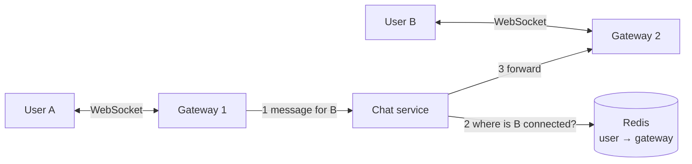

<!-- Written by `npm run lessons` from the lesson data in src/data. Edit the lesson there, not this page. -->

# Real-time communication: polling, long polling, WebSockets, SSE

**System Design · Unit 1: Networking and APIs · Lesson 3 of 5 · Should know**

> **In one line.** There are four ways for a server to get new data to a client quickly. The client keeps asking (polling), waits on an open request (long polling), keeps a two-way connection open (WebSockets), or receives a one-way stream (server-sent events, SSE).

[Open this lesson on the site](https://learn.hamropedia.com/system-design/real-time-communication-polling-long-polling-websockets-sse/) for its animation, the practice game and tap-to-explain words.

## The problem it solves

Normal HTTP lets the client ask but not the server tell. Chat, notifications, live prices and multiplayer games need updates pushed to the user within a fraction of a second.

## The idea

Normal HTTP is 'the client asks, the server answers'. Chat, live scores and notifications need the server to push. Polling is simple but wasteful. Long polling holds a request open until there's news. WebSockets keep one connection open for messages in both directions. SSE is a simpler one-way stream from server to client.

## How it works, step by step

1. Short polling: the client asks 'anything new?' every few seconds. Simple, but most answers are 'no'.
2. Long polling: the client asks, and the server holds the request open until there's news (or a timeout of about 30 seconds). The client immediately asks again.
3. WebSocket: starts as an HTTP request with an 'Upgrade' header. After that, the same connection stays open and either side can send a message at any time.
4. SSE: the client opens one HTTP request and the server keeps sending events down it; the browser reconnects automatically if it drops.
5. At scale: users connect to many gateway servers. When user A messages user B, the system looks up B's gateway in a registry (such as Redis) and forwards the message there.

## Picture it



*Each user keeps an open connection to one gateway. To reach B, the chat service looks up B's gateway in Redis and forwards the message there.*

## Analogy

Polling is a child asking 'are we there yet?' every minute. Long polling is asking once, and the driver only answers when you arrive. A WebSocket is an open phone line both people can talk on.

**Where the analogy breaks.** An open phone line costs nothing to keep open. Each WebSocket holds memory and a connection on a server, so millions of users need many connection servers, and a way to find which server each user is connected to.

## Example

WhatsApp-style chat: each user keeps a connection to a gateway server, and a lookup store records which gateway holds each user, so a message can be routed to the right one.

## Must know

- Short polling: simple, but most responses are empty; high load, and a delay of up to one polling interval.
- Long polling: fewer empty responses; works everywhere; one request per message.
- WebSockets: two-way and low latency, but connections are stateful, which makes load balancing and scaling harder.
- SSE: one-way, server to client, over normal HTTP; reconnects automatically; good for feeds and notifications.
- Stateful connections need a 'who is connected where' registry, often in Redis.

## Common mistakes

- Choosing WebSockets for one-way updates, where SSE is simpler.
- Forgetting that open connections make servers stateful: you need a connection registry and reconnect logic.
- No plan for messages missed while a client was disconnected.

> **Not true:** One-way updates (server to client): WebSockets are simpler than SSE.  
> **In fact:** For one-way updates, SSE is simpler: a one-way stream from the server to the client over ordinary HTTP. WebSockets earn their extra cost when both sides need to send.

> **Not true:** Reconnecting: the client automatically receives the messages it missed.  
> **In fact:** Messages sent while a client was disconnected are lost unless the server kept them. Store them, and let the client ask for everything after the last one it saw.

## In the interview

For chat I'd use WebSockets, because messages flow both ways with low latency. Users connect to a fleet of gateway servers, and Redis maps each user to their gateway so a message can be pushed to the right connection. For one-way updates like live scores, SSE is simpler.

<details>
<summary>&lt;b>What happens when a WebSocket server crashes?&lt;/b></summary>

Clients reconnect (with backoff) to another server, re-register where they are, and fetch any missed messages using the last message ID they saw.

</details>

<details>
<summary>&lt;b>Why not just poll every second?&lt;/b></summary>

With millions of users, that's millions of mostly empty requests every second: huge cost for little benefit.

</details>

## Practise

Try each one yourself first, then open the answer and compare.

### 1. Explain

Explain polling, long polling, WebSockets and SSE with the 'are we there yet?' picture.

<details>
<summary>Show one good answer</summary>

• Short polling: the child asks "are we there yet?" every minute. Simple, but almost every answer is "no", and you can be up to a minute late hearing "yes".  
• Long polling: the child asks once, and the driver stays quiet until they arrive (or for at most 30 seconds), then answers. The child asks again straight away. Fewer wasted questions, and the answer comes the moment it is true.  
• WebSocket: an open phone line. Once the call is connected, either person can speak at any time, in both directions.  
• SSE (server-sent events): the driver's announcements over the car speaker. The driver talks whenever there is news; the child only listens. One-way, and it reconnects by itself if it drops.

</details>

### 2. Draw

Draw how a message travels from user A to user B when they are connected to different WebSocket servers.

<details>
<summary>Show one good answer</summary>

Gateways hold the open connections but don't know where other users are; the registry does. The message is also saved before it is forwarded, so B can fetch it later if B was offline or the forward failed.

```text
User A ═══ WebSocket ═══ Gateway 1
                            │ 1. "message for B"
                            ▼
                       Chat service
                         │   │ 2. save the message
                         │   └──────────► Database
                         │ 3. where is B?
                         ├──────────────► Redis
                         │ ◄── "Gateway 2" ┘
                         │ 4. forward
                         ▼
User B ═══ WebSocket ═══ Gateway 2
```

</details>

### 3. Apply

Choose a method for: a stock price ticker, a chat app, a nightly report, and a delivery-tracking map. Justify each.

<details>
<summary>Show one good answer</summary>

• Stock price ticker: SSE. Updates only flow from server to client, many times a second, and SSE is a simple stream over normal HTTP that reconnects by itself. (If the same screen also places trades, a WebSocket can carry both.)  
• Chat app: WebSockets. Messages go both ways, typing indicators and read receipts need low latency, and one open connection is much cheaper than polling.  
• Nightly report: none of them. It is ready once a day, so a normal request is enough: email a link or send a notification when it is done, or let the page poll the job status every 30 seconds while someone waits.  
• Delivery-tracking map: SSE (or a WebSocket). The courier's position arrives every few seconds and only flows to the customer. Polling every 5 to 10 seconds also works at small scale, and is simpler to build.

The rule: two-way and fast means WebSockets; one-way and frequent means SSE; rare updates mean ordinary requests or polling.

</details>

### 4. Trade-offs

What does it cost to hold 10 million open WebSocket connections, and how would you spread them across servers?

<details>
<summary>Show one good answer</summary>

The costs of 10 million open connections:  
• Memory: each connection holds buffers and some session state, say about 20 KB, so roughly 200 GB of memory in total.  
• Servers: a well-tuned server holds about 100,000 to 1,000,000 connections. At 100,000 each, that is 100 gateway servers, plus spare capacity for failures.  
• Heartbeats: a ping every 30 seconds per connection is about 330,000 small messages a second, just to keep connections alive.  
• File handles, TLS work, and load balancers that must support long-lived connections.

Spreading them:  
• Put a layer-4 load balancer (or DNS) in front of a fleet of stateless gateway servers, sending new connections to the least-loaded one.  
• Keep a registry (Redis) of user → gateway, updated on connect and disconnect, so any service can route a message to the right gateway.  
• Plan for failure: when a gateway dies, its 100,000 users reconnect at once. Clients must back off with random jitter, so they don't stampede the other servers.  
• On deploys, drain servers slowly (stop new connections, then close old ones gradually), rather than dropping everyone at once.

```python
connections = 10_000_000
memory_gb = connections * 20e3 / 1e9          # about 20 KB each
servers = connections / 100_000               # 100k per server
pings_per_s = connections / 30                # one ping every 30 s
print(memory_gb, servers, round(pings_per_s))
# 200.0 100.0 333333
```

</details>

## Go further (optional)

- WATCH · [ByteByteGo: polling vs long polling vs websockets vs SSE](https://www.youtube.com/results?search_query=ByteByteGo+polling+vs+long+polling+vs+websockets+vs+SSE) · ByteByteGo · YouTube
- READ · [Hello Interview: design a chat system](https://www.google.com/search?q=Hello+Interview+design+a+chat+system) · hellointerview.com · free guides
- READ · [The WebSocket API](https://www.google.com/search?q=MDN+WebSocket+API) · MDN Web Docs, free

---

[← HTTP and REST API design](http-and-rest-api-design.md) · [All lessons](../../README.md) · [CDN (content delivery network) →](cdn-content-delivery-network.md)
