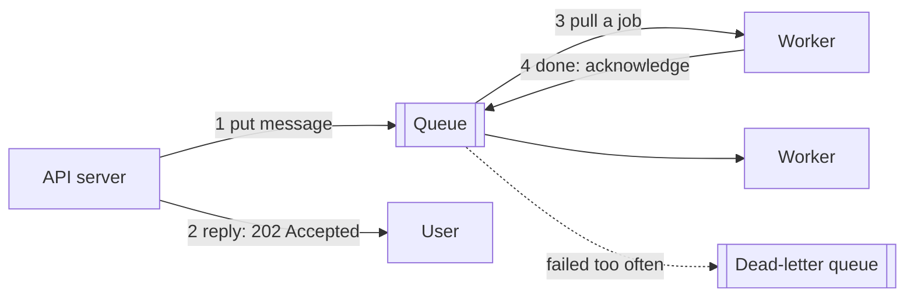

<!-- Written by `npm run lessons` from the lesson data in src/data. Edit the lesson there, not this page. -->

# Asynchronous processing and message queues (Kafka, SQS)

**System Design · Unit 2: Core concepts: scale, reliability and speed · Lesson 8 of 9 · Must know**

> **In one line.** Asynchronous processing means doing slow work later, outside the user's request. A message queue holds the work, or events, between the service that produces them and the services that consume them.

[Open this lesson on the site](https://learn.hamropedia.com/system-design/asynchronous-processing-and-message-queues-kafka-sqs/) for its animation, the practice game and tap-to-explain words.

## The problem it solves

Some work is slow (encoding video, sending emails) or comes in bursts (a sale doubles traffic). Doing it inside the user's request makes them wait, and a burst can overwhelm the services behind it.

## The idea

Instead of making a user wait while you send emails, resize images and update analytics, you put a message on a queue and reply straight away. Workers process messages at their own pace. Queues absorb spikes, decouple services and let you retry failures. SQS-style queues give each message to one worker; Kafka keeps an ordered log that many groups of consumers can read, and re-read.

## How it works, step by step

1. A user uploads a video. The API stores the file and puts a message {video_id: 42} on a queue.
2. The API replies straight away: '202 Accepted, processing'.
3. Worker processes pull messages from the queue. One worker takes message 42 and converts the video.
4. When it's done, the worker acknowledges the message, and only then is it removed. If the worker crashes first, the message becomes visible again and another worker retries it.
5. If it fails too many times, it moves to a dead-letter queue for a person to inspect.
6. If 10,000 uploads arrive at once, they simply wait in the queue; you add workers to clear it faster.

## Picture it



*The API replies at once and leaves the slow work on the queue. Workers take jobs at their own pace; a job is removed only after the worker says it's done.*

## Analogy

A restaurant's order rail. The waiter clips the order on the rail and goes back to the customers; the cooks take orders when they're ready.

**Where the analogy breaks.** A paper order is taken by exactly one cook and then it's gone. Most queues only promise 'at least once' delivery, so a message can arrive twice and consumers must be idempotent. And Kafka keeps messages after they're read, so others can read them again.

## Example

Upload a video: the API saves the file, puts a 'video uploaded' message on a queue, and replies 202 Accepted. Workers convert it into several resolutions, and the user is notified when it's ready.

## Must know

- Queue (SQS, RabbitMQ): spreads work; each message is consumed once, then deleted.
- Log or stream (Kafka): ordered, durable, replayable; partitions give order per key and parallel processing.
- Delivery guarantees: at most once, at least once (the most common), exactly once (hard; usually 'effectively once' with idempotent consumers).
- Dead-letter queue: where messages go after failing too many times.
- Pub/sub: one event fans out to many subscribers.
- Async means eventual: the user sees 'processing', not the final result straight away.

## Trade-offs

- Pros: absorbs spikes, decouples services, makes retries easy.
- Cons: more moving parts, harder debugging, eventual consistency, and you must handle ordering and duplicates.

## Common mistakes

- Assuming each message arrives exactly once. It can arrive twice, so make processing idempotent.
- Expecting order across a whole Kafka topic. Order is only kept within one partition.
- Using a queue where the user needs an immediate answer.

> **Not true:** Delivery: a queue hands each message to its consumer exactly once.  
> **In fact:** Most queues deliver at least once: after a crash or a timeout, a message can arrive twice. Make processing idempotent, so that a repeat does no harm.

> **Not true:** Kafka topic: messages stay in order across the whole topic.  
> **In fact:** Order is kept only within one partition. Messages that must stay in order need the same key, so that they go to the same partition.

## In the interview

Slow or non-critical work goes on a queue so the request stays fast. For simple task distribution I'd use a queue like SQS with a dead-letter queue. For event streams that many services need, or that I may want to replay, I'd use Kafka, partitioned by a key like user ID to keep each user's events in order. Consumers are idempotent, because delivery is at least once.

<details>
<summary>&lt;b>Kafka or SQS?&lt;/b></summary>

SQS: a simple managed queue, each message handled once, no replay. Kafka: a high-throughput ordered log with many independent consumers, replay, and ordering within a partition.

</details>

<details>
<summary>&lt;b>How do you keep messages in order?&lt;/b></summary>

Send all messages with the same key (like an order ID) to the same partition. Order is only guaranteed within a partition.

</details>

## Practise

Try each one yourself first, then open the answer and compare.

### 1. Explain

Explain why asynchronous processing makes an API faster, with the order-rail picture.

<details>
<summary>Show one good answer</summary>

Picture a restaurant's order rail. The waiter writes the order, clips it on the rail and goes straight back to the customers: the waiter doesn't stand in the kitchen while the food cooks. The cooks take orders off the rail when they are ready.

An API works the same way. Without a queue, the request does everything before replying (save the video, encode it, email the user), and the user waits the whole time. With a queue, the API does only the essential part (save the file, put "encode video 42" on the queue) and replies at once: "202 Accepted, processing". Workers do the slow part in the background.

The API is faster because the user waits only for the fast part. It is also steadier: a rush of orders just makes the rail longer, instead of overwhelming the kitchen.

</details>

### 2. Draw

Draw producer → queue → worker pool → database, plus a dead-letter queue.

<details>
<summary>Show one good answer</summary>

The producer only writes to the queue and replies; it never waits for the workers. A worker deletes a message only after the work is safely in the database (it acknowledges it). A message that keeps failing is moved aside to the dead-letter queue, so it can't block or crash the workers forever.

```text
Producer (API)
  │ 1. put message
  ▼
Queue ═══════════════════════════
  │ 2. each worker pulls one job
  ├──────────┬──────────┐
  ▼          ▼          ▼
Worker     Worker     Worker
  │ 3. do the work, save the result
  ▼
Database
  4. acknowledge → message deleted

failed 5 times? ──► Dead-letter queue
                    (a person looks at it)
```

</details>

### 3. Apply

Build a tiny producer and consumer with Python's queue module and threads. Make a consumer crash halfway, and show how a message could be processed twice.

<details>
<summary>Show one good answer</summary>

Python's queue.Queue forgets a message as soon as get() returns, so the code wraps it in a queue that, like SQS, only deletes a message when the worker acknowledges it. Unacknowledged messages come back (what a visibility timeout does).

The first worker sends emails 1, 2 and 3, but crashes after sending email 3 and before acknowledging it. The queue can't tell "crashed before doing the work" from "crashed after", so it delivers message 3 again, and the second worker sends user 3 a second email. That is at-least-once delivery.

The fix is an idempotent consumer: remember which message IDs have been handled, and skip repeats. In a real system that record must be saved in the same transaction as the work's effect (or passed to the email provider as an idempotency key); otherwise a crash between "send" and "remember" still sends twice.

```python
import queue
import threading


class AtLeastOnceQueue:
    """A message is deleted only when a worker acknowledges it."""

    def __init__(self):
        self.ready = queue.Queue()
        self.in_flight = {}                      # message id -> message
        self.lock = threading.Lock()

    def put(self, message):
        self.ready.put(message)

    def get(self):
        message = self.ready.get_nowait()        # raises queue.Empty when done
        with self.lock:
            self.in_flight[message["id"]] = message
        return message

    def ack(self, message_id):
        with self.lock:
            del self.in_flight[message_id]

    def redeliver_unacked(self):                 # what a visibility timeout does
        with self.lock:
            for message in self.in_flight.values():
                self.ready.put(message)
            self.in_flight.clear()


def worker(q, handle, crash_on=None):
    while True:
        try:
            message = q.get()
        except queue.Empty:
            return
        handle(message)                          # the work is done...
        if message["id"] == crash_on:
            return                               # ...but the worker dies before it acks
        q.ack(message["id"])


def run(handle):
    q = AtLeastOnceQueue()
    for i in range(1, 6):
        q.put({"id": i, "to": f"user{i}@mail.com"})
    first = threading.Thread(target=worker, args=(q, handle), kwargs={"crash_on": 3})
    first.start(); first.join()                  # handles 1, 2, 3, then crashes
    q.redeliver_unacked()                        # 3 was never acked, so it comes back
    second = threading.Thread(target=worker, args=(q, handle))
    second.start(); second.join()


sent = []
run(lambda message: sent.append(message["id"]))
print(sent)                                      # [1, 2, 3, 4, 5, 3]: user 3 got two emails

sent, handled = [], set()

def send_once(message):                          # idempotent consumer
    if message["id"] in handled:
        return
    sent.append(message["id"])
    handled.add(message["id"])

run(send_once)
print(sent)                                      # [1, 2, 3, 4, 5]
```

</details>

### 4. Trade-offs

When should something NOT be asynchronous? Give an example where the user must wait for the result.

<details>
<summary>Show one good answer</summary>

Keep something synchronous when the user can't continue without the result, or when the next step depends on it:

• Payment authorisation at checkout: the user must know "approved" or "declined" before seeing the confirmation page. You can't say "order placed!" and decline the card later.  
• Logging in: you can't show the account until the password has been checked.  
• Booking a seat: "is F12 still free?" must be answered before you take the money.  
• Validating input: tell the user their form is wrong now, not by email in five minutes.  
• Reading data: "show my order history" is a read; there is nothing to defer.

Async also costs something: more moving parts, harder debugging, and the user sees "processing" instead of a result. So use a queue for slow or non-essential work after the critical step (sending the receipt, updating analytics, encoding the video), not for the critical step itself.

</details>

## Go further (optional)

- READ · [Introduction to Apache Kafka](https://kafka.apache.org/intro) · kafka.apache.org
- WATCH · [ByteByteGo: Kafka vs RabbitMQ](https://www.youtube.com/results?search_query=ByteByteGo+Kafka+vs+RabbitMQ) · ByteByteGo · YouTube
- READ · [Apache Kafka 101](https://www.google.com/search?q=Confluent+Developer+Apache+Kafka+101+course) · Confluent Developer · free course

---

[← Rate limiting and backpressure](rate-limiting-and-backpressure.md) · [All lessons](../../README.md) · [Observability: logs, metrics and traces →](observability-logs-metrics-and-traces.md)
