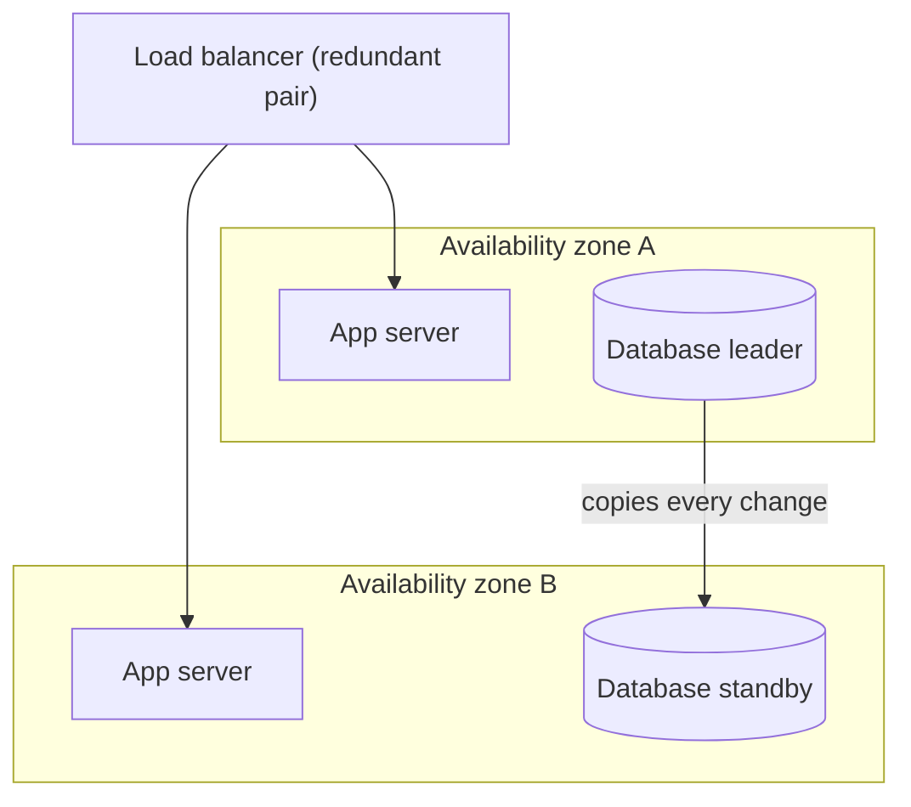

<!-- Written by `npm run lessons` from the lesson data in src/data. Edit the lesson there, not this page. -->

# Availability: nines, SLAs and redundancy

**System Design · Unit 2: Core concepts: scale, reliability and speed · Lesson 2 of 9 · Must know**

> **In one line.** Availability is the share of time a system works and responds correctly, usually written in 'nines', like 99.9%.

[Open this lesson on the site](https://learn.hamropedia.com/system-design/availability-nines-slas-and-redundancy/) for its animation, the practice game and tap-to-explain words.

## The problem it solves

Machines, disks, networks and whole datacentres fail. If your system has only one copy of anything important, that one failure takes everything down.

## The idea

99.9% ('three nines') allows about 8.8 hours of downtime a year; 99.99% about 53 minutes. You raise availability by removing single points of failure: run several copies across machines and zones, with health checks and automatic failover. An SLO is your internal target; an SLA is the promise to customers, often with refunds if you miss it.

## How it works, step by step

1. Agree the target. 99.9% means about 43 minutes of downtime a month.
2. List every component a request touches and ask: if this dies, what happens?
3. Add redundancy: at least two copies of each component, in different availability zones.
4. Add detection: health checks that notice a failure within seconds.
5. Add automatic failover: the load balancer stops sending traffic to dead servers, and a database replica is promoted when the leader dies.
6. Practise it: test failover regularly, because untested backups often don't work when you need them.

## Picture it



*Everything has a copy in a second zone. If zone A goes down, the load balancer sends traffic to zone B and the standby database takes over.*

## Analogy

A hospital with backup generators. When the mains power fails, a generator starts and the lights stay on.

**Where the analogy breaks.** A generator is one independent backup. Real systems also fail in shared ways — a bad deployment, a whole region going down, a shared database — so backups only help if they fail independently.

## Example

Two parts in series, each 99.9% available, give about 99.8% overall (0.999 × 0.999). Two redundant copies in parallel, each 99%, give 99.99% (1 − 0.01²), as long as they fail independently.

## Must know

- Downtime per year: 99% ≈ 3.65 days; 99.9% ≈ 8.8 hours; 99.99% ≈ 53 minutes; 99.999% ≈ 5 minutes.
- Dependencies in series multiply availability down; parallel copies multiply the chance of failure down.
- Remove single points of failure: load balancers, databases, DNS, the gateway itself.
- Spread across availability zones (separate datacentres in one region); for more safety, across regions.
- Active–passive: a standby takes over. Active–active: all copies serve traffic all the time.
- SLI = what you measure; SLO = your target; SLA = your contract.

## Trade-offs

- Each extra nine costs much more: extra regions, more complex failover, more testing.

## Common mistakes

- Two copies that share one point of failure (the same rack, the same power supply, the same bad deployment).
- Forgetting the database, DNS or load balancer when removing single points of failure.
- Promising 99.99% when one of your dependencies only offers 99.9%.

> **Not true:** Depending on a 99.9% database: the service can still promise 99.99%.  
> **In fact:** A service is at most as available as what it depends on. Availabilities in series multiply, so the result is below 99.9%.

> **Not true:** Two copies on one rack: no single point of failure left.  
> **In fact:** The rack is still a single point of failure: one power or network fault takes both copies down. Put the copies in different racks or zones.

## In the interview

I'd first agree a target, say 99.9%. Then I'd remove single points of failure: several app servers across availability zones, a replicated database with automatic failover, redundant load balancers and health checks. I'd also remember that every dependency in series lowers the overall availability.

<details>
<summary>&lt;b>Availability or reliability?&lt;/b></summary>

Availability: is it up and responding? Reliability: does it do the right thing over time, without errors or data loss? A system can be up but returning wrong answers.

</details>

<details>
<summary>&lt;b>Active–active or active–passive?&lt;/b></summary>

Active–active uses all capacity and fails over faster, but must handle conflicting writes. Active–passive is simpler, but the standby sits idle and failover takes longer.

</details>

## Practise

Try each one yourself first, then open the answer and compare.

### 1. Explain

Explain what 'three nines' means in hours of downtime per year.

<details>
<summary>Show one good answer</summary>

99.9% available means it may be down 0.1% of the time.

A year has 365 × 24 = 8,760 hours, and 0.1% of 8,760 is 8.76 hours. So three nines allows about 8 hours and 45 minutes of downtime a year, which is about 43 minutes a month, or about 10 minutes a week.

Each extra nine divides that by 10: four nines (99.99%) allows about 53 minutes a year; five nines, about 5 minutes.

</details>

### 2. Draw

Draw a system with no single point of failure across two availability zones.

<details>
<summary>Show one good answer</summary>

Every box has a twin in the other zone, and nothing is shared between the zones except the network. If zone A goes dark, the load balancers stop sending traffic there (health checks fail) and the standby database is promoted to leader. DNS points at both load balancers, so even the front door has a copy.

```text
           DNS (two records)
           ┌──────┴──────┐
           ▼             ▼
┌──── Zone A ────┐ ┌──── Zone B ────┐
│ Load balancer  │ │ Load balancer  │
│   │       │    │ │   │       │    │
│  App     App   │ │  App     App   │
│   │            │ │   │            │
│ DB leader ─────┼─┼─► DB standby   │
│                │ │  (promoted if  │
│                │ │   A fails)     │
└────────────────┘ └────────────────┘
```

</details>

### 3. Apply

Your app depends on 4 services in series, each 99.9% available. Calculate the best-case overall availability, and suggest one fix.

<details>
<summary>Show one good answer</summary>

In series, every service must be up for a request to work, so you multiply:  
0.999 × 0.999 × 0.999 × 0.999 = 0.996 (99.6%).

That is about 35 hours of downtime a year, four times the 8.8 hours each service allows on its own. And this is the best case: it assumes your own code never fails.

One fix: take a service off the critical path. If one of them is not needed to answer the user (say, recommendations or analytics), call it asynchronously or with a timeout and a fallback, so it failing no longer fails the request. Three in series gives 0.999³ ≈ 99.7%.

Another: give the weakest service a redundant copy in parallel. Two copies at 99.9% each give 1 − 0.001² = 99.9999%, so that link almost stops counting.

```python
series = 0.999 ** 4
print(round(series, 4), round((1 - series) * 8760, 1))   # 0.996 35.0 hours a year
print(round(0.999 ** 3, 4))                               # 0.997
print(round(1 - 0.001 ** 2, 6))                           # 0.999999
```

</details>

### 4. Trade-offs

Why does going from 99.99% to 99.999% cost so much more?

<details>
<summary>Show one good answer</summary>

99.99% allows about 53 minutes of downtime a year; 99.999% allows about 5. That changes how you have to work:

• No time for people: 5 minutes a year is less than it takes to page an engineer and open a laptop. Every failure must be detected and fixed automatically, in seconds.  
• More regions: a whole region going down for an hour would use up ten years of budget, so you need several regions serving traffic at once (active–active), with data copied between them and a way to resolve conflicting writes.  
• Every dependency must be better than five nines, including DNS, the cloud provider, and the database. Anything that isn't must be made redundant or removed from the critical path.  
• Changes are the biggest cause of outages, so every deploy and configuration change needs canary releases and automatic rollback.  
• Constant testing: failover drills and chaos experiments, or the failover won't work when you need it.

Each nine roughly multiplies the cost in money, complexity and people, while the benefit (48 fewer minutes a year) gets smaller. So pick the target from what downtime really costs the business.

</details>

## Go further (optional)

- READ · [Site Reliability Engineering, Ch 4 (service level objectives)](https://sre.google/sre-book/table-of-contents/) · Google · free online book
- READ · [The System Design Primer](https://github.com/donnemartin/system-design-primer) · Donne Martin · GitHub, free
- WATCH · [ByteByteGo: availability and the nines explained](https://www.youtube.com/results?search_query=ByteByteGo+availability+and+the+nines+explained) · ByteByteGo · YouTube

---

[← Scalability: vertical vs horizontal](scalability-vertical-vs-horizontal.md) · [All lessons](../../README.md) · [Fault tolerance: timeouts, retries, circuit breakers →](fault-tolerance-timeouts-retries-circuit-breakers.md)
