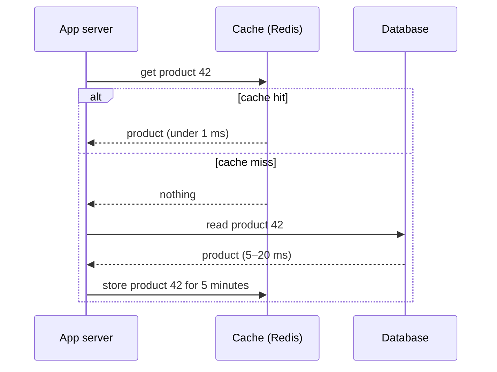

<!-- Written by `npm run lessons` from the lesson data in src/data. Edit the lesson there, not this page. -->

# Caching

**System Design · Unit 2: Core concepts: scale, reliability and speed · Lesson 5 of 9 · Must know**

> **In one line.** A cache keeps a copy of frequently used data in fast storage, usually memory, so it can be served without repeating slow work.

[Open this lesson on the site](https://learn.hamropedia.com/system-design/caching/) for its animation, the practice game and tap-to-explain words.

## The problem it solves

Reading from a database on disk, or recalculating a result, is slow and expensive compared with reading memory. When the same data is read again and again, repeating the work is waste.

## The idea

Caches exist at many layers: the browser, the CDN, the application (Redis or Memcached) and the database. The usual pattern is cache-aside: read from the cache; on a miss, read the database and store the result with a TTL. The hard parts are keeping the cache in step with the database (invalidation) and choosing what to remove when it's full (eviction, often LRU).

## How it works, step by step

1. A request needs product 42. The app asks Redis for the key 'product:42'.
2. Hit: Redis has it and returns it in under a millisecond.
3. Miss: the app reads the database (perhaps 5–20 ms), returns the result, and stores it in Redis with a TTL of, say, 5 minutes.
4. When product 42 changes, the app deletes 'product:42' from Redis, so the next read loads the fresh value.
5. When Redis is full, it evicts keys, usually the least recently used ones.
6. Measure the hit rate: 95% means only 1 read in 20 reaches the database.

## Picture it



*Cache-aside. The app always asks the cache first. On a miss it reads the database and saves a copy in the cache for next time.*

## Analogy

Keeping the books you use every day on your desk instead of walking to the library each time.

**Where the analogy breaks.** Books on your desk don't change by themselves. Data does: when the database changes, your cached copy is stale until it's updated or expires. That's the hardest problem in caching.

## Example

A product page is read 1,000 times for every update. Cache-aside in Redis with a 5-minute TTL serves almost every read from memory, and the database sees a tiny share of the traffic.

## Must know

- Cache-aside (lazy loading): check the cache → on a miss, load from the database and fill the cache. The most common pattern.
- Write-through: write the cache and database together (fresh, but slower writes). Write-back: write the cache, save to the database later (fast, but data can be lost).
- Eviction: LRU (least recently used), LFU (least frequently used), TTL expiry.
- Invalidation: delete or update the cache entry when the data changes; the TTL is your safety net.
- Problems to know: stale data, cache stampede (many misses at once), hot keys, cold start.
- Cache only data that is read often and can be slightly out of date.

## In code

```python
def get_product(product_id):
    key = f"product:{product_id}"
    cached = redis.get(key)
    if cached:
        return cached                          # hit: fast path
    product = db.query_product(product_id)    # miss: slow path
    redis.set(key, product, ex=300)           # keep for 5 minutes
    return product
```

## Common mistakes

- Caching data that changes constantly, or is hardly ever read.
- No TTL, so stale data lives forever if one invalidation is missed.
- No plan for a stampede when a very popular key expires.
- Treating the cache as the source of truth. It can be emptied at any moment.

> **Not true:** Important data: it can live in the cache alone, with no copy in a database.  
> **In fact:** A cache can be emptied at any moment: on a restart, or when memory runs out. The database stays the source of truth.

> **Not true:** Cache-aside: the cache is filled when the data is written.  
> **In fact:** Cache-aside fills the cache on a read miss: load from the database, then store the value. Filling the cache on every write is write-through.

## In the interview

Reads far outnumber writes here, so I'd add a Redis cache using cache-aside with a TTL. On writes I'd delete the cache key so the next read loads fresh data. I'd watch the hit rate, and protect hot keys from stampedes by letting one request rebuild while others wait.

<details>
<summary>&lt;b>What is a cache stampede?&lt;/b></summary>

A popular key expires and thousands of requests miss at the same moment and all hit the database. Fixes: let one request rebuild while the others wait, add random jitter to TTLs, or refresh early.

</details>

<details>
<summary>&lt;b>Update or delete the cache on a write?&lt;/b></summary>

Usually delete. It's simpler and avoids races where two writers leave an old value behind.

</details>

## Practise

Try each one yourself first, then open the answer and compare.

### 1. Explain

Explain cache-aside step by step, then explain invalidation with the books-on-your-desk picture.

<details>
<summary>Show one good answer</summary>

Cache-aside, for "get product 42":  
1. Ask the cache for the key product:42.  
2. Hit: it is there; return it (under a millisecond).  
3. Miss: read the database (5 to 20 ms), return the result, and save a copy in the cache with a TTL, say 5 minutes.  
4. When product 42 changes, write the database, then delete product:42 from the cache, so the next read fetches the fresh value.

Invalidation, with books on your desk: you keep the books you use every day on your desk instead of walking to the library. But if the library gets a new edition, the copy on your desk is now out of date, and it won't update itself. Invalidation is the rule for when you take the old copy off your desk: when you hear the library changed it (delete on write), or after a set time anyway (the TTL), in case you missed the news.

</details>

### 2. Draw

Draw the read path for a cache hit and a cache miss, and the write path that invalidates the cache.

<details>
<summary>Show one good answer</summary>

Reads go to the cache first and only reach the database on a miss. Writes go to the database (the source of truth) and then delete the cache key, rather than updating it: that avoids two writers racing and leaving an old value behind. The TTL is the safety net if a delete is ever missed.

```text
READ, cache hit
  App ──get product:42──► Cache ── found ──► App   (<1 ms)

READ, cache miss
  App ──get product:42──► Cache ── nothing
  App ──SELECT … id = 42──► Database ──► App  (5–20 ms)
  App ──set product:42, TTL 300 s──► Cache

WRITE
  App ──UPDATE products … id = 42──► Database
  App ──delete product:42──► Cache
  (the next read misses and loads the new value)
```

</details>

### 3. Apply

Implement an LRU cache class with get and put in O(1), using a dict and a doubly linked list.

<details>
<summary>Show one good answer</summary>

The dict finds a key's node in O(1). The doubly linked list keeps the nodes in order of use, most recent at the front; with links in both directions, a node can be unlinked from the middle in O(1). Two dummy "sentinel" nodes at the ends mean there is never an empty-list special case.

get moves the node to the front. put either updates and moves an existing node, or adds a new one at the front, first removing the node at the back (the least recently used) if the cache is full.

```python
class Node:
    def __init__(self, key=None, value=None):
        self.key, self.value = key, value
        self.prev = self.next = None


class LRUCache:
    def __init__(self, capacity):
        self.capacity = capacity
        self.nodes = {}                          # key -> node
        self.head, self.tail = Node(), Node()    # sentinels: head.next is the most recent
        self.head.next, self.tail.prev = self.tail, self.head

    def _unlink(self, node):
        node.prev.next, node.next.prev = node.next, node.prev

    def _push_front(self, node):
        node.prev, node.next = self.head, self.head.next
        self.head.next.prev = node
        self.head.next = node

    def get(self, key):
        node = self.nodes.get(key)
        if node is None:
            return None
        self._unlink(node)
        self._push_front(node)                   # now the most recently used
        return node.value

    def put(self, key, value):
        if key in self.nodes:
            node = self.nodes[key]
            node.value = value
            self._unlink(node)
            self._push_front(node)
            return
        if len(self.nodes) == self.capacity:
            oldest = self.tail.prev              # least recently used
            self._unlink(oldest)
            del self.nodes[oldest.key]
        node = Node(key, value)
        self.nodes[key] = node
        self._push_front(node)


cache = LRUCache(2)
cache.put("a", 1)
cache.put("b", 2)
print(cache.get("a"))      # 1     a is now the most recent
cache.put("c", 3)          # full: evicts b, the least recently used
print(cache.get("b"))      # None
print(cache.get("c"))      # 3
cache.put("a", 10)         # update: a moves to the front
cache.put("d", 4)          # evicts c
print(cache.get("c"), cache.get("a"), cache.get("d"))   # None 10 4
```

</details>

### 4. Trade-offs

Compare write-through and write-back: what does each risk, and where would you use each?

<details>
<summary>Show one good answer</summary>

Write-through: every write goes to the cache and the database together, and is confirmed only when both have it.  
• Risks: slower writes (two stores per write), and filling the cache with data nobody reads. If the two writes aren't atomic, a failure between them can leave them disagreeing.  
• Use it when reads must be fresh straight after a write and writes are fairly rare: user profiles, product details, settings.

Write-back (write-behind): writes go to the cache only, and are saved to the database later, in batches.  
• Risks: losing data. If the cache crashes before it flushes, those writes are gone. The database is also behind, so anything reading it directly sees old data.  
• Use it when writes are very frequent and losing a few is acceptable: view counters, likes, game scores, metrics. You trade some durability for very fast writes and far fewer database writes.

Money, orders and anything you can't lose should never be write-back.

</details>

## Go further (optional)

- READ · [The System Design Primer](https://github.com/donnemartin/system-design-primer) · Donne Martin · GitHub, free
- WATCH · [ByteByteGo: caching strategies](https://www.youtube.com/results?search_query=ByteByteGo+caching+strategies) · ByteByteGo · YouTube
- READ · [Caching best practices](https://www.google.com/search?q=AWS+caching+best+practices) · Amazon Web Services

---

[← Load balancing](load-balancing.md) · [All lessons](../../README.md) · [Consistency, CAP and PACELC →](consistency-cap-and-pacelc.md)
