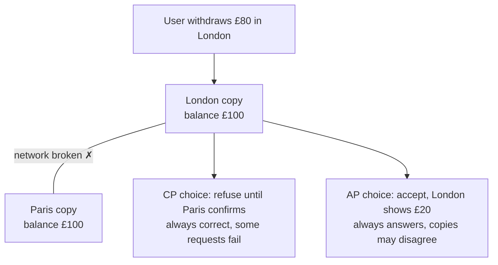

<!-- Written by `npm run lessons` from the lesson data in src/data. Edit the lesson there, not this page. -->

# Consistency, CAP and PACELC

**System Design · Unit 2: Core concepts: scale, reliability and speed · Lesson 6 of 9 · Must know**

> **In one line.** Consistency (in distributed systems) means every read sees the latest write. The CAP theorem says that during a network partition, a system must choose between consistency and availability.

[Open this lesson on the site](https://learn.hamropedia.com/system-design/consistency-cap-and-pacelc/) for its animation, the practice game and tap-to-explain words.

## The problem it solves

To survive failures and be fast for users everywhere, you keep copies of data on several machines. But copies can't all change at exactly the same instant, and the network between them can break. You must decide what users see in that gap.

## The idea

When data is copied across machines, the copies can briefly disagree. Strong consistency makes every read return the latest value, but may have to refuse requests when machines can't talk to each other. Eventual consistency always answers, but a read can be briefly out of date.

Network partitions will happen, so the real choice is C or A during a partition. PACELC adds: else (normally), you trade latency against consistency.

## How it works, step by step

1. Picture two replicas, in London and Paris, each holding a balance of £100.
2. The network between them breaks: a partition. A user in London withdraws £80.
3. CP choice: London refuses, or only accepts if it can confirm with Paris. Always correct, but some requests fail until the network heals.
4. AP choice: London accepts and records £20, while Paris still says £100. Both keep answering, but a second £80 withdrawal in Paris would overdraw the account. When the network heals, the system must reconcile the two.
5. With no partition (normal running), waiting for both copies before confirming is consistent but slower. That's the latency-versus-consistency trade-off in PACELC.

## Picture it



*The network between the two copies is broken. The system must either refuse (stay consistent) or accept and risk the copies disagreeing (stay available).*

## Analogy

Two bank branches whose phone line is cut. Either they stop withdrawals until the line is back (consistency), or they keep serving customers and reconcile later, risking an overdrawn account (availability).

**Where the analogy breaks.** A bank makes this choice once, as a policy. Real systems choose per operation: a social feed can be eventually consistent while the payment inside the same app must be strongly consistent.

## Example

Bank balance: strong consistency (CP). Likes on a post: eventual consistency (AP); nobody minds seeing 1,203 instead of 1,205 for a second.

## Must know

- C = every read sees the latest write; A = every request gets a non-error response; P = the system keeps working when messages between machines are lost.
- Partitions are unavoidable in distributed systems, so it's CP or AP during a partition.
- Consistency levels: strong, read-your-own-writes, monotonic reads, eventual.
- Quorums: with N copies, writing to W and reading from R where W + R > N means every read overlaps the latest write.
- PACELC: even without partitions, stronger consistency costs latency.
- CAP's C is not ACID's C (which is about the database's rules and constraints).

## Trade-offs

- CP: correct, but may reject requests during a partition (bank ledger).
- AP: always answers, but may return stale data and needs conflict handling (shopping cart, likes).

## Common mistakes

- Calling a system 'CA'. With replicas, partitions can't be avoided.
- Treating CAP as one choice for the whole system, instead of a choice per type of data.
- Confusing CAP's consistency with ACID's consistency.

> **Not true:** With enough replicas, a system can stay both consistent and available during a network partition.  
> **In fact:** A replica that is cut off must either refuse requests (consistent) or answer with data that may be old (available). No number of replicas removes that choice.

> **Not true:** CAP is one choice, made once for the whole system.  
> **In fact:** Different data needs different choices. A bank balance may need consistency, while a count of likes can favour availability, in the same system.

## In the interview

It depends on the data. For money or stock levels I'd choose strong consistency, accepting that some requests fail during a partition. For feeds, likes or view counts I'd choose availability with eventual consistency, because a slightly stale number is harmless and the system stays up.

<details>
<summary>&lt;b>Is a single-server SQL database CP or AP?&lt;/b></summary>

CAP is about distributed systems with replicas. One server has no partition between copies; with replicas, it depends on how replication and failover are set up.

</details>

<details>
<summary>&lt;b>Explain W + R > N.&lt;/b></summary>

If every write reaches W copies and every read checks R copies, and W + R > N, at least one copy you read must have the latest write.

</details>

## Practise

Try each one yourself first, then open the answer and compare.

### 1. Explain

Explain CAP with the two-bank-branches picture, and why 'CA' isn't a real choice for distributed systems.

<details>
<summary>Show one good answer</summary>

Two branches of a bank share every account, and the phone line between them is cut (a network partition). A customer asks the London branch to withdraw £80 from an account holding £100. London can't check with Paris. It has two choices:

• Consistency (CP): refuse, or wait, until the line is back. Every answer it gives is correct, but some customers are turned away.  
• Availability (AP): pay out and note it down, and sort things out with Paris later. Everyone is served, but Paris still thinks the balance is £100, so the account could be overdrawn twice over.

Why "CA" isn't a real choice: CA would mean "consistent and available, as long as there are no partitions". But once data lives on more than one machine, the network between them will fail sometimes; you can't choose to have no partitions. So the real question is only what you do when one happens: refuse (C) or answer (A). A single machine is "CA" only because it has nothing to be partitioned from.

</details>

### 2. Draw

Draw two replicas separated by a partition, and show what a CP system and an AP system each do with a write.

<details>
<summary>Show one good answer</summary>

The partition is the same in both pictures; the only difference is whether the replica that can't reach the other one keeps accepting writes.

```text
Replica A  ══ ✗ partition ✗ ══  Replica B
(London)                        (Paris)
balance £100                    balance £100

Write: "withdraw £80" arrives at A

CP system
  A can't confirm with B
  → refuses (or waits): error to the user
  → both still say £100: correct, not available

AP system
  A accepts → A says £20, B still says £100
  → the user gets an answer: available
  → copies disagree until the partition heals,
    then they must be reconciled
```

</details>

### 3. Apply

Label each as needing strong or eventual consistency: bank balance, Instagram likes, cinema seat booking, profile picture, stock level at checkout.

<details>
<summary>Show one good answer</summary>

• Bank balance: strong. A stale balance lets someone spend the same money twice.  
• Instagram likes: eventual. Seeing 1,203 instead of 1,205 for a second harms nobody, and the counter must stay up under huge load.  
• Cinema seat booking: strong. Two people must never both get seat F12; the booking must be checked against the latest state (a transaction, or a conditional write).  
• Profile picture: eventual, with one exception: the person who changed it should see their own change straight away (read-your-own-writes). Everyone else can catch up in a few seconds.  
• Stock level at checkout: strong at the moment of buying (decrement only if stock > 0, atomically), so you never sell the last item twice. The "only 3 left" shown while browsing can be eventual.

</details>

### 4. Trade-offs

With N = 3 copies, compare W = 3, R = 1 with W = 2, R = 2. What does each favour?

<details>
<summary>Show one good answer</summary>

With N = 3 copies, both settings satisfy W + R > N (3 + 1 = 4, 2 + 2 = 4), so every read overlaps the latest write. What differs is speed and what survives a failure.

W = 3, R = 1:  
• Reads are as fast as possible: any one copy will do.  
• Writes are slow (they wait for the slowest copy) and fail if any one of the three copies is down.  
• It favours read-heavy data that is rarely written, where losing write availability briefly is acceptable.

W = 2, R = 2:  
• Both reads and writes wait for two copies: balanced latency.  
• Both keep working with one copy down.  
• It favours availability, and workloads with a fair mix of reads and writes. This is the common default (a "quorum" of 2 out of 3).

(Going further, W = 1, R = 1 is fastest of all, but 1 + 1 is not more than 3, so reads can be stale: eventual consistency.)

</details>

## Go further (optional)

- WATCH · [Distributed Systems lecture series: consistency and consensus](https://www.youtube.com/results?search_query=Martin+Kleppmann+distributed+systems+lecture+consistency+and+consensus) · Martin Kleppmann, University of Cambridge · free on YouTube
- WATCH · [ByteByteGo: CAP theorem](https://www.youtube.com/results?search_query=ByteByteGo+CAP+theorem) · ByteByteGo · YouTube
- READ · [The System Design Primer](https://github.com/donnemartin/system-design-primer) · Donne Martin · GitHub, free

---

[← Caching](caching.md) · [All lessons](../../README.md) · [Rate limiting and backpressure →](rate-limiting-and-backpressure.md)
