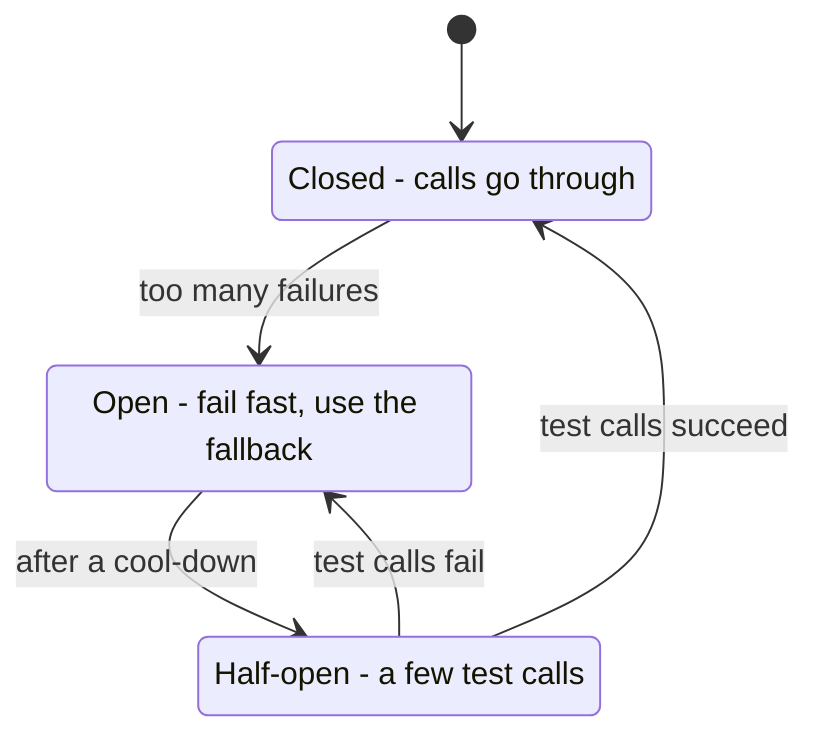

<!-- Written by `npm run lessons` from the lesson data in src/data. Edit the lesson there, not this page. -->

# Fault tolerance: timeouts, retries, circuit breakers

**System Design · Unit 2: Core concepts: scale, reliability and speed · Lesson 3 of 9 · Must know**

> **In one line.** Fault tolerance means the system keeps working, perhaps in a reduced way, when parts of it fail.

[Open this lesson on the site](https://learn.hamropedia.com/system-design/fault-tolerance-timeouts-retries-circuit-breakers/) for its animation, the practice game and tap-to-explain words.

## The problem it solves

In a system of many services, something is always slow or broken. Without protection, one slow dependency makes its callers wait, they run out of threads, and the failure spreads until everything is down.

## The idea

In distributed systems something is always failing: a server, a network link, a slow dependency. There are five defences. Timeouts: never wait forever. Retries with exponential backoff and jitter: try again, gently. Circuit breakers: stop calling a broken service for a while. Fallbacks: return cached or default data. Bulkheads: separate resources, so one failure can't sink everything.

## How it works, step by step

1. Timeout: decide how long a call may take, say 300 ms. After that, give up instead of waiting forever.
2. Retry: if the failure looks temporary and the call is safe to repeat, try again after 100 ms, then 200 ms, then 400 ms (exponential backoff), each with a little randomness (jitter).
3. Circuit breaker: count failures. If, say, half the calls fail within 10 seconds, 'open' the breaker and fail instantly for the next 30 seconds without calling the service at all.
4. Half-open: after the wait, let a few test calls through. If they succeed, close the breaker; if not, open it again.
5. Fallback: while the breaker is open, return something useful: cached data, a default, or the page without that feature.

## Picture it



*The three states of a circuit breaker. Arrows show what makes it switch from one state to another.*

## Analogy

A fuse box. When one circuit overloads, its fuse trips, so the whole house doesn't catch fire.

**Where the analogy breaks.** A fuse stays off until someone resets it. A circuit breaker tests the service again on its own after a cool-down (the 'half-open' state) and closes again when calls succeed.

## Example

Checkout calls a recommendations service. If it's slow, a 200 ms timeout plus a circuit breaker lets checkout still load, just without recommendations.

## Must know

- Always set timeouts on network calls.
- Only retry safe (idempotent) operations; use exponential backoff plus random jitter to avoid retry storms.
- Circuit breaker states: closed (normal) → open (fail fast) → half-open (test) → closed.
- Graceful degradation: lose a feature, not the whole product.
- Cascading failure: a slow service ties up threads in the services calling it, which then slow down too.
- Test it: chaos engineering breaks things on purpose, in a controlled way.

## In code

```python
import random, time

def call_with_retry(fn, attempts=4, base=0.1):
    for i in range(attempts):
        try:
            return fn()                     # fn must be safe to repeat
        except TimeoutError:
            if i == attempts - 1:
                raise
            time.sleep(base * 2**i * random.uniform(0.5, 1.5))   # backoff + jitter
```

## Common mistakes

- No timeouts, or a timeout longer than the caller's own timeout.
- Retrying operations that aren't safe to repeat, like charging a card.
- Retrying instantly without backoff, which turns a small outage into a big one.

> **Not true:** Retries: a failed card payment can be sent again like a failed read.  
> **In fact:** The first attempt may have worked before its reply was lost, so a retry could charge the card twice. Retry only operations that are safe to repeat.

> **Not true:** During an outage: retry at once, with no delay, to recover sooner.  
> **In fact:** Instant retries from many clients pile more load onto a service that is already struggling. Wait longer after each failure (exponential backoff), with some random jitter.

## In the interview

Every network call gets a timeout. Idempotent calls are retried with exponential backoff and jitter. Calls to non-critical dependencies sit behind a circuit breaker with a fallback, so the core feature keeps working when they fail. That stops one slow service from causing a cascading failure.

<details>
<summary>&lt;b>Why add jitter to retries?&lt;/b></summary>

Without it, all clients retry at the same moments and hit the recovering service in synchronised waves.

</details>

<details>
<summary>&lt;b>What's a bulkhead?&lt;/b></summary>

Separate pools of threads or connections for each dependency, so one slow dependency can't use them all up.

</details>

## Practise

Try each one yourself first, then open the answer and compare.

### 1. Explain

Explain the three circuit-breaker states with the fuse-box picture.

<details>
<summary>Show one good answer</summary>

A circuit breaker is like the fuse box in a house.

• Closed (the normal state): the fuse is in, electricity flows. Calls to the other service go through, and the breaker counts the failures.  
• Open: too many failures, so the fuse trips. Now calls aren't even attempted: they fail at once and the caller uses a fallback. That protects both sides: the caller doesn't tie up threads waiting, and the struggling service gets room to recover.  
• Half-open: this is where the fuse picture breaks. A fuse stays off until a person resets it. A circuit breaker tries again by itself after a cool-down: it lets a few test calls through. If they succeed it closes again; if they fail it opens again for another cool-down.

</details>

### 2. Draw

Draw service A calling service B through a circuit breaker, and show what A returns when the breaker is open.

<details>
<summary>Show one good answer</summary>

The breaker sits inside service A, in front of every call to B. While it is open, B receives nothing at all, and A answers its own caller straight away from the fallback, so a slow or broken B no longer makes A slow.

```text
Service A
  │ wants data from B
  ▼
Circuit breaker (inside A)
  │
  ├─ CLOSED:    call B normally,
  │             count the failures
  │
  ├─ OPEN:      don't call B at all.
  │             Return the fallback at once:
  │             · cached data
  │             · a default value
  │             · the page without that part
  │
  └─ HALF-OPEN: let a few test calls
                through to B
  │
  ▼
Service B
```

</details>

### 3. Apply

Write the retry function below, then simulate 100 clients retrying against a service that recovers after 2 seconds, with and without jitter.

<details>
<summary>Show one good answer</summary>

The retry function is the lesson's: exponential backoff (0.1 s, 0.2 s, 0.4 s…), each wait multiplied by a random factor between 0.5 and 1.5 (jitter).

The simulation fakes the clock, so it runs instantly and gives the same numbers every time. 100 clients fail at the same moment; the service is down for 2 seconds; every client keeps retrying with the same backoff.

Without jitter, all 100 clients wait exactly the same time, so every retry wave hits the service with all 100 calls in the same instant, including the wave that arrives just after it recovers (a "thundering herd"): 100 calls in one 50 ms slice. With jitter, the same 600 calls are spread out, and the busiest 50 ms after recovery sees only 7, so a recovering service isn't knocked straight back over.

The cost is visible too: with jitter, the unluckiest client gets through at 5.8 s instead of 3.1 s. Jitter trades a little extra waiting for some clients for a much smoother load on the service.

```python
import random
import time


def call_with_retry(fn, attempts=4, base=0.1):
    for i in range(attempts):
        try:
            return fn()                     # fn must be safe to repeat
        except TimeoutError:
            if i == attempts - 1:
                raise
            time.sleep(base * 2**i * random.uniform(0.5, 1.5))   # backoff + jitter


failures_left = [2]

def flaky():
    if failures_left[0] > 0:
        failures_left[0] -= 1
        raise TimeoutError
    return "ok"

print(call_with_retry(flaky))                       # ok (on the third try)


# 100 clients fail at t = 0 and retry; the service is down until t = 2 s.
# Time is simulated, so this runs instantly and is repeatable.
def simulate(jitter, clients=100, recover_at=2.0, base=0.1, attempts=8):
    random.seed(7)
    calls = []                                      # when each call reached the service
    for _ in range(clients):
        t = 0.0
        for i in range(attempts):
            calls.append(t)
            if t >= recover_at:
                break                               # this call succeeds
            wait = base * 2**i
            t += wait * random.uniform(0.5, 1.5) if jitter else wait
    after = [c for c in calls if c >= recover_at]   # the calls that meet the recovered service
    busiest = max(sum(1 for c in after if s <= c < s + 0.05) for s in after)
    return len(calls), busiest, round(max(calls), 2)


for jitter in (False, True):
    total, busiest, last = simulate(jitter)
    print(f"jitter={jitter}: {total} calls, busiest 50 ms after recovery: {busiest}, last client in at {last} s")
# jitter=False: 600 calls, busiest 50 ms after recovery: 100, last client in at 3.1 s
# jitter=True: 600 calls, busiest 50 ms after recovery: 7, last client in at 5.82 s
```

</details>

### 4. Trade-offs

When are retries dangerous? Give an example of an operation you must not blindly retry.

<details>
<summary>Show one good answer</summary>

Retries are dangerous when:  
• The operation is not safe to repeat. A timeout doesn't mean it failed; it may have worked and only the reply was lost. Retrying "charge this card £50" can charge twice.  
• The service is overloaded. Each retry is more load on a service that is already overloaded, so retries turn a slowdown into an outage. Retries also multiply through layers: if three layers each try 4 times, one user click can become 4 × 4 × 4 = 64 calls at the bottom.  
• The error is permanent. Retrying a 400 Bad Request or a 403 just fails again, more slowly.  
• The retries outlast the caller's own timeout, so the work continues after nobody is waiting for it.

Example: POST /payments/charge. Never retry it blindly. Send an idempotency key so the provider can recognise the repeat, or first ask "did charge X go through?" before trying again. Elsewhere: retry only at one layer, cap the attempts, back off with jitter, and use a retry budget (for example, retries may add at most 10% to the traffic).

</details>

## Go further (optional)

- READ · [Timeouts, retries, and backoff with jitter](https://www.google.com/search?q=Amazon+Builders+Library+timeouts+retries+backoff+with+jitter) · Amazon Builders' Library, free
- READ · [CircuitBreaker](https://martinfowler.com/bliki/CircuitBreaker.html) · Martin Fowler
- READ · [Site Reliability Engineering, Ch 22 (addressing cascading failures)](https://sre.google/sre-book/table-of-contents/) · Google · free online book

---

[← Availability: nines, SLAs and redundancy](availability-nines-slas-and-redundancy.md) · [All lessons](../../README.md) · [Load balancing →](load-balancing.md)
