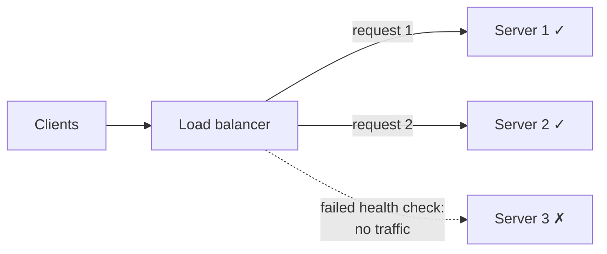

<!-- Written by `npm run lessons` from the lesson data in src/data. Edit the lesson there, not this page. -->

# Load balancing

**System Design · Unit 2: Core concepts: scale, reliability and speed · Lesson 4 of 9 · Must know**

> **In one line.** A load balancer spreads incoming requests across several servers and stops sending traffic to unhealthy ones.

[Open this lesson on the site](https://learn.hamropedia.com/system-design/load-balancing/) for its animation, the practice game and tap-to-explain words.

## The problem it solves

One server can only handle so much, and if it dies, everyone using it is affected. You need to spread requests across many servers and route around the broken ones.

## The idea

It makes many servers look like one, enables horizontal scaling and hides failures. Layer 4 balancers route by IP address and port (fast). Layer 7 balancers read the HTTP request, so they can route by path, header or cookie. Common algorithms: round robin, least connections, and hashing (the same user always goes to the same server).

## How it works, step by step

1. Clients connect to the load balancer's address, never directly to a server.
2. For each request or connection, it picks a healthy server using an algorithm: the next in turn (round robin), or the one with the fewest active connections.
3. Every few seconds it calls each server's health endpoint. After a few failures in a row it stops sending traffic there, and adds the server back when it recovers.
4. A layer 7 balancer can read the URL and send /api to API servers and /images to image servers.
5. So the balancer itself isn't a single point of failure, run two of them (one active, one standby, sharing an address) or use a managed service.

## Picture it



*Requests are shared between healthy servers. Server 3 failed its health check, so it gets no traffic until it recovers.*

## Analogy

A supermarket worker sending shoppers to the shortest checkout queue, and closing a till when it breaks.

**Where the analogy breaks.** Shoppers are fairly similar. Requests aren't: one may take 5 ms and another 5 seconds, so 'the same number of requests' isn't 'the same amount of work'. Least connections helps.

## Example

An AWS Application Load Balancer (layer 7) sends /api/\* to API servers and /images/\* to a media service, and checks each server's /health endpoint every few seconds.

## Must know

- Algorithms: round robin, weighted round robin, least connections, IP or consistent hashing.
- Health checks remove failed servers automatically.
- Layer 4: fast and protocol-agnostic. Layer 7: smarter routing and TLS handling, but more work per request.
- Sticky sessions tie a user to one server; avoid them by keeping servers stateless.
- The load balancer itself must be redundant (a pair, or a managed service).
- Load balancers are also used between internal services, not only at the edge.

## Common mistakes

- Sticky sessions that tie one user to a server forever, which breaks when that server dies.
- Health checks that only test 'is the process running?', not 'can it reach its database?'.
- Forgetting that the load balancer needs redundancy too.

> **Not true:** A health check that finds the process running proves the server can handle requests.  
> **In fact:** A process can be running and still be unable to reach its database. A good health check tests what a real request needs.

> **Not true:** Round robin sends each request to the server with the fewest open connections.  
> **In fact:** Round robin simply takes the servers in turn. Sending each request to the server with the fewest open connections is the least-connections algorithm.

## In the interview

I'd put a layer 7 load balancer in front of the stateless app servers, with health checks and least-connections routing. It runs as a redundant pair or a managed service, so it isn't a single point of failure.

<details>
<summary>&lt;b>How does a load balancer know a server is down?&lt;/b></summary>

Health checks: it calls an endpoint regularly and removes the server after several failures in a row.

</details>

<details>
<summary>&lt;b>When would you route by hashing?&lt;/b></summary>

When requests for the same key should reach the same server, for example a cache shard, so the data already in its memory gets reused.

</details>

## Practise

Try each one yourself first, then open the answer and compare.

### 1. Explain

Explain layer 4 and layer 7 load balancing in two sentences each.

<details>
<summary>Show one good answer</summary>

Layer 4: the load balancer looks only at the network level, the IP addresses and ports, and forwards whole connections without reading what is inside them. It is very fast and works for any protocol, but it can't route by URL or user.

Layer 7: the load balancer reads the HTTP request itself, its path, headers and cookies, so it can send /api to API servers and /images to an image service, and handle TLS. It is smarter, but does more work per request, and it must decrypt the traffic to read it.

</details>

### 2. Draw

Draw a load balancer with three servers, one of them failing its health check.

<details>
<summary>Show one good answer</summary>

The load balancer calls each server's /health endpoint every few seconds. Server 3 failed several checks in a row, so it gets no traffic until it passes again; requests are shared between servers 1 and 2. A good health check also tests what the server needs (can it reach its database?), not just that the process is running.

```text
              Clients
                 │
           Load balancer
    ┌────────────┼ ─ ─ ─ ─ ─ ─ ┐
    │            │             ╎ no traffic
    ▼            ▼             ▼
Server 1     Server 2      Server 3
/health ✓    /health ✓     /health ✗ ✗ ✗
requests     requests      (back in when
1, 3, 5…     2, 4, 6…       it passes again)
```

</details>

### 3. Apply

Pick an algorithm for: identical short API calls; long video uploads; a cache cluster. Justify each.

<details>
<summary>Show one good answer</summary>

• Identical short API calls: round robin. Every request costs about the same, so taking turns spreads the work evenly, and it is the simplest algorithm. (Least connections works too.)  
• Long video uploads: least connections. An upload can last seconds or an hour, so "the same number of requests" is not "the same amount of work". Round robin could stack several long uploads on one server while another sits idle; least connections sends each new upload to the server with the fewest open ones.  
• A cache cluster: consistent hashing on the cache key. The same key must always reach the same node, or every request misses (the data is in another node's memory). Consistent hashing also means that adding or removing a node only moves about 1 in n keys, instead of reshuffling almost all of them.

</details>

### 4. Trade-offs

Why are sticky sessions a problem when you scale out or a server dies?

<details>
<summary>Show one good answer</summary>

Sticky sessions pin each user to the server that served them first. That causes problems:

• Scaling out doesn't help straight away: new servers only get new users, while the existing users stay on the overloaded old servers.  
• Uneven load: a few heavy users stuck on one server can overload it while others idle, and the balancer isn't allowed to move them.  
• A server dies: everything stored in its memory for its users is lost. They are logged out, lose their basket or their half-filled form.  
• Deploys and scaling in are slow: you have to wait for sessions to drain before you can remove a server.

The fix is to make servers stateless: keep sessions in a shared store like Redis (or in a signed token on the client), so any server can serve any request and the balancer is free to spread the load.

</details>

## Go further (optional)

- READ · [What is load balancing?](https://www.cloudflare.com/learning/performance/what-is-load-balancing/) · Cloudflare Learning Center, free
- READ · [The System Design Primer](https://github.com/donnemartin/system-design-primer) · Donne Martin · GitHub, free
- WATCH · [ByteByteGo: load balancing algorithms](https://www.youtube.com/results?search_query=ByteByteGo+load+balancing+algorithms) · ByteByteGo · YouTube

---

[← Fault tolerance: timeouts, retries, circuit breakers](fault-tolerance-timeouts-retries-circuit-breakers.md) · [All lessons](../../README.md) · [Caching →](caching.md)
