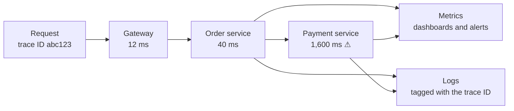

<!-- Written by `npm run lessons` from the lesson data in src/data. Edit the lesson there, not this page. -->

# Observability: logs, metrics and traces

**System Design · Unit 2: Core concepts: scale, reliability and speed · Lesson 9 of 9 · Must know**

> **In one line.** Observability is how well you can understand what a system is doing from the outside, using logs, metrics and traces.

[Open this lesson on the site](https://learn.hamropedia.com/system-design/observability-logs-metrics-and-traces/) for its animation, the practice game and tap-to-explain words.

## The problem it solves

When something goes wrong in a system of many services, you can't attach a debugger to production. Without data coming out of the system, you're guessing.

## The idea

Metrics are numbers over time (requests per second, error rate, latency percentiles), used for dashboards and alerts. Logs are detailed records of events, used for investigating. Traces follow one request across many services and show where the time went. Alert on symptoms users feel (errors, latency against your SLO), not on every CPU blip.

## How it works, step by step

1. Metrics: every service counts requests, errors and latency, and exports them every few seconds. Dashboards show trends; an alert fires when, say, the error rate stays above 1% for 5 minutes.
2. Logs: each important event is written as structured JSON, including the request's trace ID, the user ID and timings.
3. Traces: the first service creates a trace ID and passes it in a header to every service it calls. Each service records how long its part took.
4. Investigating: the alert tells you something is wrong, the dashboard shows when it started, a trace shows which service is slow, and that service's logs show why.

## Picture it



*One request's trace shows the time spent in each service, which points straight at the slow one. Metrics and logs from every service carry the same trace ID.*

## Analogy

A car: the dashboard is metrics, the service history is logs, and a GPS replay of one journey is a trace.

**Where the analogy breaks.** A car is one machine. A request may cross 20 services, so without a shared trace ID to join the logs together, you can't follow it.

## Example

The p99 checkout latency jumps from 300 ms to 2 s. The dashboard shows when; a trace shows 1.6 s spent in the payment service's database call; that service's logs show a lock timeout.

## Must know

- The four golden signals: latency, traffic, errors, saturation.
- Use percentiles (p50, p95, p99), not averages; averages hide the slow users.
- Structured logs (JSON), with a request or trace ID on every line.
- Distributed tracing (OpenTelemetry) shows the time spent in each service.
- Alert on SLO burn (user impact), and give every alert a runbook.
- Health checks and a dashboard per service.

## Common mistakes

- Alerting on causes (CPU at 80%) instead of symptoms users feel (errors, slow responses).
- Logs without a request or trace ID, so you can't connect them.
- Watching the average latency instead of percentiles: an average hides the slow requests that users actually feel.

> **Not true:** The best alerts fire on causes, such as CPU reaching 80%.  
> **In fact:** High CPU may hurt nobody, and users can suffer while CPU looks fine. Alert on the symptoms users feel: errors and slow responses.

> **Not true:** Average latency shows what the slowest users experience.  
> **In fact:** An average hides the slow requests. Percentiles show them: p99 is the time that 99% of requests beat, so it describes the slowest 1%.

## In the interview

I'd emit the four golden signals as metrics for each service, write structured logs with a trace ID, and use distributed tracing to follow requests across services. Alerts fire on user-facing symptoms, like p99 latency or error rate breaking the SLO, so on-call engineers are paged only for real problems.

<details>
<summary>&lt;b>Why p99 instead of the average?&lt;/b></summary>

The average can look fine while 1% of users wait seconds. At scale, that 1% is a lot of people, and often your heaviest users.

</details>

<details>
<summary>&lt;b>Monitoring or observability?&lt;/b></summary>

Monitoring checks for known failures with dashboards and alerts. Observability lets you ask new questions about failures you didn't predict.

</details>

## Practise

Try each one yourself first, then open the answer and compare.

### 1. Explain

Explain logs, metrics and traces with the car picture.

<details>
<summary>Show one good answer</summary>

• Metrics are the car's dashboard: a few numbers, updated all the time (speed, fuel, engine temperature). For a service: requests per second, error rate, latency percentiles. You glance at them to see if anything is wrong, and warning lights (alerts) go on when a number crosses a line.  
• Logs are the car's service history: a detailed record of individual events ("12:03: brake pads replaced"). For a service: "order 77 failed: card declined". You read them when you investigate a particular problem.  
• A trace is a GPS replay of one journey: exactly where you went and how long each part took. For a request: it entered the gateway, spent 40 ms in orders, then 1.6 s in payments. It shows where the time went.

Where the picture breaks: a car is one machine. One request can cross twenty services, so each one must pass on a shared trace ID, or you can't join the pieces together.

</details>

### 2. Draw

Draw one request crossing 3 services, and show where the trace ID is passed along.

<details>
<summary>Show one good answer</summary>

The first service that sees the request creates the trace ID and passes it on in a header (traceparent, in OpenTelemetry) on every call it makes. Every service records its own span (start, duration) under that ID and adds the ID to every log line, so one search finds the whole journey.

```text
Client
  │ GET /checkout
  ▼
Gateway ── creates trace ID abc123
  │ header traceparent: abc123
  ▼                           span: gateway, 12 ms
Order service
  │ header traceparent: abc123
  ▼                           span: orders, 40 ms
Payment service               span: payments, 1,600 ms ⚠

Every log line: {"trace_id": "abc123", ...}
All spans → tracing backend → one timeline
```

</details>

### 3. Apply

Choose 4 metrics and 2 alerts, with thresholds, for a payment API.

<details>
<summary>Show one good answer</summary>

Four metrics (per endpoint, every few seconds):  
1. Traffic: requests per second, split by endpoint and status code.  
2. Errors: the share of requests ending in a 5xx (the payment service's fault), kept separate from card declines (normal business results, not errors).  
3. Latency: p50, p95 and p99 of request time, plus the latency of calls to the card network or payment provider.  
4. Saturation: how full the database connection pool and the worker queue are.

Two alerts (each pages someone, and links to a runbook):  
1. Error rate: 5xx above 1% of requests for 5 minutes in a row. Payments failing is the most important symptom.  
2. Latency: p99 above 2 seconds for 10 minutes. Users abandon slow checkouts, and slow payments often mean a provider problem.

A useful third, as a warning rather than a page: the authorisation success rate falls more than 10% below its normal level for this time of day, which can mean a provider or fraud-rule problem even when nothing is erroring.

</details>

### 4. Trade-offs

Logging everything at debug level in production: what does it cost, and what would you do instead?

<details>
<summary>Show one good answer</summary>

What it costs:  
• Money and storage: debug logging can easily write 20 lines per request. At 10,000 requests a second and 500 bytes a line, that is 100 MB a second, about 8.6 TB a day, all paid for in ingestion, indexing and storage.  
• Speed: writing and shipping all that uses CPU, disk and network on every server, and adds latency.  
• Noise: the important lines are buried, so investigations get slower, not faster.  
• Risk: debug logs tend to include request bodies, so tokens, card numbers and personal data end up in a system with weaker controls.

Instead:  
• Log at INFO by default, as structured JSON with the trace ID, and only for meaningful events.  
• Log every error, but sample the successes (say 1%).  
• Make the log level changeable at runtime, for one service or even one user, so you can turn on debug only while investigating.  
• Use metrics for counting and traces (with sampling that keeps the slow and failed ones) for timing, instead of logging both.  
• Mask sensitive fields before they are written.

```python
requests_per_s, lines, bytes_per_line = 10_000, 20, 500
mb_per_s = requests_per_s * lines * bytes_per_line / 1e6
tb_per_day = mb_per_s * 86_400 / 1e6
print(mb_per_s, round(tb_per_day, 2))          # 100.0 8.64
```

</details>

## Go further (optional)

- READ · [Site Reliability Engineering, Ch 6 (monitoring distributed systems)](https://sre.google/sre-book/table-of-contents/) · Google · free online book
- READ · [Observability primer](https://www.google.com/search?q=OpenTelemetry+observability+primer) · OpenTelemetry docs
- WATCH · [ByteByteGo: logging tracing metrics](https://www.youtube.com/results?search_query=ByteByteGo+logging+tracing+metrics) · ByteByteGo · YouTube

---

[← Asynchronous processing and message queues (Kafka, SQS)](asynchronous-processing-and-message-queues-kafka-sqs.md) · [All lessons](../../README.md) · [SQL vs NoSQL: choosing a database →](../unit-3-data/sql-vs-nosql-choosing-a-database.md)
