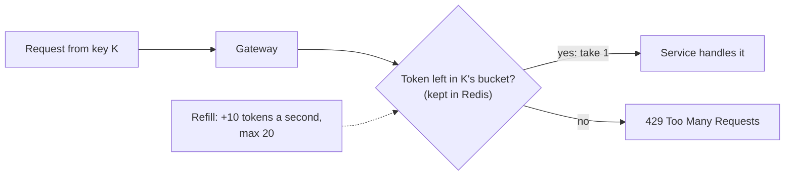

<!-- Written by `npm run lessons` from the lesson data in src/data. Edit the lesson there, not this page. -->

# Rate limiting and backpressure

**System Design · Unit 2: Core concepts: scale, reliability and speed · Lesson 7 of 9 · Must know**

> **In one line.** Rate limiting caps how many requests a client can make in a time window. Backpressure is a system telling the senders upstream to slow down when it's overloaded.

[Open this lesson on the site](https://learn.hamropedia.com/system-design/rate-limiting-and-backpressure/) for its animation, the practice game and tap-to-explain words.

## The problem it solves

Without limits, one buggy script, scraper or attacker can send so many requests that everyone else gets errors. And a system that accepts more work than it can do eventually collapses for everyone.

## The idea

Rate limits protect services from abuse, bugs and traffic spikes, and enforce fair use, like 100 requests per minute per user. Requests over the limit get HTTP 429. Common algorithms: token bucket, leaky bucket, fixed window and sliding window.

Backpressure goes further: queues have size limits, and when they fill, senders are told to wait or requests are dropped on purpose, instead of the whole system falling over.

## How it works, step by step

1. Choose the rule: for example, 10 requests per second per API key, with bursts of up to 20.
2. Token bucket: each key has a bucket that holds up to 20 tokens and gains 10 tokens every second.
3. Each request takes one token. If a token is there, the request goes through.
4. If the bucket is empty, reply 429 Too Many Requests, with 'Retry-After: 1'.
5. With many gateway servers, keep each bucket in Redis and update it atomically, so every server shares the same count.
6. Inside the system, backpressure: when a work queue reaches its limit, stop accepting new work (or drop the least important) instead of letting the queue grow forever.

## Picture it



*Each client has a bucket of tokens. A request spends one token; an empty bucket means the request is rejected until the bucket refills.*

## Analogy

A nightclub bouncer lets in a few people per minute (rate limiting). When the club is full, the queue outside stops moving (backpressure).

**Where the analogy breaks.** A bouncer is one person at one door. A real service runs on many servers, so the limit must be shared between them, usually with counters in Redis, and that shared store must be fast and always available.

## Example

Token bucket: each user's bucket holds up to 10 tokens and refills at 1 token per second. Each request takes a token; an empty bucket means 429 Too Many Requests. Short bursts are allowed; sustained abuse isn't.

## Must know

- Token bucket: allows bursts up to the bucket size, with a steady refill rate. The most common.
- Leaky bucket: processes requests at a fixed rate; smooths out bursts.
- Fixed window: a simple counter per minute, but allows double bursts at the window edges.
- Sliding window (log or counter): smoother and fairer, slightly more work.
- Limit by user, API key or IP address; return 429 with a Retry-After header.
- Backpressure: bounded queues, load shedding, and signalling clients to slow down.

## In code

```python
import time

class TokenBucket:
    def __init__(self, capacity, refill_per_sec):
        self.capacity, self.rate = capacity, refill_per_sec
        self.tokens, self.last = capacity, time.monotonic()

    def allow(self):
        now = time.monotonic()
        self.tokens = min(self.capacity, self.tokens + (now - self.last) * self.rate)
        self.last = now
        if self.tokens >= 1:
            self.tokens -= 1
            return True
        return False                    # the caller returns HTTP 429
```

## Common mistakes

- Limiting per server instead of across all servers.
- One global limit, so a single heavy user blocks everyone else.
- Unbounded queues that hide overload until memory runs out.

> **Not true:** Counters kept on each server: the limit still holds across the whole system.  
> **In fact:** With ten servers, a client could get ten times the limit. Keep the counters in a shared store such as Redis, so that every server sees the same count.

> **Not true:** One global limit shared by the users: a fair design, since no one gets special treatment.  
> **In fact:** With one shared limit, a single heavy user can use it all up and block everyone else. Limit each user, API key or IP address separately.

## In the interview

I'd rate-limit at the API gateway with a token bucket per user or API key, keeping the counters in Redis so every gateway node shares them, and return 429 with Retry-After. Internally I'd use bounded queues and load shedding, so overload slows the system down gracefully instead of crashing it.

<details>
<summary>&lt;b>Why is the fixed window unfair?&lt;/b></summary>

A client can send the full limit at 12:00:59 and again at 12:01:00, doubling the real rate across the boundary.

</details>

<details>
<summary>&lt;b>What if Redis is down?&lt;/b></summary>

Decide to fail open (allow requests and risk abuse) or fail closed (block and risk an outage), per API. Many systems fail open with a local backup limit.

</details>

## Practise

Try each one yourself first, then open the answer and compare.

### 1. Explain

Explain the token bucket with the nightclub picture.

<details>
<summary>Show one good answer</summary>

The nightclub bouncer has a bowl of wristbands, and you need one to get in. The bowl holds at most 20, and a helper drops in 10 new ones every second.

• A group of 15 arrives at once: there are wristbands in the bowl, so they all go in. Short bursts are fine, up to the size of the bowl.  
• A crowd keeps arriving faster than 10 a second: the bowl empties, and people are turned away until new wristbands drop in (HTTP 429, "come back in a second").  
• Over time, nobody gets in faster than 10 a second on average: the refill rate.

That is the token bucket: capacity = the most you allow in a burst; refill rate = the steady limit. Each request spends one token.

</details>

### 2. Draw

Draw where rate limiting happens in a system with a gateway, several servers and Redis.

<details>
<summary>Show one good answer</summary>

The limit is checked once, at the gateway, before any work is done. The counters live in Redis, not in each gateway's memory, so the limit holds no matter which gateway a request lands on. Inside, a bounded queue in front of each service gives backpressure: when it is full, new work is refused instead of building up.

```text
Clients
  │
  ▼
Load balancer
  ├────────────┬────────────┐
  ▼            ▼            ▼
Gateway 1   Gateway 2   Gateway 3
  │  1. take a token for this
  │     API key (atomic, shared)
  ├───────────────────────► Redis
  │  ◄── allowed / empty ──┘ (one bucket
  │                           per key)
  ├─ empty   → 429, Retry-After: 1
  └─ allowed → service (via a bounded queue)
```

</details>

### 3. Apply

Implement a fixed-window limiter and the token bucket below. Send a burst of 50 requests to each and compare which get through.

<details>
<summary>Show one good answer</summary>

Both limiters allow 10 requests a second, and both use a fake clock so the result is the same every run.

A burst of 50 requests in half a second: the fixed window lets the first 10 through and blocks the rest of that second. The token bucket lets 14 through: its 10 stored tokens at once, then about one more every 100 ms as tokens refill.

The real difference is at a window edge. 20 requests between 0.9 s and 1.1 s: the fixed window allows all 20 (10 at the end of the first second, 10 at the start of the next), double the limit in 0.2 seconds. The token bucket allows only 11, because tokens don't reset at a boundary; they only refill at the steady rate.

```python
class FixedWindow:
    def __init__(self, limit, window, clock):
        self.limit, self.window, self.clock = limit, window, clock
        self.current, self.count = None, 0

    def allow(self):
        window = int(self.clock() // self.window)
        if window != self.current:                  # a new window: reset
            self.current, self.count = window, 0
        if self.count < self.limit:
            self.count += 1
            return True
        return False


class TokenBucket:
    def __init__(self, capacity, refill_per_sec, clock):
        self.capacity, self.rate, self.clock = capacity, refill_per_sec, clock
        self.tokens, self.last = capacity, clock()

    def allow(self):
        now = self.clock()
        self.tokens = min(self.capacity, self.tokens + (now - self.last) * self.rate)
        self.last = now
        if self.tokens >= 1:
            self.tokens -= 1
            return True
        return False


def run(times):
    now = [0.0]
    clock = lambda: now[0]
    fixed = FixedWindow(limit=10, window=1.0, clock=clock)
    bucket = TokenBucket(capacity=10, refill_per_sec=10, clock=clock)
    fixed_ok = bucket_ok = 0
    for t in times:
        now[0] = t
        fixed_ok += fixed.allow()
        bucket_ok += bucket.allow()
    return fixed_ok, bucket_ok


burst = [i * 0.01 for i in range(50)]              # 50 requests in 0.5 s
edge = [0.9 + i * 0.01 for i in range(20)]         # 20 requests from 0.9 s to 1.1 s
print("burst of 50:", run(burst))                  # (10, 14): fixed window, token bucket
print("20 across the 1 s edge:", run(edge))       # (20, 11)
```

</details>

### 4. Trade-offs

Fail open or fail closed when the limiter's store is down? Decide for a login endpoint and for a public search API.

<details>
<summary>Show one good answer</summary>

Login endpoint: don't fail fully open. The limit there is a security control: it is what slows down password guessing and credential stuffing, and attackers look for exactly this kind of gap. Fall back to a strict limit kept in each gateway's own memory (for example, 5 attempts a minute per IP and per account, per server). That is weaker than the shared limit, but far from no limit. If even that isn't possible, fail closed: a short login outage is visible and recoverable; a successful mass account takeover is not.

Public search API: fail open, with a generous local limit as a backup. Here the limit protects capacity, not secrets. The worst case of failing open is extra load, which autoscaling and load shedding can absorb, while failing closed would turn a Redis problem into an outage for every user.

The principle: decide per endpoint, by asking which is worse, abuse getting through or real users being blocked.

</details>

## Go further (optional)

- READ · [Hello Interview: design a rate limiter](https://www.google.com/search?q=Hello+Interview+design+a+rate+limiter) · hellointerview.com · free guides
- READ · [What is rate limiting?](https://www.cloudflare.com/learning/bots/what-is-rate-limiting/) · Cloudflare Learning Center, free
- READ · [Using load shedding to avoid overload](https://www.google.com/search?q=Amazon+Builders+Library+using+load+shedding+to+avoid+overload) · Amazon Builders' Library, free

---

[← Consistency, CAP and PACELC](consistency-cap-and-pacelc.md) · [All lessons](../../README.md) · [Asynchronous processing and message queues (Kafka, SQS) →](asynchronous-processing-and-message-queues-kafka-sqs.md)
