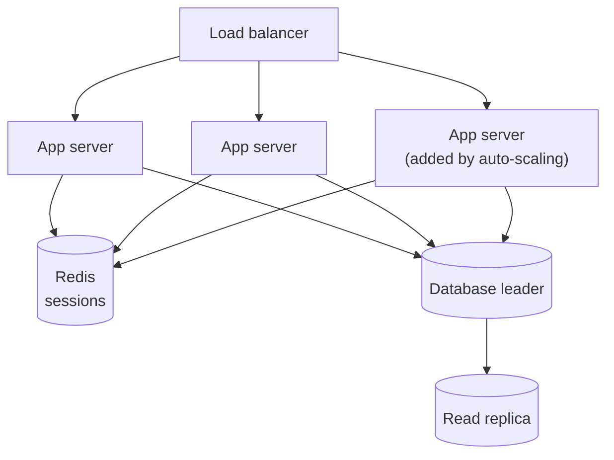

<!-- Written by `npm run lessons` from the lesson data in src/data. Edit the lesson there, not this page. -->

# Scalability: vertical vs horizontal

**System Design · Unit 2: Core concepts: scale, reliability and speed · Lesson 1 of 9 · Must know**

> **In one line.** Scalability is a system's ability to handle more load by adding resources.

[Open this lesson on the site](https://learn.hamropedia.com/system-design/scalability-vertical-vs-horizontal/) for its animation, the practice game and tap-to-explain words.

## The problem it solves

A system that works for 100 users can fail at 100,000. You need a way to add capacity without rewriting everything.

## The idea

Vertical scaling means a bigger machine (more CPU and memory). It's simple, but there's a ceiling, and that one machine can fail. Horizontal scaling means more machines behind a load balancer. It has no hard ceiling and survives failures, but needs stateless app servers and shared storage. The key trick: keep app servers stateless, and keep sessions and data in shared stores.

## How it works, step by step

1. Find the bottleneck first: is the CPU at 100%, the database slow, memory full, or the network saturated?
2. Make app servers stateless: no sessions or files kept on the server; put them in Redis and object storage instead.
3. Put a load balancer in front and add servers. With auto-scaling, servers are added automatically when CPU use or latency rises.
4. Take reads off the database: cache hot data and add read replicas.
5. When writes become the bottleneck, shard the database by a key.
6. Move slow work off the request path with queues.

## Picture it



*Horizontal scaling: identical, stateless app servers behind a load balancer. Because sessions live in Redis, any server can handle any user, so adding a server is easy.*

## Analogy

A busy restaurant can buy a bigger oven (vertical) or open more kitchens (horizontal).

**Where the analogy breaks.** More kitchens only help if any kitchen can cook any order. If half of a customer's order is in kitchen 2, it has to go back there. That's 'state', and it's why app servers should be stateless.

## Example

Moving login sessions from server memory into Redis lets any server handle any user, so you can add servers freely.

## Must know

- Stateless app servers plus a shared session store = easy horizontal scaling.
- Databases are the hard part: read replicas for more reads, sharding for more writes.
- Scale the real bottleneck: measure first (CPU, memory, database, network).
- Auto-scaling adds and removes servers based on load.
- Scalability is not speed: a system fast for one user can still collapse under many.

## Trade-offs

- Vertical: simple, no code changes, but a ceiling and a single point of failure.
- Horizontal: almost unlimited and fault tolerant, but needs statelessness, load balancing and distributed data.

## Common mistakes

- Adding app servers when the database is the real bottleneck.
- Keeping sessions in server memory, then adding more servers.
- Sharding far too early: it adds a lot of complexity.

> **Not true:** A slow system: more app servers make it faster, even when the database is the bottleneck.  
> **In fact:** Only when the app servers are the bottleneck. If the database is the slow part, more app servers just send it more work, so measure first.

> **Not true:** Sessions in a server's memory: they keep working when more servers are added.  
> **In fact:** The next request may reach a different server, which knows nothing about the session. Keep sessions in a shared store, so the app servers stay stateless.

## In the interview

I'd keep the application tier stateless so it scales horizontally behind a load balancer with auto-scaling. State goes into shared stores: sessions in Redis, data in the database. For the database, I'd add read replicas first and shard only when write volume needs it.

<details>
<summary>&lt;b>When is vertical scaling the right answer?&lt;/b></summary>

Early on, or for a database that's hard to split. It's simple and modern machines are very large. Just plan the horizontal path for later.

</details>

<details>
<summary>&lt;b>What makes a server 'stateful'?&lt;/b></summary>

It keeps data that later requests depend on, like a session in memory or an uploaded file on its local disk.

</details>

## Practise

Try each one yourself first, then open the answer and compare.

### 1. Explain

Explain vertical and horizontal scaling with the restaurant picture.

<details>
<summary>Show one good answer</summary>

A busy restaurant has two ways to cook more meals.

Vertical scaling is buying a bigger oven: one machine with more CPU and memory. It is simple (nothing about how the kitchen works changes), but there is a biggest oven you can buy, and if that one oven breaks, nobody eats.

Horizontal scaling is opening more kitchens: more machines behind a load balancer. There is no hard limit, and if one kitchen closes the others keep cooking. But it only works if any kitchen can cook any order. If half of a customer's order is sitting in kitchen 2 (state, like a session kept in one server's memory), their next request has to go back there. That is why app servers are made stateless, with sessions and files kept in shared stores.

</details>

### 2. Draw

Draw a stateless app tier behind a load balancer, with a shared session store and a database with replicas.

<details>
<summary>Show one good answer</summary>

The app servers are identical and keep nothing between requests, so the load balancer can send any user to any of them, and auto-scaling can add or remove one at any time. All state lives below them: sessions in Redis, data in the database, where the leader takes writes and the replicas serve reads.

```text
           Clients
              │
        Load balancer
     ┌────────┼────────┐
     ▼        ▼        ▼
    App      App      App   ← stateless,
   server   server   server   auto-scaled
     │        │        │
     ├────────┴────────┤
     ▼                 ▼
Redis (sessions)   Database leader ── writes
                       │ copies changes
                 ┌─────┴─────┐
                 ▼           ▼
             Replica      Replica ── reads
```

</details>

### 3. Apply

An app saves uploaded files on each server's local disk. Explain what breaks when you add a second server, and fix it.

<details>
<summary>Show one good answer</summary>

What breaks: a user uploads a photo and the load balancer sends that request to server 1, which saves it on its own disk. Their next request, "show my photo", goes to server 2, which has never seen the file: a broken image or a 404. It looks random, because it depends on which server you happen to hit. And if server 1 dies or is replaced, its files are gone for good.

The fix: keep no files on the app servers. Store uploads in shared object storage (such as Amazon S3), and save only the file's key in the database. Better still, have the server hand the client a short-lived signed upload URL, so the file goes straight to object storage and never passes through the app server at all. Serve files to users through a CDN in front of the storage.

Now every server sees the same files, any server can handle any request, and you can add or remove servers freely.

</details>

### 4. Trade-offs

Give one case where you'd scale vertically first, and why.

<details>
<summary>Show one good answer</summary>

The main database of a growing product, early on.

Say the PostgreSQL primary is running out of CPU at 5,000 queries a second. Moving it to a machine twice as big takes an hour and needs no code changes. Sharding it means choosing a shard key, rewriting the queries that join across shards, moving the data and running many databases: weeks of work and a permanent increase in complexity.

Modern machines are huge (hundreds of cores, terabytes of memory), so vertical scaling can carry a database a long way. Do it first, together with the cheap horizontal steps around it (a cache, read replicas), and plan the sharding path for when the biggest machine is no longer enough. Also: keep a standby replica, because one big machine is still a single point of failure.

</details>

## Go further (optional)

- READ · [Hello Interview: scale from zero to millions of users](https://www.google.com/search?q=Hello+Interview+scale+from+zero+to+millions+of+users) · hellointerview.com · free guides
- READ · [The System Design Primer](https://github.com/donnemartin/system-design-primer) · Donne Martin · GitHub, free
- WATCH · [ByteByteGo: vertical vs horizontal scaling](https://www.youtube.com/results?search_query=ByteByteGo+vertical+vs+horizontal+scaling) · ByteByteGo · YouTube

---

[← Proxies, reverse proxies and API gateways](../unit-1-networking/proxies-reverse-proxies-and-api-gateways.md) · [All lessons](../../README.md) · [Availability: nines, SLAs and redundancy →](availability-nines-slas-and-redundancy.md)
