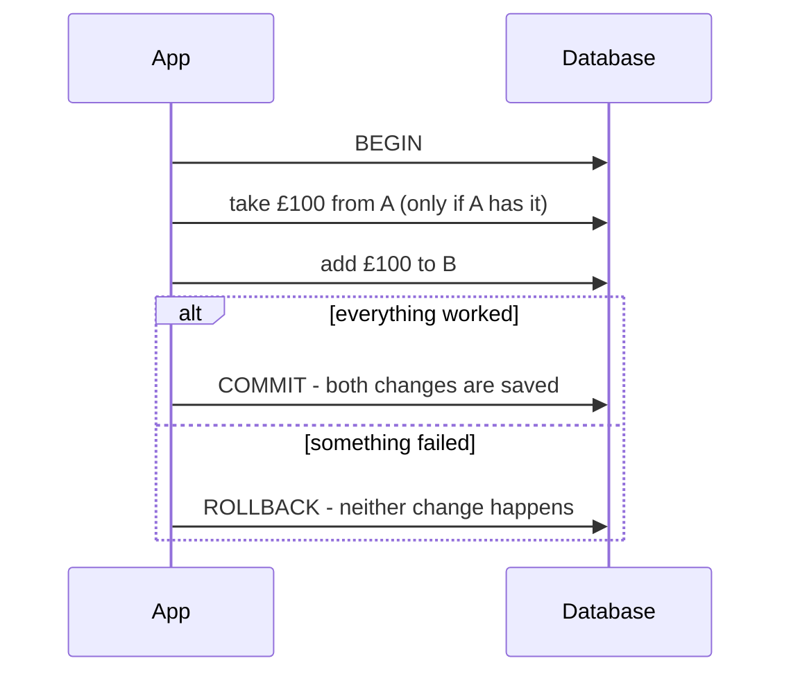

<!-- Written by `npm run lessons` from the lesson data in src/data. Edit the lesson there, not this page. -->

# ACID transactions and isolation levels

**System Design · Unit 3: Data: databases, storage and scaling data · Lesson 2 of 9 · Must know**

> **In one line.** A transaction groups several operations so they succeed or fail together. ACID stands for Atomic, Consistent, Isolated, Durable.

[Open this lesson on the site](https://learn.hamropedia.com/system-design/acid-transactions-and-isolation-levels/) for its animation, the practice game and tap-to-explain words.

## The problem it solves

Real operations change several things at once: take money from A, give it to B. If the system crashes halfway, or two users act at the same moment, money can be created or destroyed.

## The idea

Atomic: all or nothing. Consistent: the database moves from one valid state to another, so its rules always hold. Isolated: transactions running at the same time don't see each other's half-finished work. Durable: once committed, the change survives a crash. Isolation comes in levels — read committed, repeatable read, serializable — trading safety for speed.

## How it works, step by step

1. BEGIN starts a transaction. Changes are made, but other users can't see them yet (isolation).
2. The database writes each change to a write-ahead log on disk.
3. COMMIT: the log is saved to disk, and only then is success reported. After a crash, the database replays the log, so committed changes survive (durability).
4. ROLLBACK, or a crash before COMMIT: every change in the transaction is undone (atomicity).
5. Rules such as 'balance must not go below 0' are checked, so an invalid state is never committed (consistency).
6. When two transactions touch the same row, locks or version numbers decide who goes first, according to the isolation level.

## Picture it



*A transfer is one transaction: it either commits completely or rolls back completely, so money is never lost or created.*

## Analogy

A bank transfer: the money leaves account A and arrives in account B, or neither happens. You never see the money 'in the air'.

**Where the analogy breaks.** The picture is one bank. Across two databases or two services you usually can't use one ACID transaction, so you need patterns like sagas instead.

## Example

Transfer £100: begin, take £100 from A (only if A has it), add £100 to B, commit. If anything fails, roll back and both balances are unchanged.

## Must know

- Anomalies: dirty reads, non-repeatable reads, phantom reads, lost updates, write skew.
- Read committed (a common default) stops dirty reads; repeatable read or snapshot stops non-repeatable reads; serializable stops all of them but is slowest.
- Lost-update fixes: SELECT … FOR UPDATE (pessimistic lock) or a version column (optimistic locking).
- Durability comes from a write-ahead log saved to disk before the commit is confirmed.
- Distributed transactions (two-phase commit) exist but are slow and fragile; prefer sagas across services.
- Hands-on: [Transactions and ACID](https://learn.hamropedia.com/sql/transactions-and-acid/) in the SQL course runs real BEGIN, COMMIT and ROLLBACK examples.

## In code

```sql
BEGIN;
UPDATE accounts SET balance = balance - 100
 WHERE id = 'A' AND balance >= 100;   -- if 0 rows changed: ROLLBACK
UPDATE accounts SET balance = balance + 100
 WHERE id = 'B';
COMMIT;
```

## Common mistakes

- Checking a balance in one query and updating it in another without a lock: a lost update.
- Assuming the default isolation level prevents every anomaly.
- Keeping a transaction open for a long time (for example, while calling another service), which holds locks and blocks others.

> **Not true:** Reading a balance in one query and updating it in the next works correctly without a lock.  
> **In fact:** Two requests can both read 100, both subtract, and both write: one update is lost. Lock the row with SELECT … FOR UPDATE, or check a version column.

> **Not true:** Long transactions: fine to keep one open while the code calls another service.  
> **In fact:** An open transaction holds its locks, so a slow call blocks everyone who needs those rows. Keep transactions short, and call other services outside them.

## In the interview

For anything involving money or stock I'd use ACID transactions in a relational database. To stop two users buying the last item, I'd use a row lock with SELECT FOR UPDATE, or optimistic locking with a version number. I'd also pick the isolation level that blocks the anomalies that matter.

<details>
<summary>&lt;b>Optimistic or pessimistic locking?&lt;/b></summary>

Pessimistic locks the row before changing it: safe under heavy contention, but others wait. Optimistic reads a version and only updates if the version hasn't changed: fast when conflicts are rare, with a retry when they happen.

</details>

<details>
<summary>&lt;b>What is write skew?&lt;/b></summary>

Two transactions read the same data, each makes a decision, and each writes a different row, together breaking a rule — like two doctors both going off call at once. Serializable isolation prevents it.

</details>

## Practise

Try each one yourself first, then open the answer and compare.

### 1. Explain

Explain each letter of ACID with the bank-transfer picture.

<details>
<summary>Show one good answer</summary>

A transfer: take £100 from account A and add £100 to account B.

• Atomic: both steps happen, or neither does. If the server crashes after taking the money from A, the transfer is rolled back, so the £100 never vanishes "in the air".  
• Consistent: the database's rules always hold before and after. If there is a rule "balance can't go below 0", a transfer that would break it is refused; the database never ends up in an invalid state.  
• Isolated: two transfers running at the same time don't see each other's half-finished work. Someone checking A's balance mid-transfer sees either before or after, never the middle.  
• Durable: once the bank says "done", the transfer survives a crash or power cut, because it was written to the log on disk before the reply.

</details>

### 2. Draw

Draw a timeline of two transactions running at the same time and causing a lost update.

<details>
<summary>Show one good answer</summary>

Both transactions read the same starting balance, so the second write is based on an old value and wipes out the first. The fix is to stop the read and the write being separate steps: lock the row while reading it (SELECT … FOR UPDATE), do the arithmetic in the database (UPDATE … SET balance = balance − 30), or check a version number when writing.

```text
time   Transaction 1           Transaction 2
 t1    read balance → £100
 t2                            read balance → £100
 t3    write £100 − £30 = £70
 t4    COMMIT
 t5                            write £100 − £50 = £50
 t6                            COMMIT

Result: £50.
Correct: £100 − £30 − £50 = £20.
Transaction 1's change was lost.
```

</details>

### 3. Apply

Using SQLite in Python, write a transfer function that rolls back if the sender doesn't have enough money. Then run two transfers at once.

<details>
<summary>Show one good answer</summary>

The check and the subtraction are one statement: "take the money only if there is enough" (WHERE balance >= amount). If no row changed, the sender didn't have enough, so the function rolls back. BEGIN IMMEDIATE takes SQLite's write lock at the start, so the second transfer waits for the first to finish instead of failing.

Two transfers of £80 from an account holding £100, started at the same moment: exactly one succeeds and the other is rolled back. Which one wins depends on timing, but the result never does: A ends with £20, and the total money is still £100.

```python
import os
import sqlite3
import tempfile
import threading

path = os.path.join(tempfile.mkdtemp(), "bank.db")
setup = sqlite3.connect(path)
setup.execute("CREATE TABLE accounts (id TEXT PRIMARY KEY, balance INTEGER NOT NULL CHECK (balance >= 0))")
setup.executemany("INSERT INTO accounts VALUES (?, ?)", [("A", 100), ("B", 0), ("C", 0)])
setup.commit()
setup.close()


class InsufficientFunds(Exception):
    pass


def transfer(sender, receiver, amount):
    db = sqlite3.connect(path, timeout=5, isolation_level=None)   # we run the transaction ourselves
    try:
        db.execute("BEGIN IMMEDIATE")            # take the write lock now
        taken = db.execute(
            "UPDATE accounts SET balance = balance - ? WHERE id = ? AND balance >= ?",
            (amount, sender, amount),
        ).rowcount
        if taken == 0:
            raise InsufficientFunds(f"{sender} can't send {amount}")
        db.execute("UPDATE accounts SET balance = balance + ? WHERE id = ?", (amount, receiver))
        db.execute("COMMIT")
        return "done"
    except Exception as error:
        if db.in_transaction:
            db.execute("ROLLBACK")
        return f"rolled back: {error}"
    finally:
        db.close()


print(transfer("A", "B", 500))                   # rolled back: A can't send 500

results = []
threads = [threading.Thread(target=lambda to=to: results.append(transfer("A", to, 80))) for to in ("B", "C")]
for thread in threads:
    thread.start()
for thread in threads:
    thread.join()
print(sorted(results))                           # ['done', "rolled back: A can't send 80"]

db = sqlite3.connect(path)
balances = dict(db.execute("SELECT id, balance FROM accounts"))
print(balances["A"], sum(balances.values()))     # 20 100
```

</details>

### 4. Trade-offs

Why not run everything at serializable isolation?

<details>
<summary>Show one good answer</summary>

Serializable is the safest level: the result is as if transactions ran one at a time. But it costs a lot:

• Slower, and less work done at once: the database must lock more, or track more, to prove no anomaly can happen. Under contention, throughput drops sharply.  
• Many more failed transactions: with optimistic serializable isolation (PostgreSQL's SSI), conflicting transactions are aborted with a serialisation error, and the application must retry them. Busy rows make this frequent.  
• More waiting and deadlocks with lock-based implementations.

And most transactions don't need it: a single-row update, or a read that tolerates a tiny race, is fine at read committed.

So use the default (read committed) for most work, and protect the few dangerous cases precisely: SELECT … FOR UPDATE, atomic UPDATEs, version checks, unique constraints, or serializable only for the transactions that can suffer write skew (for example, "at least one doctor must stay on call").

</details>

## Go further (optional)

- WATCH · [CMU 15-445 Intro to Database Systems: transactions](https://www.youtube.com/results?search_query=CMU+15-445+database+systems+transactions) · Andy Pavlo, Carnegie Mellon · free on YouTube
- WATCH · [ByteByteGo: ACID properties](https://www.youtube.com/results?search_query=ByteByteGo+ACID+properties) · ByteByteGo · YouTube
- READ · [Transaction isolation](https://www.google.com/search?q=PostgreSQL+documentation+transaction+isolation) · PostgreSQL documentation

---

[← SQL vs NoSQL: choosing a database](sql-vs-nosql-choosing-a-database.md) · [All lessons](../../README.md) · [Database indexing →](database-indexing.md)
