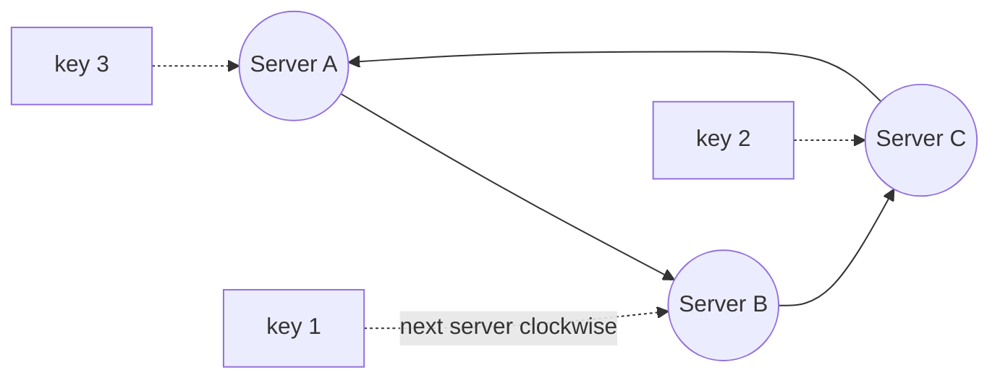

<!-- Written by `npm run lessons` from the lesson data in src/data. Edit the lesson there, not this page. -->

# Consistent hashing

**System Design · Unit 3: Data: databases, storage and scaling data · Lesson 6 of 9 · Should know**

> **In one line.** Consistent hashing assigns keys to servers so that adding or removing a server moves only a small share of the keys.

[Open this lesson on the site](https://learn.hamropedia.com/system-design/consistent-hashing/) for its animation, the practice game and tap-to-explain words.

## The problem it solves

If you place keys with hash(key) % N, adding or removing one server changes N and almost every key moves. For a cache, that means almost every request suddenly misses at once.

## The idea

With simple hash(key) % N, changing N from 4 to 5 moves almost every key, which is a disaster for a cache. Consistent hashing places both servers and keys on a ring; each key belongs to the next server clockwise. Adding a server only takes keys from its neighbour. Virtual nodes, where each server appears many times on the ring, keep the load even.

## How it works, step by step

1. Picture a ring of numbers from 0 up to a huge maximum.
2. Hash each server's name to a position on the ring. With virtual nodes, each server gets many positions.
3. Hash each key to a position, then walk clockwise to the first server you meet: that server owns the key.
4. Add a server: it only takes the keys between itself and the server before it. Everything else stays where it is.
5. Remove a server: its keys move to the next server clockwise — spread across many servers if you use virtual nodes.

## Picture it



*Picture the arrows between servers as a circle. Each key belongs to the next server clockwise; a new server only takes keys from its neighbour.*

## Analogy

A round table where each guest serves the dishes between themselves and the guest before them. A new guest sitting down only takes dishes from one neighbour.

**Where the analogy breaks.** At a table, guests sit evenly spaced. Random positions on the ring are uneven, so one server can end up with far more keys. Virtual nodes fix this by giving each server many seats.

## Example

Going from 4 to 5 servers with hash % N moves about 80% of the keys. With consistent hashing, only about 20% (roughly 1 in 5) move.

## Must know

- hash % N moves most keys whenever N changes.
- The ring: a key belongs to the first server clockwise from it.
- Adding or removing a server moves about 1/N of the keys.
- Virtual nodes even out the load and spread a dead server's keys across many others.
- Used in: Cassandra, DynamoDB, distributed caches, some load balancers.

## In code

```python
import bisect, hashlib

def h(s):
    return int(hashlib.md5(s.encode()).hexdigest(), 16)

class Ring:
    def __init__(self, servers, vnodes=100):
        self.points = sorted((h(f"{s}#{i}"), s) for s in servers for i in range(vnodes))
        self.keys = [p for p, _ in self.points]

    def server_for(self, key):
        i = bisect.bisect(self.keys, h(key)) % len(self.points)
        return self.points[i][1]
```

## Common mistakes

- Too few virtual nodes, so the load is uneven.
- Assuming it fixes hot keys. It doesn't.
- Forgetting replication: each key usually lives on the next 2–3 servers on the ring, not just one.

> **Not true:** Consistent hashing stops one very popular key from overloading a server.  
> **In fact:** It spreads the keys evenly, but one hot key still lives on one server. Hot keys need their own fix, such as caching or splitting the key.

> **Not true:** Routing with hash % N moves only a few keys when a server is added.  
> **In fact:** Changing N changes the result for almost every key. On a consistent-hashing ring, adding a server moves only about 1/N of them.

## In the interview

For a distributed cache or a sharded store I'd use consistent hashing with virtual nodes. Adding or removing a node then moves only about 1/N of the keys, instead of nearly all of them, and the load stays balanced.

<details>
<summary>&lt;b>Why virtual nodes?&lt;/b></summary>

With few servers, random ring positions are uneven. Many points per server average this out, and a failed server's keys spread over many servers instead of overloading one neighbour.

</details>

<details>
<summary>&lt;b>What doesn't consistent hashing solve?&lt;/b></summary>

Hot keys. One extremely popular key still lands on one server; you need replication or caching for that.

</details>

## Practise

Try each one yourself first, then open the answer and compare.

### 1. Explain

Explain, with numbers, why hash % N is bad when the number of servers changes.

<details>
<summary>Show one good answer</summary>

With hash % N, the server for a key depends on N. Going from 4 servers to 5, a key stays put only if hash % 4 = hash % 5, which is true only when hash % 20 is 0, 1, 2 or 3: 4 cases out of 20. So 20% of keys stay and about 80% move.

For a cache with 10 million keys, that means about 8 million keys are suddenly on the "wrong" server: 80% of requests miss at once, all of them fall through to the database, and the database can collapse. Removing a server is just as bad.

Consistent hashing moves only the keys the new server takes over: about 1 in 5 (1/N), and only from its neighbours.

</details>

### 2. Draw

Draw a ring with 3 servers and 6 keys, then add a fourth server and show which keys move.

<details>
<summary>Show one good answer</summary>

Each key belongs to the first server clockwise from it. When D joins at position 60, it takes only the keys between the server before it (B at 45) and itself: here just k4. Every other key keeps its server, which is the whole point.

```text
Ring positions 0–99, clockwise.
Servers: A at 10, B at 45, C at 80

k1 at  5 → A        k4 at 50 → C
k2 at 20 → B        k5 at 70 → C
k3 at 40 → B        k6 at 90 → A  (wraps past 99)

Add D at 60:
k4 at 50 → D   ← the only key that moves (C → D)
k5 at 70 → C   (C is still the first after 60)
all others: unchanged
```

</details>

### 3. Apply

Implement the ring below, map 10,000 keys to 4 servers, add a fifth, and count how many keys moved. Then try again with vnodes=1.

<details>
<summary>Show one good answer</summary>

The ring is the lesson's code. 10,000 keys go on 4 servers; then a fifth is added and the keys are mapped again.

With plain hash % N, 7,960 of the 10,000 keys move: about 80%, as the maths predicts.

With 100 virtual nodes per server, 1,682 move (about 17%, close to the ideal 1 in 5), all of them to the new server, and the load is fairly even: 2,335 to 2,711 keys each.

With 1 virtual node per server, only 303 move. That sounds better, but it is bad news: the new server happened to land in a short arc of the ring, so it takes almost no load, while the old servers are badly uneven (1,765 to 2,953 keys). Four random points cut the ring into very unequal arcs. That is why real systems use many virtual nodes.

```python
import bisect
import hashlib


def h(s):
    return int(hashlib.md5(s.encode()).hexdigest(), 16)


class Ring:
    def __init__(self, servers, vnodes=100):
        self.points = sorted((h(f"{s}#{i}"), s) for s in servers for i in range(vnodes))
        self.keys = [p for p, _ in self.points]

    def server_for(self, key):
        i = bisect.bisect(self.keys, h(key)) % len(self.points)
        return self.points[i][1]


keys = [f"user:{i}" for i in range(10_000)]
servers = ["s1", "s2", "s3", "s4"]


def moved(vnodes):
    before, after = Ring(servers, vnodes), Ring(servers + ["s5"], vnodes)
    return sum(before.server_for(k) != after.server_for(k) for k in keys)


def load(vnodes):
    ring = Ring(servers, vnodes)
    counts = dict.fromkeys(servers, 0)
    for k in keys:
        counts[ring.server_for(k)] += 1
    return counts


print("hash % N moved:", sum(h(k) % 4 != h(k) % 5 for k in keys))
print("ring, 100 vnodes moved:", moved(100), load(100))
print("ring, 1 vnode moved:", moved(1), load(1))
# hash % N moved: 7960
# ring, 100 vnodes moved: 1682 {'s1': 2514, 's2': 2335, 's3': 2711, 's4': 2440}
# ring, 1 vnode moved: 303 {'s1': 2953, 's2': 2680, 's3': 2602, 's4': 1765}
```

</details>

### 4. Trade-offs

When would plain hash % N still be acceptable?

<details>
<summary>Show one good answer</summary>

When the number of servers almost never changes, or when moving everything is cheap:

• A fixed-size cluster, resized rarely and in a planned window, where a full reshuffle can be done slowly in the background.  
• Data that is cheap to rebuild, such as a small cache that can warm up again from the database without hurting it.  
• A fixed number of logical shards: hash(key) % 1,024 picks one of 1,024 logical shards that never changes, and a small table maps logical shards to machines. This is hash % N with N fixed forever, and rebalancing moves whole logical shards. Many databases do exactly this.

It is also simpler: no ring, no virtual nodes, and every client computes the same answer with one line of code.

</details>

## Go further (optional)

- READ · [Hello Interview: design consistent hashing](https://www.google.com/search?q=Hello+Interview+design+consistent+hashing) · hellointerview.com · free guides
- WATCH · [ByteByteGo: consistent hashing](https://www.youtube.com/results?search_query=ByteByteGo+consistent+hashing) · ByteByteGo · YouTube
- READ · [Consistent hashing](https://www.google.com/search?q=Tom+White+consistent+hashing+blog) · Tom White's blog

---

[← Partitioning and sharding](partitioning-and-sharding.md) · [All lessons](../../README.md) · [Object storage (S3) for files and media →](object-storage-s3-for-files-and-media.md)
