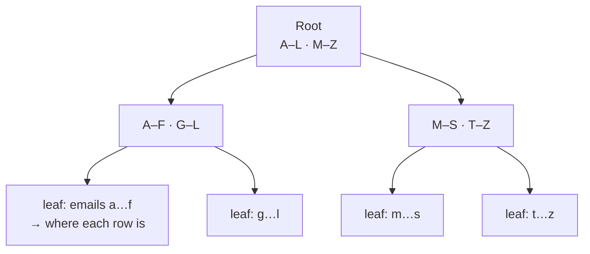

<!-- Written by `npm run lessons` from the lesson data in src/data. Edit the lesson there, not this page. -->

# Database indexing

**System Design · Unit 3: Data: databases, storage and scaling data · Lesson 3 of 9 · Must know**

> **In one line.** An index is an extra data structure that lets the database find rows without scanning the whole table.

[Open this lesson on the site](https://learn.hamropedia.com/system-design/database-indexing/) for its animation, the practice game and tap-to-explain words.

## The problem it solves

Finding one row among 100 million by checking every row takes seconds. Users and other services can't wait that long, and the database burns CPU doing it.

## The idea

Most databases use B-tree indexes: sorted, balanced trees that find a value in a few steps and also support ranges and sorting. Indexes make reads fast but writes slower, because every index must be updated, and they use extra storage. Composite indexes cover several columns, and the column order matters.

## How it works, step by step

1. Without an index, WHERE email = 'a@b.com' reads every row: a full table scan.
2. CREATE INDEX on email builds a B-tree: a sorted tree where each step down cuts the search space enormously.
3. With 100 million rows the tree is only about 3–4 levels deep, so finding the row takes a handful of reads instead of millions.
4. The index stores the email plus a pointer to the row, and the database follows that pointer.
5. Every INSERT, or UPDATE of the email, must also update the tree, which costs time.
6. EXPLAIN shows the plan: 'Index Scan' is good; 'Seq Scan' on a big table means no useful index was found.

## Picture it



*A B-tree index. To find an email, start at the root and take one branch per level; a few steps reach the leaf that says where the row is.*

## Analogy

The index at the back of a textbook: you look up 'eigenvalue — page 212' instead of reading every page.

**Where the analogy breaks.** A book's index is written once. A database index is updated on every insert and update, which is why adding indexes to a write-heavy table has a real cost.

## Example

SELECT \* FROM orders WHERE user_id = 42 ORDER BY created_at DESC LIMIT 20 is fast with an index on (user_id, created_at). Without it, the database scans millions of rows.

## Must know

- B-tree: equality and range queries, and ORDER BY. Hash index: equality only.
- A composite index on (a, b) helps queries on a, or on a and b, but not on b alone (the leftmost-prefix rule).
- Covering index: contains every column the query needs, so the table itself isn't read.
- Every index slows writes and uses storage; index for your real queries only.
- Use EXPLAIN to check whether a query uses an index.
- LSM trees (Cassandra, RocksDB): very fast writes, merged in the background.
- Hands-on: [Reading a query plan with EXPLAIN](https://learn.hamropedia.com/sql/reading-a-query-plan-with-explain/) in the SQL course shows real query plans before and after adding an index.

## In code

```sql
CREATE INDEX idx_orders_user_time ON orders (user_id, created_at);

EXPLAIN SELECT * FROM orders
WHERE user_id = 42
ORDER BY created_at DESC LIMIT 20;
```

## Common mistakes

- Indexing every column 'just in case'.
- A composite index with the columns in the wrong order.
- Wrapping the column in a function (WHERE LOWER(email) = …) so the index can't be used.

> **Not true:** The order of the columns in a composite index makes no difference.  
> **In fact:** An index on (a, b) is sorted by a first, so it helps queries on a, or on a and b, but not on b alone. Put first the column your queries always filter on.

> **Not true:** `WHERE LOWER(email) = …` can use a normal index on email.  
> **In fact:** The function hides the column, so the index can't be used and every row is checked. Compare the bare column with a value instead, for example by storing emails in lower case.

## In the interview

I'd add indexes that match the main queries: for 'latest orders for a user', a composite index on user_id and created_at. I'd check with EXPLAIN, and avoid indexing everything, since every index slows writes.

<details>
<summary>&lt;b>Why doesn't an index on (a, b) help a query on b alone?&lt;/b></summary>

The index is sorted by a first, so values of b are scattered all through it — like a phone book sorted by surname being no help for finding a first name.

</details>

<details>
<summary>&lt;b>B-tree or LSM tree?&lt;/b></summary>

B-trees update in place and are great for reads. LSM trees append writes and merge later, so writes are faster, but a read may check several files.

</details>

## Practise

Try each one yourself first, then open the answer and compare.

### 1. Explain

Explain an index with the textbook picture, and why it slows writes.

<details>
<summary>Show one good answer</summary>

An index is like the index at the back of a textbook. To find "eigenvalue", you don't read 900 pages; you look it up in the sorted index ("page 212") and go straight there. A database index is a sorted structure (usually a B-tree) of one column's values, each pointing to the row that has it, so finding a row takes a handful of steps instead of reading the whole table.

Why it slows writes: a book's index is written once, when it is printed. A database index has to be kept correct all the time. Every INSERT adds an entry to every index on the table, every DELETE removes one, and every UPDATE of an indexed column moves one. A table with 5 indexes does 6 writes for each new row, and the indexes take disk space and memory too.

</details>

### 2. Draw

Draw a small B-tree for 10 numbers, and the path to find one of them.

<details>
<summary>Show one good answer</summary>

In a B-tree (strictly, a B+ tree), the root holds dividing values and the leaves hold the sorted keys. To find 25: at the root, 25 is between 18 and 30, so take the middle branch; in that leaf, 25 is there. Two steps for 10 numbers, and only about 4 or 5 steps for 100 million, because each level divides the search space by the number of branches.

```text
              ┌─────────┐
              │ 18 │ 30 │   root
              └─────────┘
       < 18 ╱     │ 18–29  ╲ ≥ 30
┌──────────┐ ┌──────────┐ ┌────────────┐
│ 3  7  12 │ │18  21  25│ │30 34 40 45 │  leaves
└──────────┘ └──────────┘ └────────────┘
                     ▲
Find 25: root → between 18 and 30 →
middle leaf → found.
```

</details>

### 3. Apply

In SQLite, make a table with 1 million rows, time a query, add an index and time it again. Use EXPLAIN QUERY PLAN to see the difference.

<details>
<summary>Show one good answer</summary>

Without an index the plan says SCAN: SQLite reads all 1,000,000 rows to find the 15 belonging to user 4242. With the index it says SEARCH … USING INDEX: it walks the B-tree straight to that user's rows. The answer is identical; the time drops by a factor of thousands.

Exact times depend on the machine; on mine the scan took about 20 ms and the indexed lookup about 4 microseconds.

```python
import random
import sqlite3
import time

db = sqlite3.connect(":memory:")
db.execute("CREATE TABLE orders (id INTEGER PRIMARY KEY, user_id INTEGER, amount INTEGER)")
random.seed(1)
db.executemany(
    "INSERT INTO orders (user_id, amount) VALUES (?, ?)",
    ((random.randrange(100_000), random.randrange(1, 500)) for _ in range(1_000_000)),
)

query = "SELECT COUNT(*), SUM(amount) FROM orders WHERE user_id = 4242"


def plan(sql):
    return [row[-1] for row in db.execute("EXPLAIN QUERY PLAN " + sql)]


def timed(sql, runs=20):
    start = time.perf_counter()
    for _ in range(runs):
        result = db.execute(sql).fetchone()
    return result, (time.perf_counter() - start) / runs * 1000


print(plan(query))                    # ['SCAN orders']: reads every row
result, ms = timed(query)
print(result, f"{ms:.1f} ms")         # (15, 4418) 20.2 ms

db.execute("CREATE INDEX idx_orders_user ON orders (user_id)")
print(plan(query))                    # ['SEARCH orders USING INDEX idx_orders_user (user_id=?)']
result, ms = timed(query)
print(result, f"{ms:.3f} ms")         # (15, 4418) 0.004 ms
```

</details>

### 4. Trade-offs

A table receives 50,000 writes a second and has 9 indexes. What would you check and change?

<details>
<summary>Show one good answer</summary>

Every write updates the table plus all 9 indexes: 10 structures, 50,000 times a second. That is most likely where the time goes.

What I'd check:  
• Which indexes are actually used (in PostgreSQL, pg_stat_user_indexes: an idx_scan of 0 means never used).  
• Duplicates: an index on (a) is redundant when one on (a, b) exists.  
• Indexes on columns with few distinct values (status, a boolean), which rarely help.  
• Which queries need each index, and how often they run: a nightly report shouldn't slow every write all day.  
• Write latency, disk I/O and log volume, and whether random keys (UUID v4) are splitting index pages.

What I'd change:  
• Drop unused and redundant indexes; merge several into one composite or covering index.  
• Use partial indexes (only the rows a query needs, such as WHERE status = 'pending').  
• Move reporting queries to a read replica or a warehouse, with their own indexes.  
• Batch writes, and use time-ordered keys.  
• If it is append-only data (events, logs), consider a store built for heavy writes (an LSM-tree database such as Cassandra).

</details>

## Go further (optional)

- READ · [Use The Index, Luke](https://use-the-index-luke.com/) · Markus Winand, free
- WATCH · [CMU 15-445 Intro to Database Systems: storage and retrieval](https://www.youtube.com/results?search_query=CMU+15-445+database+systems+storage+and+retrieval) · Andy Pavlo, Carnegie Mellon · free on YouTube
- WATCH · [ByteByteGo: database indexing explained](https://www.youtube.com/results?search_query=ByteByteGo+database+indexing+explained) · ByteByteGo · YouTube

---

[← ACID transactions and isolation levels](acid-transactions-and-isolation-levels.md) · [All lessons](../../README.md) · [Replication →](replication.md)
