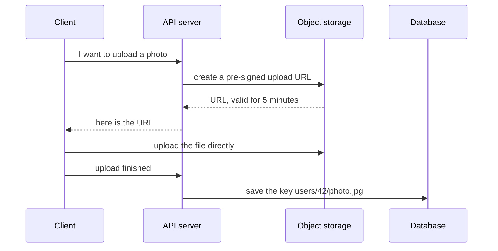

<!-- Written by `npm run lessons` from the lesson data in src/data. Edit the lesson there, not this page. -->

# Object storage (S3) for files and media

**System Design · Unit 3: Data: databases, storage and scaling data · Lesson 7 of 9 · Must know**

> **In one line.** Object storage keeps files ('objects') such as images, videos and backups as a key pointing to bytes plus metadata, in a cheap, very durable, almost unlimited store like Amazon S3.

[Open this lesson on the site](https://learn.hamropedia.com/system-design/object-storage-s3-for-files-and-media/) for its animation, the practice game and tap-to-explain words.

## The problem it solves

Photos, videos, backups and documents are big and numerous. Storing them in a database makes it huge, slows backups and costs a lot; storing them on one server's disk breaks scaling.

## The idea

Databases are bad at holding big files. Instead, store the file in object storage and keep only its key or URL in the database. Clients can upload straight to storage with a pre-signed URL, so big files never pass through your servers. Put a CDN in front for fast downloads.

## How it works, step by step

1. The client asks your API: 'I want to upload a photo'.
2. The API checks the user, then asks the storage service for a pre-signed URL: a link that allows one upload, to one key, for a few minutes.
3. The client uploads the file straight to that URL. Your servers never touch the bytes.
4. The API saves a row: photo ID, owner, object key, size and created time.
5. To show the photo, the app uses a CDN URL for that key, or a short-lived signed download link for private files.

## Picture it



*The file goes straight from the client to storage. Your servers only hand out the upload link and record where the file is.*

## Analogy

A cloakroom: you hand in your coat (the file) and get a ticket (the key). The ticket goes in your pocket (the database).

**Where the analogy breaks.** In a cloakroom you could swap a coat's buttons in place. Objects are usually replaced whole, not edited in the middle, so object storage is for files, not for records that change often.

## Example

Profile photo upload: the app asks the API for a pre-signed URL, uploads straight to S3, then the API saves 'users/42/avatar.jpg' in the users table.

## Must know

- Big binary data goes in object storage; the metadata and key go in the database.
- Pre-signed URLs let clients upload or download directly and securely, for a limited time.
- Very durable (S3 is designed for 99.999999999%, 'eleven nines') and cheap per GB.
- Storage classes: hot (frequent access) and cold or archive (cheap, slow to get back).
- Large uploads use multipart upload: in chunks, retryable and resumable.

## Common mistakes

- Putting files in database BLOB columns.
- Making a storage bucket public by accident.
- Sending big uploads through your own app servers.

> **Not true:** Videos and other large files: stored in the database, next to their metadata.  
> **In fact:** Big files make the database huge and slow its backups. Put the file in object storage, and keep only its key and metadata in the database.

> **Not true:** Big uploads: sent through your own app servers on the way to storage.  
> **In fact:** That ties up app servers with slow transfers. Give the client a pre-signed URL, and it uploads straight to object storage.

## In the interview

Files go in object storage like S3, never in the database. The database keeps the object key and metadata. Clients upload directly using pre-signed URLs, and downloads go through a CDN.

<details>
<summary>&lt;b>Why not store images in the database?&lt;/b></summary>

It makes the database huge, slows backups and replication, and wastes expensive database capacity on cheap bytes.

</details>

<details>
<summary>&lt;b>How do you upload 2 GB over a bad connection?&lt;/b></summary>

Multipart upload: send it in chunks, retry the failed ones, and resume instead of starting again.

</details>

## Practise

Try each one yourself first, then open the answer and compare.

### 1. Explain

Explain object storage with the cloakroom picture.

<details>
<summary>Show one good answer</summary>

Object storage works like a cloakroom. You hand in your coat (the file: a photo, a video, a backup) and get a ticket back (the key, such as users/42/avatar.jpg). You keep the ticket in your pocket (the database stores the key, not the file). Whenever you need the coat, you show the ticket and get it back.

The cloakroom is huge, cheap and very safe (S3 keeps copies in several places), and it doesn't care what is in the coat. Where the picture breaks: you can't change a button on a coat while it hangs there. Objects are written and replaced whole, not edited in the middle, so object storage is for files, not for records that change often.

</details>

### 2. Draw

Draw the upload flow with a pre-signed URL: client, API, S3 and database.

<details>
<summary>Show one good answer</summary>

The file never passes through your API servers: they only check who the user is, hand out a short-lived upload link, and record the key afterwards. Big uploads don't tie up your servers, and storage handles the bandwidth.

```text
Client ── 1. "I want to upload a photo" ──► API
                                            │ 2. check the user
                                            │ 3. ask for a pre-signed
                                            ▼    URL (5 minutes)
                                       Object storage (S3)
API ◄── URL ───────────────────────────────┘
Client ◄── 4. here is the URL ── API

Client ── 5. PUT the file ──► Object storage
Client ── 6. "upload finished" ──► API
                                    │ 7. save the key
                                    ▼
                                 Database
                         (photo_id, owner, key, size)
```

</details>

### 3. Apply

Design storage for a photo app: where do the original image, the thumbnails and the metadata go?

<details>
<summary>Show one good answer</summary>

• Original image: object storage, in a private bucket, under a key such as photos/{user_id}/{photo_id}/original.jpg. Uploaded directly by the client with a pre-signed URL. A lifecycle rule moves originals to a cheaper storage class after, say, 60 days, when they are rarely opened.  
• Thumbnails and resized versions (150 px, 600 px, 1080 px): made by background workers after the upload (a queue message "photo 42 uploaded"), and stored in object storage beside the original. They are served through a CDN with a long cache time, because feeds load them constantly. Location data is stripped from public versions.  
• Metadata: the database (photo_id, owner_id, object keys of each size, width, height, file size, caption, privacy setting, created_at). This is what the app queries; it never lists the bucket.

Private photos are served with short-lived signed URLs (or signed CDN URLs), never by making the bucket public.

</details>

### 4. Trade-offs

When would you use a normal file system or block storage instead?

<details>
<summary>Show one good answer</summary>

Object storage is for whole files, read and written as a unit, over HTTP, at some latency. Use something else when that doesn't fit:

• Block storage (a disk attached to one server, such as AWS EBS) for a database's own data files, and a virtual machine's boot disk. They need fast, small, random reads and writes in the middle of files.  
• Files changed in place: appending to logs, editing parts of large files. Object storage would rewrite the whole object each time.  
• A shared file system (NFS, AWS EFS) for software that expects real files and folders, with locking and renaming, shared across several servers, such as older applications or build tools.  
• Very low-latency scratch space, such as a local SSD for intermediate files while transcoding a video. Copy the final result to object storage afterwards.

</details>

## Go further (optional)

- READ · [What is Amazon S3?](https://www.google.com/search?q=What+is+Amazon+S3+AWS+documentation) · AWS documentation
- READ · [Hello Interview: S3-like object storage](https://www.google.com/search?q=Hello+Interview+S3-like+object+storage) · hellointerview.com · free guides
- WATCH · [ByteByteGo: how S3 works](https://www.youtube.com/results?search_query=ByteByteGo+how+S3+works) · ByteByteGo · YouTube

---

[← Consistent hashing](consistent-hashing.md) · [All lessons](../../README.md) · [Search: inverted indexes and Elasticsearch →](search-inverted-indexes-and-elasticsearch.md)
