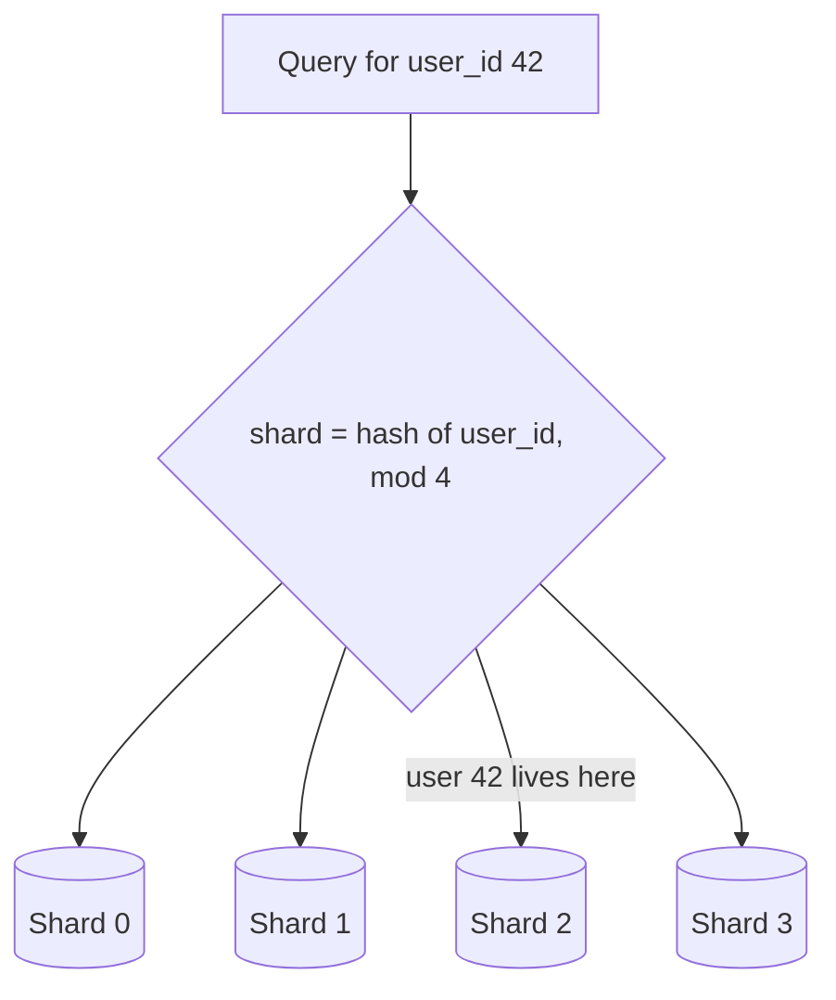

<!-- Written by `npm run lessons` from the lesson data in src/data. Edit the lesson there, not this page. -->

# Partitioning and sharding

**System Design · Unit 3: Data: databases, storage and scaling data · Lesson 5 of 9 · Must know**

> **In one line.** Sharding splits a large dataset across several databases (shards), each holding part of the data.

[Open this lesson on the site](https://learn.hamropedia.com/system-design/partitioning-and-sharding/) for its animation, the practice game and tap-to-explain words.

## The problem it solves

Even the biggest single database has limits on storage and write speed. When your data or writes outgrow it, you have to split the data across machines.

## The idea

When one database can't handle the writes or the data size, you split it by a shard key. Range sharding (A–M, N–Z) keeps neighbouring keys together but can create hot spots. Hash sharding spreads data evenly but makes range queries harder. The shard key is the biggest decision: it decides balance, which queries stay on one shard, and how hard it is to add shards later.

## How it works, step by step

1. Choose a shard key that matches your main query, such as user_id.
2. A routing rule maps each key to a shard: for example, shard = hash(user_id) % 16.
3. The application, or a proxy, uses that rule to send each query to the right shard.
4. Queries by user_id hit one shard and are fast. Queries across all users must ask every shard and merge the results, which is slow.
5. To add capacity, split shards or move some keys. Consistent hashing, or many small logical shards, makes this much easier.

## Picture it



*The shard key decides which database holds each user. A query by user ID goes straight to one shard.*

## Analogy

A library too big for one building, split across several buildings: by the author's first letter, or by a code that spreads the books evenly.

**Where the analogy breaks.** Library visitors can walk between buildings. Queries that need data from many shards (joins, global counts) are slow and complicated, so you choose the shard key around the main queries.

## Example

An Instagram-like app shards user data by a hash of user_id, so one user's posts all live on the same shard and 'show my profile' touches one database.

## Must know

- A good shard key: many distinct values, an even spread, and it matches the main access pattern.
- Hash sharding: even load, poor for ranges. Range sharding: good for ranges, risk of hot spots.
- Hot keys (a celebrity) can overload one shard: split them further, or cache them.
- Cross-shard joins and transactions are hard: design so you don't need them.
- Resharding is painful; consistent hashing or many small logical shards make it easier.
- Shard only when needed: try caching, read replicas and a bigger machine first.

## Common mistakes

- A shard key with few values (like country), which creates huge, uneven shards.
- A time-based key that sends every new write to the same shard.
- Designs whose common requests need joins or transactions across shards.

> **Not true:** Shard key: country is a good one, since each user has exactly one.  
> **In fact:** A key with few values makes huge, uneven shards: one big country can overload its shard. A good shard key has many distinct values, spread evenly.

> **Not true:** Time-based shard key: new writes are spread evenly across the shards.  
> **In fact:** New rows all carry the latest time, so they all land on the same shard. That shard becomes a hot spot while the others sit idle.

## In the interview

Once writes or data outgrow one database, I'd shard by a key that matches the main query. Here that is user_id, hashed for an even spread, so a user's data lives on one shard. I'd use consistent hashing or many logical shards to make adding machines easier, and handle very hot users with caching.

<details>
<summary>&lt;b>Why not shard by created_at?&lt;/b></summary>

All new writes would land on the newest shard, a hot spot, while the old shards sit idle.

</details>

<details>
<summary>&lt;b>How do you query across shards?&lt;/b></summary>

Scatter-gather (ask every shard, merge the results), or keep a separate index or a precomputed view built for that query.

</details>

## Practise

Try each one yourself first, then open the answer and compare.

### 1. Explain

Explain sharding and the shard key with the library-buildings picture.

<details>
<summary>Show one good answer</summary>

The library has grown too big for one building, so the books are split across several buildings (shards). The shard key is the rule for which building a book goes in: by the author's first letter (A–F in building 1: range sharding), or by a code that spreads the books evenly (hash sharding).

If you know a book's key, you go straight to the right building: a query by the shard key touches one shard. But a question like "every book published in 2020" has to be asked in every building and the answers combined, which is slow. So you choose the shard key to match the questions asked most often, and you choose one that spreads books evenly, so no single building is overwhelmed.

</details>

### 2. Draw

Draw 4 shards with hash(user_id) % 4 routing, and show what happens when you add a fifth.

<details>
<summary>Show one good answer</summary>

With hash % N, the shard depends on N, so changing N from 4 to 5 changes the answer for most keys: about 80% of the data has to move (here 7 of 10 users). The fix is to decouple keys from physical machines: consistent hashing, or a fixed number of logical shards (say 1,024) that are mapped to machines in a table, so adding a machine moves a few whole logical shards and nothing else.

```text
shard = hash(user_id) % 4        (say the hash is the id)

user_id:  1  2  3  4  5  6  7  8  9  10
% 4:      1  2  3  0  1  2  3  0  1  2
% 5:      1  2  3  4  0  1  2  3  4  0
moves?    .  .  .  ✓  ✓  ✓  ✓  ✓  ✓  ✓

Shard 0: 4, 8      Shard 1: 1, 5, 9
Shard 2: 2, 6, 10  Shard 3: 3, 7

Add a fifth shard → 7 of 10 users move.
In general, about 4 in 5 keys move.
```

</details>

### 3. Apply

Choose a shard key for: a chat app's messages, an online shop's orders, a URL shortener. Justify each.

<details>
<summary>Show one good answer</summary>

• Chat messages: conversation_id. The main query is "the latest messages in this chat", so all of a conversation's messages should live together, sorted by time inside the shard. There are millions of conversations, so the spread is even. (One giant group chat can be a hot spot; split it by time bucket if needed.)  
• Online shop orders: customer_id. "My orders" is the most common query and stays on one shard. To look an order up by order_id alone, put the shard number inside the order ID, or keep a small lookup table from order_id to shard. Reports across all orders go to a separate analytics copy.  
• URL shortener: the short code (hashed). Every redirect is a lookup by code and nothing else, so hashing the code gives a perfectly even spread and one shard per request.

</details>

### 4. Trade-offs

Range or hash sharding for sensor readings that are always queried by time range?

<details>
<summary>Show one good answer</summary>

Neither on its own is ideal.

• Range sharding by time alone: a time-range query reads one or two shards (good), but every new reading has the newest timestamp, so all writes land on the newest shard (a hot spot), while the old shards sit idle.  
• Hash sharding: writes spread evenly (good), but neighbouring times are scattered, so every time-range query has to ask every shard and merge the results.

The usual answer is both: shard by a hash of the sensor ID (spreading the writes across sensors), and within each shard store each sensor's readings sorted by time, often in one partition per sensor per day. "Sensor 17 between 09:00 and 10:00" then goes to one shard and reads one contiguous range. Queries across all sensors for a time range are rarer; they scatter to every shard, or run on a pre-aggregated copy (time-series databases such as TimescaleDB do this partitioning for you).

</details>

## Go further (optional)

- WATCH · [Distributed Systems lecture series: partitioning](https://www.youtube.com/results?search_query=Martin+Kleppmann+distributed+systems+lecture+partitioning) · Martin Kleppmann, University of Cambridge · free on YouTube
- WATCH · [ByteByteGo: database sharding](https://www.youtube.com/results?search_query=ByteByteGo+database+sharding) · ByteByteGo · YouTube
- READ · [The System Design Primer](https://github.com/donnemartin/system-design-primer) · Donne Martin · GitHub, free

---

[← Replication](replication.md) · [All lessons](../../README.md) · [Consistent hashing →](consistent-hashing.md)
