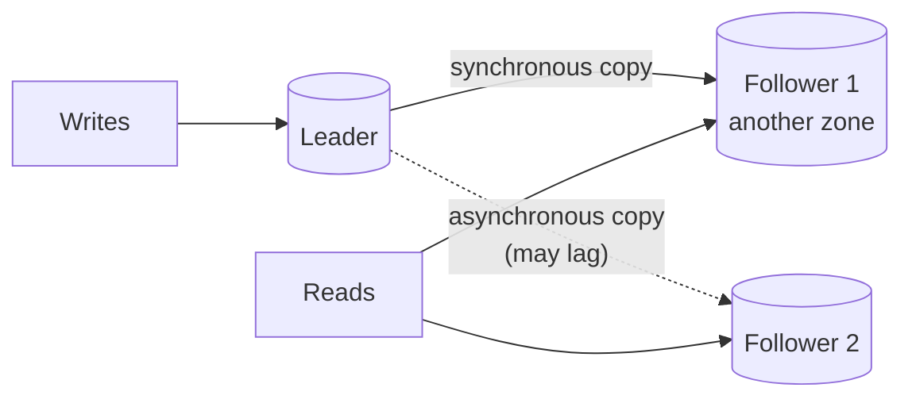

<!-- Written by `npm run lessons` from the lesson data in src/data. Edit the lesson there, not this page. -->

# Replication

**System Design · Unit 3: Data: databases, storage and scaling data · Lesson 4 of 9 · Must know**

> **In one line.** Replication keeps copies of the same data on several machines.

[Open this lesson on the site](https://learn.hamropedia.com/system-design/replication/) for its animation, the practice game and tap-to-explain words.

## The problem it solves

One copy of your data is a single point of failure, and one machine can only answer so many reads. You need copies — and then you have to keep them in agreement.

## The idea

Copies give you availability (another copy takes over when one fails), durability, and more read capacity. In leader–follower replication, all writes go to the leader and the followers copy them; reads can go to followers. Copying can be synchronous (safe but slower) or asynchronous (fast, but followers can lag behind). Multi-leader and leaderless designs allow writes in several places but must resolve conflicts.

## How it works, step by step

1. A write arrives at the leader. The leader saves it and adds it to its replication log.
2. Followers read that log and apply the same changes in the same order.
3. Synchronous: the leader waits until a follower confirms before telling the client 'done'. Asynchronous: it replies immediately and the followers catch up.
4. Reads can go to followers to spread the load, but they may be slightly behind.
5. If the leader dies: notice it (missed heartbeats), pick the most up-to-date follower, promote it, and send writes to it.

## Picture it



*All writes go to the leader, which copies them to the followers. Reads can be spread across the followers, but an asynchronous follower may be slightly behind.*

## Analogy

A teacher writes on the main whiteboard and assistants copy it onto boards in other rooms. Students in those rooms may see each update a moment later.

**Where the analogy breaks.** Assistants copy perfectly and in order. Real followers can lag seconds behind or miss updates during failures, and if the main board breaks, safely choosing a new 'main board' (failover) is tricky.

## Example

A user changes their profile name and refreshes, but the read goes to a lagging replica and shows the old name. Fix: 'read your own writes' — send that user's reads to the leader for a short time after a write.

## Must know

- Leader–follower: simple and common; all writes go through one leader.
- Synchronous: no data loss on failover, but slower writes. Asynchronous: fast, but recent writes can be lost.
- Replication lag causes stale reads; fixes include read-your-own-writes and monotonic reads.
- Failover: detect that the leader is dead, promote a follower, redirect writes. Risk: split brain.
- Multi-leader: writes in several regions; conflicts need rules (last write wins, merging).
- Leaderless (Dynamo-style): quorums with W + R > N.

## Common mistakes

- Reading from a replica straight after a write, and being surprised by old data.
- Fully asynchronous replication for data you can't afford to lose.
- Automatic failover with no protection against two leaders (split brain).

> **Not true:** Read from a replica straight after a write: you get the new data.  
> **In fact:** Replicas apply changes a little after the leader (replication lag), so a read straight after a write can return old data. Read your own writes from the leader.

> **Not true:** Asynchronous: fast, and no write is lost when the leader fails.  
> **In fact:** The leader confirms a write before its followers have it. If the leader dies in that moment, the write is gone. Synchronous replication avoids this, with slower writes.

## In the interview

I'd use leader–follower replication: writes to the leader, reads spread across replicas, with at least one synchronous replica in another zone for safe failover. Screens where users must see their own change straight away read from the leader.

<details>
<summary>&lt;b>What is split brain?&lt;/b></summary>

Two nodes both believe they're the leader and both accept writes, creating conflicting data. Prevented with consensus, quorums or fencing tokens.

</details>

<details>
<summary>&lt;b>Replication or sharding?&lt;/b></summary>

Replication copies the same data to many machines (availability, read capacity). Sharding splits different data across machines (write capacity, storage). Big systems do both.

</details>

## Practise

Try each one yourself first, then open the answer and compare.

### 1. Explain

Explain leader–follower replication and replication lag with the whiteboard picture.

<details>
<summary>Show one good answer</summary>

A teacher writes on the main whiteboard (the leader). Assistants in other rooms copy every line onto their own boards (the followers), in the same order. All new writing happens on the main board only; students can read any board, which spreads them out (more read capacity), and if the main room floods, one assistant's board becomes the new main board (failover).

Replication lag is the moment between the teacher writing a line and an assistant copying it. A student in another room may see the old version for a moment. With asynchronous copying, the teacher doesn't wait for the assistants, so the lag can grow to seconds when they're busy; with synchronous copying, the teacher waits for at least one assistant to confirm each line, which is safer but slower.

</details>

### 2. Draw

Draw a leader with two followers, one synchronous and one asynchronous, and the path of a write.

<details>
<summary>Show one good answer</summary>

The client hears "done" only after the leader has saved the write and the synchronous follower has confirmed it, so a committed write survives losing the leader. The asynchronous follower is updated afterwards; reads sent to it may briefly miss the newest writes.

```text
Client ── 1. write ──► Leader
                         │ 2. save, add to the log
                         ├──► Follower 1 (synchronous,
                         │      another zone)
                         │ ◄── 3. "saved" ──┘
                         │
Client ◄── 4. "done" ────┤
                         │
                         └ ─ ─► Follower 2 (asynchronous)
                                  5. catches up later;
                                  may lag behind
```

</details>

### 3. Apply

Users see their old profile right after updating it. Explain why, and give two fixes.

<details>
<summary>Show one good answer</summary>

Why: the update went to the leader, but the next read went to a follower that hadn't copied it yet. Replication is asynchronous, so a follower can be a fraction of a second, or a few seconds, behind. The user sees their old profile and thinks the save failed.

Fixes:  
1. Read your own writes: for a short time after a user changes something (say 10 seconds), send that user's reads of their own data to the leader. Or always read a user's own profile from the leader; other people's views of it can come from followers.  
2. Read from a follower that has caught up: the write returns its position in the replication log, and the read is only served by a follower at or past that position (otherwise it goes to the leader).

Also helpful: the app shows the new value straight away from what it just sent (an optimistic update), and pins each user to one follower, so they never see time go backwards between refreshes.

</details>

### 4. Trade-offs

Synchronous or asynchronous replication for a payment ledger? For a social feed?

<details>
<summary>Show one good answer</summary>

Payment ledger: synchronous, to at least one follower in another zone. With asynchronous replication, a leader crash can lose the last few committed payments, even though customers were told "paid". That is not acceptable for money. The price is slower writes (each commit waits for a second copy), which is worth paying.

Social feed: asynchronous. Speed and availability matter more. If a rare failover loses the last second of likes or a post shows up a moment late, almost nobody notices, and the writes stay fast even under huge load.

A common middle way: one synchronous follower and the rest asynchronous ("semi-synchronous"), so you get no data loss with only one extra wait per write.

</details>

## Go further (optional)

- WATCH · [Distributed Systems lecture series: replication](https://www.youtube.com/results?search_query=Martin+Kleppmann+distributed+systems+lecture+replication) · Martin Kleppmann, University of Cambridge · free on YouTube
- WATCH · [ByteByteGo: database replication explained](https://www.youtube.com/results?search_query=ByteByteGo+database+replication+explained) · ByteByteGo · YouTube
- READ · [The System Design Primer](https://github.com/donnemartin/system-design-primer) · Donne Martin · GitHub, free

---

[← Database indexing](database-indexing.md) · [All lessons](../../README.md) · [Partitioning and sharding →](partitioning-and-sharding.md)
