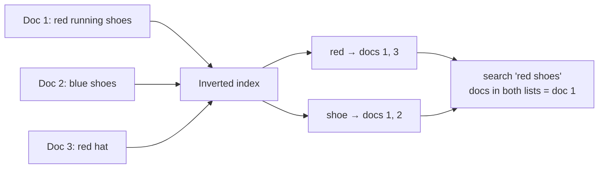

<!-- Written by `npm run lessons` from the lesson data in src/data. Edit the lesson there, not this page. -->

# Search: inverted indexes and Elasticsearch

**System Design · Unit 3: Data: databases, storage and scaling data · Lesson 8 of 9 · Should know**

> **In one line.** Full-text search finds the documents that contain some words and ranks them by relevance. It's built on an inverted index: a map from each word to the documents containing it.

[Open this lesson on the site](https://learn.hamropedia.com/system-design/search-inverted-indexes-and-elasticsearch/) for its animation, the practice game and tap-to-explain words.

## The problem it solves

Users type words, not IDs, and they expect the best matches first, even with typos. Normal database indexes can't do that efficiently.

## The idea

A SQL query like LIKE '%shoe%' scans every row. A search engine builds an inverted index in advance ('shoe' → documents 3, 17, 42), so lookups are fast. It also handles word forms (running → run), typos, and ranking (for example BM25). Search engines like Elasticsearch are usually a second store, filled from the main database.

## How it works, step by step

1. Indexing: each document's text is split into words, lowercased, and reduced to stems ('Running Shoes' → 'run', 'shoe').
2. For each word, the engine adds the document's ID to that word's posting list.
3. A search for 'red shoes' looks up the lists for 'red' and 'shoe' and intersects them, giving the documents that contain both.
4. Each match gets a score: words that are rare overall but frequent in this document score higher (TF-IDF or BM25), and business signals like popularity can be added.
5. The top results are returned. The index is split across many shards, which are searched in parallel.

## Picture it



*Documents are broken into words, and each word points to the documents containing it. A search intersects the lists for its words.*

## Analogy

The index at the back of a cookbook that lists, for each ingredient, every recipe page that uses it.

**Where the analogy breaks.** A cookbook index is exact. Search must also guess what the user meant — misspellings, synonyms, word forms — and rank thousands of matches, which is a whole field of its own.

## Example

An online shop writes products to PostgreSQL, streams every change to Elasticsearch, and serves the search box from Elasticsearch.

## Must know

- Inverted index: each term → a list of document IDs (a posting list).
- Text analysis: lowercase, split into words, drop stop words, reduce words to their stem.
- Ranking: TF-IDF or BM25 relevance, plus business signals like popularity.
- The database stays the source of truth; keep the search index in sync with change events.
- Search results are eventually consistent with the database.

## In code

```python
from collections import defaultdict

docs = {1: "red running shoes", 2: "blue shoes", 3: "red hat"}
index = defaultdict(set)
for doc_id, text in docs.items():
    for word in text.lower().split():
        index[word].add(doc_id)

index["red"] & index["shoes"]    # {1}: documents with both words
```

## Common mistakes

- Making the search engine the source of truth.
- Forgetting that new or changed items take a moment to become searchable.
- Using LIKE '%word%' on large tables.

> **Not true:** A new document can be found by search the instant it is saved.  
> **In fact:** The search index is updated a moment after the main database, so new or changed items take a short time to appear.

> **Not true:** `LIKE '%word%'` is a fast way to search text in a large table.  
> **In fact:** A pattern that starts with % cannot use a normal index, so every row is scanned. An inverted index maps each word straight to the documents that contain it.

## In the interview

For text search I'd use a search engine like Elasticsearch, built on inverted indexes and fed from the main database through change events. The database stays the source of truth; search can lag by a second or two.

<details>
<summary>&lt;b>Why not just use SQL LIKE?&lt;/b></summary>

A LIKE with a leading wildcard can't use a normal index, so it scans every row, and it can't rank results or handle typos.

</details>

<details>
<summary>&lt;b>How do you keep search in sync?&lt;/b></summary>

Publish changes, or read them from the database's log (change data capture), onto a queue, and let an indexer update the search engine.

</details>

## Practise

Try each one yourself first, then open the answer and compare.

### 1. Explain

Explain an inverted index with the cookbook picture.

<details>
<summary>Show one good answer</summary>

An inverted index is like the index at the back of a cookbook that lists, for every ingredient, the pages of every recipe that uses it: "garlic: 12, 40, 88; lemon: 40, 90".

To find a recipe with garlic and lemon, you don't read every recipe; you look up both ingredients and take the pages in both lists: page 40. A search engine does the same with words: it splits every document into words in advance, and for each word keeps the list of documents that contain it. A search for "red shoes" looks up two lists and intersects them, which is fast however many documents there are.

Where the picture breaks: a cookbook index is exact. A search engine also has to guess what you meant (running, ran, runs; typos; synonyms) and rank thousands of matches so the best come first.

</details>

### 2. Draw

Draw database → change stream → indexer → search engine → search API.

<details>
<summary>Show one good answer</summary>

The database stays the source of truth. Every change flows out through a change stream (published events, or change data capture reading the database's log), and an indexer turns each change into an update of the search index. The search API reads only from the search engine. New or edited items appear in search a second or two later: eventual consistency.

```text
App ── writes ──► Database (source of truth)
                     │ change stream
                     │ (CDC or events)
                     ▼
                   Queue
                     │
                     ▼
                   Indexer
                     │ add / update / delete
                     ▼
                 Search engine
                 (inverted index, shards)
                     ▲
User ── "red shoes" ─┤
         Search API ─┘
```

</details>

### 3. Apply

Extend the code below to 1,000 product titles, with lowercasing and simple stemming, and support AND queries.

<details>
<summary>Show one good answer</summary>

1,000 titles are generated from every combination of size, colour, material and item. Text is lowercased and split into words, and a very simple stemmer turns "shoes" into "shoe" and "running" into "run", so "Red Running Shoe" finds "red running shoes". An AND query intersects the posting lists of all its words.

The stemmer is deliberately crude: it would turn "canvas" into "canva". That is harmless here, because queries go through the same function, but real engines use proper stemmers (such as Porter's) for each language.

```python
import itertools
import re
from collections import defaultdict

sizes = ["small", "large", "kids", "classic", "slim"]
colours = ["red", "blue", "black", "white", "green"]
materials = ["leather", "canvas", "running", "hiking", "wooden"]
items = ["shoes", "boots", "bags", "hats", "jackets", "chairs", "tables", "lamps"]
titles = [" ".join(words) for words in itertools.product(sizes, colours, materials, items)]


def stem(word):
    if word.endswith("ing") and len(word) > 5:
        word = word[:-3]
        if word[-1] == word[-2]:
            word = word[:-1]                 # running -> runn -> run
    elif word.endswith("s") and not word.endswith("ss") and len(word) > 3:
        word = word[:-1]                     # shoes -> shoe
    return word


def terms(text):
    return [stem(w) for w in re.findall(r"[a-z0-9]+", text.lower())]


index = defaultdict(set)
for doc_id, title in enumerate(titles):
    for term in terms(title):
        index[term].add(doc_id)


def search(query):                           # AND: every word must match
    words = terms(query)
    if not words:
        return []
    ids = set.intersection(*(index.get(w, set()) for w in words))
    return sorted(titles[i] for i in ids)


print(len(titles))                                  # 1000
print(search("Red Running Shoe"))
# ['classic red running shoes', 'kids red running shoes', 'large red running shoes',
#  'slim red running shoes', 'small red running shoes']
print(len(search("boot")), len(search("black boots")))   # 125 25
print(search("purple shoes"))                       # []
```

</details>

### 4. Trade-offs

When is PostgreSQL's built-in full-text search enough, and when do you need Elasticsearch?

<details>
<summary>Show one good answer</summary>

PostgreSQL's built-in full-text search (a tsvector column with a GIN index) is enough when:  
• the data fits comfortably in one database (up to a few million documents) and search traffic is moderate;  
• simple relevance ranking is fine;  
• you value having one system, and search results that are always exactly in step with the data (same transaction, no sync pipeline).  
For an internal tool or a small shop, this is often the right answer.

You need Elasticsearch (or OpenSearch) when:  
• the data or the query volume outgrows one machine, and search must scale out across shards;  
• relevance really matters and needs tuning: field boosts, synonyms, business signals, typo tolerance (fuzzy matching), autocomplete;  
• you need fast facets and aggregations ("Brand: Nike (120)") over large result sets, or many languages;  
• you search logs and events at volume.  
The cost: another system to run and keep in sync, and results that lag the database by a moment.

</details>

## Go further (optional)

- READ · [Introduction to Information Retrieval, Ch 1 (Boolean retrieval)](https://nlp.stanford.edu/IR-book/) · Manning, Raghavan, Schütze · free
- READ · [Hello Interview: Elasticsearch deep dive](https://www.google.com/search?q=Hello+Interview+Elasticsearch+deep+dive) · hellointerview.com · free guides
- WATCH · [ByteByteGo: how Elasticsearch works](https://www.youtube.com/results?search_query=ByteByteGo+how+Elasticsearch+works) · ByteByteGo · YouTube

---

[← Object storage (S3) for files and media](object-storage-s3-for-files-and-media.md) · [All lessons](../../README.md) · [Unique ID generation →](unique-id-generation.md)
