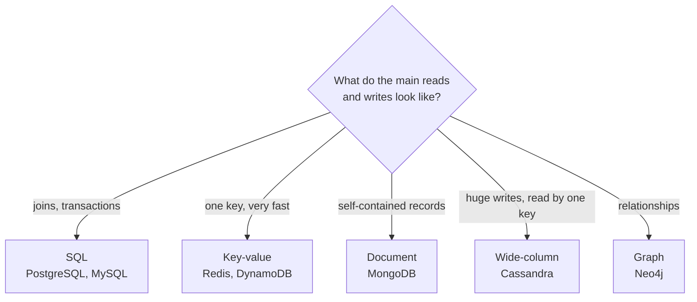

<!-- Written by `npm run lessons` from the lesson data in src/data. Edit the lesson there, not this page. -->

# SQL vs NoSQL: choosing a database

**System Design · Unit 3: Data: databases, storage and scaling data · Lesson 1 of 9 · Must know**

> **In one line.** SQL (relational) databases store data in tables with a fixed schema and support joins and transactions. NoSQL is a family of other models: key-value, document, wide-column and graph.

[Open this lesson on the site](https://learn.hamropedia.com/system-design/sql-vs-nosql-choosing-a-database/) for its animation, the practice game and tap-to-explain words.

## The problem it solves

Different data and different access patterns need different storage. A wrong choice hurts later: slow queries, joins you can't do, or a database that can't keep up with the writes.

## The idea

Start from your data and how it's accessed. Relational databases (PostgreSQL, MySQL) suit structured data with relationships and strong consistency. Key-value stores (Redis, DynamoDB) give fast lookups by key. Document stores (MongoDB) hold flexible JSON-like records. Wide-column stores (Cassandra) handle huge write volumes. Graph databases (Neo4j) suit highly connected data like social networks.

## How it works, step by step

1. List the main queries: 'get a user's last 20 orders', 'find all messages in a chat by time', 'count the likes on a post'.
2. If you need joins, transactions and flexible queries over structured data, start with SQL.
3. If one simple lookup by key dominates, and must be extremely fast or enormous, consider a key-value store.
4. If each record is a self-contained document with varying fields, consider a document store.
5. If writes are massive and reads always follow one key (like chat messages by conversation), consider a wide-column store.
6. If the questions are about relationships ('friends of friends who like X'), consider a graph database.

## Picture it



*Start from how the data is used, then follow the matching arrow to a kind of database.*

## Analogy

SQL is a well-organised filing cabinet with labelled folders and cross-references. NoSQL is a set of specialised containers: a key rack, a box of folders, a giant ledger, a map of connections.

**Where the analogy breaks.** A filing cabinet can't grow past the office. Relational databases actually scale a long way with replicas and sharding, and many NoSQL stores now support transactions. The line is blurrier than the slogan.

## Example

Take an online shop. Orders and payments go in PostgreSQL, because transactions matter. Shopping carts and sessions go in a key-value store: fast and simple. Product search goes in Elasticsearch. 'People also bought' goes in a precomputed table or a graph.

## Must know

- Choose by access pattern: what are the main reads and writes, and by which key?
- SQL: joins, ACID transactions, a strict schema; scales with replicas and, with more effort, sharding.
- Key-value: very fast by key, no complex queries. Document: flexible schema, nested data.
- Wide-column (Cassandra): massive write volume; queries designed around the partition key.
- Graph: relationships first (friends of friends).
- Default in most interviews: start with SQL unless there's a clear reason not to.
- Hands-on: the [SQL course](https://learn.hamropedia.com/sql/) teaches the language itself, from SELECT to window functions, with every query runnable.

## Trade-offs

- SQL: flexible queries and strong guarantees, but harder to scale writes horizontally.
- NoSQL: easy scale-out for specific patterns, but limited queries, and you must design around access patterns up front.

## Common mistakes

- Choosing NoSQL because it 'scales', without checking the queries you need.
- Designing a NoSQL schema like SQL tables, then needing joins.
- Forgetting that different parts of one system can use different databases.

> **Not true:** A system that has to scale: choose NoSQL, since SQL databases stop at one machine.  
> **In fact:** A SQL database scales a long way with replicas and sharding. Choose by the reads and writes you need: NoSQL gives up joins, and often transactions too.

> **Not true:** One system: one kind of database for the orders, the sessions and the search alike.  
> **In fact:** Different parts have different needs. Orders may sit in SQL, sessions in a key-value store and search in a search engine, all in one system.

## In the interview

I'd choose based on the access patterns. For orders and payments with relationships and transactions, PostgreSQL. For very high write volume with simple key-based reads, like chat messages, a wide-column store like Cassandra. For sessions and hot data, Redis. Using different stores for different jobs is normal.

<details>
<summary>&lt;b>Why might chat messages go in Cassandra?&lt;/b></summary>

Huge write volume, always read by conversation and time: a natural partition key and sort order, with easy horizontal scaling.

</details>

<details>
<summary>&lt;b>Is NoSQL always faster?&lt;/b></summary>

No. It's fast for the access pattern it was designed for. Unplanned queries and joins can be slow or impossible.

</details>

## Practise

Try each one yourself first, then open the answer and compare.

### 1. Explain

Explain the four NoSQL types with one good use for each.

<details>
<summary>Show one good answer</summary>

• Key-value (Redis, DynamoDB): a giant dictionary; give it a key, get a value back, very fast. Good for: user sessions, a cache, a shopping cart.  
• Document (MongoDB): each record is a JSON-like document, and records can have different fields. Good for: a product catalogue, where a shirt has sizes and a laptop has RAM.  
• Wide-column (Cassandra): rows grouped by a partition key and sorted inside it, built for enormous write volumes spread over many machines. Good for: chat messages by conversation, or sensor readings by device and time.  
• Graph (Neo4j): nodes and the relationships between them are stored directly, so following links is cheap. Good for: a social network ("friends of friends who like X"), or spotting fraud rings.

</details>

### 2. Draw

Draw the tables for users, orders and order items, with keys and relationships.

<details>
<summary>Show one good answer</summary>

One user has many orders, and one order has many item lines; order_items is keyed by the pair (order_id, product_id). Two details worth saying out loud: the item keeps the price at the time of purchase (product prices change later), and orders get an index on (user_id, created_at) for "my latest orders".

```text
users
  user_id       PK
  email         UNIQUE, NOT NULL
  name
  created_at
     │ 1
     │
     │ many
orders
  order_id      PK
  user_id       FK → users.user_id
  status
  total_pence
  created_at
     │ 1
     │
     │ many
order_items
  order_id      PK (part 1), FK → orders
  product_id    PK (part 2), FK → products
  quantity
  unit_price_pence   (the price when bought)
```

</details>

### 3. Apply

Pick a database for: a bank ledger, IoT sensor readings, user sessions, a social graph, a product catalogue. Justify each.

<details>
<summary>Show one good answer</summary>

• Bank ledger: relational (PostgreSQL). Money needs ACID transactions (a transfer is two changes that must both happen), constraints (no negative balance), and exact reports. Correctness matters far more than raw scale.  
• IoT sensor readings: a time-series database (TimescaleDB, InfluxDB), or wide-column (Cassandra) partitioned by (sensor, day). Huge numbers of small writes, always appended, read by sensor and time range, and old data is downsampled or deleted.  
• User sessions: key-value (Redis). Looked up by session ID on every request, must be very fast, and expire on their own (a TTL). Losing one just means logging in again.  
• Social graph: a graph database (Neo4j) for queries several hops deep. At very large scale, many companies keep each user's list of friends in a sharded key-value or wide-column store, and precompute the expensive questions.  
• Product catalogue: a document store (MongoDB), or PostgreSQL with JSONB columns, because products have different attributes. Search over it goes in a search engine (Elasticsearch), fed from the main store.

</details>

### 4. Trade-offs

A startup used MongoDB for everything and now needs reports that join 5 collections. What went wrong, and what would you do?

<details>
<summary>Show one good answer</summary>

What went wrong: the database was chosen for "it scales" rather than for how the data is used. Users, orders, products and payments are relational data, connected by keys, and reports are exactly the cross-collection joins MongoDB is weakest at. So now there are slow $lookup chains, copies of the same data in several documents drifting apart, and reports run against the production database.

What to do:  
1. Short term: don't run reports on production. Stream every change (MongoDB change streams) into a relational warehouse (PostgreSQL, BigQuery or Snowflake) and run the five-way joins there. Reports become fast and safe, and nothing in the app changes.  
2. Longer term: move the core relational data (orders, payments) into PostgreSQL, where joins and transactions are natural, one part at a time. Keep MongoDB where it fits, such as the flexible product catalogue.

The lesson: choose the store per kind of data, from its access patterns, and expect reporting to need its own copy of the data.

</details>

## Go further (optional)

- WATCH · [CMU 15-445 Intro to Database Systems: data models and query languages](https://www.youtube.com/results?search_query=CMU+15-445+database+systems+data+models+and+query+languages) · Andy Pavlo, Carnegie Mellon · free on YouTube
- WATCH · [ByteByteGo: SQL vs NoSQL](https://www.youtube.com/results?search_query=ByteByteGo+SQL+vs+NoSQL) · ByteByteGo · YouTube
- READ · [The System Design Primer](https://github.com/donnemartin/system-design-primer) · Donne Martin · GitHub, free

---

[← Observability: logs, metrics and traces](../unit-2-core-concepts/observability-logs-metrics-and-traces.md) · [All lessons](../../README.md) · [ACID transactions and isolation levels →](acid-transactions-and-isolation-levels.md)
