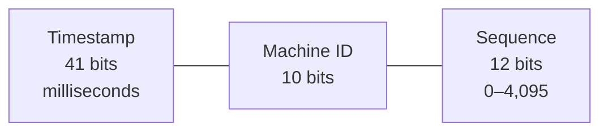

<!-- Written by `npm run lessons` from the lesson data in src/data. Edit the lesson there, not this page. -->

# Unique ID generation

**System Design · Unit 3: Data: databases, storage and scaling data · Lesson 9 of 9 · Should know**

> **In one line.** Generating IDs that are unique across many servers, without one shared database counter.

[Open this lesson on the site](https://learn.hamropedia.com/system-design/unique-id-generation/) for its animation, the practice game and tap-to-explain words.

## The problem it solves

Every order, message and user needs an ID that never repeats. With many servers creating records at the same moment, one shared counter becomes a bottleneck and a single point of failure.

## The idea

A single auto-increment counter becomes a bottleneck at scale. There are three options. UUIDs: random, no coordination, 128-bit, but version 4 isn't ordered by time. A ticket server that hands out ranges of numbers. Or Snowflake-style IDs: 64-bit numbers made from a timestamp, a machine ID and a sequence number. They're unique, roughly ordered by time, and generated locally.

## How it works, step by step

1. A Snowflake ID is built as: timestamp (41 bits), then machine ID (10 bits), then sequence (12 bits).
2. Each machine gets a unique machine ID when it starts, from configuration or a coordinator.
3. For each new ID within the same millisecond, the machine adds one to its sequence (0 up to 4,095).
4. If the sequence runs out, the machine waits for the next millisecond.
5. Because the timestamp comes first, IDs made later are bigger, so they sort roughly by time.

## Picture it



*One 64-bit Snowflake ID, read left to right. The time comes first, so later IDs are bigger and sort by time.*

## Analogy

Ticket numbers at a deli with several ticket machines. Each machine prints its own machine code plus the time, so tickets never clash.

**Where the analogy breaks.** Deli machines share one wall clock. Servers' clocks drift, and a clock that jumps backwards could create duplicate Snowflake IDs, so the generator must notice and wait.

## Example

Snowflake: 41 bits of milliseconds since a chosen start date, 10 bits of machine ID, and 12 bits of sequence, so each machine can make 4,096 IDs per millisecond.

## Must know

- Auto-increment: simple, but a single point of failure and a bottleneck, and it reveals your counts.
- UUID v4: no coordination, 128 bits, random order (bad for inserts into a B-tree index).
- UUID v7 and ULID: ordered by time and still need no coordination.
- Snowflake: 64 bits, sortable by time; needs unique machine IDs and sane clocks.
- Range allocation: each server reserves a block of, say, 1,000 IDs at a time.

## Common mistakes

- Two machines accidentally sharing a machine ID.
- Ignoring clock problems: time-based IDs can repeat or go backwards when a server's clock is corrected.
- Exposing sequential IDs that let outsiders count your orders or guess other users' links.

> **Not true:** Time-based IDs: no repeats, because a server's clock moves forward.  
> **In fact:** A server's clock can be corrected backwards, and two machines can make IDs in the same millisecond. Time-based IDs also need a machine ID and a sequence number.

> **Not true:** Sequential IDs in public links: they reveal no information to outsiders.  
> **In fact:** With IDs 1001, 1002, 1003, an outsider can count your orders and guess other people's links. Use random-looking IDs in anything public.

## In the interview

I'd use Snowflake-style 64-bit IDs: timestamp, machine ID and a per-millisecond sequence. They're generated locally without coordination, they're unique, and they sort roughly by time, which keeps database indexes efficient.

<details>
<summary>&lt;b>Why not UUID v4 everywhere?&lt;/b></summary>

128 bits is bigger, and random order scatters inserts across a B-tree index, which hurts write speed. Time-ordered UUID v7 avoids that.

</details>

<details>
<summary>&lt;b>What if the clock goes backwards?&lt;/b></summary>

Detect it, and wait until the clock catches up (or refuse to generate), so an ID is never repeated.

</details>

## Practise

Try each one yourself first, then open the answer and compare.

### 1. Explain

Explain the three parts of a Snowflake ID and why each one is needed.

<details>
<summary>Show one good answer</summary>

A Snowflake ID is one 64-bit number made of three parts:

• Timestamp (41 bits): milliseconds since a chosen start date. It comes first, so IDs made later are bigger and sort by time, which keeps database indexes efficient (new rows go at the end).  
• Machine ID (10 bits): a number unique to each generator, up to 1,024 of them. It is what lets two machines make IDs in the same millisecond without asking each other, because their IDs differ in this part.  
• Sequence (12 bits): a counter within one millisecond on one machine, 0 to 4,095. It separates IDs made by the same machine in the same millisecond; when it runs out, the machine waits for the next millisecond.

Take away any part and you get duplicates: without the machine ID, across machines; without the sequence, within one machine; without the timestamp, as soon as the sequence wraps.

</details>

### 2. Draw

Draw the 64 bits of a Snowflake ID, with the size of each part.

<details>
<summary>Show one good answer</summary>

41 bits of milliseconds last about 69 years from the chosen start date. 10 bits allow 1,024 machines, and 12 bits allow 4,096 IDs per machine per millisecond: about 4 million a second from each machine. The top bit stays 0, so the ID is always a positive signed 64-bit number (a BIGINT).

```text
│ 1 │        41 bits          │ 10 bits │ 12 bits  │
│ 0 │ milliseconds since the  │ machine │ sequence │
│   │ chosen start date       │ ID      │          │
│   │ (about 69 years)        │ 0–1,023 │ 0–4,095  │
  ▲
  sign bit: always 0, so the ID stays positive
```

</details>

### 3. Apply

Implement a Snowflake generator in Python, create 100,000 IDs in a loop, and check they're unique and increasing.

<details>
<summary>Show one good answer</summary>

The ID is built with bit shifts: (milliseconds since the start date) &lt;&lt; 22, then machine ID &lt;&lt; 12, then the sequence. A lock makes it safe to call from several threads. If the clock goes backwards, it refuses to make an ID rather than risk a duplicate; if 4,096 IDs are used in one millisecond, it waits for the next one.

100,000 IDs come out unique and strictly increasing, and a second generator with a different machine ID never produces any of the same numbers.

```python
import threading
import time


class Snowflake:
    EPOCH = 1_704_067_200_000                    # 2024-01-01, in milliseconds

    def __init__(self, machine_id):
        assert 0 <= machine_id < 1024            # 10 bits
        self.machine_id = machine_id
        self.last_ms = -1
        self.sequence = 0
        self.lock = threading.Lock()

    @staticmethod
    def _now():
        return int(time.time() * 1000)

    def next_id(self):
        with self.lock:
            now = self._now()
            if now < self.last_ms:
                raise RuntimeError("clock moved backwards; refusing to make an ID")
            if now == self.last_ms:
                self.sequence = (self.sequence + 1) & 4095       # 12 bits
                if self.sequence == 0:                           # 4,096 used this millisecond
                    while now <= self.last_ms:
                        now = self._now()                        # wait for the next one
            else:
                self.sequence = 0
            self.last_ms = now
            return ((now - self.EPOCH) << 22) | (self.machine_id << 12) | self.sequence


gen = Snowflake(machine_id=7)
ids = [gen.next_id() for _ in range(100_000)]
print(len(set(ids)) == len(ids))                     # True: all unique
print(all(a < b for a, b in zip(ids, ids[1:])))      # True: strictly increasing
first = ids[0]
print((first >> 12) & 1023, first & 4095)            # 7 0: machine 7, sequence 0

other = Snowflake(machine_id=8)
print(len(set(ids) & {other.next_id() for _ in range(1_000)}))   # 0: no clashes
```

</details>

### 4. Trade-offs

Compare UUID v4, UUID v7 and Snowflake as the primary key of a write-heavy table.

<details>
<summary>Show one good answer</summary>

• UUID v4: needs no coordination at all, but it is random, so each new row lands at a random place in the primary-key B-tree. On a write-heavy table that means page splits, poor cache use and slower inserts. It is also 16 bytes, which every secondary index repeats. Avoid it as the primary key of a busy table.  
• UUID v7: no coordination, and time-ordered (it starts with a millisecond timestamp, followed by random bits), so inserts go to the end of the index like a counter. Still 16 bytes. A good default when you want UUIDs.  
• Snowflake: time-ordered and only 8 bytes (a BIGINT), so indexes are the smallest and fastest. The cost: you must hand out unique machine IDs and handle clocks going backwards, and the ID reveals when (and on which machine) it was made.

For a write-heavy table: Snowflake if you can run the machine-ID setup, otherwise UUID v7. Either way, not UUID v4.

</details>

## Go further (optional)

- READ · [Hello Interview: design a unique ID generator in distributed systems](https://www.google.com/search?q=Hello+Interview+design+a+unique+ID+generator+in+distributed+systems) · hellointerview.com · free guides
- WATCH · [ByteByteGo: unique ID generator](https://www.youtube.com/results?search_query=ByteByteGo+unique+ID+generator) · ByteByteGo · YouTube
- READ · [Announcing Snowflake](https://www.google.com/search?q=Twitter+engineering+blog+announcing+Snowflake) · Twitter engineering blog

---

[← Search: inverted indexes and Elasticsearch](search-inverted-indexes-and-elasticsearch.md) · [All lessons](../../README.md) · [Monolith vs microservices →](../unit-4-distributed/monolith-vs-microservices.md)
