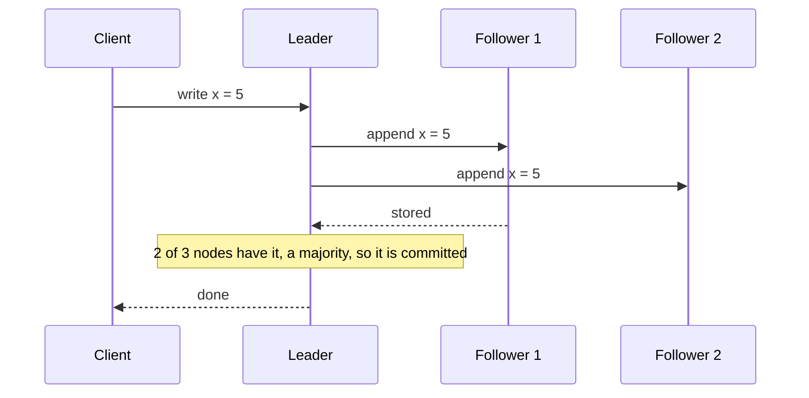

<!-- Written by `npm run lessons` from the lesson data in src/data. Edit the lesson there, not this page. -->

# Consensus and leader election (Raft)

**System Design · Unit 4: Distributed systems and security · Lesson 3 of 4 · Bonus**

> **In one line.** Consensus is getting several machines to agree on a value — such as who the leader is, or the order of operations — even when some of them fail.

[Open this lesson on the site](https://learn.hamropedia.com/system-design/consensus-and-leader-election-raft/) for its animation, the practice game and tap-to-explain words.

## The problem it solves

Several machines need to agree, even when some crash or messages are delayed. If two of them both believe they're in charge, data gets corrupted.

## The idea

Many systems need exactly one leader, or one agreed order of changes. Raft does this: nodes elect a leader by majority vote; the leader adds commands to its log and copies them to the others; an entry is committed once a majority has it. With 5 nodes, the cluster survives 2 failures. Tools like etcd and ZooKeeper give you this, so you don't build it yourself.

## How it works, step by step

1. Every node starts as a follower. If a follower hears nothing from a leader for a random timeout (say 150–300 ms), it becomes a candidate.
2. The candidate increases the term number and asks the others for their votes. Each node votes once per term.
3. With votes from a majority, it becomes the leader and sends regular heartbeats.
4. Clients send writes to the leader, which adds each one to its log and sends it to the followers.
5. Once a majority have stored an entry, it's committed and applied, and the leader tells the followers.
6. If the leader fails, the heartbeats stop, a new election begins, and the new leader's log becomes the reference.

## Picture it



*A write counts once a majority of the nodes have stored it, even if one follower is slow or down.*

## Analogy

A committee that decides by majority vote. As long as most members are present, decisions stand, and two separate groups can never both be the majority.

**Where the analogy breaks.** A committee meets in one room. Machines talk over unreliable networks with delays, so Raft needs terms (numbered elections) and timeouts to stop two leaders acting at once.

## Example

Kubernetes stores its cluster state in etcd, which uses Raft. A 3-node etcd cluster keeps working if 1 node fails.

## Must know

- Majority (quorum) = more than half; a cluster of N tolerates (N − 1) ÷ 2 failures, so use odd sizes like 3 or 5.
- Raft roles: follower, candidate, leader. Terms stop an old leader from acting.
- Randomised election timeouts avoid split votes.
- Used for: leader election, distributed locks, configuration and metadata.
- Don't build your own: use etcd, ZooKeeper or a managed service.

## Common mistakes

- Running an even number of nodes: 4 nodes survive only 1 failure, the same as 3, so the extra node buys nothing.
- Thinking the smaller side of a partition can still accept writes.
- Building your own consensus instead of using a tested system.

> **Not true:** 4 nodes: one more failure survived than with 3 nodes.  
> **In fact:** A majority of 4 is 3, so 4 nodes survive only 1 failure, the same as 3 nodes. That is why clusters use odd sizes such as 3 or 5.

> **Not true:** Partition: the smaller side keeps accepting writes.  
> **In fact:** Only the side with a majority can elect a leader and accept writes. That rule is what stops two leaders (split brain).

## In the interview

Where we need a single leader or a distributed lock, I'd rely on a consensus system like etcd or ZooKeeper. It uses Raft or a similar protocol, so a majority must agree and the cluster survives the failure of a minority of nodes.

<details>
<summary>&lt;b>Why odd numbers of nodes?&lt;/b></summary>

A 4-node cluster needs 3 for a majority and still only survives 1 failure — the same as 3 nodes, at higher cost.

</details>

<details>
<summary>&lt;b>What is a fencing token?&lt;/b></summary>

An increasing number handed out with a lock. Storage rejects writes carrying an older number, so a paused old leader can't corrupt data when it wakes up.

</details>

## Practise

Try each one yourself first, then open the answer and compare.

### 1. Explain

Explain majority voting, and why it prevents two leaders, with the committee picture.

<details>
<summary>Show one good answer</summary>

Think of a committee that only decides by majority vote. A decision counts only if more than half of all members vote for it, and each member votes once per election.

Why that prevents two leaders: to become leader you need votes from more than half the members. Two different candidates would each need more than half, and two "more than halves" must share at least one member. That member can only vote once in an election (a term), so both can't win the same election.

It also explains what happens when the network splits a 5-node cluster into 3 and 2: the side with 3 is a majority and carries on; the side with 2 can't elect a leader or commit anything, so it waits. They can never both decide different things. Raft adds terms (numbered elections), so an old leader that wakes up after a pause sees a higher term number and steps down instead of acting on stale authority.

</details>

### 2. Draw

Draw a 5-node Raft cluster copying one log entry, and mark the moment it's committed.

<details>
<summary>Show one good answer</summary>

The entry is committed the moment a majority (3 of 5, counting the leader itself) has stored it, not when all five have. That is why the cluster keeps working with two nodes slow or down. Followers that were behind catch up from the leader's log later.

```text
Client ── write x = 5 ──► Leader N1
                           │ appends it to its log  (1 of 5)
        ┌─────────┬────────┼─────────┬─────────┐
        ▼         ▼                  ▼         ▼
       N2        N3                 N4        N5
     stored ✓  stored ✓          (slow…)   (down ✗)
        │         │
        └─────────┴──► "stored" ──► Leader

Leader + N2 + N3 = 3 of 5 = a majority
  ★ COMMITTED here: apply x = 5, reply "done"

N4 stores it a moment later; N5 catches up
from the leader's log when it comes back.
```

</details>

### 3. Apply

Use the Raft visualisation to watch an election and a leader failure, and write down the sequence of events.

<details>
<summary>Show one good answer</summary>

A typical run of the visualisation:

1. All nodes start as followers, each with a random election timeout.  
2. One node's timeout runs out first. It becomes a candidate, starts term 1, votes for itself and asks the others for their votes.  
3. The others haven't voted in term 1 yet, so they vote for it. With a majority, it becomes the leader.  
4. The leader sends heartbeats regularly; each heartbeat resets the followers' timeouts, so no new election starts.  
5. A client write arrives at the leader. It appends it to its log (uncommitted) and sends it with the next heartbeat. Once a majority confirm, the leader commits it, applies it and replies to the client; the next heartbeat tells the followers to commit too.  
6. The leader is stopped. Heartbeats stop, a follower times out, becomes a candidate for term 2, wins a majority and becomes the new leader.  
7. When the old leader comes back, it sees the higher term, steps down to follower, and any entries it had that were never committed are replaced by the new leader's log.

Also worth watching: a split vote. Two candidates time out together and split the votes, so nobody wins; they wait new random timeouts and try again, and one wins the next term.

</details>

### 4. Trade-offs

Why does consensus make writes slower, and when is that worth it?

<details>
<summary>Show one good answer</summary>

Why writes get slower:  
• Every write waits for a round trip to a majority of nodes, and each of them saves it to disk before replying. Across availability zones that adds milliseconds to every write.  
• All writes go through one leader, which caps the write rate the group can handle.  
• During an election (a few hundred milliseconds or more), no writes are accepted at all, and the minority side of a partition can't write until it heals.

When it is worth it: for small, critical data where two machines disagreeing would be a disaster:  
• who the leader is, and locks ("only one worker processes this job");  
• cluster configuration and metadata (Kubernetes keeps all its state in etcd);  
• the agreed order of transactions in a strongly consistent database (Spanner, CockroachDB).

When it isn't: high-volume data where a little staleness is fine (likes, view counts, logs, metrics). There, faster eventual consistency is the better trade.

</details>

## Go further (optional)

- READ · [Raft, visualised](https://thesecretlivesofdata.com/raft/) · The Secret Lives of Data, free
- READ · [The Raft consensus algorithm](https://raft.github.io/) · raft.github.io
- WATCH · [Distributed Systems lecture series: consistency and consensus](https://www.youtube.com/results?search_query=Martin+Kleppmann+distributed+systems+lecture+consistency+and+consensus) · Martin Kleppmann, University of Cambridge · free on YouTube

---

[← Distributed transactions: sagas and the outbox pattern](distributed-transactions-sagas-and-the-outbox-pattern.md) · [All lessons](../../README.md) · [Security basics: authentication, authorisation, OAuth and JWT →](security-basics-authentication-authorisation-oauth-and-jwt.md)
