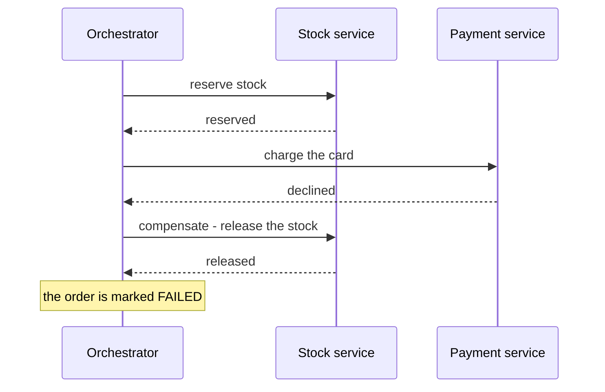

<!-- Written by `npm run lessons` from the lesson data in src/data. Edit the lesson there, not this page. -->

# Distributed transactions: sagas and the outbox pattern

**System Design · Unit 4: Distributed systems and security · Lesson 2 of 4 · Should know**

> **In one line.** A saga runs a business process across several services as a series of local transactions, with a compensating action to undo each step if a later step fails.

[Open this lesson on the site](https://learn.hamropedia.com/system-design/distributed-transactions-sagas-and-the-outbox-pattern/) for its animation, the practice game and tap-to-explain words.

## The problem it solves

An order needs stock reserved, a card charged and a shipment booked, in three different services with three databases. No single transaction can cover all three, but you still can't leave an order half done.

## The idea

Across services you can't wrap everything in one ACID transaction. A saga runs steps one by one — reserve stock, charge the card, create the shipment — and if charging fails, it runs compensations, like releasing the stock. Steps are coordinated by choreography (services react to each other's events) or orchestration (a central coordinator tells each step what to do).

The outbox pattern makes 'update my database and publish an event' reliable: write the event into an outbox table in the same transaction, then publish it.

## How it works, step by step

1. The orchestrator starts the saga: 'reserve stock'. The stock service reserves it and replies OK.
2. Next, 'charge the card'. The payment service tries, and the card is declined.
3. The orchestrator runs the compensations in reverse order: 'release the stock'.
4. The order is marked FAILED and the user is told.
5. Outbox: each service, in the same local transaction as its change, writes an event row into an outbox table. A relay reads new rows and publishes them, retrying until it succeeds.

## Picture it



*Each step is a local transaction. When the payment fails, the orchestrator undoes the earlier step instead of leaving the order half done.*

## Analogy

Booking a holiday: flight, hotel, car. If the car booking fails, you cancel the hotel and the flight. You don't pretend the trip never happened; you undo each step.

**Where the analogy breaks.** When you cancel a holiday, nobody else sees the half-booked state. In a saga, other users can see the in-between state (stock reserved, then released), so every step and compensation must allow for that, and be idempotent.

## Example

The order service writes the order and an 'OrderCreated' outbox row in one transaction. A relay publishes it to Kafka. The payment service charges the card, or emits 'PaymentFailed' if it's declined. In that case the order service cancels the order.

## Must know

- Two-phase commit (2PC) gives an atomic commit across databases, but blocks on failures and couples services.
- Saga = local transactions + compensating actions.
- Choreography: decentralised, event-driven, but hard to follow as it grows. Orchestration: a central workflow, clearer, one more component.
- Outbox pattern: avoids the dual-write problem (the database update succeeds but publishing the event fails).
- Every step and compensation must be idempotent, because messages can arrive twice.

## Common mistakes

- Forgetting compensations, or making them unsafe to repeat.
- Publishing events outside the database transaction (the dual-write problem).
- Using two-phase commit across services and creating fragile coupling.

> **Not true:** Saving to the database and then publishing an event always succeed or fail together.  
> **In fact:** A crash between the two leaves the data saved and the event never sent (the dual-write problem). The outbox pattern writes the event in the same transaction as the data.

> **Not true:** Saga: a failed step is undone by the database's own rollback.  
> **In fact:** Each step is its own committed transaction, so there is nothing left to roll back. A saga runs a compensating action instead, such as releasing the stock.

## In the interview

For checkout across services I'd use an orchestrated saga: reserve stock, take payment, confirm the order, with a compensating step for each. Each service writes its state change and its outgoing event atomically using the outbox pattern, and every handler is idempotent.

<details>
<summary>&lt;b>What is the dual-write problem?&lt;/b></summary>

Writing to the database and publishing to a queue as two separate steps. If one succeeds and the other fails, the systems disagree. The outbox pattern makes it one transaction.

</details>

<details>
<summary>&lt;b>Why not use two-phase commit?&lt;/b></summary>

It holds locks until every participant agrees, and if the coordinator fails, participants can be stuck. It also works poorly across different technologies.

</details>

## Practise

Try each one yourself first, then open the answer and compare.

### 1. Explain

Explain a saga with the holiday-booking picture.

<details>
<summary>Show one good answer</summary>

Booking a holiday means three bookings with three different companies: the flight, the hotel and the car. There is no single "book all three or none" button across companies. So you book them one after another, and each booking is complete on its own (a local transaction).

If the car booking fails, you don't pretend the trip never happened. You undo what you already did, in reverse: cancel the hotel, then cancel the flight. Those cancellations are the compensating actions.

That is a saga: a business process spread over several services, done as a series of local transactions, each with a matching "undo". Where the picture breaks: while you are booking, nobody else sees your half-booked trip, but in a saga other users can see the in-between state (the stock is reserved, then released). And a cancellation might be sent twice, so every compensation must be safe to repeat.

</details>

### 2. Draw

Draw an orchestrated checkout saga, with its normal path and its compensation path.

<details>
<summary>Show one good answer</summary>

The orchestrator holds the state of each checkout and decides the next step. Compensations run in reverse order and only for steps that already succeeded. Each step and each compensation must be idempotent, because the orchestrator retries them after timeouts.

```text
Normal path
  Orchestrator ─1─► Stock:    reserve items   ✓
               ─2─► Payment:  charge the card ✓
               ─3─► Shipping: book delivery   ✓
               ─4─► order = CONFIRMED

Compensation path (the card is declined)
  Orchestrator ─1─► Stock:    reserve items   ✓
               ─2─► Payment:  charge the card ✗
               ─C1► Stock:    release items   ✓
               ───► order = FAILED, tell the user

If shipping fails at step 3:
  C2 refund the card, then C1 release the items
  (undo in reverse order)
```

</details>

### 3. Apply

Write the outbox table schema, and the steps a relay process follows to publish events safely.

<details>
<summary>Show one good answer</summary>

The key move is to write the event in the same database transaction as the change it describes: either both are saved or neither is. A separate relay then publishes it.

The relay's steps:  
1. Read a batch of unpublished rows in id order (FOR UPDATE SKIP LOCKED lets several relays share the work without taking the same rows).  
2. Publish each to the broker (for example Kafka), using aggregate_id as the message key so events for one order stay in order. Wait for the broker to confirm.  
3. Mark those rows as published.  
4. If it crashes between steps 2 and 3, the rows are published again on the next run. Delivery is at least once, so consumers skip events whose id they have already handled.  
5. Delete (or archive) published rows after a few days.

Instead of polling, a change-data-capture tool (such as Debezium) can read new outbox rows straight from the database's log.

```sql
-- PostgreSQL
CREATE TABLE outbox (
  id            BIGSERIAL PRIMARY KEY,      -- increasing: publish in this order
  event_id      UUID NOT NULL UNIQUE,       -- consumers use it to skip duplicates
  aggregate_id  TEXT NOT NULL,              -- e.g. the order id; the message key
  event_type    TEXT NOT NULL,              -- e.g. 'OrderCreated'
  payload       JSONB NOT NULL,
  created_at    TIMESTAMPTZ NOT NULL DEFAULT now(),
  published_at  TIMESTAMPTZ                 -- NULL until the relay has sent it
);
CREATE INDEX outbox_unpublished ON outbox (id) WHERE published_at IS NULL;

-- In the business transaction:
BEGIN;
INSERT INTO orders (order_id, customer_id, total) VALUES ('o-77', 'c-42', 5000);
INSERT INTO outbox (event_id, aggregate_id, event_type, payload)
VALUES (gen_random_uuid(), 'o-77', 'OrderCreated', '{"order_id": "o-77", "total": 5000}');
COMMIT;

-- The relay, in a loop:
BEGIN;
SELECT id, aggregate_id, event_type, payload
FROM outbox
WHERE published_at IS NULL
ORDER BY id
LIMIT 100
FOR UPDATE SKIP LOCKED;
-- ...publish each row to the broker and wait for its confirmation...
UPDATE outbox SET published_at = now() WHERE id = ANY (:published_ids);
COMMIT;
```

</details>

### 4. Trade-offs

Choreography or orchestration for a 6-step loan application? Justify your choice.

<details>
<summary>Show one good answer</summary>

Orchestration.

A loan application is long (identity check, credit check, affordability, underwriting decision, signed offer, payout), runs for days, includes people (an underwriter reviewing a case), and has branches ("refer to a person if the score is borderline") and timeouts ("cancel if not signed in 14 days"). An orchestrator, usually a workflow engine such as Temporal or AWS Step Functions, keeps all of that in one readable state machine:  
• You can see where every application is, which customers and regulators will ask about, and get an audit trail.  
• Compensations run in a clear order.  
• Changing the order of steps happens in one place.

With choreography, six services each react to each other's events. Nobody holds the whole picture, the flow exists only in your head, and adding a step means changing several services. That suits short flows with two or three steps.

The cost of orchestration: one more component to run, and a risk that business rules move into the orchestrator. Keep the decisions in the services; the orchestrator only decides what happens next.

</details>

## Go further (optional)

- READ · [Pattern: Saga](https://microservices.io/patterns/data/saga.html) · microservices.io, free
- READ · [Pattern: Transactional outbox](https://microservices.io/patterns/data/transactional-outbox.html) · microservices.io, free
- WATCH · [ByteByteGo: saga pattern](https://www.youtube.com/results?search_query=ByteByteGo+saga+pattern) · ByteByteGo · YouTube

---

[← Monolith vs microservices](monolith-vs-microservices.md) · [All lessons](../../README.md) · [Consensus and leader election (Raft) →](consensus-and-leader-election-raft.md)
