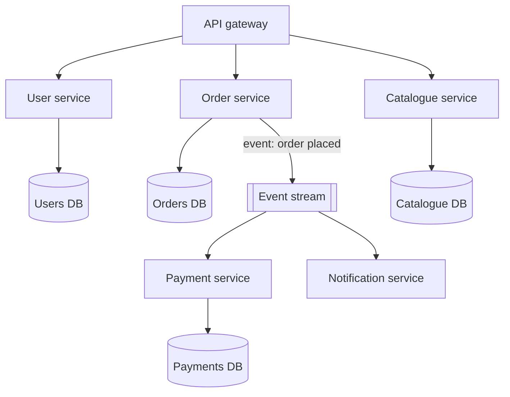

<!-- Written by `npm run lessons` from the lesson data in src/data. Edit the lesson there, not this page. -->

# Monolith vs microservices

**System Design · Unit 4: Distributed systems and security · Lesson 1 of 4 · Must know**

> **In one line.** A monolith is one deployable application. Microservices split the system into small services, each owning one business capability and its own data, talking over the network.

[Open this lesson on the site](https://learn.hamropedia.com/system-design/monolith-vs-microservices/) for its animation, the practice game and tap-to-explain words.

## The problem it solves

As a product and team grow, one big codebase becomes slow to build, risky to deploy and hard for many teams to work on at once. But splitting it creates network and data problems.

## The idea

A monolith is simpler to build, test and deploy at first. Microservices let teams deploy independently and scale parts separately, but add network calls, partial failures, distributed data and running costs. A good path: start with a well-structured (modular) monolith, and split off services when there's a clear reason.

## How it works, step by step

1. Find boundaries around business capabilities: users, catalogue, orders, payments.
2. Give each service its own database. Other services get its data only through its API or its events.
3. Use synchronous calls (REST or gRPC) when an answer is needed now, and events for things that can happen later.
4. Put a gateway at the edge, add tracing across services, and give each service its own deployment pipeline.
5. Split gradually: carve one service out of the monolith at a time (the 'strangler fig' approach).

## Picture it



*Each service owns its own database. Services that don't need an immediate answer react to events instead of calling each other directly.*

## Analogy

A monolith is a Swiss army knife: one tool, many blades. Microservices are a toolbox of separate tools: each is better and replaceable, but you need a box, labels and more organisation.

**Where the analogy breaks.** Tools in a box don't depend on each other. Services call each other over a network that can be slow or fail, so 50 carelessly built services can be far less reliable than one knife.

## Example

An online shop splits into user, catalogue, order, payment and notification services, each with its own database. The order service publishes 'order placed' events that the payment and notification services react to.

## Must know

- Each service owns its data; services don't share a database.
- They communicate through APIs (synchronous) or events (asynchronous).
- You'll need: service discovery, an API gateway, distributed tracing, and a deployment pipeline per service.
- Data consistency across services is eventual; use sagas for multi-step workflows.
- Conway's law: a system's structure tends to mirror the teams that build it.

## Trade-offs

- Monolith: simple, fast to change early, one deployment; can become tangled and hard for many teams.
- Microservices: independent deployments and scaling; network failures, complexity and data consistency costs.

## Common mistakes

- Splitting by technical layer (a 'database service') instead of by business capability.
- Chains of synchronous calls six services deep.
- A small team starting a new product as 30 microservices.

> **Not true:** A new product built by a small team should start as microservices.  
> **In fact:** Microservices cost effort from the first day: networks between parts, many deployments, tracing. A small team moves faster with a monolith, and can split it later.

> **Not true:** Splitting into services: by technical layer, such as one 'database service'.  
> **In fact:** Then every feature needs changes in several services at once. Split by business capability (orders, payments, shipping), so each team owns one whole piece.

## In the interview

I'd start with a modular monolith unless there's a clear need for independent scaling or many separate teams. If we split, each service owns its data, services talk through APIs and events, and we invest in a gateway, tracing and automated deployments from day one.

<details>
<summary>&lt;b>What's a 'distributed monolith'?&lt;/b></summary>

Services that are split up but so tightly coupled they must be deployed together: all the costs of microservices and none of the benefits.

</details>

<details>
<summary>&lt;b>Why not share one database between services?&lt;/b></summary>

It couples them: a schema change for one breaks the others, and no service truly owns its data.

</details>

## Practise

Try each one yourself first, then open the answer and compare.

### 1. Explain

Explain monolith versus microservices with the knife-and-toolbox picture.

<details>
<summary>Show one good answer</summary>

A monolith is a Swiss army knife: one tool with every blade built in. It is simple to carry around (one thing to build, test and deploy), and the blades share one handle (one codebase, one database). But to sharpen one blade, the whole knife goes back to the shop: every change ships everything, and as more people work on it they get in each other's way.

Microservices are a toolbox of separate tools. Each tool does one job well and can be replaced or upgraded on its own (each service is deployed and scaled independently, by its own team, with its own database). But now you need the box, labels and some organisation: a gateway, service discovery, monitoring and tracing, and a pipeline per service.

Where the picture breaks: tools in a box don't depend on each other. Services call each other over a network, so a slow or broken one can drag the others down. Fifty carelessly built services can be far less reliable than one knife.

</details>

### 2. Draw

Draw an online shop as 5 microservices with their databases, marking synchronous calls and asynchronous events.

<details>
<summary>Show one good answer</summary>

Each service owns its database, and no service reads another's. Synchronous calls are used only when an answer is needed right now (the order service asks the catalogue for the current price and stock). Everything that can happen afterwards travels as events, so a slow notification service can never hold up checkout.

```text
──►  synchronous call (REST or gRPC)
═══  event stream (asynchronous)
[ ]  the service's own database

Client ──► API gateway
             ├──► User service ── [Users]
             ├──► Catalogue ───── [Catalogue]
             └──► Order service ─ [Orders]
                    │ ──► Catalogue: price? in stock?
                    │
                    │ OrderPlaced
                    ▼
         ═══════ event stream ═══════
            │                   │
            ▼                   ▼
     Payment service     Notification service
       [Payments]          (email, push)
            │
            │ PaymentSucceeded / PaymentFailed
            ▼
         event stream ══► Order service
                          (updates the status)
```

</details>

### 3. Apply

List 3 signs that a monolith should be split, and 3 signs that it shouldn't be yet.

<details>
<summary>Show one good answer</summary>

Signs it should be split:  
1. Many teams are getting in each other's way: merge conflicts, a release train where one team's bug blocks everyone else's release.  
2. Parts have very different needs: image processing needs big CPU machines and scales with uploads, while checkout needs high reliability. In one deployment you scale and risk everything together.  
3. One area has a clear, stable boundary (payments, search, notifications) and changes on its own schedule, so it can be carved out with a clean API.

Signs it shouldn't be yet:  
1. A small team (one or two teams). The coordination costs of microservices will outweigh the benefits.  
2. The boundaries are still moving: the product is young, and you would split along the wrong lines and then have to change many services at once.  
3. The basics are missing: no automated deployment pipeline, no monitoring or tracing, no one to run the extra infrastructure. And the real bottleneck is often the database, which splitting the code doesn't fix.

A good first step either way is a modular monolith: clear modules with clean interfaces inside one deployment, which can be split later along the lines that proved stable.

</details>

### 4. Trade-offs

What new kinds of failure appear when a function call becomes a network call?

<details>
<summary>Show one good answer</summary>

• Partial failure: a function call either works or throws. A network call can also time out, and then you don't know whether the work happened or not.  
• Latency: a function call takes nanoseconds; a network call takes milliseconds, and sometimes seconds. A chain of six calls adds up, and the slowest one sets the pace.  
• Duplicates: because of timeouts, callers retry, so the same request can arrive twice. Every operation that changes something must be idempotent.  
• Cascading failure: one slow service ties up the threads of everything that calls it, and the slowness spreads. You need timeouts, circuit breakers and bulkheads.  
• Inconsistency: each service has its own database, so there is no transaction across them. Data is eventually consistent, and multi-step work needs sagas.  
• Version mismatch: the caller and the callee are deployed separately, so they must cope with each other's old and new versions of the API.  
• Harder debugging: one user request crosses many services and many logs; without distributed tracing you can't follow it.  
• Service discovery, network partitions and serialisation errors: things a function call never had to think about.

</details>

## Go further (optional)

- READ · [Microservices](https://martinfowler.com/articles/microservices.html) · Martin Fowler and James Lewis
- WATCH · [ByteByteGo: monolith vs microservices](https://www.youtube.com/results?search_query=ByteByteGo+monolith+vs+microservices) · ByteByteGo · YouTube
- READ · [Microservice architecture patterns](https://microservices.io/patterns/) · microservices.io, free

---

[← Unique ID generation](../unit-3-data/unique-id-generation.md) · [All lessons](../../README.md) · [Distributed transactions: sagas and the outbox pattern →](distributed-transactions-sagas-and-the-outbox-pattern.md)
