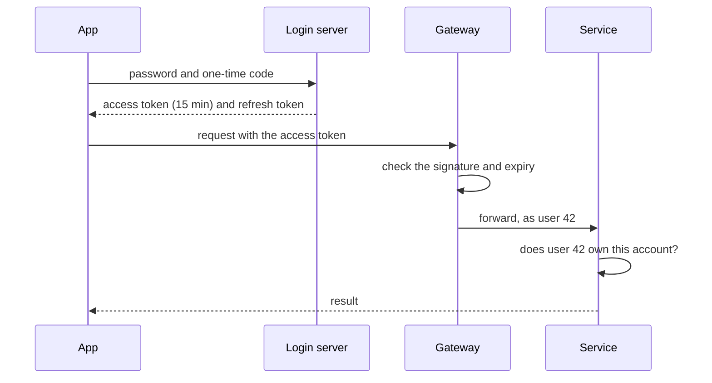

<!-- Written by `npm run lessons` from the lesson data in src/data. Edit the lesson there, not this page. -->

# Security basics: authentication, authorisation, OAuth and JWT

**System Design · Unit 4: Distributed systems and security · Lesson 4 of 4 · Must know**

> **In one line.** Authentication checks who you are. Authorisation checks what you're allowed to do.

[Open this lesson on the site](https://learn.hamropedia.com/system-design/security-basics-authentication-authorisation-oauth-and-jwt/) for its animation, the practice game and tap-to-explain words.

## The problem it solves

Every system must know who is calling and what they may do, and must keep data safe even if something leaks. Mistakes here are the most expensive kind.

## The idea

A user logs in once and gets a session ID or a token that proves who they are on later requests. A JWT is a signed token that services can check without a database lookup. OAuth 2.0 lets one app act on another service for a user without seeing their password; 'Sign in with Google' adds OpenID Connect on top.

Also essential: HTTPS everywhere, passwords stored with a slow salted hash, least privilege, encryption at rest, and no secrets in code.

## How it works, step by step

1. Login: the user sends their password over HTTPS. The server hashes it with the stored salt and compares the result with the stored hash.
2. If it matches (and the second factor is valid), the server issues a short-lived access token and a longer-lived refresh token.
3. Each request carries the access token. The gateway checks its signature and expiry without a database call.
4. The service checks authorisation: does this user own account 123? This check happens on the server, every time.
5. When the access token expires, the app swaps the refresh token for a new one. Logging out revokes the refresh token.

## Picture it



*Authentication happens once at login. After that, every request carries a token, and the service still checks permissions on every request.*

## Analogy

A hotel: reception checks your passport (authentication) and gives you a key card that opens only your room and the gym (authorisation).

**Where the analogy breaks.** A key card can be switched off at reception instantly. A JWT stays valid until it expires, because services only check its signature, not a central list. So keep JWTs short-lived and use refresh tokens.

## Example

Take a banking app. You log in with a password plus a one-time code (multi-factor), and get a 15-minute access token and a refresh token. The gateway checks the token's signature. The payments service checks that the user owns the account before moving any money.

## Must know

- Never store plain passwords: use a slow, salted hash (bcrypt, scrypt, Argon2).
- Session cookies (state kept on the server, easy to revoke) or JWTs (stateless, hard to revoke).
- OAuth 2.0 = delegated authorisation; OpenID Connect = login and identity on top of it.
- Authorisation models: role-based (RBAC) or attribute-based (ABAC). Check on every request, on the server.
- Defence in depth: TLS, input validation, rate limiting, least privilege, audit logs.
- Common attacks: SQL injection, cross-site scripting (XSS), cross-site request forgery (CSRF), credential stuffing.

## Common mistakes

- Checking permissions only in the user interface.
- Long-lived JWTs that can't be revoked.
- Storing passwords with a fast hash (MD5, SHA-256) or without a salt.
- Committing secrets such as passwords or API keys to Git, where they stay in the history for ever.

> **Not true:** Hiding a button in the user interface stops a user from doing that action.  
> **In fact:** Anyone can send a request straight to the server, without the interface. Check permissions on the server, for every request.

> **Not true:** Storing passwords: SHA-256 is a good choice, because it is fast.  
> **In fact:** Fast is the problem: an attacker can try billions of guesses a second. Use a slow, salted hash made for passwords, such as bcrypt or Argon2.

## In the interview

Authentication goes through an identity provider with multi-factor login, issuing short-lived access tokens and refresh tokens. The gateway verifies tokens, and each service enforces authorisation on every request — for example, that the user owns the account. Passwords are stored with a slow hash, everything runs over TLS, and sensitive data is encrypted at rest.

<details>
<summary>&lt;b>How do you revoke a JWT?&lt;/b></summary>

Keep them short-lived, revoke the refresh token, and for urgent cases keep a small deny-list that the gateway checks.

</details>

<details>
<summary>&lt;b>Why hash passwords with a slow algorithm?&lt;/b></summary>

If the database leaks, attackers have to try guesses one at a time, and a slow hash makes every guess expensive.

</details>

## Practise

Try each one yourself first, then open the answer and compare.

### 1. Explain

Explain authentication versus authorisation with the hotel picture.

<details>
<summary>Show one good answer</summary>

At a hotel, reception checks your passport when you arrive. That is authentication: proving who you are. It happens once, at check-in (login).

Reception then gives you a key card. The card opens your room and the gym, but not other guests' rooms or the staff office. That is authorisation: what you are allowed to do. It is checked at every door you try (on every request), not just once.

Where the picture breaks: reception can switch a key card off instantly. A JWT access token keeps working until it expires, because services only check its signature, not a central list. That is why access tokens are kept short-lived and paired with a refresh token that can be revoked.

</details>

### 2. Draw

Draw the login and token-refresh flow for a mobile app.

<details>
<summary>Show one good answer</summary>

The access token is short-lived and sent with every request; the refresh token is long-lived, stored securely on the phone, and only ever sent to the login server. Rotating the refresh token on every use means a stolen one is detected the moment both copies are used.

```text
1. Log in
   App ── password + one-time code ──► Auth server
   App ◄── access token (15 min)
           + refresh token (30 days, kept in
             the phone's secure storage)

2. Every request
   App ── request + access token ──► Gateway
          signature ok? not expired? ──► Service
          Service: may user 42 do this?

3. Access token expired
   App ── request ──► Gateway ── 401 expired
   App ── refresh token ──► Auth server
          valid? not revoked?
   App ◄── new access token + new refresh token
           (the old refresh token stops working)
   App ── retry the request ──► ✓

4. Log out, or fraud detected
   Auth server revokes the refresh token:
   no new access tokens; the last one dies
   within 15 minutes
```

</details>

### 3. Apply

Write Python functions that hash and check a password with hashlib.scrypt and a random salt, and explain why the salt matters.

<details>
<summary>Show one good answer</summary>

scrypt is slow and needs a lot of memory on purpose, so each guess costs an attacker real time and money. hmac.compare_digest compares in constant time, so the time taken doesn't leak how many characters matched.

Why the salt matters: it is a random value, different for every password, stored next to the hash. Two users with the same password get different hashes, so:  
• an attacker can't use precomputed tables of hashes for common passwords (rainbow tables);  
• they can't see which users share a password;  
• they must attack each hash separately, which multiplies their work by the number of users.  
The salt isn't secret; its job is to be unique.

```python
import hashlib
import hmac
import os

N, R, P = 2**14, 8, 1            # cost: how much memory and CPU each guess takes


def hash_password(password):
    salt = os.urandom(16)                                   # a new random salt every time
    key = hashlib.scrypt(password.encode(), salt=salt, n=N, r=R, p=P, dklen=32)
    return salt.hex() + "$" + key.hex()                     # store the salt with the hash


def check_password(password, stored):
    salt_hex, key_hex = stored.split("$")
    key = hashlib.scrypt(password.encode(), salt=bytes.fromhex(salt_hex), n=N, r=R, p=P, dklen=32)
    return hmac.compare_digest(key.hex(), key_hex)          # constant-time comparison


first = hash_password("correct horse")
second = hash_password("correct horse")
print(check_password("correct horse", first), check_password("wrong", first))   # True False
print(first == second)           # False: same password, different salts, different hashes
```

</details>

### 4. Trade-offs

Sessions or JWTs for a web app that must log a user out instantly when fraud is detected?

<details>
<summary>Show one good answer</summary>

Sessions.

With server-side sessions, the browser holds only a random session ID (in a Secure, HttpOnly cookie), and the session itself lives in a store such as Redis. When fraud is detected, delete the session: the very next request fails, and the user is logged out instantly, on every server.

A JWT is checked by its signature alone, so it stays valid until it expires. To kill one instantly, every request would have to check a deny-list, which is a central lookup on every request: you have rebuilt sessions, with extra complexity.

If JWTs are needed anyway (for example, for many services that check tokens themselves), the compromise is very short-lived access tokens (a few minutes), revocable refresh tokens, and a small deny-list checked at the gateway for emergencies. But for a web app with this requirement, sessions are the simpler and safer choice.

</details>

## Go further (optional)

- READ · [OWASP Top Ten](https://owasp.org/www-project-top-ten/) · OWASP, free
- READ · [Introduction to JSON Web Tokens](https://jwt.io/introduction) · jwt.io
- WATCH · [ByteByteGo: OAuth 2.0 explained](https://www.youtube.com/results?search_query=ByteByteGo+OAuth+2.0+explained) · ByteByteGo · YouTube

---

[← Consensus and leader election (Raft)](consensus-and-leader-election-raft.md) · [All lessons](../../README.md) · [OOP: the four pillars →](../unit-5-oop-solid/oop-the-four-pillars.md)
