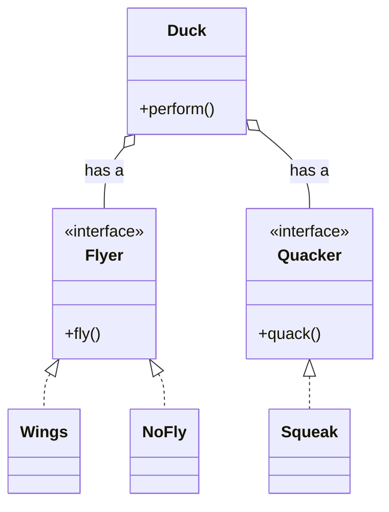

<!-- Written by `npm run lessons` from the lesson data in src/data. Edit the lesson there, not this page. -->

# Composition over inheritance, and interfaces

**System Design · Unit 5: Low-level design: OOP and SOLID · Lesson 2 of 9 · Must know**

> **In one line.** Composition means building a class out of other objects it has ('has-a'), instead of inheriting from a parent ('is-a').

[Open this lesson on the site](https://learn.hamropedia.com/system-design/composition-over-inheritance-and-interfaces/) for its animation, the practice game and tap-to-explain words.

## The problem it solves

Inheritance looks like free reuse, but every subclass is tied to its parent's details. With several independent features, the number of subclasses explodes.

## The idea

Inheritance ties a child class closely to its parent's internals, so changes ripple down and deep trees get rigid. Composition plugs behaviour in through small objects behind interfaces, so you can swap them at runtime and test each alone. Rule of thumb: inherit for a true 'is-a' with shared behaviour; otherwise, compose.

## How it works, step by step

1. With inheritance, 3 kinds of flying × 3 kinds of sound = 9 subclasses, and every new kind multiplies them again.
2. With composition, a Duck simply holds a flyer object and a quacker object.
3. Each behaviour is a small class implementing a tiny interface: fly() or quack().
4. You build a duck by choosing its parts: Duck(Wings(), Quack()) or Duck(NoFly(), Squeak()).
5. You can even swap a part while the program runs, and test each part on its own.

## Picture it



*A Duck has a flyer and a quacker (the diamond means 'has a'). Dashed arrows mean 'implements': any flyer or quacker can be plugged in.*

## Analogy

A phone with a replaceable camera module, compared with a phone whose camera is moulded into the case. Upgrading the module is easy; re-moulding the case isn't.

**Where the analogy breaks.** Phone modules have sockets designed in advance. In code you still have to choose good interfaces, and composing everything everywhere can create a maze of tiny objects.

## Example

Instead of Duck → FlyingDuck → QuackingFlyingDuck classes, a Duck has a flying behaviour and a quacking behaviour. A rubber duck gets NoFly and Squeak.

## Must know

- If one thing "is a" kind of another, inheritance may fit. If it "has a" part, use composition.
- Composition lets you change behaviour at runtime and test with fakes.
- Program to an interface, not to an implementation: depend on what a part does, not on which class does it.
- Dependency injection: pass collaborators in; don't create them inside the class.

## In code

```python
class Duck:
    def __init__(self, flyer, quacker):
        self.flyer, self.quacker = flyer, quacker   # has-a, not is-a
    def perform(self):
        return f"{self.flyer.fly()} / {self.quacker.quack()}"

class Wings:
    def fly(self): return "flaps its wings"

class NoFly:
    def fly(self): return "can't fly"

class Squeak:
    def quack(self): return "squeak"

rubber_duck = Duck(NoFly(), Squeak())
rubber_duck.perform()        # "can't fly / squeak"
```

## Common mistakes

- Using inheritance for 'has-a' relationships (a Car extends Engine).
- Creating collaborators inside the class instead of passing them in.

> **Not true:** A Car class should extend Engine, because a car needs an engine.  
> **In fact:** A car has an engine; it is not a kind of engine. Use composition: the Car holds an Engine object and calls it.

## In the interview

I prefer composition: a class holds small collaborator objects behind interfaces, and they're injected. It's more flexible than inheritance, easier to test, and avoids fragile class trees. I use inheritance only for a genuine 'is-a' with shared behaviour.

<details>
<summary>&lt;b>What is dependency injection?&lt;/b></summary>

Giving an object its dependencies from outside, usually through the constructor, instead of creating them inside — so you can swap them, for example a fake payment gateway in tests.

</details>

<details>
<summary>&lt;b>What is the 'fragile base class' problem?&lt;/b></summary>

A change to a parent class unexpectedly breaks subclasses that relied on its internal behaviour.

</details>

## Practise

Try each one yourself first, then open the answer and compare.

### 1. Explain

Explain composition over inheritance with the phone-camera picture.

<details>
<summary>Show one good answer</summary>

Two phones. In the first, the camera is moulded into the case. To get a better camera you need a whole new phone: that is inheritance, where behaviour is baked into the class, and changing it means a new subclass. In the second, the camera is a module that clicks into a standard slot. To upgrade, you swap the module; the rest of the phone doesn't change, and you can test a module on its own. That is composition: the object holds a separate part, behind an interface (the slot), and the part can be swapped, even while the program runs.

With inheritance, every combination of features needs its own class (FlyingQuackingDuck, FlyingSqueakingDuck…). With composition, you combine small parts freely: a duck has a way of flying and a way of quacking.

</details>

### 2. Draw

Draw the Duck design with its behaviour objects as a class diagram.

<details>
<summary>Show one good answer</summary>

The Duck has its two behaviours (the diamond means it holds them). Each behaviour is an interface, and the small classes below implement it (the dotted line with a hollow triangle). A rubber duck is just Duck(NoFly(), Squeak()): no new subclass needed.

```text
Duck
 - flyer:   FlyBehaviour
 - quacker: QuackBehaviour
 + perform()
   ◆ has a                ◆ has a
   │                      │
   ▼                      ▼
 «interface»            «interface»
 FlyBehaviour           QuackBehaviour
  + fly()                + quack()
   △       △              △        △
   ┊       ┊              ┊        ┊
 Wings   NoFly          Quack    Squeak
```

</details>

### 3. Apply

Refactor a Notifier hierarchy (EmailNotifier, SmsNotifier, EmailAndSmsNotifier) into one Notifier that holds a list of channels.

<details>
<summary>Show one good answer</summary>

With inheritance, every mix of channels needs its own class: with email, SMS and push, that is up to 7 classes (every non-empty combination of 3). With composition, there is one Notifier holding a list of channels, and one small class per channel. Any combination is just a different list, and a new channel is one new class.

```python
from abc import ABC, abstractmethod


class Channel(ABC):
    @abstractmethod
    def send(self, user, message): ...


class EmailChannel(Channel):
    def send(self, user, message):
        return f"email to {user}: {message}"


class SmsChannel(Channel):
    def send(self, user, message):
        return f"sms to {user}: {message}"


class Notifier:
    def __init__(self, channels):
        self.channels = list(channels)           # has many channels

    def notify(self, user, message):
        return [channel.send(user, message) for channel in self.channels]


print(Notifier([EmailChannel(), SmsChannel()]).notify("priya", "Your order shipped"))
# ['email to priya: Your order shipped', 'sms to priya: Your order shipped']


class PushChannel(Channel):                      # a new channel: no combination classes
    def send(self, user, message):
        return f"push to {user}: {message}"


print(Notifier([SmsChannel(), PushChannel()]).notify("tom", "Code 4821"))
# ['sms to tom: Code 4821', 'push to tom: Code 4821']
```

</details>

### 4. Trade-offs

When is inheritance still the better choice?

<details>
<summary>Show one good answer</summary>

When there is a true "is a kind of" relationship, the child can keep every promise the parent makes, and they share real behaviour:

• Exception classes: class PaymentDeclined(PaymentError). Code that catches PaymentError should catch every kind of payment error. This is exactly what inheritance is for.  
• Framework extension points: a test class extends unittest.TestCase, or a web view extends the framework's base view. The framework is designed to be extended this way and calls your overrides.  
• Template method: the parent fixes the steps of an algorithm and the children fill in one or two of them (for example, a report that always loads, formats and saves, where only the formatting differs).  
• Shallow, stable hierarchies you own: one or two levels, unlikely to grow.

The warning signs that composition would be better: a hierarchy getting deeper, classes for combinations of features, or a child overriding a method to do nothing.

</details>

## Go further (optional)

- READ · [Inheritance and Composition: A Python OOP Guide](https://www.google.com/search?q=Real+Python+inheritance+and+composition+a+Python+OOP+guide) · Real Python
- READ · [Strategy pattern](https://refactoring.guru/design-patterns/strategy) · Refactoring.Guru, free

---

[← OOP: the four pillars](oop-the-four-pillars.md) · [All lessons](../../README.md) · [SOLID: S — Single Responsibility Principle →](solid-s-single-responsibility-principle.md)
