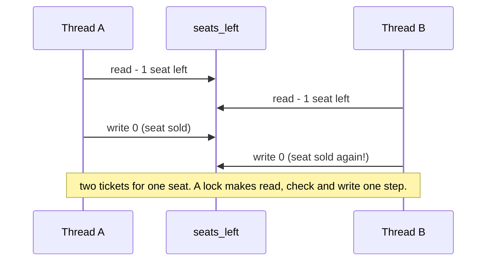

<!-- Written by `npm run lessons` from the lesson data in src/data. Edit the lesson there, not this page. -->

# Concurrency basics: threads, locks and race conditions

**System Design · Unit 5: Low-level design: OOP and SOLID · Lesson 9 of 9 · Should know**

> **In one line.** Concurrency is several tasks making progress at the same time. A race condition is a bug where the result depends on the exact timing between them.

[Open this lesson on the site](https://learn.hamropedia.com/system-design/concurrency-basics-threads-locks-and-race-conditions/) for its animation, the practice game and tap-to-explain words.

## The problem it solves

Real systems serve many users at once. When two of them change the same data at the same moment, results can be silently wrong, like one seat sold twice.

## The idea

LLD questions like seat booking or elevators often ask: what if two users act at once? If two threads read a counter, add one and write it back at the same moment, one update is lost.

Locks (mutexes) make a critical section run one thread at a time; atomic operations and thread-safe queues avoid manual locks. Watch out for deadlock: two threads each waiting for a lock the other one holds.

## How it works, step by step

1. Thread A reads seats_left = 1. Thread B also reads seats_left = 1.
2. A sells the seat and writes 0. B also sells the seat and writes 0. Two tickets have been sold for one seat.
3. Fix: wrap 'read, check, write' in a lock. Now B waits until A has finished, then reads 0 and refuses.
4. Across many servers, do it in the database with a conditional update: UPDATE seats SET sold = true WHERE id = 7 AND sold = false. Then check that exactly one row changed.

## Picture it



*Both threads read before either writes, so both think the seat is free. That's a race condition.*

## Analogy

Two people filling in the same paper form at once: both read '3 seats left', both write '2 seats left', and one booking disappears. A lock is a rule that only one person may hold the form at a time.

**Where the analogy breaks.** People can see each other. Threads can't, and the bug may appear once in a million runs, so you have to reason about it, not just test for it.

## Example

Seat booking: 'check the seat is free, then mark it booked' must happen as one step. Within one program, that means inside a lock. Across many servers, it means inside a database transaction with a row lock.

## Must know

- Critical section: code that touches shared data; protect it with a lock.
- A race condition: two threads read a value, change it and write it back with no lock, so one of the updates is lost.
- Deadlock needs four conditions; break 'circular wait' by always taking locks in the same order, or use timeouts.
- Across several servers, an in-program lock isn't enough: use database transactions or a distributed lock.
- Prefer thread-safe queues and data that never changes, where you can.

## In code

```python
import threading

count = 0
lock = threading.Lock()

def add_many():
    global count
    for _ in range(100_000):
        with lock:          # without the lock, updates can be lost
            count += 1

threads = [threading.Thread(target=add_many) for _ in range(4)]
for t in threads: t.start()
for t in threads: t.join()
print(count)                # 400000
```

## Common mistakes

- Locking only the write, instead of the whole read-check-write.
- Holding a lock while doing slow work, like a network call.
- Taking locks in different orders in different places, which causes deadlock.

> **Not true:** Locking only the write is enough to make a read-check-write sequence safe.  
> **In fact:** Two threads can both read and check before either one writes, so both pass the check. Hold the lock around the whole read-check-write.

> **Not true:** Two locks, two threads: the order in which each thread takes them does not matter.  
> **In fact:** If one thread holds lock A and waits for B while the other holds B and waits for A, both wait for ever: a deadlock. Always take locks in the same order.

## In the interview

Anywhere two users can change the same thing, like booking the last seat, I'd make 'check and update' a single atomic step. Within one process that is a lock. Across servers it is a database transaction with a row lock, or optimistic versioning. I'd take locks in a fixed order to avoid deadlock.

<details>
<summary>&lt;b>Process or thread?&lt;/b></summary>

A process has its own memory. Threads share their process's memory, which makes communication easy but needs synchronisation.

</details>

<details>
<summary>&lt;b>How do you prevent deadlock?&lt;/b></summary>

Take locks in one agreed global order, hold them briefly, or use try-lock with a timeout.

</details>

## Practise

Try each one yourself first, then open the answer and compare.

### 1. Explain

Explain a race condition with the paper-form picture.

<details>
<summary>Show one good answer</summary>

Two people are filling in the same paper booking form at the same time. Both read "3 seats left". Both write their booking and change it to "2 seats left". Two seats have gone, but the form says only one did: one booking has silently disappeared, and the hall may be overbooked.

That is a race condition: the result depends on the exact timing of two actors, because "read the value, work out the new one, write it back" is several steps, and the other person can slip in between them.

A lock is the rule that only one person may hold the form at a time. The second person waits until the first has finished writing, then reads "2 seats left" and writes "1". The read-and-write becomes one indivisible step (a critical section).

</details>

### 2. Draw

Draw a timeline of two threads causing a lost update, then the same timeline with a lock.

<details>
<summary>Show one good answer</summary>

The race happens because both threads read before either writes, so each writes a value based on stale data. With the lock, thread B can't even read until A has written and released, so its read sees A's result.

```text
Without a lock (count starts at 3)
time   Thread A            Thread B
 t1    read count → 3
 t2                        read count → 3
 t3    write 3 + 1 = 4
 t4                        write 3 + 1 = 4
Result: 4. Expected 5: one update was lost.

With a lock
 t1    take the lock
 t2    read count → 3      wants the lock: waits…
 t3    write 4
 t4    release the lock
 t5                        take the lock
 t6                        read count → 4
 t7                        write 5, release
Result: 5.
```

</details>

### 3. Apply

Run the counter code below with and without the lock using several threads. Then write a tiny deadlock with two locks and fix it by ordering them.

<details>
<summary>Show one good answer</summary>

In CPython, count += 1 rarely shows the race on its own, because the interpreter seldom switches threads in the middle of it. Splitting it into read, a forced switch (time.sleep(0)) and write makes the race happen every time. Without the lock, updates are lost: the total comes out below 4,000, and different on every run. With the lock, it is always 4,000.

The deadlock: thread 1 takes lock A then wants B, while thread 2 takes B then wants A. Each waits for the other forever. (Here a timeout lets the program report it instead of hanging.) The fix is to always take locks in the same order: both threads take A, then B, so one simply waits for the other to finish.

```python
import threading
import time

count = 0
lock = threading.Lock()


def add_many(use_lock, n=1000):
    global count
    for _ in range(n):
        if use_lock:
            with lock:
                current = count
                time.sleep(0)        # let another thread run here
                count = current + 1
        else:
            current = count
            time.sleep(0)
            count = current + 1


def run(use_lock):
    global count
    count = 0
    threads = [threading.Thread(target=add_many, args=(use_lock,)) for _ in range(4)]
    for t in threads:
        t.start()
    for t in threads:
        t.join()
    return count


print("without the lock:", run(False) < 4000)    # without the lock: True (updates were lost)
print("with the lock:", run(True))               # with the lock: 4000


# A deadlock: two threads take the same two locks in opposite orders.
a, b = threading.Lock(), threading.Lock()
results = []


def take(first, second, name):
    with first:
        time.sleep(0.1)                          # both threads now hold one lock each
        if second.acquire(timeout=1):            # a real deadlock would wait forever
            second.release()
            results.append(f"{name}: done")
        else:
            results.append(f"{name}: stuck (deadlock)")


def both(order_1, order_2):
    results.clear()
    threads = [threading.Thread(target=take, args=(*order_1, "thread 1")),
               threading.Thread(target=take, args=(*order_2, "thread 2"))]
    for t in threads:
        t.start()
    for t in threads:
        t.join()
    return sorted(results)


print(both((a, b), (b, a)))    # ['thread 1: stuck (deadlock)', 'thread 2: stuck (deadlock)']
print(both((a, b), (a, b)))    # ['thread 1: done', 'thread 2: done']: same order, no deadlock
```

</details>

### 4. Trade-offs

Why is a Python threading.Lock useless for a seat-booking system running on 10 servers?

<details>
<summary>Show one good answer</summary>

A threading.Lock lives in the memory of one Python process. Ten servers run ten separate processes, each with its own lock, and none of them knows about the others.

Two customers click "book seat F12" at the same moment; the load balancer sends one request to server 3 and the other to server 7. Each server takes its own lock (which nobody else is holding), each checks that F12 is free, and each books it. The seat is sold twice, and the locks did nothing.

The check-and-book must happen at a single place that every server shares:  
• The database (best): a conditional update, UPDATE seats SET booked_by = :user WHERE seat_id = :seat AND booked_by IS NULL, then check one row changed; or a row lock with SELECT … FOR UPDATE inside a transaction; or a UNIQUE constraint on (show_id, seat_id) in the bookings table, so the second insert fails.  
• A distributed lock (Redis, or etcd/ZooKeeper), with a time limit and a fencing token, for work that isn't a single database write.

</details>

## Go further (optional)

- READ · [An Intro to Threading in Python](https://www.google.com/search?q=Real+Python+an+intro+to+threading+in+Python) · Real Python
- READ · [threading — Thread-based parallelism](https://docs.python.org/3/library/threading.html) · Python docs
- READ · [The Little Book of Semaphores](https://www.google.com/search?q=The+Little+Book+of+Semaphores+Allen+Downey) · Allen Downey · free

---

[← UML class diagrams and relationships](uml-class-diagrams-and-relationships.md) · [All lessons](../../README.md) · [Singleton →](../unit-6-patterns/singleton.md)
