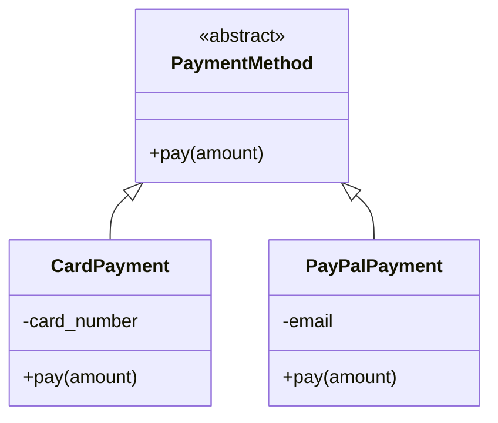

<!-- Written by `npm run lessons` from the lesson data in src/data. Edit the lesson there, not this page. -->

# OOP: the four pillars

**System Design · Unit 5: Low-level design: OOP and SOLID · Lesson 1 of 9 · Must know**

> **In one line.** Object-oriented programming organises code into objects that bundle data and behaviour. Its four pillars are encapsulation, abstraction, inheritance and polymorphism.

[Open this lesson on the site](https://learn.hamropedia.com/system-design/oop-the-four-pillars/) for its animation, the practice game and tap-to-explain words.

## The problem it solves

Large programs written as one long list of functions and shared variables become impossible to change safely. OOP groups data with the code that's allowed to change it.

## The idea

Encapsulation hides an object's internal data behind methods, so it can't be put into an invalid state. Abstraction shows callers only what they need. Inheritance lets one class reuse and extend another. Polymorphism lets different classes be used through the same interface, each behaving in its own way.

## How it works, step by step

1. Group related data and behaviour into a class: a BankAccount holds a balance and has deposit() and withdraw().
2. Make the balance private, and have withdraw() check there's enough money first. That's encapsulation.
3. Callers only see deposit(), withdraw() and the balance. That's abstraction.
4. A SavingsAccount is a kind of BankAccount that also adds interest. That's inheritance.
5. Code that loops over all accounts and calls monthly_update() gets the right behaviour for each type. That's polymorphism.

## Picture it



*The arrow with a hollow triangle means 'is a kind of'. Both payment types share the pay() method (polymorphism) and hide their details (the minus sign means private).*

## Analogy

A car. You use the steering wheel and pedals (abstraction) without touching the engine (encapsulation). An electric car is a kind of car (inheritance), and 'press the accelerator' works differently in each (polymorphism).

**Where the analogy breaks.** Cars are physical and their family tree is shallow. In code, inheritance is easy to overuse: deep class trees become fragile, which is why composition is often the better choice.

## Example

A payment system: an abstract PaymentMethod with pay(amount); CardPayment and PayPalPayment each implement it differently; checkout simply calls method.pay(amount) without caring which one it has.

## Must know

- Encapsulation: private state, with public methods that keep it valid.
- Abstraction: interfaces and abstract classes describe what, not how.
- Inheritance: an 'is-a' relationship; reuses code but creates tight coupling.
- Polymorphism: one interface, many implementations; replaces long if/else chains on type.

## In code

```python
from abc import ABC, abstractmethod

class PaymentMethod(ABC):                  # abstraction
    @abstractmethod
    def pay(self, amount: float) -> str: ...

class CardPayment(PaymentMethod):
    def __init__(self, card_number: str):
        self._card = card_number            # encapsulation: kept internal
    def pay(self, amount):
        return f"Charged £{amount} to card ending {self._card[-4:]}"

class PayPalPayment(PaymentMethod):
    def __init__(self, email: str):
        self._email = email
    def pay(self, amount):
        return f"Charged £{amount} via PayPal ({self._email})"

for method in [CardPayment("4111111111111111"), PayPalPayment("a@b.com")]:
    print(method.pay(20))                   # polymorphism
```

## Common mistakes

- Public fields that anyone can set to invalid values.
- Using inheritance just to reuse a few lines of code.
- Type checks (if isinstance …) where polymorphism would do.

> **Not true:** Public fields: fine, as long as other code sets sensible values.  
> **In fact:** Nothing then stops other code from setting an invalid value, such as a negative balance. Keep the state private and change it through methods that check it.

## In the interview

Encapsulation protects an object's state. Abstraction exposes only what callers need. Inheritance models an 'is-a' relationship to reuse behaviour. Polymorphism lets code work with an interface while each class supplies its own behaviour, like checkout calling pay() on any payment method.

<details>
<summary>&lt;b>Abstract class or interface?&lt;/b></summary>

An interface only declares methods. An abstract class can also hold shared code and state. In Python both are usually written with ABC.

</details>

<details>
<summary>&lt;b>Overloading or overriding?&lt;/b></summary>

Overloading: the same method name with different parameters, chosen at compile time (for example in Java). Overriding: a subclass replaces a parent's method, chosen at runtime — that's polymorphism.

</details>

## Practise

Try each one yourself first, then open the answer and compare.

### 1. Explain

Explain the four pillars with the car picture.

<details>
<summary>Show one good answer</summary>

• Abstraction: to drive, you use the steering wheel, the pedals and the gear stick. You don't need to know how fuel injection works. A class shows callers only the few methods they need.  
• Encapsulation: the engine is under the bonnet, out of reach. You can't set the engine speed to an impossible value by hand; you can only press the accelerator, which keeps it within safe limits. A class keeps its data private and only lets it change through methods that keep it valid.  
• Inheritance: an electric car is a kind of car. It has everything a car has (wheels, seats, a steering wheel) and adds a battery. A subclass reuses its parent and extends it.  
• Polymorphism: "press the accelerator" works on any car, but a petrol car burns more fuel while an electric car draws more current. Code calls the same method on different classes, and each does its own version.

</details>

### 2. Draw

Draw a class diagram for Shape with Circle and Rectangle subclasses and an area() method.

<details>
<summary>Show one good answer</summary>

Shape is abstract: it only promises area(). Each subclass keeps its own measurements private (the minus sign) and implements area() its own way. The hollow triangle points from each subclass up to the parent: "is a kind of".

```text
           «abstract»
             Shape
        ───────────────
        + area(): float
               △
      ┌────────┴────────┐
   Circle           Rectangle
────────────     ──────────────
- radius         - width
                 - height
+ area()         + area()
  = π × r²         = width × height
```

</details>

### 3. Apply

Code the Shape example in Python, then add a Triangle without changing any code that uses shapes.

<details>
<summary>Show one good answer</summary>

total_area only knows about Shape and its area() method. Adding Triangle is one new class; total_area, and any other code that uses shapes, is not touched. That is polymorphism (and the open/closed principle): the caller says "give me your area", and each shape answers in its own way.

```python
import math
from abc import ABC, abstractmethod


class Shape(ABC):
    @abstractmethod
    def area(self) -> float: ...


class Circle(Shape):
    def __init__(self, radius):
        self._radius = radius

    def area(self):
        return math.pi * self._radius ** 2


class Rectangle(Shape):
    def __init__(self, width, height):
        self._width, self._height = width, height

    def area(self):
        return self._width * self._height


def total_area(shapes):                  # the code that uses shapes
    return sum(shape.area() for shape in shapes)


print(round(total_area([Circle(1), Rectangle(2, 3)]), 2))                   # 9.14


class Triangle(Shape):                   # added later: total_area is untouched
    def __init__(self, base, height):
        self._base, self._height = base, height

    def area(self):
        return 0.5 * self._base * self._height


print(round(total_area([Circle(1), Rectangle(2, 3), Triangle(4, 5)]), 2))   # 19.14
```

</details>

### 4. Trade-offs

Give one example where inheritance makes a design worse.

<details>
<summary>Show one good answer</summary>

A stack built by inheriting from a list: class Stack(list).

It looks like neat reuse: a list can already add to the end and pop from the end. But inheritance hands over everything a list can do, and the stack can't take any of it back. Callers can now insert(0, x), sort it, delete from the middle or slice it, all of which break the one promise a stack makes: last in, first out. (Java made exactly this mistake: its Stack class extends Vector.)

Composition fixes it: the Stack holds a list privately and exposes only push(), pop() and peek(). Users can't break it, and the list could later be swapped for something else without anyone noticing.

The general lesson: inherit only for a true "is a kind of", where the child can honour every promise the parent makes. "Uses one internally" is composition.

</details>

## Go further (optional)

- WATCH · [Python OOP tutorials](https://www.youtube.com/results?search_query=Corey+Schafer+Python+OOP+tutorial+classes+and+instances) · Corey Schafer · free on YouTube
- READ · [Object-Oriented Programming (OOP) in Python](https://www.google.com/search?q=Real+Python+object-oriented+programming+in+Python) · Real Python

---

[← Security basics: authentication, authorisation, OAuth and JWT](../unit-4-distributed/security-basics-authentication-authorisation-oauth-and-jwt.md) · [All lessons](../../README.md) · [Composition over inheritance, and interfaces →](composition-over-inheritance-and-interfaces.md)
