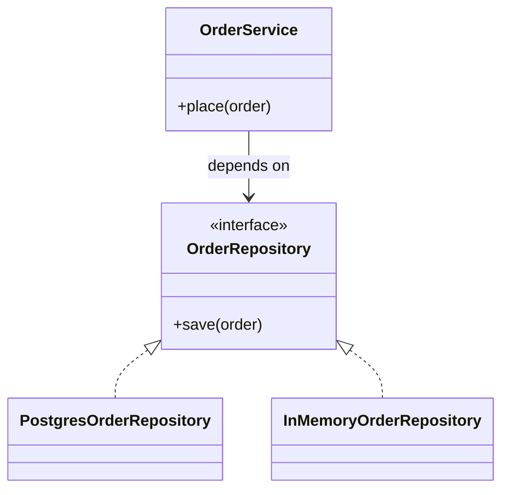

<!-- Written by `npm run lessons` from the lesson data in src/data. Edit the lesson there, not this page. -->

# SOLID: D — Dependency Inversion Principle

**System Design · Unit 5: Low-level design: OOP and SOLID · Lesson 7 of 9 · Must know**

> **In one line.** High-level code should depend on abstractions, not on concrete low-level details.

[Open this lesson on the site](https://learn.hamropedia.com/system-design/solid-d-dependency-inversion-principle/) for its animation, the practice game and tap-to-explain words.

## The problem it solves

When business logic creates its own database connection or email client, it's welded to them. You can't test it without a real database, and switching providers means rewriting business code.

## The idea

If OrderService creates a MySQLDatabase directly, you can't swap the database or test without one. Instead, OrderService depends on an OrderRepository interface, and the concrete repository — MySQL in production, an in-memory one in tests — is passed in.

## How it works, step by step

1. Find a high-level class that creates a low-level one: OrderService creates PostgresRepository() inside itself.
2. Define the interface the high-level code actually needs: OrderRepository with save(order).
3. Make the low-level class implement that interface.
4. Pass the implementation into the high-level class through its constructor.
5. At start-up, connect the real pieces together. In tests, pass in fakes.

## Picture it



*The service depends only on the interface. The real database version and the test version both plug in underneath it.*

## Analogy

A standard wall socket. Your lamp depends on 'a standard socket', not on one particular power station, so you can switch energy supplier without rewiring the lamp.

**Where the analogy breaks.** Socket standards are agreed by whole countries. In code you design the abstraction yourself, and a bad one (leaking database details) gives you none of the benefits.

## Example

OrderService(repository) uses PostgresOrderRepository in production and InMemoryOrderRepository in tests.

## Must know

- Depend on interfaces; inject the implementations (dependency injection).
- Makes testing easy with fakes and mocks.
- Lets you swap infrastructure, like the database or email provider, with no change to business logic.
- Dependency inversion is the principle; dependency injection is a technique for achieving it.

## In code

```python
from abc import ABC, abstractmethod

class OrderRepository(ABC):                 # the abstraction
    @abstractmethod
    def save(self, order): ...

class PostgresOrderRepository(OrderRepository):
    def save(self, order): ...             # real database code

class InMemoryOrderRepository(OrderRepository):
    def __init__(self): self.orders = []
    def save(self, order): self.orders.append(order)

class OrderService:
    def __init__(self, repo: OrderRepository):   # injected, not created inside
        self.repo = repo
    def place(self, order):
        self.repo.save(order)

service = OrderService(InMemoryOrderRepository())   # easy to test
```

## Common mistakes

- An interface that copies one vendor's API exactly, so the abstraction leaks.
- Creating dependencies inside methods 'just this once'.

> **Not true:** Creating the database object inside the method that uses it keeps the code easy to test.  
> **In fact:** The method is then tied to the real database, so a test can't hand it a fake one. Pass the dependency in from outside (dependency injection).

## In the interview

Dependency inversion means business logic depends on interfaces, and concrete implementations are injected. My OrderService depends on an OrderRepository interface, so I can use Postgres in production and an in-memory fake in tests.

<details>
<summary>&lt;b>Dependency inversion or dependency injection?&lt;/b></summary>

Inversion is the design rule: depend on abstractions. Injection is the technique: pass dependencies in, often done for you by a framework like Spring.

</details>

## Practise

Try each one yourself first, then open the answer and compare.

### 1. Explain

Explain dependency inversion with the wall-socket picture.

<details>
<summary>Show one good answer</summary>

Your lamp plugs into a standard wall socket. It doesn't depend on a particular power station; it depends on the standard ("230 V, this plug shape"). So you can switch energy supplier, or run the house on solar panels, without rewiring the lamp. Both sides depend on the standard, not on each other.

Dependency inversion says the same about code: high-level code (OrderService, the business rules) shouldn't depend on low-level details (a MySQL database class). Both should depend on an abstraction (an OrderRepository interface). OrderService is given a repository instead of creating one: a Postgres one in production, an in-memory one in tests. Swapping the database, or testing without one, needs no change to OrderService.

</details>

### 2. Draw

Draw OrderService, the OrderRepository interface and two implementations, with arrows showing what depends on what.

<details>
<summary>Show one good answer</summary>

The key detail is the direction of the arrows. OrderService points at the interface, and so do both implementations, so the business code no longer points at the database code. That is the "inversion". The wiring code at startup picks the concrete class and passes it in.

```text
OrderService ── depends on ──► «interface»
 + place(order)                 OrderRepository
                                 + save(order)
                                    △        △
                                    ┊        ┊ implement
                 PostgresOrderRepository   InMemoryOrderRepository
                 (production)              (tests)

main() / start-up code:
  repo = PostgresOrderRepository(connection)
  service = OrderService(repo)        ← injected
```

</details>

### 3. Apply

Write a NotificationService that depends on a MessageSender interface; implement EmailSender and FakeSender, and test with the fake.

<details>
<summary>Show one good answer</summary>

NotificationService depends only on MessageSender. EmailSender is the real implementation (it would be given an SMTP client in production, so it isn't run here); FakeSender just records what it was asked to send. The test hands the service a FakeSender and checks exactly one message went out, with no email server, network or mocking library needed.

```python
from abc import ABC, abstractmethod


class MessageSender(ABC):
    @abstractmethod
    def send(self, to, text): ...


class EmailSender(MessageSender):                # the real one, used in production
    def __init__(self, smtp_client):
        self.smtp = smtp_client

    def send(self, to, text):
        self.smtp.sendmail("noreply@shop.com", to, text)


class FakeSender(MessageSender):                 # for tests: just records messages
    def __init__(self):
        self.sent = []

    def send(self, to, text):
        self.sent.append((to, text))


class NotificationService:
    def __init__(self, sender: MessageSender):   # injected, never created inside
        self.sender = sender

    def order_shipped(self, email, order_id):
        self.sender.send(email, f"Order {order_id} has shipped")


def test_order_shipped_sends_one_message():
    fake = FakeSender()
    NotificationService(fake).order_shipped("priya@mail.com", 105)
    assert fake.sent == [("priya@mail.com", "Order 105 has shipped")]


test_order_shipped_sends_one_message()
print("test passed")                             # test passed
```

</details>

### 4. Trade-offs

When is adding an interface for a single implementation unnecessary?

<details>
<summary>Show one good answer</summary>

• There will only ever be one implementation, and it is fast and in-process (a price calculator, a date formatter). An interface adds a file and a jump for nothing. Injecting the concrete class still keeps it testable.  
• In Python, duck typing already lets you pass any object with the right methods, and test tools can stand in for a class, so a formal ABC is often optional.  
• Small scripts, prototypes and glue code that will be rewritten anyway.  
• Simple value objects (Money, an Address): there is nothing to swap.

Worth it at the boundaries with slow, external or changing things: databases, other services, payment providers, email and SMS, the clock, the file system. Those are exactly the things you want to replace in tests, and the ones most likely to change.

</details>

## Go further (optional)

- READ · [SOLID: the first 5 principles of object-oriented design](https://www.google.com/search?q=DigitalOcean+SOLID+the+first+5+principles+of+object+oriented+design) · DigitalOcean, free
- WATCH · [SOLID principles explained with examples](https://www.youtube.com/results?search_query=SOLID+principles+explained+with+examples) · YouTube
- READ · [Inversion of Control Containers and the Dependency Injection pattern](https://martinfowler.com/articles/injection.html) · Martin Fowler

---

[← SOLID: I — Interface Segregation Principle](solid-i-interface-segregation-principle.md) · [All lessons](../../README.md) · [UML class diagrams and relationships →](uml-class-diagrams-and-relationships.md)
