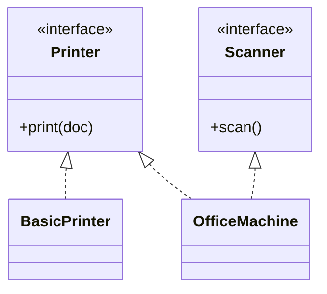

<!-- Written by `npm run lessons` from the lesson data in src/data. Edit the lesson there, not this page. -->

# SOLID: I — Interface Segregation Principle

**System Design · Unit 5: Low-level design: OOP and SOLID · Lesson 6 of 9 · Must know**

> **In one line.** Clients shouldn't be forced to depend on methods they don't use. Prefer several small, focused interfaces over one big one.

[Open this lesson on the site](https://learn.hamropedia.com/system-design/solid-i-interface-segregation-principle/) for its animation, the practice game and tap-to-explain words.

## The problem it solves

Big 'do-everything' interfaces force classes to implement methods that make no sense for them, and every change to the big interface touches classes that don't care.

## The idea

A giant interface forces every class that implements it to write methods it doesn't need (often empty, or throwing errors), and changes ripple into classes that don't care. Split interfaces by what their users actually need.

## How it works, step by step

1. Look for implementations full of empty methods or 'not supported' errors.
2. Group the interface's methods by which clients actually call them.
3. Make one small interface per group: Printer, Scanner, Fax.
4. Classes implement only what they really do, and each client depends only on the small interface it uses.

## Picture it



*Small interfaces. The basic printer implements only Printer; the office machine implements both.*

## Analogy

A TV remote with 80 buttons when you only need power, volume and channel. Give most people a simple remote, and an advanced one to those who need it.

**Where the analogy breaks.** A remote is one physical object. In code, too many tiny interfaces can be confusing too, so group methods that are always used together.

## Example

A Machine interface with print(), scan() and fax() forces a basic printer to implement fax(). Split it into Printer, Scanner and Fax; an office machine implements all three.

## Must know

- Warning sign: methods that raise NotImplementedError or do nothing.
- Split interfaces by what each client needs (role interfaces).
- Works hand in hand with single responsibility.

## In code

```python
from abc import ABC, abstractmethod

class Printer(ABC):
    @abstractmethod
    def print(self, doc): ...

class Scanner(ABC):
    @abstractmethod
    def scan(self): ...

class BasicPrinter(Printer):                 # no fake scan() needed
    def print(self, doc): return f"printing {doc}"

class OfficeMachine(Printer, Scanner):
    def print(self, doc): return f"printing {doc}"
    def scan(self): return "scanned page"
```

## Common mistakes

- One interface per method everywhere, which fragments the design.
- Keeping the fat interface 'for convenience'.

> **Not true:** Interface segregation means one method per interface.  
> **In fact:** It means no client should depend on methods it doesn't use. Group methods by what each client needs: one role may well need several.

## In the interview

Interface segregation means small, client-specific interfaces, so classes don't implement methods they don't need — for example separate Printer and Scanner interfaces instead of one big Machine interface.

<details>
<summary>&lt;b>Interface segregation or single responsibility?&lt;/b></summary>

Single responsibility is about why a class changes. Interface segregation is about what clients are forced to depend on. Both lead to smaller, focused pieces.

</details>

## Practise

Try each one yourself first, then open the answer and compare.

### 1. Explain

Explain interface segregation with the TV-remote picture.

<details>
<summary>Show one good answer</summary>

A TV remote with 80 buttons, when most people only use power, volume and channel. Everyone has to cope with the buttons they never use, and a remote that must support all 80 is expensive to make. Better: a simple remote for most people, and an advanced one for those who want it.

The interface segregation principle says the same about interfaces: don't force a class to implement methods it doesn't need. A Machine interface with print(), scan() and fax() forces a basic printer to write fake scan() and fax() methods that just throw errors, and any change to fax() touches every printer. Split it into small interfaces by what their users actually need (Printer, Scanner, Fax), and let each class implement only the ones that are true for it.

</details>

### 2. Draw

Draw the before (Machine) and after (Printer, Scanner, Fax) designs.

<details>
<summary>Show one good answer</summary>

Before, one fat interface forces BasicPrinter to fake two methods that throw errors. After, each class implements only the interfaces that are true for it, and code that only prints asks for a Printer, so it works with both machines.

```text
Before
  «interface» Machine
   + print()  + scan()  + fax()
       △                     △
  BasicPrinter          OfficeMachine
   print() ✓             print() ✓
   scan()  ✗ raises      scan()  ✓
   fax()   ✗ raises      fax()   ✓

After
  «interface»   «interface»   «interface»
   Printer       Scanner        Fax
   + print()     + scan()       + fax()
      △  △          △             △
      ┊  └┄┄┄┄┄┐    ┊   ┌┄┄┄┄┄┄┄┄┄┘
  BasicPrinter  OfficeMachine
  (Printer)     (Printer, Scanner, Fax)
```

</details>

### 3. Apply

Split a Worker interface with work(), eat() and sleep() so that a RobotWorker isn't forced to implement eat().

<details>
<summary>Show one good answer</summary>

Three small interfaces, one per ability. A human worker implements all three; a robot implements only Workable, so it has no fake eat() that does nothing. Code that runs a shift asks only for Workable, and the lunch break only for Eater, so each part of the program depends only on what it uses.

```python
from abc import ABC, abstractmethod


class Workable(ABC):
    @abstractmethod
    def work(self): ...


class Eater(ABC):
    @abstractmethod
    def eat(self): ...


class Sleeper(ABC):
    @abstractmethod
    def sleep(self): ...


class HumanWorker(Workable, Eater, Sleeper):
    def work(self): return "writes code"
    def eat(self): return "has lunch"
    def sleep(self): return "sleeps 8 hours"


class RobotWorker(Workable):                     # no eat() or sleep() to fake
    def work(self): return "welds car doors"


def run_shift(workers):                          # needs only work()
    return [worker.work() for worker in workers]


def lunch_break(eaters):                         # needs only eat()
    return [eater.eat() for eater in eaters]


print(run_shift([HumanWorker(), RobotWorker()]))    # ['writes code', 'welds car doors']
print(lunch_break([HumanWorker()]))                 # ['has lunch']
```

</details>

### 4. Trade-offs

How can you tell when an interface has become too small?

<details>
<summary>Show one good answer</summary>

Signs an interface has been split too far:  
• The small interfaces are always used together. Every class implements all four, and every caller needs all four, so they are really one role.  
• Functions need several parameters for one object: process(doc: Printable, s: Stapleable, c: Collatable) where all three are the same machine.  
• You can't name them as roles. Good interfaces are named after what a client needs ("Printer", "PaymentMethod"); if you are reduced to "HasName" and "HasId", you are splitting by method instead of by client.  
• There are more interfaces than real implementations, and each has exactly one method and one implementer.

The principle is about clients: split when different callers need different parts. If no caller ever uses one part without the others, merge them back.

</details>

## Go further (optional)

- READ · [SOLID: the first 5 principles of object-oriented design](https://www.google.com/search?q=DigitalOcean+SOLID+the+first+5+principles+of+object+oriented+design) · DigitalOcean, free
- WATCH · [SOLID principles explained with examples](https://www.youtube.com/results?search_query=SOLID+principles+explained+with+examples) · YouTube

---

[← SOLID: L — Liskov Substitution Principle](solid-l-liskov-substitution-principle.md) · [All lessons](../../README.md) · [SOLID: D — Dependency Inversion Principle →](solid-d-dependency-inversion-principle.md)
