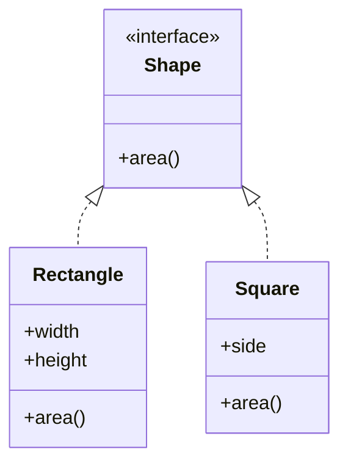

<!-- Written by `npm run lessons` from the lesson data in src/data. Edit the lesson there, not this page. -->

# SOLID: L — Liskov Substitution Principle

**System Design · Unit 5: Low-level design: OOP and SOLID · Lesson 5 of 9 · Must know**

> **In one line.** Objects of a subclass must work anywhere the parent class is expected, without breaking the program.

[Open this lesson on the site](https://learn.hamropedia.com/system-design/solid-l-liskov-substitution-principle/) for its animation, the practice game and tap-to-explain words.

## The problem it solves

Polymorphism only works if every subtype really behaves like its parent. One misbehaving subclass forces callers to add special cases, and bugs appear far away from their cause.

## The idea

A subclass must keep its parent's promises. It can't demand more (stricter inputs) or deliver less (weaker results), and it shouldn't throw surprises. If calling code has to check 'is this the special subclass?', the principle is broken.

## How it works, step by step

1. Write down what callers rely on: 'after set_width(5), the width is 5 and the height hasn't changed'.
2. Check that every subclass keeps that promise. Square breaks it: setting the width also changes the height.
3. If a subclass can't keep a promise, it isn't a true subtype for that behaviour.
4. Fix it with a different hierarchy: Rectangle and Square both implement a Shape interface with area(), and there are no setters that conflict.

## Picture it



*The fixed design. Square no longer pretends to be a changeable Rectangle; both are simply Shapes, so neither can break the other's promises.*

## Analogy

A substitute teacher: lessons should run normally. If the substitute refuses to teach maths, the school timetable breaks.

**Where the analogy breaks.** A human substitute can explain what's different. Code can't, so the contract — what methods accept and guarantee — must be clear.

## Example

The classic case: Square inheriting from Rectangle. Code that sets width = 5 and height = 4 expects an area of 20, but a Square keeps its sides equal and gives 16. So Square shouldn't extend a changeable Rectangle.

## Must know

- Subclasses keep the parent's contract: the same or looser inputs, the same or stronger outputs.
- Warning signs: overridden methods that throw 'not supported', or isinstance checks in calling code.
- Fix: a better abstraction, such as a Shape interface with area().

## In code

```python
class Rectangle:
    def __init__(self, w, h): self.w, self.h = w, h
    def set_width(self, w): self.w = w
    def set_height(self, h): self.h = h
    def area(self): return self.w * self.h

class Square(Rectangle):
    def set_width(self, w): self.w = self.h = w
    def set_height(self, h): self.w = self.h = h

def resize(r: Rectangle):
    r.set_width(5)
    r.set_height(4)
    assert r.area() == 20        # fails for a Square: its area is 16
```

## Common mistakes

- Overriding a method just to throw 'not supported'.
- A subclass that needs more specific input than its parent accepts.

> **Not true:** Overriding a method to throw 'not supported': allowed, and code written for the parent still works.  
> **In fact:** Code written for the parent calls that method and now crashes. A subclass must keep the parent's promises; if it can't, the abstraction is wrong.

## In the interview

Liskov means a subclass must work anywhere its parent does. The classic counter-example is Square extending Rectangle: setting width and height separately breaks for a square, so they shouldn't share that inheritance.

<details>
<summary>&lt;b>Penguin extends Bird, and Bird has fly()?&lt;/b></summary>

A penguin can't fly, so fly() would throw — a Liskov violation. Fix it with a separate FlyingBird type, or give flying as an ability through composition.

</details>

## Practise

Try each one yourself first, then open the answer and compare.

### 1. Explain

Explain Liskov with the substitute-teacher picture.

<details>
<summary>Show one good answer</summary>

When a teacher is off sick, a substitute takes the class, and the school's timetable carries on as normal: maths at 9, the lesson happens. Nobody has to check who is teaching today. But if the substitute refuses to teach maths, or teaches it only to half the class, the timetable breaks, and the school has to start checking "is this the substitute?" before every lesson.

The Liskov substitution principle says a subclass must be usable anywhere its parent is expected, with no surprises: it accepts at least the same inputs, gives at least the same results, and keeps the same promises. The classic failure is a Square that extends a changeable Rectangle. Code that sets width 5 and height 4 expects an area of 20; the Square keeps its sides equal and gives 16. The "substitute" broke a promise, so it isn't a valid substitute.

</details>

### 2. Draw

Draw a better design for Rectangle and Square using a Shape interface.

<details>
<summary>Show one good answer</summary>

Rectangle and Square are both Shapes, but neither is a kind of the other, and Shape doesn't promise set_width or set_height. Each class keeps only the promises it can honour. Code that needs to resize width and height separately asks for a Rectangle; code that only needs an area asks for a Shape.

```text
            «interface»
               Shape
            + area()
           △         △
           ┊         ┊
   Rectangle         Square
   - width           - side
   - height
   + set_size(w, h)  + set_side(s)
   + area() = w × h  + area() = side²

No Square → Rectangle arrow: a square
can't keep a rectangle's promise
that width and height change separately.
```

</details>

### 3. Apply

Run the code below and watch the assertion fail, then redesign it so the check passes for every shape.

<details>
<summary>Show one good answer</summary>

The first half is the lesson's code: resize() works for a Rectangle and fails its check for a Square, whose area comes out as 16.

The redesign stops Square pretending to be a Rectangle. Both implement a Shape interface that promises only area(); only Rectangle has set_size(). resize() asks for a Rectangle, so a Square can no longer be passed in, and the check always holds. Both can still go anywhere a Shape is expected.

```python
from abc import ABC, abstractmethod


# The original design: Square extends Rectangle.
class OldRectangle:
    def __init__(self, w, h): self.w, self.h = w, h
    def set_width(self, w): self.w = w
    def set_height(self, h): self.h = h
    def area(self): return self.w * self.h


class OldSquare(OldRectangle):
    def set_width(self, w): self.w = self.h = w
    def set_height(self, h): self.w = self.h = h


def old_resize(r):
    r.set_width(5)
    r.set_height(4)
    assert r.area() == 20


old_resize(OldRectangle(2, 3))
square = OldSquare(3, 3)
try:
    old_resize(square)
except AssertionError:
    print("the check fails for a square: area =", square.area())   # ... area = 16


# The redesign: both are Shapes; only a Rectangle can change width and height separately.
class Shape(ABC):
    @abstractmethod
    def area(self): ...


class Rectangle(Shape):
    def __init__(self, w, h): self.w, self.h = w, h
    def set_size(self, w, h): self.w, self.h = w, h
    def area(self): return self.w * self.h


class Square(Shape):
    def __init__(self, side): self.side = side
    def set_side(self, side): self.side = side
    def area(self): return self.side ** 2


def resize(r: Rectangle):
    r.set_size(5, 4)
    assert r.area() == 20                    # holds for every Rectangle


resize(Rectangle(2, 3))
print([shape.area() for shape in [Rectangle(2, 3), Square(3)]])     # [6, 9]
```

</details>

### 4. Trade-offs

Why do Liskov violations so often show up as isinstance checks?

<details>
<summary>Show one good answer</summary>

Because an isinstance check is what calling code does when it can no longer trust the parent type.

If every subclass kept the parent's promises, the caller would just call the method and get the right behaviour (polymorphism). When one subclass breaks a promise (a Square that can't set width alone, a ReadOnlyFile that throws on write()), callers get bitten, and the quick fix is a special case: "if isinstance(shape, Square): do something different". The check is the symptom; the broken substitution is the cause.

Those checks then spread: every caller needs one, and every new subclass that breaks the rules needs another branch everywhere, which also breaks the open/closed principle. The real fix is to change the hierarchy (stop the bad inheritance, split the interface), not to teach every caller about the exception.

</details>

## Go further (optional)

- READ · [SOLID: the first 5 principles of object-oriented design](https://www.google.com/search?q=DigitalOcean+SOLID+the+first+5+principles+of+object+oriented+design) · DigitalOcean, free
- WATCH · [SOLID principles explained with examples](https://www.youtube.com/results?search_query=SOLID+principles+explained+with+examples) · YouTube

---

[← SOLID: O — Open/Closed Principle](solid-o-open-closed-principle.md) · [All lessons](../../README.md) · [SOLID: I — Interface Segregation Principle →](solid-i-interface-segregation-principle.md)
